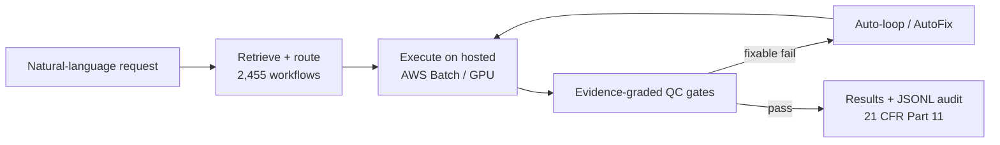

# BioMate: Orchestrated, Evidence-Graded Bioinformatics — A Technical White Paper

**Prepared by:** BizBildr LLC for BioMate AI · **July 2026** · Confidential — Internal Review Draft
**Author(s):** Yaoyun Zhang, et al. · Platform Version: [build/commit hash]

> Draft. This paper is organized around a dual thesis — **novel technique → measured benefit**. Every quantitative claim is sourced to an executed benchmark; estimates, targets, self-reported, and placeholder figures are labelled as such. Proposal-stage work appears only in §10 (Roadmap).

---

## 0. Executive Summary

Modern bioinformatics and drug-discovery analysis is fragmented across dozens of expert-gated tools, slow, costly, and hard to reproduce — and the fashionable alternative, a general-purpose "AI scientist" that writes and runs its own code, is wrong most of the time. BioMate takes a different path built on **specific technical innovations**: it orchestrates validated tools instead of generating code, grades every quality decision by the strength of its scientific evidence, closes the loop by autonomously remediating failures, and hosts reference-scale compute and indexes that users cannot run locally. Each innovation produces a measured benefit.

**The innovation → benefit spine (headline per pillar):**

| Core technique (the *how*) | Measured benefit (the *so what*) | vs comparator |
|---|---|---|
| Multi-channel CiPA qNET cardiac model | hERG false positives **58% → 8%**; ADMET hERG AUROC **0.9313** | ADMET-AI 0.870 |
| Cohort-varying PBPK physiology as workflows | **8+ special populations**; AUC **100% within 2-fold** | EMA ≥67% |
| Evidence-graded governance + regulatory-basis taxonomy | audit completeness **1.0 vs 0.0**; 96.4% auto-remediation | Tower/Galaxy/KNIME (p=1.6×10⁻⁴) |
| Non-destructive LLM key-term injection | routing **100% P@1** | Claude Sonnet 4.6 85.2% |
| Hosted large-DB index + gold-standard re-rank | cryo-EM **$27 vs $900**; 214M-structure search | expert manual |

---

## 1. The Problem

A typical multi-omics or drug-discovery analysis crosses many tools, each with its own inputs, parameters, and failure modes. Hand-offs add latency and error; quality control is applied post hoc with one-size-fits-all thresholds; there is rarely an auditable record of why any decision was made; and reference-scale compute is out of reach for most labs. Meanwhile "autonomous AI science" over-promises: on the independent SGI-Bench evaluation, the **best autonomous system scores 33.83/100** — code that runs but is correct only ~37% of the time (arXiv:2512.16969). *(Third-party benchmark, not a BioMate result; it frames the opportunity.)*

## 2. Thesis: Orchestration + Evidence-Graded Governance

BioMate routes a natural-language request to validated workflows, executes them on hosted infrastructure, gates every quality decision by graded evidence, autonomously remediates failures, and records a portable audit trail.

That orchestration beats autonomous code generation is measured: on **BixBench** BioMate scores **≈48%** vs 29.2% (best published), 22.9% (GPT-5), 18.3% (Gemini 2.5 Pro); on **BiomniEval1**, **71.3%** vs ≈65% (fine-tuned baseline). *(BixBench = 50-question Verified subset; full run in progress.)*

## 3. Core Technical Innovations

BioMate's results are downstream of a set of deliberate methodological innovations. Each is novel relative to the standard tool or the "autonomous agent" baseline, and each is tied to a measured benefit and a case study.

| # | Innovation | What is novel | Benefit (measured / *target*) | Case |
|---|---|---|---|---|
| I1 | **Multi-channel CiPA qNET cardiac model** | Replaces single-channel hERG threshold with an O'Hara-Rudy ODE net-charge metric across 5 ion channels | False positives on safe ICaL co-blockers **58%→8%**; binary accuracy +10.5pp | 01 |
| I2 | **Evidence-graded governance (GOLD/SILVER/BRONZE)** | Every QC threshold carries a provenance grade tied to a citation/DOI | Machine-readable audit; **1.0 vs 0.0** completeness | 04 |
| I3 | **Three-tier RegulatoryBasis taxonomy** | Classifies gates REGULATORY / RISK_STRATIFICATION / OPERATIONAL to decide *whether automation may act* | Auto-loop **never overrides** a named FDA/ICH criterion | 04 |
| I4 | **Closed-loop citation-anchored remediation** | Parameter tuning with cited provenance, guard floors, hard 3-iteration budget | **96.4%** gate convergence; +50–70pp per domain | 01, 04 |
| I5 | **19-fixer AutoFix self-repair** | Diagnoses and repairs *failed executions*, incl. AWS Batch OOM/timeout — feasible only because BioMate owns the runtime | *Target ≥90% recovery* vs 65–70% (AI Scientist) | 10 |
| I6 | **Non-destructive LLM key-term injection** | Appends LLM-inferred terms to keyword search *without discarding user anchors*; three independent additive signals, no hard-coded routing | routing **100% P@1** (destructive rewrite regresses to 26%) | 05 |
| I7 | **Worst-case-preserving fan-out** | Shards a compound library into parallel jobs with a max-aggregating reduce, so no shard can hide the worst toxicity hit | *Target 20–50×* with QC guarantee intact | 06 |
| I8 | **Cohort-varying PBPK physiology** | Encodes CYP ontogeny (Hill functions), per-trimester induction, GFR/Child-Pugh scaling as parameterized workflows | **8+ populations**; EMA-qualified adult engine | 03 |
| I9 | **Hosted large-DB index + re-rank QC** | Mounts a 214M-structure Foldseek index read-only from S3, per-query fan-out, TM-align re-rank as QC; reference-DB cache survives worker recycle | 214M-structure search; cache **10³–10⁴×/hit** | 06, 09 |
| I10 | **Interactive protocol-aware cryo-EM QC** | Protocol-aware thresholds with audited halt-and-override, replacing silent auto-filtering | Nyquist **1.78 Å**, **zero false halts** | 02 |

The rest of the paper pairs each value pillar with the innovation(s) behind it.

## 4. Pillar I — Scientific Rigor & Accuracy (innovations I1, I8)

**The innovation:** BioMate does not just call an ADMET model; it adds a **multi-channel CiPA cardiac model (I1)** that computes a net-charge metric across five ion channels, distinguishing genuinely dangerous compounds from clinically safe multi-channel blockers that single-channel hERG screening wrongly kills.
**The benefit:** On the TDC scaffold splits, ADMET beats the ADMET-AI baseline on every endpoint (hERG **0.9313** vs 0.870; DILI 0.9130; AMES 0.9339; PPBR MAE 5.01% vs 8.6%), and CiPA cuts safe-compound false positives from **58% to 8%**. In structural biology, BioMate reconstructs EMPIAR-10028 to the **Nyquist-limited 1.78 Å**. A fully validated case (semaglutide vs SUSTAIN-1) reproduces trial body-weight loss (−4.53 kg).

## 5. Pillar II — Coverage & Cohort Breadth (innovation I8)

**The innovation:** BioMate encodes **each patient population's physiology as its own parameterized PBPK workflow (I8)** — CYP maturation, pregnancy enzyme induction, renal/hepatic clearance scaling — rather than defaulting to a 70 kg adult.
**The benefit:** a validated workflow for **8+ special populations** (pediatric across 10 age bands, pregnancy per trimester, renal mild→ESRD, hepatic Child-Pugh A–C, geriatric, obesity, sex, first-in-human), on a platform of **2,455 workflows across 34 domains** routed at **100% top-1 precision**, replacing $50–200K/yr licensed software. *(Pediatric/pregnancy/disease-state models are guidance-grounded, not yet cohort-validated.)*

## 6. Pillar III — Speed & Cost (innovations I7, I9)

**The innovation:** **worst-case-preserving fan-out (I7)** parallelizes screening without weakening the QC guarantee, and a **hosted large-DB index architecture (I9)** puts reference-scale search and caching on infrastructure users cannot provision locally.
**The benefit:** cryo-EM at **$27 vs $900** (33× cheaper, 89% less analyst time; 3.4× multi-GPU); reference-DB lookups **5–15 s → <1 ms** (~10³–10⁴×/hit); structural homology over the **214M-structure AlphaFold DB** as a hosted query; IND authoring 40–120 h → <1 min. *(Fan-out 20–50× and full-index Foldseek speedups are targets pending production measurement.)*

## 7. Pillar IV — Governance, Compliance & Reproducibility (innovations I2, I3, I4, I5, I10)

**The innovation:** a stack of governance techniques — **evidence-graded thresholds (I2)**, a **regulatory-basis taxonomy that bounds automation (I3)**, **citation-anchored closed-loop remediation (I4)**, a **19-fixer execution-repair engine (I5)**, and **protocol-aware interactive QC (I10)**.
**The benefit:** autonomous remediation converges for **96.4%** of 125 scenarios (+50–70pp per domain) while **never overriding a regulatory criterion**; audit-trail completeness scores **1.0 vs 0.0** for Tower/Galaxy/KNIME (p=1.57×10⁻⁴); AutoFix repairs failed runs including cloud resource failures no autonomous system handles. *(QC-governance confusion-matrix and the AutoFix 20-case benchmark are scheduled; those are targets.)*

## 8. Reproducibility: From Paper to Result (innovation I6)

**The innovation:** **non-destructive key-term injection (I6)** — inferring the missing technical vocabulary of a query while preserving the user's own anchors — powers both interactive routing and paper-to-workflow matching.
**The benefit:** routing at **100% P@1** (a destructive full-rewrite regresses to 26%, proving the design point), and the correct executable pipeline for a published method in the **top five 100% of the time** (Hit@5 = 1.00).

## 9. Consolidated Evidence

Full 27-row finished-benchmarks table + cohort-coverage matrix are in the companion catalog (`BioMate_CaseStudy_UseCase_Catalog.xlsx`). Selected receipts:

| Domain | Benchmark (n) | BioMate | Comparator | Delta |
|---|---|---|---|---|
| ADMET hERG | TDC (132) | AUROC 0.9313 | ADMET-AI 0.870 | +0.061 |
| CiPA safety | Dutta 2017 (19) | 73.7% (FP 8%) | hERG-only 63.2% (FP 58%) | +10.5pp |
| Auto-loop | 125 scenarios | 96.4% ≤3 iter | ~35% single-shot | +61pp |
| PBPK AUC | 30–31 drugs | 100% within 2-fold | EMA ≥67% | met |
| Cryo-EM | EMPIAR-10028 | 1.78 Å / $27 | published 2.2 Å / ~$900 | 33× cost |
| Retrieval | 54 cases | 100% P@1 | Claude 85.2% | +14.8pp |
| BixBench | 50 | 48% | K-Dense 29.2% | +18.8pp |
| Audit | 40 runs | 1.0 | Tower/Galaxy/KNIME 0.0 | p=1.6e-4 |

## 10. Roadmap — Where We're Going

Delivered evidence is the spine; the following are **in progress or planned**, presented as pipeline, not proof:
- **Multi-omics & systems biology** — consensus integration vs public gold standards (Sturm, NeurIPS, BEELINE).
- **Autoimmune cross-specialty chaining** — SLE/RA/COVID (GWAS→scRNA→spatial→GRN→trial).
- **CryoEnsemble** — rare-conformer recovery (pivotal experiment pending).
- **Proteomics QC, cross-run stability** — protocols defined; benchmarks to run.
- **Measurement backlog** — full BixBench 296, QC-governance AWS benchmark, ADMET fan-out + Foldseek at scale, AutoFix 20-case run: each converts a target/placeholder into a measured result.

## 11. Appendix — Methods, Data & Code Availability

Per-case dataset accessions, package versions, compute environments, and the complete `[GAP]` list are in the companion Scientific & Technical Validation Reports and the catalog's Evidence-Gaps sheet. Public reference datasets: TDC, EMPIAR-10028, AlphaFold DB, BixBench, BiomniEval1, SUSTAIN-1. Data/code deposition (Zenodo/HuggingFace DOIs) scheduled per study before external release.

---

*Companion materials: 10 Commercial Case Briefs, 10 Scientific & Technical Validation Reports (PDF), the use-case catalog (Excel), the template-alignment assessment, and the webinar schedule — all under `business/case_studies/`.*
