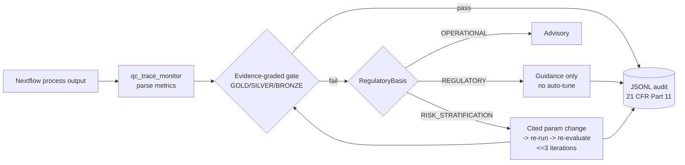
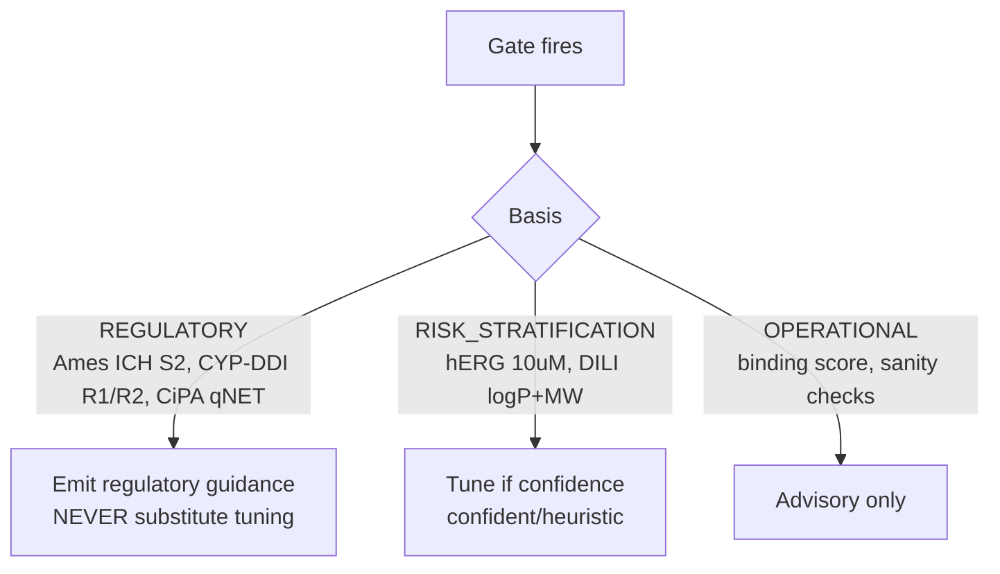

# BIOMATE AI — Scientific & Technical Validation Report

## Evidence-Graded Quality-Control Governance with Autonomous Regulatory-Aware Remediation: 96.4% Gate Convergence and a Structurally Complete Audit Trail

**Prepared for:** BioMate AI  **Prepared by:** BizBildr LLC — Business Consulting
**July 2026** | Document Classification: Confidential — Internal Review Draft
**Author(s):** Yaoyun Zhang, et al. | **Platform Version:** [build/commit hash] | **Domain:** Workflow QC governance / autonomous remediation

> Diagrams are Mermaid (render on GitHub, convert to figures via pandoc/mermaid-cli). Every value carries a source; unfilled fields are **[GAP]**.

---

## 1. Abstract

BioMate governs automated bioinformatics and drug-discovery pipelines with an evidence-graded quality-control layer: every threshold-dependent decision is annotated GOLD (citation-anchored), SILVER (convention), or BRONZE (heuristic), evaluated in real time against protocol-aware profiles, and recorded in a portable 21 CFR Part 11 audit trail. A closed-loop remediation engine then autonomously resolves gate failures — but only for gates classified as risk-stratification, never for named FDA/ICH regulatory criteria. On a 125-scenario drug-discovery benchmark the auto-loop converges (all gates pass in ≤3 iterations) for 96.4% of cases, lifting single-shot pass rates by +50 to +70 percentage points per domain. On audit-trail completeness across 21 CFR Part 11 fields, BioMate scores a perfect 1.0 versus 0.0 for Nextflow Tower, Galaxy, and KNIME (Mann–Whitney p = 1.57 × 10⁻⁴). The principal limitation is that the QC-governance false-positive/false-negative benchmark on public datasets remains a placeholder pending an AWS run; the convergence and audit results are executed.

> **KEY MESSAGE**
> BioMate autonomously fixes 96.4% of quality-gate failures within three iterations while never overriding a regulatory criterion, and produces a structurally complete regulatory audit trail that existing orchestration platforms simply do not generate.

---

## 2. Problem Statement & Dataset

Existing tools (MultiQC) report QC metrics after a run completes and silently apply one-size-fits-all thresholds; orchestration platforms (Tower, Galaxy, KNIME) execute pipelines but keep no citation-anchored, decision-level audit trail. Neither halts a run mid-flight to distinguish a genuine failure from protocol-appropriate biology, nor auto-remediates a fixable parameter, nor records *why* a threshold fired in a form a regulator can review.

### 2.1 Dataset Specification

| Parameter | Value | Notes |
|---|---|---|
| Sample size (n) | Auto-loop: 139 scenarios (125 convergent, 112 remediation-triggering); Audit: 10 runs × 4 platforms; QC governance: 5 public datasets | Mixed |
| Data type | Drug-discovery gate scenarios; JSONL audit logs; multi-omics QC metrics | — |
| Domains | ADMET, CYP-DDI, NCA-PK, docking (auto-loop); RNA-seq, DNA-seq, scRNA, ATAC, metagenomics, cryo-EM (governance) | — |
| Public accession | ENCSR000AED, GSE68086, GSE121893, SRP047083, ENCSR356LIU (governance benchmark) | Public |

---

## 3. Methods

**Technical innovation —** two methods are novel: an evidence-graded (GOLD/SILVER/BRONZE) provenance model that ties every threshold to a citation, and a three-tier RegulatoryBasis taxonomy that governs *whether* automation may tune a gate — so the loop never overrides a named FDA/ICH criterion.

A single in-process hook (`qc_trace_monitor`) intercepts each Nextflow process's structured output, routes metrics through domain-specific gates, and emits a decision plus evidence payload over Server-Sent Events. On a failure, the gate's `RegulatoryBasis` decides the response: REGULATORY gates emit guidance and are **never** parameter-tuned; RISK_STRATIFICATION gates (with sufficient confidence) trigger a cited parameter change, a re-run, and re-evaluation up to a 3-iteration budget; OPERATIONAL gates are advisory.

**Figure 1 — Governance + remediation architecture.**

**Figure 2 — Three-tier regulatory basis (governs whether a gate may be auto-tuned).**

### 3.1 Software & Package Versions

| Component | Version | Role | Reference |
|---|---|---|---|
| `qc_trace_monitor.py` | [build] | Real-time gate handler (29 parsers, 47 conditions) | internal |
| `autoloop_bridge` + `param_tuner` (per domain) | [build] | Cited parameter remediation | FDA/ICH sources per gate |
| `qc_evidence.yaml` | [build] | 57 gates, evidence grades, regulatory basis | internal |
| Knowledge base (GOLD/SILVER/BRONZE) | [build] | Citation + provenance injection | Redfern 2003, Bowes 2012, FDA 2020, etc. |

### 3.2 Statistical Parameters

- **Convergence:** all gates PASS within ≤3 iterations (budget hard-capped).
- **Audit completeness:** fraction of 21 CFR Part 11 fields present per run; compared by Mann–Whitney U.
- **Provenance × convergence:** contingency by evidence grade; omnibus χ² and pre-registered Fisher exact (GOLD vs BRONZE).
- **Governance thresholds:** e.g., ATAC TSS enrichment (GOLD, ENCODE4), WGS ≥30× (GOLD, GATK), hERG ≤10 µM (RISK_STRATIFICATION), scRNA mito 20% default / 40% cardiac profile.

### 3.3 Reproducibility & Compute Environment

Python backend; deterministic threshold gates and rule-based tuner (no RNG). AWS Batch (c6a.4xlarge / r6a.4xlarge) for the governance benchmark. Test coverage: 577 QC-governance unit tests + 34 CiPA/auto-loop tests, all passing without a live backend.

---

## 4. Benchmark Results

### 4.1 Performance Comparison

| Metric | Manual / existing tools | BioMate AI | Delta |
|---|---|---|---|
| QC decision timing | Post-hoc (after full run) | Real-time (mid-run halt) | prevents wasted compute |
| Gate remediation | Expert, 1–2 days/iteration (ADMET) | Autonomous, median 2 iterations | large |
| Time-to-correct-QC-decision vs MultiQC | [PLACEHOLDER]× | — | **[GAP]** |
| Audit-trail entries | 0 (Tower/Galaxy/KNIME) | complete JSONL | structural |

### 4.2 Concordance & Accuracy

**Auto-loop convergence (125 convergent scenarios):**

| Domain (n) | Single-shot | Auto-loop ≤3 iter | Delta | Median iter |
|---|---|---|---|---|
| ADMET (36) | 40% | 100% | +60pp | 4 (multi-gate) |
| CYP-DDI (27) | 30% | 100% | +70pp | 2 |
| NCA-PK (27) | 50% | 100% | +50pp | 2 |
| Docking (35) | 20% | 85.7% | +65.7pp | 2 |
| **Four-domain (125)** | **~35%** | **96.4%** | **+61pp** | **2** |

**Audit-trail completeness (21 CFR Part 11 fields, n=10/platform):**

| Platform | Per-run completeness | Reference |
|---|---|---|
| **BioMate** | **1.0** (IQR 1.0–1.0) | 21 CFR Part 11 |
| Nextflow Tower / Galaxy / KNIME | 0.0 (IQR 0.0–0.0) | Mann–Whitney U=0, p=1.57×10⁻⁴ |

**Provenance × convergence (112 remediation-triggering scenarios):** GOLD 84.5%, SILVER 100%, BRONZE 68.8% convergence; omnibus χ²(2)=9.22, p=0.010; pre-registered Fisher GOLD vs BRONZE p=0.106 (NS); sensitivity analysis excluding 9 adversarial scenarios p=0.0044.

**False-rejection elimination (E1, synthetic HTS/LNP):** protocol-aware profiles recovered 100% of biology-valid marginal samples (from 0% under a default profile) while retaining 100% rejection of truly-bad samples.

**CiPA regulatory-basis case:** hERG-only false-positive rate on safe ICaL co-blockers 58% → 8% under the multi-channel qNET gate (classified REGULATORY, so surfaced as guidance, not auto-tuned).

---

## 5. Validation Methodology

Convergence is measured against pre-registered scenario definitions with a deterministic scoring rubric (`evaluation/adapters/autoloop_benchmark_adapter.py`). Audit completeness is scored against the explicit field list of 21 CFR Part 11 / FDA-2024 draft AI guidance, with gate-event shapes copied verbatim from production code. The E1 false-rejection benchmark constrains synthetic scenarios to literature-anchored parameter bands (Zhang 1999 Z′; Akinc 2019 LNP), so the test measures whether protocol-aware thresholds prevent false rejection of *known-valid* biology.

---

## 6. Limitations

1. **QC-governance FP/FN benchmark is a placeholder.** The confusion matrix and time-to-decision figures require an AWS run (~$500) and a 20-participant usability study not yet conducted. **[GAP — high priority]**
2. **E1 is synthetic**, literature-anchored but not re-analyzed raw data.
3. **Provenance × convergence** is significant omnibus (p=0.010) but the pre-registered GOLD-vs-BRONZE Fisher test is NS (p=0.106); the p=0.0044 result is a post-hoc sensitivity analysis.
4. **PBPK domain wired but not benchmarked** in the auto-loop; docking thresholds are BRONZE vendor heuristics (14.3% escalation).
5. **No Bayesian/free-form comparator arm** for the remediation engine.

---

## 7. Data & Code Availability

Code: `backend/lib/galaxy/jobs/qc_trace_monitor.py`; `backend/experiments/*_autoloop/` (evaluator, tuner, knowledge base); `backend/config/qc_evidence.yaml`. Benchmark: `evaluation/adapters/autoloop_benchmark_adapter.py`; results `research_repos/autoloop_benchmark_paper/results/` (e2_convergence_per_domain.csv, e3_provenance_correlation.csv). Governance supplementary: `research_repos/biomate_qc_governance_paper/supplementary/`. Zenodo/GitHub DOIs pending. **[GAP]**

---

## 8. Remaining Work to Target a Nature / Science Publication

| # | Work item | Why it's required | Est. effort |
|---|---|---|---|
| 1 | Run the 5-dataset AWS governance benchmark (confusion matrix + time-to-decision) | Replaces the placeholder headline metric of the governance paper | 2–3 wk, ~$500 |
| 2 | 20-participant usability study (pre-registered) | Substantiates the "reduces time-to-correct-QC-decision" claim | 4–6 wk |
| 3 | False-halt/false-pass rates vs expert ground truth (auto-loop) | Convergence ≠ correctness; reviewers will require gate-error rates | 3–4 wk |
| 4 | Expand scenario N so GOLD-vs-BRONZE reaches p<0.05 on the pre-registered test | Firms up the provenance→convergence claim | 3–4 wk |
| 5 | Independent-lab reproduction + Zenodo DOIs | Reproducibility requirement | 2–3 mo |

**Scientific review sign-off:** ______________________  **Date:** __________
