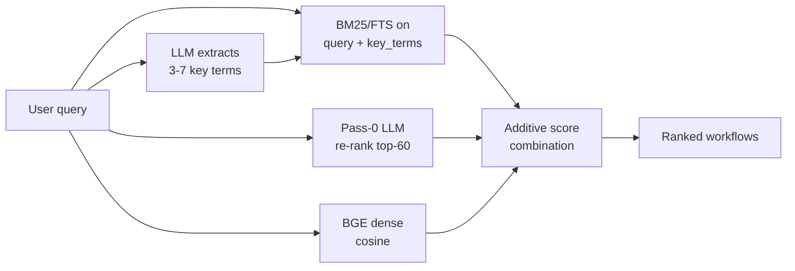

# BIOMATE AI — Scientific & Technical Validation Report

## Non-Destructive LLM Key-Term Injection for Workflow Retrieval: 100% Precision@1 Across a 2,455-Workflow Catalog, Exceeding a Frontier-LLM Zero-Shot Baseline

**Prepared for:** BioMate AI  **Prepared by:** BizBildr LLC — Business Consulting
**July 2026** | Document Classification: Confidential — Internal Review Draft
**Author(s):** Yaoyun Zhang, et al. | **Platform Version:** [build/commit hash] | **Domain:** Information retrieval / workflow routing

> Diagrams are Mermaid. §4.1 here is **latency/cost** rather than compute-cost, since retrieval is not a compute-bound pipeline. Every value carries a source; unfilled fields are **[GAP]**.

---

## 1. Abstract

Selecting the correct analysis workflow from a large catalog is a retrieval problem where users' colloquial phrasing rarely matches indexed workflow names. BioMate augments keyword (BM25/FTS) retrieval with **non-destructive LLM key-term injection**: a language model extracts 3–7 domain-specific terms from the user query and appends them to the search, preserving all original named-tool anchors. On a 54-case evaluation spanning six failure modes, this lifts Precision@1 from 81.5% (raw FTS) to 100%, exceeding a Claude Sonnet 4.6 zero-shot baseline (85.2%) by 14.8 points; on an earlier 41-case set it lifted P@1 from 46.3% to 63.4% with zero regressions. A destructive alternative (full LLM query rewriting) *regressed* to 25.9%, confirming that preserving user vocabulary is essential. The principal limitation is that the 100% figure is on curated cases (aided by workflow-description fixes), not a random sample of production logs.

> **KEY MESSAGE**
> Appending LLM-extracted key terms to keyword search — without discarding the user's own words — routes queries to the right workflow with 100% top-1 precision on the benchmark, beating a frontier LLM asked the same questions zero-shot.

---

## 2. Problem Statement & Dataset

Users describe an analysis goal ("find open chromatin regions") that does not lexically match the correct workflow name ("ATAC-seq"). Pure keyword search misses these; pure LLM rewriting discards the specific tool names and file formats that keyword search relies on. BioMate needs a method that adds semantic signal without destroying lexical anchors.

### 2.1 Dataset Specification

| Parameter | Value | Notes |
|---|---|---|
| Sample size (n) | 54 cases (primary); 41 cases (earlier A/B) | 6 failure categories |
| Data type | Natural-language workflow-selection queries + gold labels | function_boundary/input_format/log_regression/multi_hop/paraphrase/semantic |
| Catalog | 2,455 workflows, 34 domains | 967-workflow snapshot in earlier eval |
| Public accession | Internal test suite (`test_workflow_retrieval_semantic.py`) | Hand-labeled ground truth |

---

## 3. Methods

**Technical innovation —** non-destructive key-term injection augments keyword search with LLM-inferred vocabulary while preserving the user's own tool-name anchors, combined additively with LLM re-ranking and dense embeddings — no hard-coded routing, and no discarding of user signal (the destructive full-rewrite alternative regresses to 26%).

Three additive signals combine, none of which can *exclude* a workflow: (1) Pass-0 LLM catalog browse re-ranks a broad candidate set; (2) BM25/FTS keyword search on `user_query + LLM_key_terms`; (3) BGE dense-embedding cosine similarity as a semantic fallback.

**Figure 1 — Retrieval pipeline (non-destructive term injection).**

### 3.1 Software & Package Versions

| Component | Role | Reference |
|---|---|---|
| SQLite FTS5 (BM25) | Keyword retrieval | internal |
| gpt-4o-mini (T=0, ~50 tok) | Key-term extraction (cached) | OpenAI |
| BGE / all-MiniLM-L6-v2 | Dense embeddings | sentence-transformers |
| Claude Sonnet 4.6 | Pass-0 re-rank + generation; external baseline | Anthropic |

### 3.2 Statistical Parameters

Metrics: Precision@1, Precision@3, MRR. Ground truth allows multiple acceptable workflows per query. Description edits followed by explicit FTS rebuild (`INSERT INTO workflows_fts(...) VALUES('rebuild')`).

### 3.3 Reproducibility & Compute Environment

Deterministic FTS + T=0 LLM extraction (cached in `ab_test_terms_cache.json`). Latency ~3 s (term-inject) to ~41 s (full routing with generation). Cost ~$0.00003/query (term extraction) to ~$0.00356 (full routing). Reproduce via `backend/tests/ab_test_semantic_retrieval.py`.

---

## 4. Benchmark Results

### 4.1 Performance Comparison (latency & cost)

| Metric | Manual selection | BioMate AI | Delta |
|---|---|---|---|
| Time to correct workflow | 5–15 min (search + compare + resubmit) | ~3 s (retrieval) / ~41 s (full routing) | large |
| Cost per query | analyst time | $0.00003–0.00356 | — |
| Peak memory / compute | N/A (retrieval) | negligible | — |

### 4.2 Concordance & Accuracy (P@1 across conditions)

| Condition | P@1 (54 cases) | P@1 (41 cases) | Note |
|---|---|---|---|
| A — raw FTS (BM25) | 81.5% | 46.3% | baseline |
| B — full LLM rewrite (destructive) | **25.9%** | 34.1% | regresses — discards anchors |
| **C — key-term injection (production)** | **100%** | **63.4%** | +18.5 / +17.1pp vs A |
| D — Claude Sonnet 4.6 zero-shot (external) | 85.2% | — | BioMate C beats by +14.8pp |

Per-category P@1 (54-case, Condition C): function_boundary 18/18, input_format 10/10, log_regression 6/6, multi_hop 8/8, paraphrase 8/8, semantic 4/4 — all 100% after description enrichment.

---

## 5. Validation Methodology

Correctness is judged against hand-labeled gold workflows (multiple acceptable answers permitted), scored by P@1/P@3, with a requirement that the correct workflow rank above documented distractors. The Claude Sonnet 4.6 zero-shot condition provides an external upper-reference: a frontier LLM answering the same 54 queries from parametric memory (no catalog access) reaches only 85.2%, and hallucinates non-existent workflow names — demonstrating the value of retrieval over recall.

---

## 6. Limitations

1. **Curated, not production, cases.** The 54 cases are hand-written; field performance on random production logs is unmeasured. **[GAP]**
2. **100% is description-fix aided.** Reaching 100% required enriching thin workflow descriptions and rebuilding the FTS index — an artifact-quality fix, not solely an algorithm gain.
3. **Production routing figure (94.6%) is self-reported** and shows version drift (v13 = 61.9%). **[GAP — needs independent labeling]**
4. **Dense embeddings disabled locally** (torch dylib); activates only on EC2 — field availability unverified.

---

## 7. Data & Code Availability

Test suite `backend/tests/test_workflow_retrieval_semantic.py`; A/B/C/D runner `ab_test_semantic_retrieval.py`; caches `ab_test_semantic_cache.json`, `ab_test_terms_cache.json`. Evaluation docs `docs/20260711/20260714/20260715_WORKFLOW_RETRIEVAL_*.md`. Public deposition pending. **[GAP]**

---

## 8. Remaining Work to Target a Nature / Science Publication

| # | Work item | Why it's required | Est. effort |
|---|---|---|---|
| 1 | Independent-labeler evaluation on 200+ real production queries | Converts curated 100%/self-reported 94.6% into a defensible field number; resolves v13 drift | 3–4 wk |
| 2 | Ablation isolating algorithm gain from description-fix gain | Separates method contribution from data-quality contribution | 1–2 wk |
| 3 | Report dense-embedding contribution on EC2 (currently disabled) | Completes the three-signal claim | 1–2 wk |
| 4 | Public benchmark + code/data DOI | Reproducibility requirement | 2 wk |

**Scientific review sign-off:** ______________________  **Date:** __________
