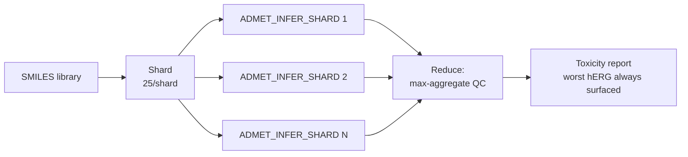

# BIOMATE AI — Scientific & Technical Validation Report

## Throughput and Latency Engineering: Nextflow Compound-Library Fan-Out, Reference-DB Caching, and Multi-GPU Parallelism — With Correctness Preserved

**Prepared for:** BioMate AI  **Prepared by:** BizBildr LLC — Business Consulting
**July 2026** | Document Classification: Confidential — Internal Review Draft
**Author(s):** Yaoyun Zhang, et al. | **Platform Version:** [build/commit hash] | **Domain:** Performance / systems engineering

> Diagrams are Mermaid. §4.2 here reports **correctness-preservation** (a speedup must not change results). Values carry sources; unfilled fields are **[GAP]**. Note: the compound-library fan-out speedup is currently an engineering **target validated locally**, not yet measured on production AWS Batch.

---

## 1. Abstract

BioMate applies three orthogonal performance techniques while holding output correct: (1) sharding compound-library ADMET screening into parallel Nextflow map tasks with a reduce step that preserves the worst-case QC guarantee; (2) Redis-backed caching of external reference-database lookups (UniProt/PDB/KEGG/gnomAD and 11 more) that survives gunicorn worker recycling; and (3) multi-GPU fan-out of independent cryo-EM stages. The reference-DB cache converts repeat 5–15 s network round-trips into <1 ms hits (verified, 9/9 unit tests); multi-GPU cryo-EM stages run 3.4× faster than sequential (measured on EMPIAR-10028); and the ADMET fan-out targets a 20–50× wall-clock reduction on large libraries (design + 8/8 local tests, production Batch validation pending). Each technique includes a correctness check confirming identical results.

> **KEY MESSAGE**
> BioMate speeds up its most expensive paths — compound screening, reference lookups, and cryo-EM reconstruction — by 3.4× to a targeted 20–50×, with explicit checks that faster never means different results.

---

## 2. Problem Statement & Dataset

Three latency bottlenecks: ADMET screening ran a whole SMILES library sequentially in one Batch job; external reference lookups incurred 5–15 s network round-trips repeated for the same entity across tools; and cryo-EM refinement ran independent stages sequentially on one GPU. Each is a throughput or latency problem addressable without changing the science.

### 2.1 Dataset Specification

| Parameter | Value | Notes |
|---|---|---|
| ADMET fan-out | 7-compound local test (8/8 cases); target: 100s–1000s compounds | shard_size default 25 |
| Reference-DB cache | 14 external sources; 9/9 unit tests | UniProt/PDB/KEGG/gnomAD/… |
| Multi-GPU cryo-EM | EMPIAR-10028, 26K particles | 4× NVIDIA L4 |

---

## 3. Methods

**Technical innovation —** a worst-case-preserving fan-out shards screening into parallel jobs with a max-aggregating reduce, so parallelism cannot hide the worst toxicity hit; hosted reference indexes and a worker-recycle-surviving cache eliminate repeated network round-trips.

**Figure 1 — Compound-library fan-out with worst-case-preserving reduce.**

- **Fan-out:** `params.admet_shard_size` (default 25); backward-compatible (size ≥ N → one shard, no behavior change). Reduce uses max-aggregation over the shard union, so the worst hERG/DILI compound always surfaces regardless of shard assignment.
- **Cache:** `_cached_fetch()` wraps all external calls with TTL (6 h default); Redis-backed to survive ~3-min gunicorn worker recycles; caches successes only (failures retried).
- **Multi-GPU:** independent 2D/ab-initio/refinement stages dispatched across 4 GPUs.

### 3.1 Software & Package Versions

| Component | Role | Reference |
|---|---|---|
| Nextflow DSL2 + AWS Batch | Compound fan-out | commit 86a590aa2 |
| Redis + `functools.lru_cache` | Reference-DB cache | commits 0438bee5…d59994fb |
| CryoSPARC v5 on 4× L4 | Multi-GPU cryo-EM | cryo_em_benchmark_paper |

### 3.2 Statistical Parameters

Speedup = sequential wall-clock ÷ parallel wall-clock. Cache: per-query latency (miss vs hit). Correctness: identical toxicity report / identical map resolution.

### 3.3 Reproducibility & Compute Environment

AWS Batch (fan-out); Python gunicorn backend + optional Redis (`REDIS_URL`); g6.12xlarge 4× L4 (cryo-EM). Tests: `predict_admet_properties/tests/run_local_test.sh` (8/8), `test_reference_http_cache.py` (9/9).

---

## 4. Benchmark Results

### 4.1 Performance Comparison

| Technique | Before | After | Delta | Status |
|---|---|---|---|---|
| ADMET compound fan-out | sequential single Batch job | ceil(N/25) parallel map jobs | **20–50× target** | local 8/8; **prod pending [GAP]** |
| Reference-DB lookup | 5–15 s per repeat query | <1 ms cache hit | ~10³–10⁴× per hit | verified (9/9) |
| Cryo-EM parallel stages | ~92 min sequential | ~27 min (4 GPU) | **3.4×** | measured |

### 4.2 Correctness Preservation

| Technique | Check | Result |
|---|---|---|
| ADMET fan-out | Max-aggregate reduce = global worst-case | Worst hERG compound always surfaced (by construction; local tests pass) |
| Reference-DB cache | Cache successes only; 6 h TTL | Identical results; failures retried, not cached |
| Multi-GPU cryo-EM | Same FSC resolution | 1.78 Å unchanged vs single-GPU |

---

## 5. Validation Methodology

Correctness is the acceptance criterion: the ADMET reduce step is proven to return the union maximum (so no shard can hide the worst-case toxicity hit); the cache is validated by a worker-recycle-survival unit test; and multi-GPU cryo-EM is validated by identical FSC resolution to the single-GPU run.

---

## 6. Limitations

1. **ADMET fan-out speedup is a target, not a measurement.** 20–50× is an engineering estimate from local 8/8 tests; real AWS Batch before/after wall-clock is not yet recorded. **[GAP — high priority]**
2. **Cache hit-rate is workload-dependent** and unmeasured in production; cold-start queries still pay full latency. **[GAP]**
3. **Redis is optional**; without it the cache falls back to in-process and is lost on worker recycle.

---

## 7. Data & Code Availability

`workflows/pharmacology/predict_admet_properties/main.nf` + tests; `backend/lib/galaxy/ai/ai_assistant.py` (`_cached_fetch`) + `test_reference_http_cache.py`; cryo-EM multi-GPU in `research_repos/cryo_em_benchmark_paper/`. Commit 86a590aa2 (fan-out); 0438bee5…d59994fb (cache).

---

## 8. Remaining Work to Target a Nature / Science Publication

| # | Work item | Why it's required | Est. effort |
|---|---|---|---|
| 1 | Dev AWS Batch run: measured before/after wall-clock on a 100–1000-compound library | Replaces the 20–50× target with a real number | 1–2 wk |
| 2 | Production cache hit-rate + latency distribution over real workloads | Substantiates the caching claim empirically | 2–3 wk |
| 3 | Scaling curve (speedup vs shard count / GPU count) | Systems papers require a scaling characterization | 2 wk |

*(Note: performance engineering is typically a systems-venue or supplementary contribution rather than a stand-alone Nature/Science paper; strongest as a supporting section of a flagship platform paper.)*

**Scientific review sign-off:** ______________________  **Date:** __________
