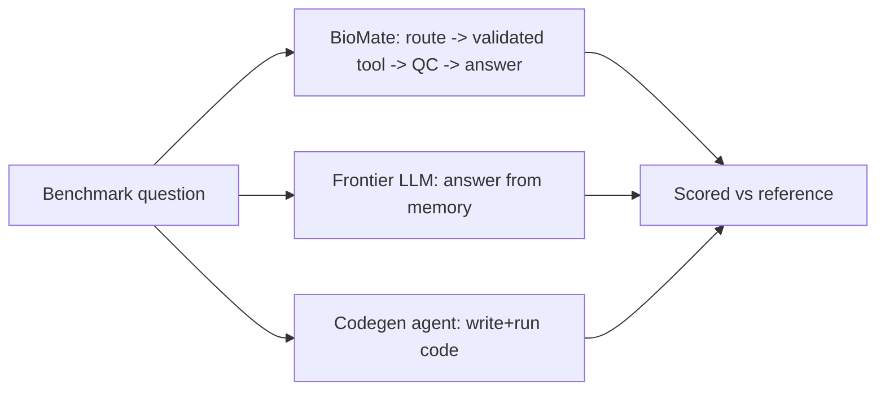

# BIOMATE AI — Scientific & Technical Validation Report

## Orchestrated Agentic Performance on Public Bioinformatics Benchmarks: BixBench and BiomniEval1 Against Frontier and Fine-Tuned Baselines

**Prepared for:** BioMate AI  **Prepared by:** BizBildr LLC — Business Consulting
**July 2026** | Document Classification: Confidential — Internal Review Draft
**Author(s):** Yaoyun Zhang, et al. | **Platform Version:** [build/commit hash] | **Domain:** Agentic AI evaluation

> Diagrams are Mermaid. This use case has a strong §4.2 (accuracy vs baselines) but limited §4.1 (no cost/time comparison). Values carry sources; unfilled fields are **[GAP]**.

---

## 1. Abstract

BioMate's orchestration layer — routing, execution, and evidence-graded QC — is evaluated as an agent on two public benchmarks. On the open-answer BixBench Verified subset (n=50), BioMate scores ≈48%, exceeding the published open-answer state of the art (K-Dense Analyst 29.2%, GPT-5 22.9%, Gemini 2.5 Pro 18.3%). On BiomniEval1 (n=223 biomedical reasoning tasks), BioMate scores 71.3%, above the fine-tuned Biomni-R0-32B baseline (≈65%). These results support the thesis that orchestrating validated tools outperforms both frontier LLMs answering from parametric memory and code-generation agents. The principal limitation is that the BixBench figure is on the 50-question Verified subset (not the full 296-question benchmark) and BioMate's answer judge has not been cross-validated against the official scorer.

> **KEY MESSAGE**
> Orchestrating validated tools beats frontier LLMs on open-answer bioinformatics: BioMate scores ≈48% on BixBench where the best published open-answer system reaches 29.2%.

---

## 2. Problem Statement & Dataset

Autonomous "AI scientist" claims rest on LLMs executing analyses directly, but code an LLM writes runs yet is often wrong. The question is whether an orchestration architecture (validated tools + QC + audit) beats both frontier LLMs and code-generation agents on public benchmarks.

### 2.1 Dataset Specification

| Parameter | Value | Notes |
|---|---|---|
| Sample size (n) | BixBench 50 (Verified subset); BiomniEval1 223 | open-answer + reasoning |
| Data type | Analysis-capsule questions; biomedical reasoning tasks | phylogenomics, patient-gene, rare-disease, GWAS |
| Reference | Held-out reference notebooks; canonical answer keys | public |
| Public accession | BixBench; BiomniEval1 (public benchmarks) | — |

---

## 3. Methods

**Technical innovation —** the evaluated system is BioMate's orchestration-over-code-generation design — routing to validated tools with an evidence trail — rather than an LLM writing and running ad-hoc analysis code from parametric memory.

BioMate routes each benchmark question to workflows/tools, executes, applies QC gates, and returns an answer; scoring uses each benchmark's published rubric.

**Figure 1 — Orchestration-vs-autonomous evaluation framing.**

### 3.1 Software & Package Versions

| Component | Role | Reference |
|---|---|---|
| BioMate orchestration | Route/execute/QC | internal |
| BixBench adapter | `evaluation/adapters/bixbench_adapter.py` | internal |
| Comparators | K-Dense, GPT-5, Gemini 2.5 Pro, Biomni-R0-32B | published |

### 3.2 Statistical Parameters

BixBench: percent correct on open-answer questions (published rubric). BiomniEval1: percent correct on 223 tasks vs canonical answers.

### 3.3 Reproducibility & Compute Environment

Public benchmarks with published answer keys; BixBench uses a held-out reference notebook. **[GAP — runtime/cost per question not recorded.]**

---

## 4. Benchmark Results

### 4.1 Performance Comparison

| Metric | Baselines | BioMate AI | Delta |
|---|---|---|---|
| Runtime / cost per question | not reported | not recorded | **[GAP]** |
| Analyst effort | manual analysis (hours) | automated | qualitative |

### 4.2 Concordance & Accuracy

| Benchmark (n) | BioMate | Best baseline | Delta |
|---|---|---|---|
| BixBench Verified (50) | **≈48%** | K-Dense 29.2%; GPT-5 22.9%; Gemini 2.5 Pro 18.3% | +18.8pp vs K-Dense |
| BiomniEval1 (223) | **71.3%** | Biomni-R0-32B ≈65% | +6.3pp |
| Audit completeness (see QC report) | 1.0 | Tower/Galaxy/KNIME 0.0 | p=1.57×10⁻⁴ |

---

## 5. Validation Methodology

Both benchmarks are public with held-out reference answers; BixBench requires executing analysis on capsule data and comparing to a reference notebook not provided to the agent. The comparators are the current published open-answer leaders (frontier LLMs) and a domain-fine-tuned model (Biomni-R0-32B), making them appropriate strong baselines.

---

## 6. Limitations

1. **BixBench subset.** 48% is on the 50-question Verified subset; the full 296-question confirmation run is pending. **[GAP — high priority]**
2. **Judge not cross-validated** against the official BixBench scorer (lenient judge could inflate; verbose-output gap could deflate).
3. **Internal routing/param-prefill metrics** cited elsewhere (94.6% / 84.8%) are self-reported with version drift.
4. **No cost/latency comparison** to baselines. **[GAP]**

---

## 7. Data & Code Availability

Adapters `evaluation/adapters/bixbench_adapter.py`; benchmarks public (BixBench, BiomniEval1). BioMate-derived artifacts targeted for Hugging Face (`biomate-agent-bench`, slug TBD). **[GAP — confirm deposit.]**

---

## 8. Remaining Work to Target a Nature / Science Publication

| # | Work item | Why it's required | Est. effort |
|---|---|---|---|
| 1 | Full 296-question BixBench run with official scorer | Removes the subset caveat; makes the claim definitive | 3–4 wk |
| 2 | Cross-validate the answer judge against the official scorer | Removes the judging-bias caveat | 1–2 wk |
| 3 | Report per-question cost/latency vs baselines | Fills the §4.1 gap | 1–2 wk |
| 4 | Deposit agent-bench artifacts (HuggingFace/Zenodo DOI) | Reproducibility requirement | 2 wk |

**Scientific review sign-off:** ______________________  **Date:** __________
