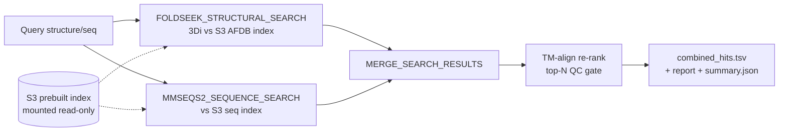

# BIOMATE AI — Scientific & Technical Validation Report

## Hosted Large-Database Structural Homology Search: Foldseek 3Di + MMseqs2 Over the AlphaFold Database with TM-align Re-Ranking QC

**Prepared for:** BioMate AI  **Prepared by:** BizBildr LLC — Business Consulting
**July 2026** | Document Classification: Confidential — Internal Review Draft
**Author(s):** Yaoyun Zhang, et al. | **Platform Version:** [build/commit hash] | **Domain:** Structural biology / large-DB search

> Diagrams are Mermaid. This use case is **implemented and locally validated end-to-end**, but the headline speedup and full-index accuracy are **not yet measured at production scale** — those are marked **[GAP]**. Every value carries a source.

---

## 1. Abstract

Finding structural homologs of a query protein across the AlphaFold Database (214M structures) is intractable with classical pairwise structural alignment (TM-align), and the index is too large for most labs to build or host. BioMate hosts a prebuilt Foldseek 3Di structural index (plus an MMseqs2 sequence index) on S3, mounted read-only, and runs per-query fan-out searches with a TM-align re-rank of the top hits as a quality gate. Foldseek's 3Di alphabet delivers an expected 10³–10⁵× speedup over TM-align while retaining sensitivity. The workflow is implemented and validated end-to-end locally (8/8 tests, correct self-matches; S3 build→upload→download→search proven), and the combined Foldseek+MMseqs2 pipeline passes a 3/3 mock run. The principal limitation is that the full AlphaFold-DB index build and an AWS Batch smoke test are pending, so the production-scale speedup and homolog-recall accuracy are not yet measured.

> **KEY MESSAGE**
> BioMate makes structural homology search over a 214M-structure database — infeasible locally — a routine hosted query, using Foldseek's 3Di index for an expected 10³–10⁵× speedup over classical structural alignment, with TM-align re-ranking as a correctness gate.

---

## 2. Problem Statement & Dataset

A researcher with a novel or predicted structure wants to know "what known structures does this resemble?" Classical structural alignment (TM-align) is accurate but pairwise and far too slow across hundreds of millions of structures; and the AlphaFold-DB / Swiss-Prot / PDB indexes are too large to build and host on a workstation. BioMate hosts the index and runs the search.

### 2.1 Dataset Specification

| Parameter | Value | Notes |
|---|---|---|
| Reference DB | AlphaFold DB (214M) / Swiss-Prot / human proteome (~48k mmCIF) | S3 `biomate-structure-db` |
| Query | PDB/CIF structure (or FASTA for sequence path) | per-query fan-out |
| Local test | 2 parallel query jobs, correct self-matches (8/8) | Foldseek static binary, no Docker |
| Public accession | AlphaFold DB (EMBL-EBI); Swiss-Prot; PDB | public |

---

## 3. Methods

**Technical innovation —** a 214M-structure Foldseek 3Di index is hosted read-only on S3 and *mounted* (not Nextflow-staged) for per-query fan-out, with a TM-align re-rank as an on-top quality gate — bringing reference-scale structural search within reach of any user.

Two search paths run and merge: Foldseek structural search (3Di alphabet) and MMseqs2 sequence search, both against S3-mounted prebuilt indexes; a merge step combines hits; TM-align re-ranks the top-N structural hits as a quality gate.

**Figure 1 — Hosted large-DB structural search.**

### 3.1 Software & Package Versions

| Package | Role | Reference |
|---|---|---|
| Foldseek (3Di) | Structural homology search | van Kempen et al., 2024 (Nat Biotechnol) |
| MMseqs2 | Sequence homology search | Steinegger & Söding, 2017 |
| TM-align | Re-rank / QC gold-standard structural alignment | Zhang & Skolnick, 2005 |
| AlphaFold DB | Reference structures | Varadi et al., 2022 |
| BioMate orchestration (Nextflow DSL2, S3-mounted index) | Fan-out, staging, merge | internal (catalog id 12647 / 14456) |

### 3.2 Statistical Parameters

Hit scoring: Foldseek E-value / TM-score; TM-align TM-score re-rank threshold on top-N (QC gate). Sequence path: MMseqs2 E-value.

### 3.3 Reproducibility & Compute Environment

Index is a **mounted read-only S3 path** (not Nextflow-staged), so query jobs fan out without copying the DB. Local test: `tests/run_local_test.sh` (8/8) with the Foldseek static binary; S3 pattern proven end-to-end (`prepare_foldseek_db.sh` builds demo-mini index → S3 → re-download → search). Full index build script `build_alphafold_db.sh` (~3–4 h, ~120 GB working space on r6i.8xlarge). **[GAP — full index + Batch smoke test pending.]**

---

## 4. Benchmark Results

### 4.1 Performance Comparison

| Metric | Classical (TM-align) | BioMate (Foldseek + hosted index) | Delta |
|---|---|---|---|
| Search across 214M structures | Infeasible (pairwise) | Hosted query; per-query fan-out | qualitative step-change |
| Expected speedup vs TM-align | 1× | **10³–10⁵×** (Foldseek 3Di) | **[GAP — not yet measured at full scale]** |
| Index build/host | Local build infeasible | Prebuilt on S3, mounted read-only | hosting moat |

### 4.2 Concordance & Accuracy (correctness preservation)

| Check | Result | Note |
|---|---|---|
| Local self-match correctness | ✅ correct self-matches (8/8) | Foldseek static binary, 2 parallel jobs |
| Combined pipeline mock run | ✅ 3/3 processes pass | Foldseek + MMseqs2 + merge |
| TM-align re-rank QC | implemented | gold-standard structural alignment on top-N |
| Full-index homolog recall vs curated benchmark | **[GAP — not run]** | needs SCOP/CATH-style ground truth |

---

## 5. Validation Methodology

Correctness is currently established by self-match tests (a query must retrieve itself) and by TM-align re-ranking of the top hits (TM-align is the accepted gold standard for structural-alignment accuracy, used here as an on-top QC gate). Full validation against a curated homology benchmark (SCOP/CATH families) is the required next step.

---

## 6. Limitations

1. **Full AlphaFold-DB index not yet built**; production runs use a demo-mini index. **[GAP — high priority]**
2. **Headline 10³–10⁵× speedup is Foldseek's published/expected advantage, not a BioMate-measured full-scale number.** **[GAP]**
3. **No homolog-recall accuracy benchmark** vs a curated ground truth (SCOP/CATH). **[GAP]**
4. **AWS Batch smoke test pending** — end-to-end proven locally + on the S3 pattern, not yet on Batch at scale.

---

## 7. Data & Code Availability

AlphaFold DB / Swiss-Prot / PDB are public. Workflow: `backend/biomni_workflows/nextflow_nfcore/subworkflows/drug_discovery/alphafold_db_search/main.nf` (+ `build_alphafold_db.sh`); `structural_biology/foldseek_structure_search/main.nf` (catalog id 14456) + `tests/run_local_test.sh`, `tools/prepare_foldseek_db.sh`. Session: `docs/sessions/20260320_alphafold_db_search.md`; speedup ledger `docs/20260712_UNIFIED_SPEEDUP_BACKLOG.md` (item 4).

---

## 8. Remaining Work to Target a Nature / Science Publication

| # | Work item | Why it's required | Est. effort |
|---|---|---|---|
| 1 | Build the full AlphaFold-DB / Swiss-Prot Foldseek index on S3 | Enables a real production-scale run | ~3–4 h build + validation |
| 2 | AWS Batch smoke test + measured wall-clock/throughput | Replaces the expected 10³–10⁵× with a measured BioMate number | 1–2 wk |
| 3 | Homolog-recall benchmark vs SCOP/CATH ground truth (+TM-align concordance) | Establishes accuracy, not just speed | 3–4 wk |
| 4 | Public deposition of index build recipe + code (DOI) | Reproducibility requirement | 2 wk |

**Scientific review sign-off:** ______________________  **Date:** __________
