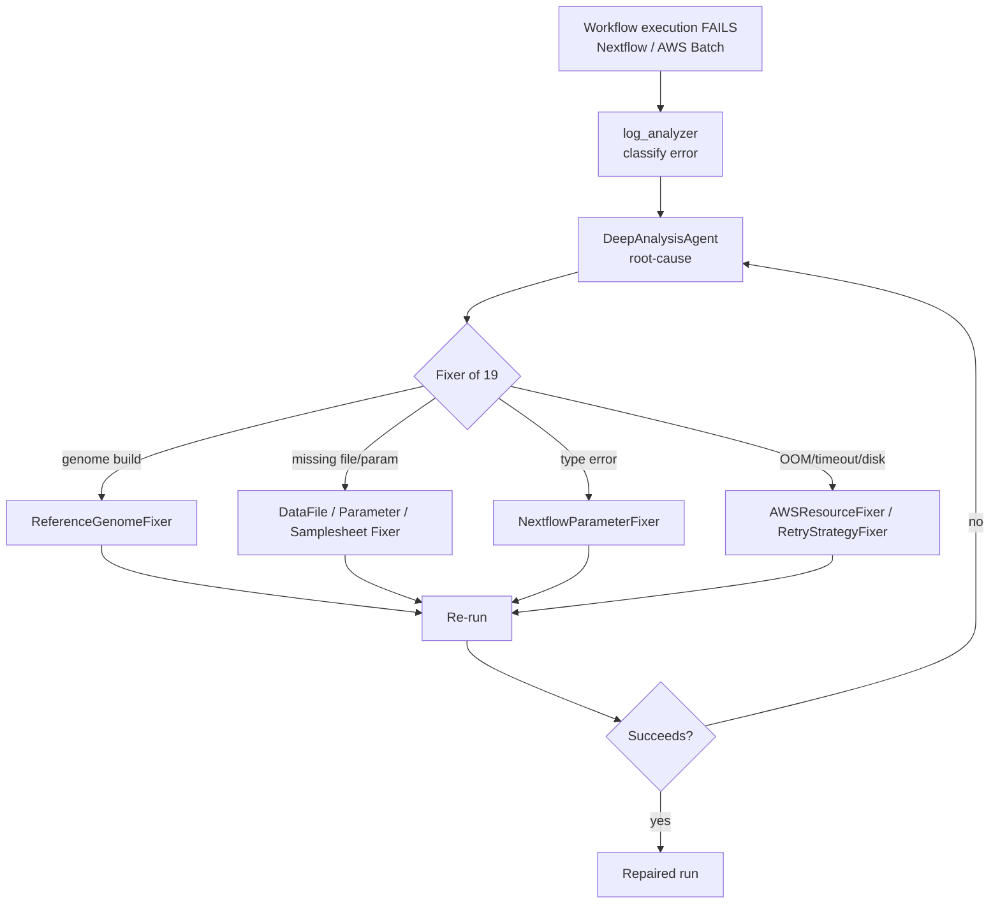

# BIOMATE AI — Scientific & Technical Validation Report

## Autonomous Workflow-Execution Repair: A 19-Fixer AutoFix Engine for Failed Bioinformatics Pipelines, Including AWS Batch Resource Failures

**Prepared for:** BioMate AI  **Prepared by:** BizBildr LLC — Business Consulting
**July 2026** | Document Classification: Confidential — Internal Review Draft
**Author(s):** Yaoyun Zhang, et al. | **Platform Version:** [build/commit hash] | **Domain:** Workflow reliability / autonomous repair

> Diagrams are Mermaid. **Status caveat (read first):** AutoFix3 is **implemented and deployed** (operational on dev), but its 20-case accuracy benchmark is **defined and not yet run** — so §4.2 scores are **targets, not measured**. This is the highest-priority gap for this case study. Every value carries a source.

---

## 1. Abstract

BioMate's AutoFix engine (AutoFix3) automatically diagnoses and repairs *failed* workflow executions — a capability distinct from QC-gate remediation, which tunes parameters on runs that succeed. When a Nextflow/AWS Batch job fails, a DeepAnalysisAgent parses the error log, an IterativeDebugger and 19 specialized fixers propose a concrete repair (correct genome build, supply a missing input, fix a parameter type, or resize/retry an out-of-memory or timed-out Batch job), and the workflow is re-run. The system is deployed and healthy on dev (all four components operational) with manual and (in progress) automatic triggering. Its competitive frame is the AI Scientist paper (Lu et al., 2024), which reports a 65–70% self-correction recovery rate on Python/config errors; AutoFix targets ≥90% and uniquely covers AWS Batch **resource failures** (OOM, wall-time timeout, disk-full) that have no equivalent in general-purpose autonomous-science systems. The principal limitation is that the 20-case benchmark has not yet been run, so the recovery rate is a target rather than a measurement.

> **KEY MESSAGE**
> BioMate doesn't just run bioinformatics workflows — it repairs the ones that fail, with a 19-fixer engine covering error classes (including cloud resource failures) that autonomous-science systems don't handle, targeting a ≥90% recovery rate versus the 65–70% reported for general AI self-correction.

---

## 2. Problem Statement & Dataset

Real bioinformatics runs fail constantly — a wrong genome build, a missing samplesheet file, a string where an integer was expected, an out-of-memory STAR alignment. Today a scientist must read the cloud log, diagnose the cause, edit the workflow, and resubmit — minutes to hours per failure. AutoFix automates that loop. The benchmark comprises 20 deliberately-broken workflow states drawn from real AWS Batch error patterns.

### 2.1 Dataset Specification

| Parameter | Value | Notes |
|---|---|---|
| Sample size (n) | 20 deliberately-broken workflow states | 4 categories × 5 |
| Categories | genome_mismatch, missing_input, param_type_error, resource_failure | real AWS Batch patterns |
| Data type | Workflow name + params + realistic error log | chat-based diagnosis (as a user experiences it) |
| Public accession | Internal (`evaluation/.../run_autofix_benchmark.py`) | LLM judge = Claude Haiku |

---

## 3. Methods

**Technical innovation —** a closed-loop repair engine (DeepAnalysisAgent + IterativeDebugger + 19 specialized fixers) diagnoses and re-runs *failed* executions — including AWS Batch resource failures — a capability available only because BioMate owns the execution environment end to end.

On execution failure, the log analyzer classifies the error, the DeepAnalysisAgent identifies the root cause, and the matching fixer (of 19) proposes a concrete repair; the IterativeDebugger can iterate. Repairs re-run through the normal executor.

**Figure 1 — AutoFix execution-repair loop (distinct from QC auto-loop).**

### 3.1 Software & Package Versions

| Component | Role | Reference |
|---|---|---|
| AutoFix3 (DeepAnalysisAgent, IterativeDebugger, EnhancedToolKit, 19 fixers) | Failure diagnosis + repair | `backend/lib/galaxy/ai/workflow_ops/autofix/` |
| `log_analyzer.py` | Error classification | internal |
| LLM judge (Claude Haiku) | Benchmark scoring | Anthropic |
| Executor hook | `nextflow_workflow_runner.py` (Path B auto-trigger) | internal |

### 3.2 Statistical Parameters

Per case: 1.0 (root cause + fix correct), 0.5 (root cause correct, fix partial), 0.0 (wrong root cause). Targets: genome_mismatch ≥0.90, missing_input ≥0.90, param_type_error ≥0.95, resource_failure ≥0.80, **overall ≥0.90**.

### 3.3 Reproducibility & Compute Environment

Chat-based diagnosis (tests the user-facing capability, not the internal API). Deployed on dev: `/api/autofix3/status` → operational, all 4 components true; manual trigger `/api/workflows/:wid/invocations/:iid/autofix3/run`. Run the benchmark with `python evaluation/runners/run_autofix_benchmark.py`.

---

## 4. Benchmark Results

### 4.1 Performance Comparison

| Metric | Manual debugging | BioMate AutoFix | Delta |
|---|---|---|---|
| Diagnose + fix a failed Batch run | 15 min – hours (read log, diagnose, edit, resubmit) | automated diagnosis + proposed fix | large |
| Error classes covered | analyst knowledge | 19 fixers across 4 categories | breadth |
| Cloud resource failures (OOM/timeout/disk) | manual instance resizing | AWSResourceFixer / RetryStrategyFixer | unique vs AI Scientist |

### 4.2 Concordance & Accuracy

| Category | N | Target | Measured |
|---|---|---|---|
| genome_mismatch | 5 | ≥0.90 | **[GAP — not run]** |
| missing_input | 5 | ≥0.90 | **[GAP]** |
| param_type_error | 5 | ≥0.95 | **[GAP]** |
| resource_failure | 5 | ≥0.80 | **[GAP]** |
| **Overall** | 20 | **≥0.90** | **[GAP — benchmark defined, not yet executed]** |

**Competitive reference:** AI Scientist (Lu et al., 2024) reports 65–70% self-correction recovery (Python/config errors), mean 2.1 attempts. AutoFix targets ≥90% and adds a resource-failure category with no AI-Scientist equivalent.

---

## 5. Validation Methodology

The benchmark presents 20 realistic broken states (based on real AWS Batch failures) via chat; an LLM judge scores semantic correctness of the root-cause diagnosis and the proposed fix (not string match). The AI Scientist paper's 65–70% recovery rate is the external comparator — a general-purpose floor that a bioinformatics-specialized repair engine should exceed.

---

## 6. Limitations

1. **Benchmark not yet run** — accuracy is a target, not a measurement. **[GAP — highest priority for this case study]**
2. **Auto-trigger not yet firing in production** — as of 2026-06-06 the engine is deployed and manually triggerable but `total_invocations_tracked = 0`; Path-B auto-invocation on failure is being wired.
3. **Hard resource cases** (e.g., AMBER GPU memory) are expected to score lower — the engine may not know every tool's resource profile.
4. **Single-shot diagnosis** in the benchmark (no retry loop measured), whereas production uses the IterativeDebugger.

---

## 7. Data & Code Availability

Engine: `backend/lib/galaxy/ai/workflow_ops/autofix/` (toolkit, persistence) + `autofix3.py` + `log_analyzer.py`. Benchmark harness: `evaluation/runners/run_autofix_benchmark.py`; cases in `docs/20260412_AUTOFIX_BENCHMARK_REPORT.md`. System reference: `docs/20260310_AUTOFIX_SYSTEM_REFERENCE.md`; auto-trigger design: `docs/20260606_AUTOFIX3_PATH_CHOICE.md`.

---

## 8. Remaining Work to Target a Nature / Science Publication

| # | Work item | Why it's required | Est. effort |
|---|---|---|---|
| 1 | **Run the 20-case benchmark** and report per-category + overall recovery | Converts the target into a real, comparable number — this is the gating step | 1 wk |
| 2 | Complete Path-B auto-trigger; report production recovery rate + mean attempts on real failures | Demonstrates the capability in production, not just on synthetic cases | 2–4 wk |
| 3 | Head-to-head vs AI Scientist self-correction on a shared error set | Substantiates the competitive claim | 3–4 wk |
| 4 | Expand beyond 20 cases; add tool-resource knowledge for hard cases | Statistical power + closes the resource-failure gap | 3–4 wk |

**Scientific review sign-off:** ______________________  **Date:** __________
