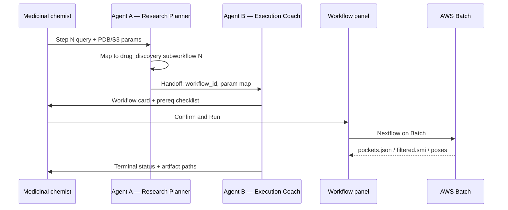

# Two agents, four workflows: how we run an ANDV inhibitor triage stack without losing the science between steps

*Agentic Biology — a case study in splitting **planning** from **execution** on a real small-molecule program, and why chain-of-custody matters more than green checkmarks.*

---

When a medicinal chemist says “screen this pocket,” they are not asking for a chatbot. They are asking for a **sequence of validated tools**—pocket detection, pharmacophore filtering, ADMET triage, docking—with parameters that match their receptor, library, and assay context. The failure mode in most “AI for drug discovery” demos is not bad language; it is **silent decoupling**: step four runs, but it consumes the wrong SMILES panel because nothing in the UI enforced that step two’s output became step three’s input.

We used the deposited **ANDV glycoprotein** structure (Guo *et al.*, *Cell*, 2026; PDB **9P3I**) as a disciplined stress test for BioMate’s **two-agent** chat architecture on the **inhibitor track**. This post is about that split—what each agent is responsible for, what we shipped, and what our own audit caught before we would ever claim a chained story in public.

## The two agents (and why two is enough)

BioMate does not throw one monolithic model at “do my program.” In the inhibitor UI flow we use two cooperating roles inside one thread:

**Agent A — Research Planner**

- Classifies intent as **inhibitor / drug discovery** (not vaccine epitope, not cryo-EM).
- Maps the user’s natural language to the **correct subworkflow** for the current stage: pocket druggability, pharmacophore filter, ADMET, AutoDock Vina, optional MD or generative follow-up.
- Extracts **explicit parameters**: `pdb_input`, S3 paths to reference actives and compound libraries, druggability thresholds, docking box center when the user references a top pocket from step 1.
- Produces a **structured handoff**—workflow id, param map, QC hints—for Agent B. Agent A does **not** submit Batch jobs.

**Agent B — Execution Coach**

- Renders the **workflow card** in the right panel (`Confirm & Run`), surfaces prereqs (missing library paths, empty required fields).
- On Run, captures `run_id`, drives status UI to a terminal badge, and summarizes **handoff artifacts** for the next chat turn (“filtered compounds live at …”).
- After completion, points to HTML reports, JSON metrics, and downloads—without overstating what was *scientifically* chained vs merely *executed*.

The user sees one conversation. The engineering value is **separation of concerns**: routing and parameter extraction can be retried or clarified without re-executing an hour-long docking job, and execution state does not pollute the planner’s context window with stack traces.

## What the four-step stack actually is

| Step | Purpose | Typical artifact |
|------|---------|------------------|
| 1 — Pocket | Tractability, volume, druggability score | `structure_pockets.json`, top pocket center |
| 2 — Pharmacophore | Filter demo library against reference actives | `filtered_compounds.smi` |
| 3 — ADMET | Triage permeability, clearance, liability flags | `toxicity_report.json`, per-compound table |
| 4 — Docking | Pose generation and affinity ranking | Vina outputs, pose PDBs |

All four are **Nextflow** workflows under BioMate’s drug-discovery registry, executed on **AWS Batch** when `outdir` and inputs are on **S3**. The interesting engineering is not Docker—it is **manifest JSON** offline that links `run_id`s per step so a program lead can audit what ran when.

## What we learned the hard way (integrity paragraph)

On an early demo run (`andv_nf_pipeline_20260512T181054Z`), every step reported **succeeded**. Our internal audit still graded the run **CONCERNS**: pharmacophore filtering produced one SMILES set, while ADMET and docking consumed a **fixed `smiles_list`** baked into later parameter files—not the filtered hits. Execution green; **scientific chain wrong**.

We fixed the CLI orchestrator (`run_andv_inhibitor_pipeline_nextflow.py`) to read `02_pharmacophore/filtered_compounds.smi` into steps 3–4 when that artifact exists. A later chained run (`20260513T032000Z`) is the one we cite for manuscript figures. **Agent B’s job is to surface paths honestly**; **Agent A’s job is not to imply chaining** unless the manifest proves it.

That distinction is exactly why we publish the audit alongside the blog.

## What works in the UI today

Playwright stepwise tests (**INH-1 … INH-4**) cover **pocket** and **pharmacophore** through chat → card → Run → terminal status—mirroring how a chemist actually works one stage at a time. Param names match Nextflow schema (`reference_actives`, `compound_library`, not legacy `*_s3` suffixes). Screenshots and audit JSON live under `frontend/e2e/screenshots/andv-inhibitor-stepwise/`.

ADMET and docking are validated heavily on the **CLI manifest** path; extending the same two-agent UI story to steps 3–4 is on the roadmap.

## Who this is for

- **Med chem / structure-based design leads** who want reproducible triage without becoming Nextflow operators.
- **Platform teams** building orchestration layers who need a concrete example of **planner vs coach** separation and **file handoff** discipline.
- **Reviewers and collaborators** who should ask for the **manifest** before trusting a figure.

## Try the scaffolding

The orchestration layer—workflow search, parameter prefill, Batch execution, QC interpretation—is what BioMate ships. You can stress it on your own receptor and libraries:

👉 **https://biomate.ai/try**

## What’s next in this series

Next post: **Plan A**—the same two-agent pattern on **nf-core/epitopeprediction** (class I epitope binding, MHCnuggets, samplesheet-driven FASTA on S3)—and why “NOT mhcquant” is a routing problem, not a prompt trick.

## Tags

`drug-discovery`, `andv`, `hantavirus`, `nextflow`, `aws-batch`, `docking`, `admet`, `agentic-ai`, `reproducibility`

## Related paths (internal)

- UI scenario: `research/anti-virus/docs/BIOMATE_UI_SCENARIO_ANDV_INHIBITOR_PIPELINE.md`
- Audit (demo run): `research/anti-virus/runs/andv_nf_pipeline_20260512T181054Z/AUDIT.md`
- Chained evidence run: `research/anti-virus/runs/andv_nf_pipeline_20260513T032000Z/`
