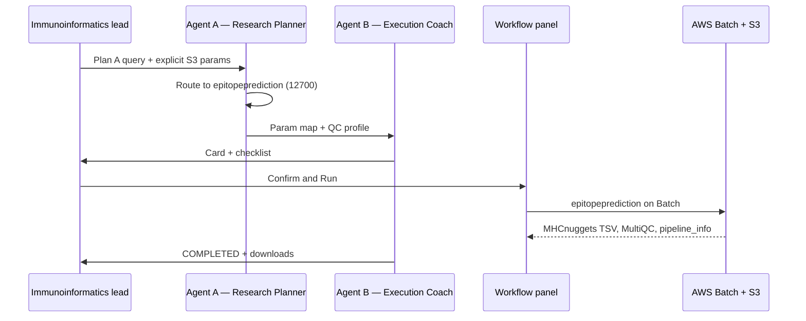

# Two agents, one samplesheet: Plan A epitope prediction without routing to the wrong nf-core pipeline

*Agentic Biology — how BioMate separates **immunoinformatics planning** from **Batch execution** for class I epitope binding, and why “NOT mhcquant” belongs in the search layer—not only in the prompt.*

---

Vaccine and immunogen design teams do not wake up asking for “an nf-core workflow.” They ask for **allele-resolved binding scores** on a defined antigen segment, with a tool choice (MHCnuggets, MHCflurry, NetMHCpan), a samplesheet that points at FASTA on S3, and a reproducible `run_id` they can cite in a supplement.

BioMate’s **Plan A** track for **Andes virus (ANDV)** encodes that intent through the same **two-agent** pattern we use on the inhibitor program—**Agent A** plans and parameterizes; **Agent B** coaches execution—applied to **`nf-core/epitopeprediction`** (Galaxy registry id **12700**), not **`mhcquant`**.

This post explains why that routing distinction matters, what each agent does, and what we validated in silico (with explicit non-claims).

## Agent A — Research Planner (immunoinformatics)

When a user pastes a Plan A-style query—explicit `input = s3://…/samplesheet.csv`, `tools = mhcnuggets`, `genome_reference = grch37`, peptide length bounds, HLA alleles in the sheet—Agent A must:

| Output | Content |
|--------|---------|
| Intent | Plan A / vaccine / class I epitope binding |
| Workflow match | `nf-core/epitopeprediction` (not LC-MS immunopeptidomics) |
| Param extraction | S3 samplesheet, `outdir`, tool list, reference genome |
| Compute hint | `profile: docker`, executor **awsbatch** when cloud staging is on |
| Risk notes | Samplesheet `filename` column must be absolute `s3://` paths; nf-core has no generic `aws` profile alias |

Agent A prepares the workflow card and prefill map. It does **not** launch Batch.

**Routing pitfall we fixed:** Queries that mention “nf-core” and “MHC” used to anchor FTS on weak tokens and surface **`mhcquant`**—a **mass-spec immunopeptidomics** pipeline—for **computational epitope prediction** queries. The fix lives in unified workflow search: explicit pipeline slugs (`epitopeprediction`), negation (`NOT mhcquant`), epitope vs MS signal terms, and skipping redundant LLM routing verification when the user names the slug that already won search.

## Agent B — Execution Coach

Agent B’s job is operational clarity:

- Render **`nf-core/epitopeprediction`** in the workflow panel with **Confirm & Run**.
- Validate prereqs: samplesheet reachable, required params non-empty.
- On Run: `POST /api/workflows/execute` → poll to **COMPLETED** or **FAILED**.
- Surface MultiQC, MHCnuggets TSV paths, and download controls—without claiming **in vivo immunogenicity** or vaccine efficacy.

## What “done” means for Plan A (in silico only)

We treat these as **demonstrated**:

- **CLI/Batch:** `run_plan_a_epitopeprediction_batch.py` — terminal success for run `a44876b7-…`, mirrored outputs under `runs/plan_a_epitope_a44876b7_s3_mirror/` (~810 peptide–allele rows, MHCnuggets).
- **UI E2E (Playwright PA-1 … PA-5):** Chat cites epitope / epitopeprediction; workflow card appears; execute reaches terminal state; completion UX when the run succeeds.
- **API:** `generate_workflow` returns `nfcore/epitopeprediction/main.nf` in ~10s when LLM fallback config resolves `GEMINI_API_KEY` / Anthropic correctly.

We do **not** claim animal immunogenicity, neutralization, or population coverage until checklist items in `PLAN_A_VACCINE_INSILICO_PUBLICATION_CHECKLIST.md` are authored (allele expansion tables, MSA/consensus immunogen, optional structure hypotheses).

## Engineering details readers actually need

1. **Samplesheet on S3:** Each row’s `filename` must be a full `s3://` URI to FASTA—not a bare filename the executor cannot resolve.
2. **Profile:** Use **`docker`** with Batch executor; do not assume an `aws` Nextflow profile on this pipeline.
3. **Worktree:** Vendored `backend/nf-core-workflows/epitopeprediction` must include `conf/` (`ensure_nfcore_epitopeprediction_worktree.sh` if sparse-checkout stripped it).
4. **Polling:** If the client hits HTTP 500 mid-poll, resume with `--poll-run-id`—do not re-POST and orphan a healthy Batch job.

## Honest UI gaps we are still closing

- Advanced-settings accordions can hide `#input` / `#tools` fields; E2E helpers now expand nested parameter groups.
- A UI execute can still **fail on Batch** while routing is correct—root-cause is execution/parameters, not search. Treat green routing + red run as separate tickets.

## Who this is for

- **Vaccine / immunoinformatics leads** standardizing MHC binding panels before wet-lab expansion.
- **Bioinformatics platform owners** separating **FTS routing** from **LLM workflow generation** latency and fallback chains.
- **Reviewers** who should demand `run_id`, samplesheet URI, and tool list in any computational supplement.

## Try it

Run your own samplesheet on Batch through the same orchestration layer:

👉 **https://biomate.ai**

Pair with the inhibitor-track post for the full “one structure, two discovery forks” story.

## Tags

`vaccine-informatics`, `epitope-prediction`, `nf-core`, `mhcnuggets`, `andv`, `hantavirus`, `aws-batch`, `agentic-ai`, `nextflow`

## Related paths (internal)

- UI scenario: `research/anti-virus/docs/BIOMATE_UI_SCENARIO_PLAN_A_EPITOPE.md`
- Publication checklist: `research/anti-virus/docs/PLAN_A_VACCINE_INSILICO_PUBLICATION_CHECKLIST.md`
- CLI: `research/anti-virus/scripts/run_plan_a_epitopeprediction_batch.py`
- Campaign blog draft: `research/anti-virus/docs/BLOG_DRAFT_ANDV_CAMPAIGN.md`
