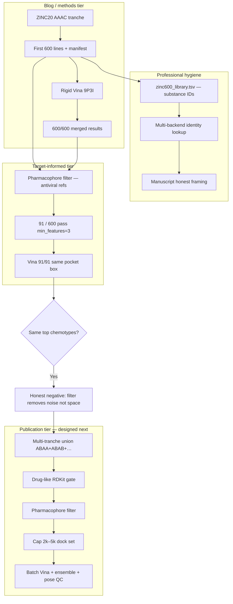
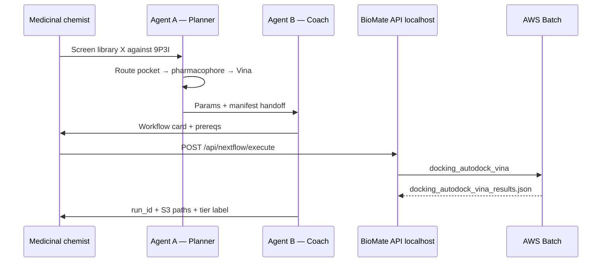

# Six hundred compounds is a blog, not a paper: the professional path from ZINC slice to target-informed HTS

*Agentic Biology — how we turned an ANDV virtual screen into an auditable workflow story, why the first 600 compounds stay in the blog tier, and what publication-scale library design actually looks like.*

---

A platform demo and a medicinal chemistry claim are not the same artifact. We learned that on the **Andes virus (ANDV) glycoprotein** inhibitor track (PDB **9P3I**): you can dock **600** purchasable compounds on **AWS Batch**, archive every `run_id`, and still not have a defensible **hit discovery** story—unless you are precise about *what those 600 were* and *what they were for*.

This post is that precision. It walks the **complete professional path** we implemented after the initial screen: provenance, identity recovery, pharmacophore filtering, docking, ensemble sensitivity, and honest negatives. It also draws a bright line: **600 = blog / methods tier**; **2,000–5,000 target-informed compounds = publication tier**.

---

## What the 600 actually were (not ad hoc, not ground truth)

The 600 are the **first 600 SMILES** from one ZINC20 2D tranche file:

`https://files.docking.org/2D/AA/AAAC.smi` (~1,013 lines total)

| Myth | Fact |
|------|------|
| “Hand-picked leads” | **No** — deterministic file order |
| “ANDV-informed library” | **No** — no pocket pharmacophore before the first dock |
| “Representative ZINC20 sample” | **No** — one **AA** cell (small MW, polar) |
| “Why 600?” | Campaign **≥500** methods gate + Vina batch economics (~50 compounds/job) |

Physicochemical profile of the deck (RDKit on all 600):

| Property | Median |
|----------|--------|
| MW | 163 Da |
| logP | −1.57 |
| TPSA | 85 Ų |

That chemistry explains the top Vina hits: **small, polar, guanidine-/nucleobase-like** scaffolds—not a surprise, not a validated lead series.

**Blog-worthy:** reproducible funnel at scale, manifest JSON, purchasable IDs restored.  
**Paper-worthy as primary HTS:** **no** — reviewers will ask about tranche choice and chemical space.

---

## The professional path (complete workflow)

We treat “professional” as **chain-of-custody + target-informed filtering + explicit tiering**, not better adjectives.

### Stage 1 — Provenance and IDs (fix the silent failure mode)

Early library copy dropped **ZINC substance IDs** (SMILES-only `.smi`). Professional minimum:

- `zinc600_library.tsv` — `zinc_substance_id` + `smiles`
- `zinc600_library.manifest.json` — tranche URL, selection method, `target_informed: false`
- `ZINC600_LIBRARY_PROVENANCE.md` — what we may and may not claim

Example: **INH-01** (`N=C(N)NC(=O)c1nccnc1N`) → substance ID **33753639**, PubChem **3036436**.

### Stage 2 — Full rigid screen (methods proof)

- **600/600** AutoDock Vina on 9P3I (top-pocket box)
- Best rigid score **−6.527 kcal/mol** (Z600-R1)
- Compute lead **INH-01** at **−6.267** with GROMACS pose QC (**0.26 nm** ligand RMSD)

Scores rank compounds; **QC + narrative discipline** pick the lead.

### Stage 3 — Pharmacophore filter (first target-informed step)

Reference actives: ribavirin, favipiravir, umifenovir, oseltamivir.  
RDKit SMARTS consensus, **min_features = 3** (same rule as BioMate `pharmacophore_filtering`).

| Metric | Value |
|--------|-------|
| Screened | 600 |
| Passed | **91** (15.2%) |
| Vina docked | **91/91** |
| Top hit | Still **−6.527** (same SMILES as raw #1) |
| INH-01 | Rank **3/91**, **−6.208** kcal/mol |

**Interpretation:** pharmacophore on a polar tranche **filters noise**; it does **not** open new chemical space. That pushed us to publication-scale design.

### Stage 4 — Ensemble sensitivity (honest physics check)

Six receptor conformers (deposited Guo structures + pocket trim), top-5 ZINC SMILES:

- **4/5** improved vs rigid on deposit conformers — but Δ ≤ **0.14 kcal/mol**
- **INH-01 unchanged** at −6.267 on 9P3I

Ensemble is a **sensitivity analysis**, not a lead promotion event.

### Stage 5 — Two-agent BioMate workflow (unchanged from Post 10)

**Agent A** never blurs blog-tier pilots with publication HTS. **Agent B** surfaces manifests, not checkmarks.

---

## Blog vs publication: tiering table

| Dimension | Blog (600 AAAC) | Publication (target design) |
|-----------|-------------------|-----------------------------|
| **Purpose** | Prove BioMate funnel + provenance | Virtual HTS with defensible library |
| **Library** | 1 tranche, first N lines | **Multi-tranche union** (~40k raw) |
| **Pre-filter** | Optional (we added pharm post hoc) | **Pharmacophore + drug-like gate** before dock |
| **Dock count** | 600 | **2,000–5,000** |
| **Controls** | Not in deck | Reference actives + INH-01 always included |
| **Claim** | “Documented methods-scale screen” | “Target-informed purchasable HTS on 9P3I” |
| **Where it lives** | This post + marketing | Manuscript + supplement |

Full design survey: `research/anti-virus/docs/PUBLICATION_ZINC_LIBRARY_DESIGN.md`

---

## Publication library design (survey conclusion)

We surveyed ZINC20 tranche sizes on `files.docking.org`:

| Tranche | ~Lines | Role |
|---------|-------:|------|
| AAAC (current) | 1,013 | Blog slice — too narrow |
| ABAA / ABAB | ~16,700 each | Drug-like band candidates |
| BBAA | 5,084 | Mid polarity |
| BCAC | 1,626 | Additive diversity |

**Recommended v1 raw pool:** ABAA + ABAB + ABAC + BBAA + BCAC ≈ **42k** lines (deduped).  
**Pharmacophore pass (est. 10%):** ≈ **4,200** → dock cap **5,000**.  
**Batch economics:** 50 SMILES/job → ~100 jobs — same pattern as ZINC600, larger wall clock.

That design **does** make sense for publication. The 600 design **does not**—and we will not pretend otherwise in the manuscript.

---

## What we say publicly

**Say:** “We ran a **600-compound methods pilot** on a documented ZINC20 AAAC subset to validate the BioMate inhibitor funnel; publication HTS uses a **multi-tranche, pharmacophore-filtered** deck.”

**Do not say:** “ZINC20 representative screen,” “ANDV-guided library,” or “computational lead” without pose QC and experimental context.

---

## Try the workflow on your target

The orchestration layer—provenance manifests, pharmacophore filter, Batch Vina, manifest audit—is what BioMate ships:

👉 **https://biomate.ai/try**

---

## Series context

- **Post 10:** Two-agent four-step inhibitor stack + chain-of-custody audit  
- **Post 11:** Plan A epitopeprediction routing  
- **Post 12 (this):** Why 600 is blog tier + professional path to publication HTS  

## Tags

`drug-discovery`, `andv`, `zinc20`, `virtual-screening`, `pharmacophore`, `reproducibility`, `agentic-ai`, `aws-batch`, `honest-science`

## Related paths (internal)

- Provenance: `research/anti-virus/runs/publication_20260528T223525Z/zinc600_screen/ZINC600_LIBRARY_PROVENANCE.md`
- Pharmacophore pilot: `research/anti-virus/runs/publication_20260528T223525Z/zinc600_pharmacophore/`
- Publication design: `research/anti-virus/docs/PUBLICATION_ZINC_LIBRARY_DESIGN.md`
