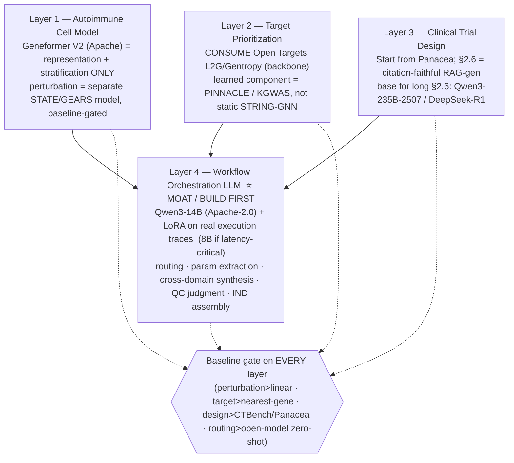

# BioMate LLM-Training Roadmap v2 (Re-Based, 2026)

**Date:** 2026-07-18 · **Supersedes:** Part 4 of `20260701_BIOMATE_AUTOIMMUNE_STRATEGY_AND_LLM_TRAINING.md`
**Basis:** `20260718_LLM_TRAINING_DEEP_SURVEY.md` (four cited adversarial surveys)

> What changed vs v1: base model re-based off the stale Llama 3.1 70B; three of four layers re-scoped to adopt existing SOTA backbones instead of rebuilding behind them; a mandatory baseline-gate added to every layer; sequencing reordered to start with the one defensible moat (Layer 4 trace flywheel), which already has in-house training data.

---

## 1. Revised architecture



## 2. Per-layer re-based plan

| Layer | v1 (stale) | v2 (re-based) | Why (survey) |
|---|---|---|---|
| **L4 Orchestration** | Fine-tune Llama 3.1 70B | **Qwen3-14B + LoRA** on execution-trace corpus (8B drop-down; **GLM-4-9B-0414 (MIT)** A/B hedge) | 7–14B target (32B too slow to serve/train); Qwen3 = only small family with verified tool-use + Apache + best QLoRA ergonomics; trace flywheel is the moat |
| **L3 Trial design** | Fine-tune Llama 3.1 70B end-to-end | **Start from Panacea**; rescope to citation-faithful **§2.6** on **Qwen3-14B (thinking mode)** — same small model, 128K ctx (DeepSeek-R1-Distill-Qwen-14B optional reasoning specialist); **cut biomarker task** | Panacea already does design; biomarkers ≠ LLM task; §2.6 is the novel piece; one 14B model covers routing + §2.6 |
| **L2 Target-ID** | STRING v12 GNN + transformer | **Consume L2G/Gentropy**; if DL, **PINNACLE/KGWAS**; demote eQTL to a feature | GNN behind GBM SOTA; eQTL-alone doesn't predict approval |
| **L1 Cell model** | Geneformer v2 fine-tune (perturbation + stratification) | **Geneformer V2 for stratification only**; **separate STATE/GEARS perturbation model** on CD4⁺ T Perturb-seq | Geneformer fails vs linear baselines on perturbation |

## 3. Baseline-gate checklist (non-negotiable — ship only if passed)

- [ ] **L1 perturbation** > additive / mean / ridge-linear baseline (Ahlmann-Eltze *Nat Methods* 2025)
- [ ] **L1 stratification** > logistic-regression-on-HVG baseline on held-out RA/SLE cohorts (target AUC ≥ 0.75)
- [ ] **L2 target-ID** > nearest-gene AND ≥ L2G on **drug-approval** labels (not GWAS recovery)
- [ ] **L3 design** ≥ Panacea / frontier-zero-shot on **CTBench + TrialPanorama**
- [ ] **L3 §2.6** — build a **citation-faithfulness eval first** (none exists publicly); report factuality, not ROUGE alone
- [ ] **L4 routing** > best open-model **zero-shot** on held-out intents, especially the **long tail** (rare modalities, cross-domain chains) — not RNA-seq/variant-calling (being commoditized)
- [ ] **L4 param extraction** F1 > rule-only and > frontier-zero-shot baselines

## 4. Re-based timeline

```
Month 0–1  Data infrastructure
  ├── Build Layer-4 trace corpus (see 20260718_LAYER4_TRACE_CORPUS_BUILD_SPEC.md)
  │     seed from the 2026-07 validation traces (already executed) + session audit logs
  ├── Stand up Qwen3-14B LoRA fine-tuning env (single 24GB GPU; Unsloth/Axolotl)
  ├── Pull CELLxGENE immune + AMP RA/SLE + SLECA (L1); CD4⁺ T Perturb-seq (perturbation)
  └── Wire L2 to Open Targets L2G/Gentropy API (no training needed to start)

Month 1–3  Layer 4 v0 (⭐ moat, highest ROI first)
  ├── SFT Qwen3-14B on trace corpus (routing + param + synthesis + QC + IND-assembly)
  ├── GATE: routing > open-model zero-shot on long-tail held-out intents
  └── Deploy behind existing router; start DPO from accepted-vs-modified session outputs

Month 2–4  Layer 1 stratification (parallel)
  ├── Fine-tune Geneformer V2 for RA/SLE responder stratification
  ├── GATE: AUC ≥ 0.75 vs logistic-regression baseline
  └── Separate track: STATE/GEARS perturbation model, baseline-gated (research-tier)

Month 3–5  Layer 2 (consume, then augment)
  ├── Ship L2G-score-consuming target ranker; validate on approval labels
  └── Optional: add PINNACLE context embeddings if it beats L2G-only

Month 4–6  Layer 3 §2.6 (rescoped)
  ├── Benchmark Panacea/frontier on CTBench; build §2.6 faithfulness eval
  └── Citation-grounded §2.6 generation (Qwen3-235B-2507 / DeepSeek-R1)

Month 6+   Integration + flywheel
  └── Unify layers; DPO on accumulating real user traces; long-tail robustness focus
```

## 5. Compute & license notes

- **Qwen3-14B dense** QLoRAs on a **single 24GB GPU** (even 16GB) — far cheaper/faster than 32B or the v1 Llama-70B plan; **Qwen3-8B** for the tightest latency. Avoid 32B+ (serving latency) and MoE (bf16 LoRA, no clean 4-bit) at this stage.
- **Small-model caveat (honest):** off-the-shelf there is a ~30-point BFCL tool-use gap between 8B (~47%) and the 32B tier (~76%). That gap is precisely what the in-domain fine-tune closes — a router trained on *BioMate's own tool schemas* doesn't need general BFCL breadth. Validate on our own eval harness (no public BFCL row exists for Qwen3-14B / GLM-4-9B-0414).
- **Kimi excluded** (no dense 7–14B open model); **DeepSeek R1-Distill** kept only as an optional *reasoning* specialist (it's Qwen2.5 underneath, reasoning-tuned not tool-tuned).
- **Licenses:** Qwen3 (Apache-2.0), DeepSeek (MIT), GLM (MIT) — clean for a commercial product; **avoid Llama Community** (700M-MAU + no-competitor-training clauses) and **Arc STATE** weights (non-commercial) for anything shipped.
- **Do not** build orchestration on a bio-specialized base (documented tool-use collapse 89%→~0% after domain SFT). Use LoRA to limit forgetting.

## 6. Moat positioning (external language)

Lead with the **execution-trace flywheel** and the **end-to-end omics→ADMET→PBPK→IND integration**, not "no one does capability X" (3 of 5 such claims are already eroded/contradicted — BioMaster, NEXUS, BioWorkflow, AutoIND). Flag "2,455 workflows" and "IND-ready" as needing qualification externally.
