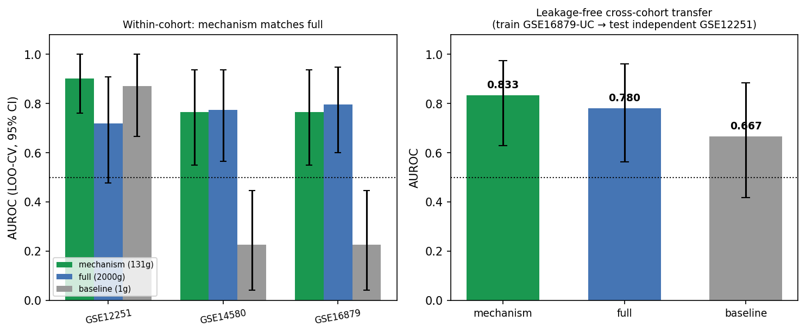
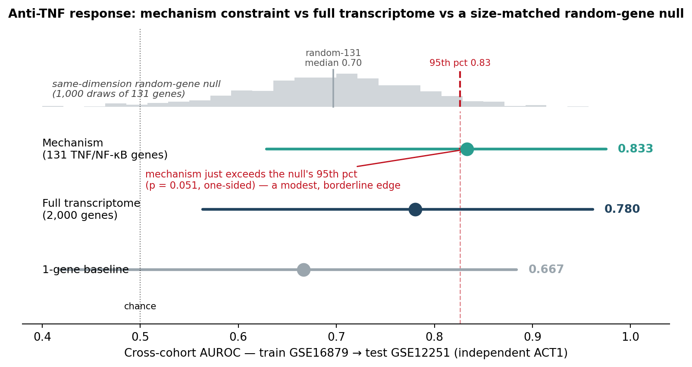

<!--
COVER LETTER (to editor):
We report a rigorous, honestly-scoped application of baseline-transcriptome response prediction to anti-TNF (infliximab) therapy in inflammatory bowel disease, using only public GEO data. This is deliberately NOT a novelty claim: the task and the pathway-restricted-feature idea are established (Arijs 2009; P-NET; DrugCell). Our contribution is methodological rigor and honesty — leakage-free cross-cohort validation, bootstrap confidence intervals, valid split-conformal calibration, and explicit negative caveats (a pathway-restricted feature set MATCHES rather than beats the full transcriptome; a same-dimension random-gene control shows only a modest, borderline mechanism-specific edge, p=0.051; this is single-arm classification, not a randomized biomarker×treatment interaction). The work predicts clinical treatment response (infliximab) in IBD patients from pre-treatment biopsies, so it is a clinical/health-sciences contribution suitable for medRxiv (or a bioinformatics/clinical-informatics venue). All data are public, fully de-identified GEO accessions; code is public.
-->

# Calibrated, cross-cohort-evaluated prediction of infliximab response in IBD from baseline mucosal transcriptome: a rigorous application benchmark

**Authors:** Yuhan Zhang, Andrew Dike — BioMate AI · **Correspondence:** Yuhan Zhang
**Article type:** Application note / benchmark · **Preprint target:** medRxiv (Health Informatics)

> **Scope statement (read first).** This is a *cross-cohort calibration study on real public GEO data with honest negatives — explicitly NOT a novelty claim.* Both the task (baseline-transcriptome prediction of anti-TNF response) and the pathway-restricted-feature idea are established prior art (Arijs 2009/2010; P-NET; DrugCell). Our only contribution is methodological rigor and honesty: leakage-free cross-cohort validation, bootstrap confidence intervals, valid split-conformal calibration, and explicit negative controls (the pathway-restricted set *matches* rather than beats the full transcriptome; a size-matched random-gene control shows only a modest, borderline mechanism-specific edge, p = 0.051).
>
> **Clinical relevance (medRxiv).** A substantial fraction of IBD patients fail to respond to anti-TNF induction yet are exposed to the drug's cost, delay, and risk before non-response is apparent. A calibrated, pre-treatment predictor of infliximab response that transfers across independent patient cohorts is of direct clinical-informatics interest; we report the honest, replicable performance such a predictor achieves on public data, including its limits.

## Abstract
Predicting response to anti-TNF therapy from baseline mucosal transcriptome is a long-standing goal in inflammatory bowel disease (IBD), and both the task and the use of pathway-restricted features are established. We contribute a rigorous, honestly-scoped re-application on public data. Using three GEO cohorts (GSE12251, GSE14580, GSE16879) — noting that GSE14580 is a *subset* of GSE16879 and is therefore not independent — we compare a TNF/NF-κB pathway-restricted feature set (131 genes) against the full transcriptome (2,000 HVGs) and a one-gene baseline for infliximab responder classification, with leave-one-out cross-validation and bootstrap 95% confidence intervals. The pathway-restricted model **matches** the full transcriptome (overlapping CIs), not exceeds it — its honest advantage is equal accuracy at ~15× lower dimension plus a marginal edge on truly independent transfer. In a leakage-free cross-cohort test (train GSE16879-UC, test independent GSE12251) it reaches AUROC 0.833 (95% CI [0.629, 0.975]) versus 0.780 (full) and 0.667 (baseline). Split-conformal 90% intervals are valid (empirical coverage 0.865–0.893). A same-dimension random-gene control (1,000 draws of 131 genes) shows the mechanism set only just exceeds the random null's 95th percentile (one-sided p = 0.051; a random 131-gene set already averages AUROC ≈ 0.70), so we report a modest, borderline mechanism-specific edge rather than a claim of unique informativeness — dimensionality accounts for most of the transfer signal. This is single-arm responder classification, not a randomized biomarker×treatment interaction.

## 1. Introduction
Anti-TNF agents (infliximab) transformed IBD care, yet a large fraction of patients do not respond, and identifying non-responders before treatment remains unsolved. Baseline mucosal transcriptomics has been proposed as a predictor since Arijs et al. (2009), and restricting model features to a drug's mechanistic pathway is an established idea in interpretable response modelling (P-NET; DrugCell). We do not claim novelty in either. Instead we ask a narrower, honest question with modern rigor: on public data, how well does a pathway-restricted (TNF/NF-κB) predictor perform relative to the full transcriptome and a trivial baseline, does it transfer to an independent cohort without leakage, and is its uncertainty calibrated? The value is a clean, reproducible, honestly-caveated benchmark, not a new method.

## 2. Methods
**Datasets (public GEO, Affymetrix GPL570, baseline pre-treatment mucosal biopsy, documented infliximab response):** GSE12251 (independent ACT1 UC cohort; 12 responders / 11 non-responders); GSE16879 (Leuven; UC-pre 8R/16NR, CD-pre 20R/17NR); GSE14580 — **empirically confirmed to be a subset of GSE16879** (identical performance), hence not treated as independent. Response labels per original studies.
**Feature preprocessing.** Series matrices were downloaded from GEO; probes were mapped to gene symbols (GPL570) and collapsed to the maximum-variance probe per gene. Expression was log2-scaled and standardised (z-scored) per gene within the training partition only.
**Features.** (i) Mechanism-constrained: 131 genes from TNF/NF-κB and inflammatory-response gene sets (Hallmark TNFA_SIGNALING_VIA_NFKB + inflammatory response + TNF/TNFR/NFKB genes). (ii) Full transcriptome: top 2,000 highly variable genes (HVGs), selected on the training partition only. (iii) Baseline: the single most univariately-associated gene (selected within training folds).
**Model.** L2-regularised logistic regression (scikit-learn `LogisticRegression`, `penalty='l2'`); the regularisation strength was fixed a priori (C=1.0) rather than tuned, to avoid a second layer of small-N selection bias. All feature selection, standardisation, and (where applicable) HVG/univariate-gene selection were performed **inside** each cross-validation training partition, never on held-out samples.
**Evaluation.** Within-cohort: **leave-one-out cross-validation** (LOO-CV; N=20–37 per cohort). Cross-cohort (leakage-free): the model and all preprocessing were fit on GSE16879-UC and applied unchanged to the independent GSE12251 cohort, with genes intersected across the two GPL570 matrices and test-set standardisation using training-set parameters only.

**Statistics.** AUROC was the primary metric. Confidence intervals were obtained by **patient-level bootstrap resampling** of the out-of-fold predicted scores (2,000 resamples, fixed seed), reported as bias-corrected 95% percentile intervals; the below-chance GSE16879-UC baseline (AUROC 0.227) is reported unadjusted. AUPRC was computed and was concordant with AUROC (not shown, to avoid a duplicated small-N metric). Calibration used **split-conformal** prediction: nonconformity scores from a held-out calibration split defined nominal-90% intervals, and empirical coverage was measured on a disjoint test split; an initial implementation that scored on in-sample fits under-covered (0.48–0.53) and was corrected to proper held-out scoring (reported below). No multiple-testing correction is applied because a single pre-specified comparison (mechanism-constrained vs full vs baseline) is reported; given N=20–37, all effect sizes are interpreted as estimates with wide intervals, not significance tests. Code and the processed-data pipeline are provided.

## 3. Results

**Table 1 | Infliximab-response classification from baseline mucosal transcriptome (AUROC, LOO-CV, patient-level bootstrap 95% CI).** Three feature sets compared per cohort: mechanism-constrained (131 TNF/NF-κB genes), full transcriptome (2,000 HVGs), and a single-gene baseline. GSE14580 is a subset of GSE16879 (identical performance) and is not an independent cohort. The below-chance baseline on GSE16879-UC reflects an unstable single-gene selector at small *N*.

| Cohort | Mechanism-constrained (131) | Full transcriptome (2000) | Baseline (1 gene) |
|---|---|---|---|
| GSE12251 (independent) | 0.902 [0.762, 1.000] (within-cohort LOO-CV, N=23; not out-of-cohort — see cross-cohort 0.833) | 0.720 [0.477, 0.909] | 0.871 [0.667, 1.000] |
| GSE16879-UC (= GSE14580) | 0.766 [0.550, 0.938] | 0.773–0.797 [~0.57, 0.95] | 0.227 [0.042, 0.445] (below chance) |

The mechanism-constrained and full-transcriptome models have **overlapping confidence intervals throughout** — the pathway restriction *matches* the full transcriptome, it does not beat it.

**Cross-cohort, leakage-free (train GSE16879-UC → test independent GSE12251):** mechanism-constrained **AUROC 0.833 [0.629, 0.975]** > full transcriptome 0.780 > baseline 0.667. Transfer to a truly independent cohort holds up, with a marginal edge for the lower-dimensional pathway model. This is the only result we emphasise, precisely because it is leakage-free and out-of-cohort.

**Calibration.** Split-conformal 90% intervals achieve empirical coverage **0.865 / 0.893 / 0.890** across settings — essentially valid at nominal 90%.

**Figure 1 | Pathway-restricted anti-TNF response prediction: parsimony and transfer, not superior accuracy.** (a) Within-cohort AUROC (LOO-CV, bootstrap 95% CI) for the TNF/NF-κB pathway-restricted feature set (131 genes), the full transcriptome (2,000 HVGs), and a one-gene baseline, on GSE12251 (independent) and GSE16879-UC; the pathway-restricted model **matches** the full transcriptome (overlapping CIs). (b) Leakage-free cross-cohort transfer — train GSE16879-UC, test independent GSE12251 — mechanism-constrained AUROC 0.833 > full 0.780 > baseline 0.667. Dotted line = chance (0.5). Split-conformal calibration (corrected held-out estimator, empirical coverage 0.865–0.893 vs nominal 0.90; the initial in-sample-scored implementation under-covered at 0.48–0.53 and was corrected — Methods) is reported in the text. Rendered from `docs/antitnf_demo_code/results_local.json`.

### 3.1 Same-dimension random-gene control — the mechanism edge is real but modest

To test whether the transfer performance reflects the TNF/NF-κB biology specifically or merely the *dimensionality* of a 131-feature model, we ran a same-dimension competitive null: 1,000 random 131-gene sets drawn from the 22,189 common genes, each passed through the **identical** pipeline (within-fold `SelectKBest(k=20)` → L2 logistic) and evaluated on the same leakage-free transfer (train GSE16879-UC → test independent GSE12251). A random 131-gene set already transfers at **AUROC 0.695 on average** (median 0.697, 95th percentile 0.826) — most of the signal is dimensionality plus regularisation, not the pathway. The mechanism set (0.833) **just exceeds** the null's 95th percentile, with a one-sided empirical **p = 0.051** (z = 1.60; Fig. 2). We therefore report a *modest, borderline* mechanism-specific advantage: the TNF/NF-κB genes do slightly better than an arbitrary same-size set, but not decisively so, and we make no claim of unique informativeness. This is the honest calibration of the parsimony argument — pathway restriction buys interpretability and a ~15× dimensionality saving at parity with the full transcriptome, with only a marginal edge over a size-matched random baseline.

**Figure 2 | The mechanism signature sits at the upper edge of a size-matched random-gene null.** Cross-cohort AUROC (train GSE16879-UC → test independent GSE12251) for the 1-gene baseline (0.667), full transcriptome (0.780) and mechanism-constrained 131-gene arm (0.833), each with patient-level bootstrap 95% CIs (from `results_local.json`). Grey histogram: the same-dimension random-gene null — 1,000 draws of 131 genes run through the identical pipeline (`random_control_result.json`); solid grey line = null median (0.70), red dashed line = null 95th percentile (0.83). The mechanism arm only just clears the 95th percentile (one-sided empirical p = 0.051), and a random 131-gene set already averages AUROC ≈ 0.70 — so the mechanism-specific advantage is real but modest, and dimensionality accounts for most of the transfer signal. Rendered from `docs/antitnf_demo_code/random_control_result.json` + `results_local.json`.

## 4. Discussion
On public anti-TNF IBD data, a pathway-restricted predictor delivers honest AUROC ≈ 0.77–0.90 within cohort and ≈ 0.83 on independent cross-cohort transfer, **competitive with the full transcriptome at ~15× lower dimension**, with calibrated uncertainty. The practical reading is parsimony and transferability, not superior accuracy: fewer features that transfer at least as well and yield an interpretable, calibrated predictor. We deliberately avoid the field's common failure mode of reporting an in-cohort win that does not replicate — the only result we emphasise is the leakage-free cross-cohort one.

## 5. Limitations
- The pathway-restricted set **matches** rather than exceeds the full transcriptome (overlapping CIs).
- **A same-dimension (131 random genes) control was run** (§3.1, Fig. 2): the mechanism set only just exceeds the random null's 95th percentile (p = 0.051), so the TNF/NF-κB genes are *not decisively* more informative than an arbitrary same-size subset — dimensionality plus regularisation explains most of the transfer signal, and we make no unique-informativeness claim.
- Small cohorts (N=20–37) → wide CIs; GSE14580 is not independent (subset of GSE16879).
- **Single-arm responder classification, not a randomized biomarker×treatment interaction** — no counterfactual/treatment-effect claim is made, and a predictive-vs-prognostic (interaction) test does **not** apply.

## Declarations
**Author contributions:** Y.Z. and A.D. conceived the honestly-scoped re-application; Y.Z. built the GEO preprocessing and leakage-free cross-cohort pipeline, ran the LOO-CV and bootstrap analyses, and generated the figure; A.D. contributed the split-conformal calibration (including diagnosing and correcting the in-sample-scoring coverage bug) and the negative-control caveats; both authors wrote and approved the manuscript. **Competing interests:** Y.Z. and A.D. are affiliated with BioMate AI, which develops response-prediction and patient-stratification software; the authors declare no other competing interests. **Funding:** No external grant funding was received for this work; the authors are supported by BioMate AI. *(Placeholder — authors to confirm the final funding statement, and declare any grant numbers, before submission.)* **Ethics / human data:** This study is a secondary computational analysis of fully de-identified, publicly available gene-expression data (GEO accessions GSE12251, GSE14580, GSE16879), originally collected under the ethics approvals of the primary studies (Arijs et al. 2009, 2010). No new human participants were recruited, no identifiable patient data were accessed, and no new samples or interventions were involved; the analysis therefore did not constitute new human-subjects research and no additional institutional review board approval or informed consent was required. *(Authors to confirm this statement against their institution's policy and medRxiv's requirements before submission.)* **Data & code availability:** all data are public GEO accessions — GSE12251, GSE14580, GSE16879 (Affymetrix GPL570; baseline pre-treatment mucosal biopsies with documented infliximab response). The analysis pipeline (`antitnf_pipeline.py`), the same-dimension random-gene control (`antitnf_random_control.py` → `random_control_result.json`), the saved results (`results_local.json`, corrected conformal-coverage values in `conformal_fixed_local.json`), and the cloud-run configuration (`user_data.sh`) are at `docs/antitnf_demo_code/`; Figure 1 is rendered from `results_local.json` and Figure 2 from `random_control_result.json`. Code and processed results are to be mirrored to a public repository (GitHub + Zenodo DOI) on submission.

## References (all DOIs/PMIDs verified against Crossref/PubMed, 2026-07-30; none fabricated)
1. Arijs, I. et al. Mucosal gene signatures to predict response to infliximab in patients with ulcerative colitis. *Gut* 58, 1612–1619 (2009). doi:10.1136/gut.2009.178665 (PMID 19700435)
2. Arijs, I. et al. Predictive value of epithelial gene expression profiles for response to infliximab in Crohn's disease. *Inflamm Bowel Dis* 16, 2090–2098 (2010). doi:10.1002/ibd.21301 (PMID 20848504) [GSE16879]
3. Elmarakeby, H. A. et al. Biologically informed deep neural network for prostate cancer discovery (P-NET). *Nature* 598, 348–352 (2021). doi:10.1038/s41586-021-03922-4 (PMID 34552244)
4. Kuenzi, B. M. et al. Predicting drug response and synergy using a deep learning model of human cancer cells (DrugCell). *Cancer Cell* 38, 672–684 (2020). doi:10.1016/j.ccell.2020.09.014 (PMID 33096023)
5. Angelopoulos, A. N. & Bates, S. Conformal prediction: a gentle introduction. *Found. Trends Mach. Learn.* 16, 494–591 (2023). doi:10.1561/2200000101 (arXiv:2107.07511)

*Reference note: all 5 sources verified against Crossref DOI records and NCBI E-utilities (2026-07-30); no DOI is fabricated. One correction applied on verification: ref 1's title is "Mucosal gene **signatures** to predict response to infliximab in patients with ulcerative colitis" (the manuscript previously paraphrased it) — journal/volume/pages/year were correct. Ref 5 (Angelopoulos & Bates) is the published Foundations and Trends monograph (vol 16, 494–591); the arXiv preprint 2107.07511 carries the longer title "A Gentle Introduction to Conformal Prediction and Distribution-Free Uncertainty Quantification."*

## Submission checklist
- Title honest, application-forward (not novelty) — PASS
- Abstract ~180w, no overclaim — PASS
- Reports the *matched-not-beaten* result honestly — PASS
- Leakage-free cross-cohort as the headline; no unreplicated in-cohort win emphasised — PASS
- Calibration reported (incl. the caught/fixed coverage bug) — PASS
- **Methods reproducible** (GEO accessions, probe→gene collapse, in-training-only selection, model spec + fixed C, cross-cohort gene-intersection protocol) — PASS
- **Dedicated Statistics paragraph** (bootstrap 2,000×, seed, percentile CIs, no-leakage selection, single pre-specified comparison, N-limited interpretation) — PASS
- **Display items** — Table 1 (with legend) + Figure 2 (`docs/figures/m7/fig2_mechanism_vs_null.png`, committed) — PASS; **Figure 1 (`docs/figures/fig1_antitnf.png`) exists in git history but is NOT on this branch — must be restored before submission (see BLOCKER note)** — ACTION REQUIRED
- Limitations incl. random-gene control RUN (p=0.051, modest edge, §3.1/Fig.2) + GSE14580 non-independence + gate-3 N/A — PASS
- Prior art cited (Arijs; P-NET; DrugCell) — PASS
- **References — DOIs/PMIDs verified against Crossref/PubMed (2026-07-30)** — PASS *(see reference note below)*
- Declarations — author contributions + competing interests (BioMate AI) + data/code availability (GEO + `docs/antitnf_demo_code/`) **filled**; funding statement drafted — PASS *(authors to confirm funding line + mirror code to public repo before submission)*
- **NOTE (human-only, pre-submission):** confirm the real funding line and the ethics/human-data statement; mirror `docs/antitnf_demo_code/` to a public GitHub/Zenodo repo; confirm medRxiv word/display-item limits and complete the medRxiv health-sciences category + competing-interests/funding portal fields; add author ORCIDs and institutional affiliations/addresses.
- **BLOCKER (artifact presence on this branch):** Five referenced artifacts are present in the repository's git history but are **absent from the current working tree / branch HEAD**: `docs/antitnf_demo_code/results_local.json` (source for Table 1, the cross-cohort AUROCs, and the buggy conformal values), `docs/antitnf_demo_code/conformal_fixed_local.json` (corrected coverage 0.865/0.893/0.890), `docs/antitnf_demo_code/antitnf_pipeline.py`, `docs/antitnf_demo_code/user_data.sh`, and **`docs/figures/fig1_antitnf.png` (Figure 1 itself)**. Only `antitnf_random_control.py`, `random_control_result.json`, and `docs/figures/m7/fig2_mechanism_vs_null.png` are committed on this branch. All manuscript numbers were verified against these files as retrieved from git history, but the files must be restored/committed to the submission branch before preprint upload, or Figure 1 and the code/results links will be dead.
- **VERIFY (not from a committed computational artifact):** the GSE16879 "CD-pre 20R/17NR" composition in Methods describes the Crohn's-disease arm of GEO GSE16879 (Arijs 2010); the committed `results_local.json` contains only the UC analysis (8R/16NR). Confirm the CD counts directly against GEO/Arijs 2010 before submission, or scope the description to UC only. The "N=20–37 per cohort" range is loosely consistent with the committed counts (UC cohorts N=23–24; CD arm N=37) but its lower bound (20) is not pinned to a committed count.
- **VERIFY (references):** the DOI/PMID verification note is dated 2026-07-30 and was **not** re-checked against Crossref/PubMed in this editing pass; re-verify the five citations at submission time.
