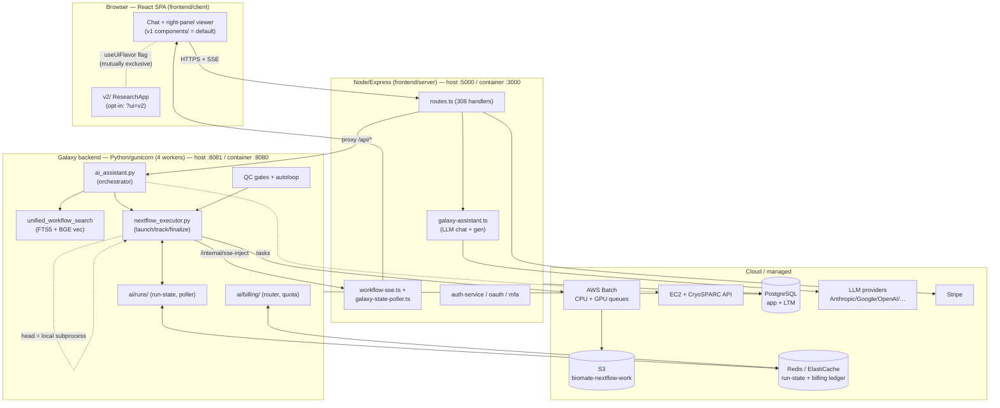
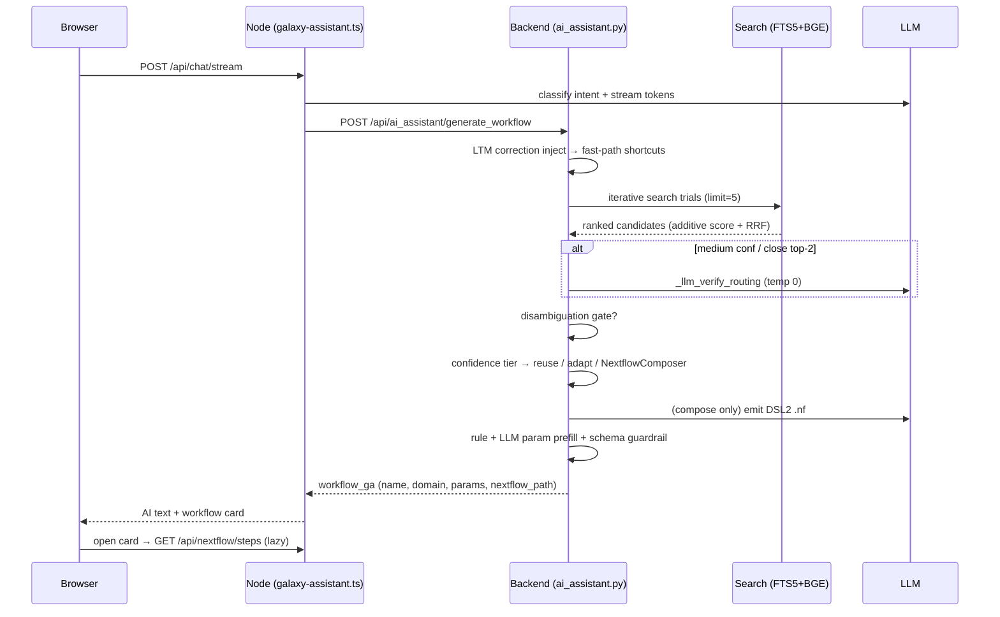
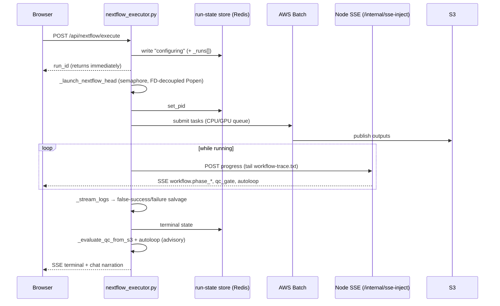
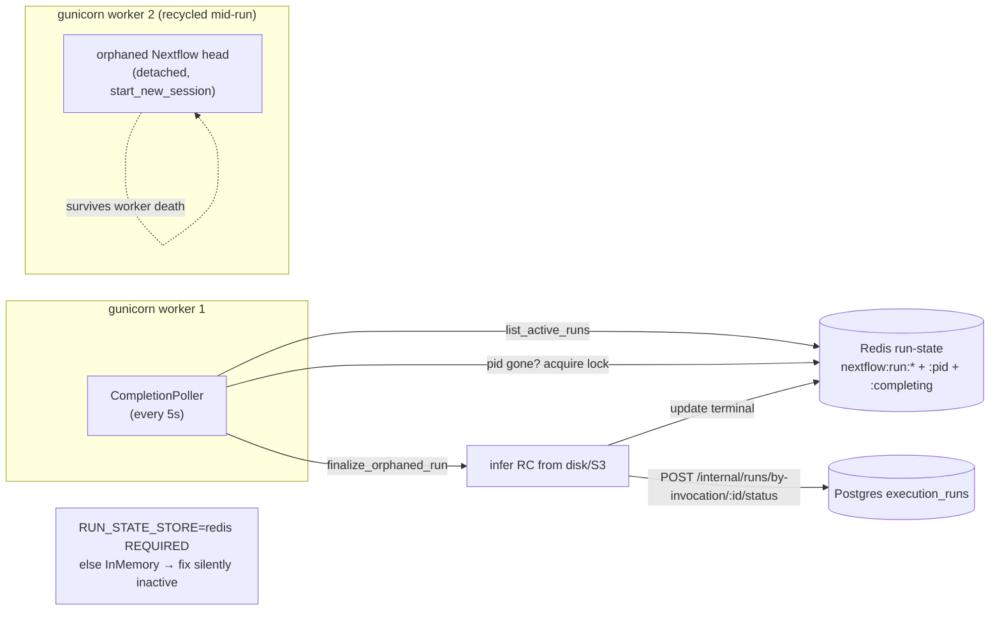
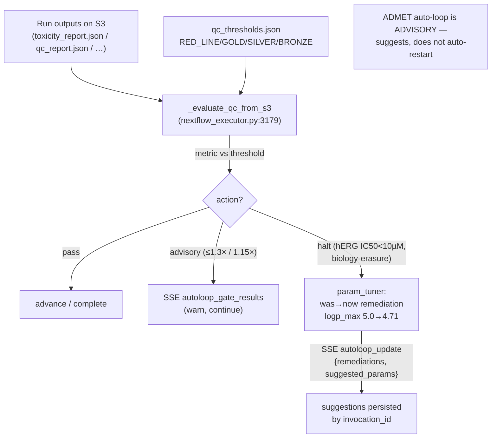
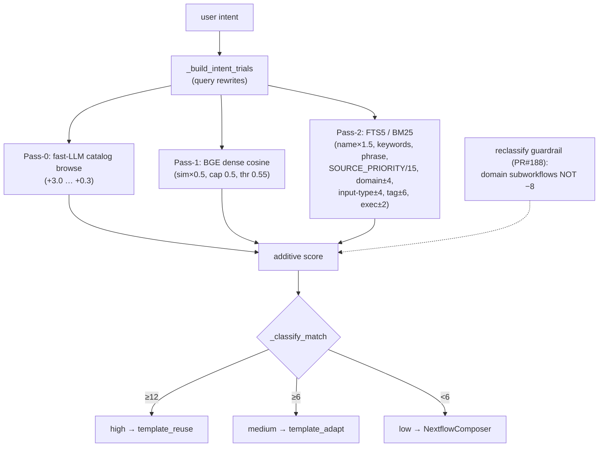
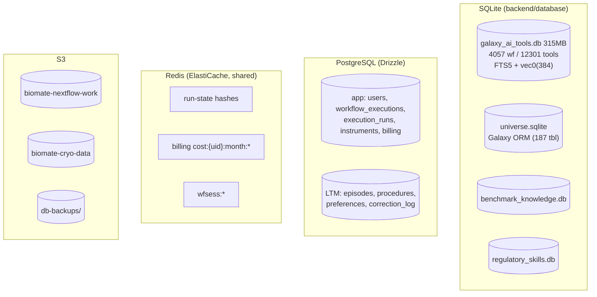
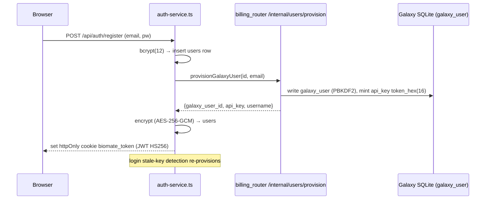
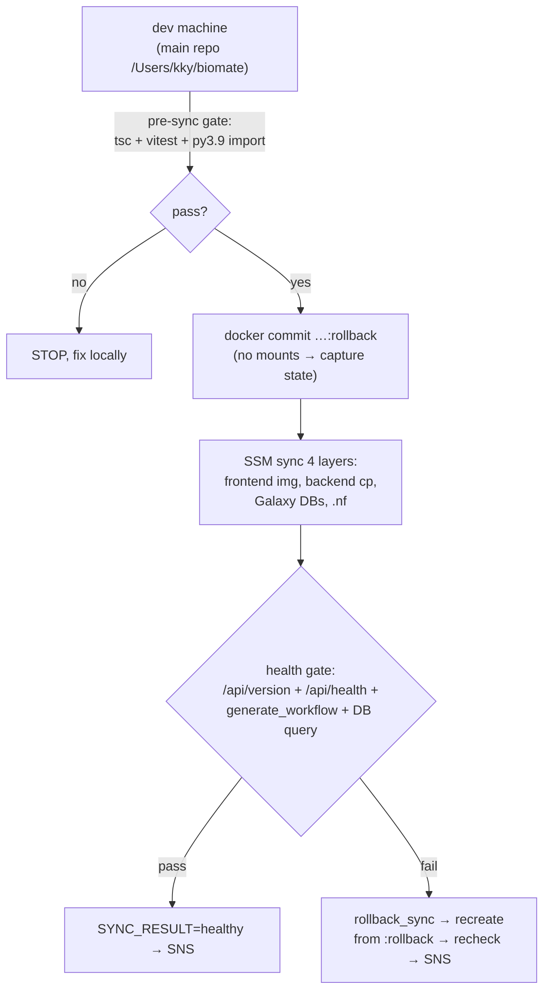
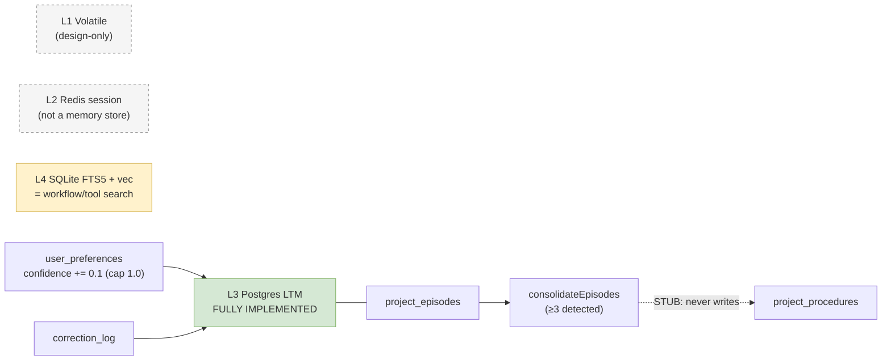

# Diagrams

Two formats:
- **Inline Mermaid** below — renders directly on GitHub / most Markdown viewers.
- **draw.io XML** in [`diagrams/`](diagrams/) — open any `*.drawio.xml` directly in [draw.io / diagrams.net](https://app.diagrams.net) (File → Open) or the VS Code Draw.io extension.

| draw.io file | Mermaid section |
|--------------|-----------------|
| `diagrams/01_overall_architecture.drawio.xml` | [1](#1-overall-system-architecture) |
| `diagrams/02_chat_to_workflow.drawio.xml` | [2](#2-chat--workflow-generation-sequence) |
| `diagrams/03_execution_runstate.drawio.xml` | [3](#3-run--execution--sse--finalize), [4](#4-run-state-persistence--orphan-completion) |
| `diagrams/04_data_stores.drawio.xml` | [7](#7-data-stores) |
| `diagrams/05_qc_autoloop.drawio.xml` | [5](#5-qc-gate--auto-loop) |

---

## 1. Overall system architecture

## 2. Chat → workflow generation (sequence)

## 3. Run → execution → SSE → finalize

## 4. Run-state persistence & orphan completion

## 5. QC gate / auto-loop

## 6. Search & routing scoring

## 7. Data stores

## 8. Auth & Galaxy provisioning

## 9. Deploy / sync (sync_to_dev.sh)

## 10. Memory hierarchy (design vs code)

