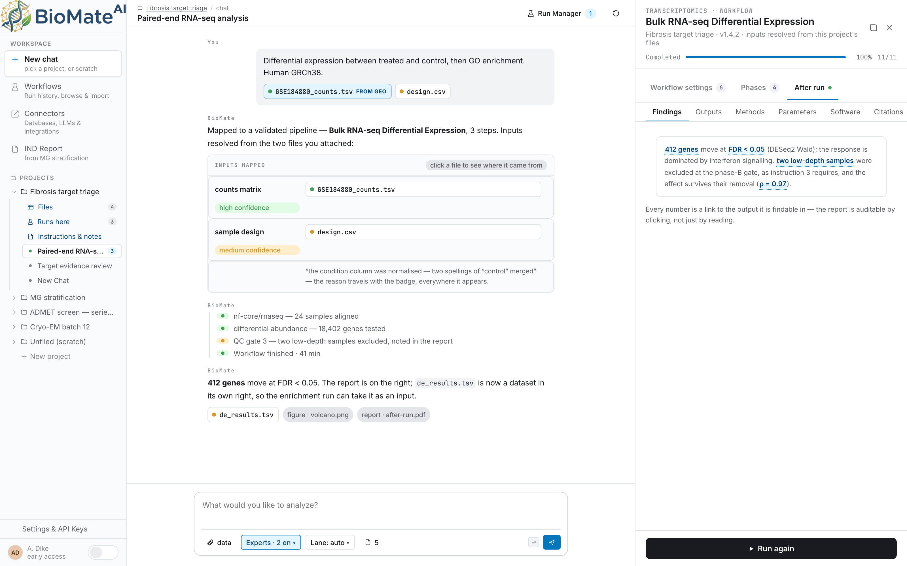
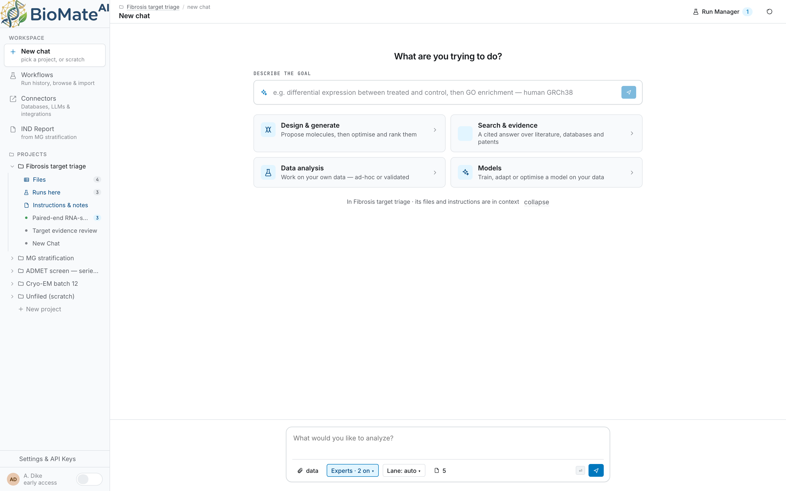
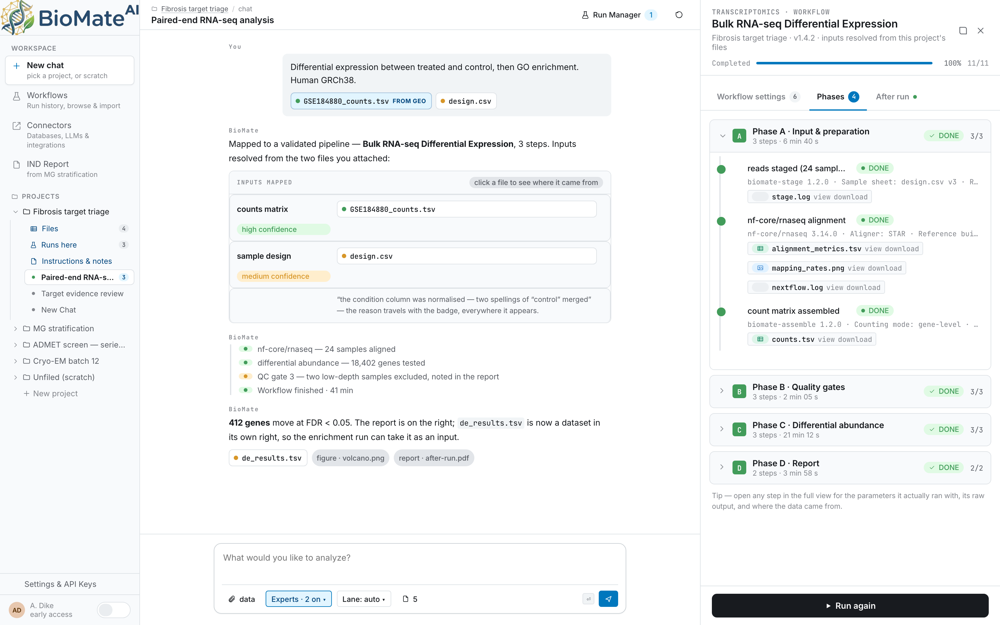
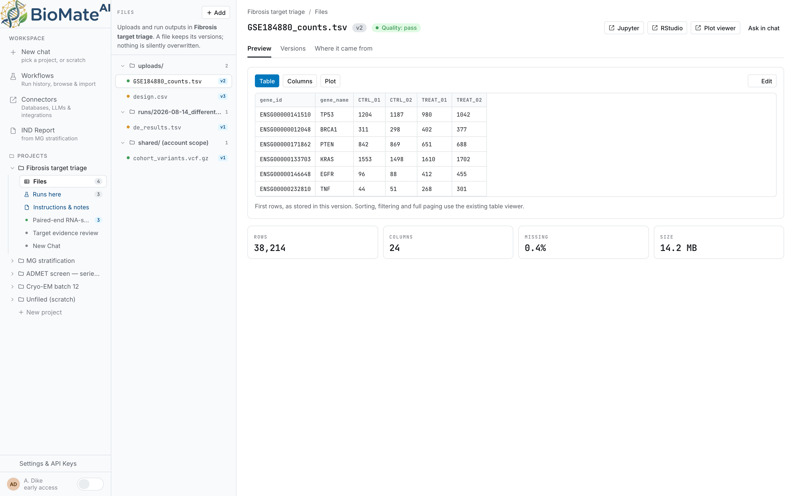

% BioMate — China Hospital & Pharma Partnership
% Partnership Proposal
% Draft for review · 2026-09-08

# An AI Platform for Biomedical R&D

- A researcher asks a goal in plain language
- BioMate assembles and runs the right analysis on secure compute
- Returns an auditable, report-grade result — fast, correct, traceable

::: notes
A senior analyst that never sleeps, shows its work, and follows the rules.
The screenshot: a plain-language "differential expression, then GO enrichment, human GRCh38" becomes a validated pipeline with a findings report — the whole value proposition in one view.
:::

# The Problem (plainly)

- Modern medicine generates huge biological data — genomes, tumor profiles, patient cohorts
- Turning data into a decision (a signal, a drug lead, a safety verdict) normally needs teams of specialists and months
- BioMate turns "ask" into a validated answer — done correctly and traceably

# What BioMate Does — Three Ideas

- **One simple front door** — ask in plain language; the platform picks and runs the right analysis
- **Built-in quality & safety checks** — every result checked against scientific thresholds; flags what is uncertain instead of guessing
- **Auditable & compliant output** — traceable methods and documentation, built for hospital audit and domestic compliance (PIPL / 人类遗传资源 / 信创)

# Two Separate Paths — Do Not Confuse Them

- **Path A — The Platform.** A software product hospitals and pharma license and run. A recurring software business: nearer-term, lower-risk, predictable.
- **Path B — Joint Drug Development.** Co-develop drug programs using the platform + hospital data. An asset business: higher-value, longer-horizon, shared upside.
- **Different economics, timelines, risk, and agreements** — pursued in parallel, structured and priced **separately**. This deck treats them apart on purpose.

::: notes
The single most important framing: these are two different businesses. Never pool their economics or their terms. Path A funds the lights; Path B is the long-horizon upside.
:::

# Path A — The Platform (what it does)

- **A general biomedical analysis platform** — one conversational front door over a broad library of validated analyses spanning **many domains**: genomics & variant interpretation, bulk & single-cell RNA-seq, epigenomics, proteomics, metagenomics & pathogen ID, imaging, and multi-omics integration
- **Drug-molecule work is just one of many uses** — and the *molecule-design* part is Path B; the platform itself serves the full breadth of biomedical research below

# Path A — The Platform (who it serves)

- **Hospital research departments** — each department its own slice:
  - **Oncology** — tumor genomic profiling & variant interpretation, cohort biomarkers, patient stratification
  - **Infectious disease / microbiology** — pathogen identification & antimicrobial-resistance (AMR) analysis from sequencing
  - **Medical genetics / rare disease** — hereditary-variant analysis and interpretation
  - **Immunology** — single-cell immune profiling and atlases
  *(the clinician signs the clinical report; the platform does the research analysis)*
- **Pharma & biotech R&D** — the same platform for bench-science self-service: omics analysis, target biology, biomarker discovery, reproducible validated pipelines
- **The business:** license & deploy per hospital / department / capability pack — recurring

# Path A — The Platform (the value)

- **Speed** — months of specialist work compressed into a guided, automated flow
- **Trust** — quality gates + auditability + "it says when it doesn't know"
- **Breadth in one place** — a wide library of analyses under one interface
- **Compliant & on-premise** — runs inside the hospital on a domestic stack

# Path B — Joint Drug Development (the co-development path)

- A **separate** collaboration: use the platform + a hospital's own data to run drug-R&D programs together
- **Target → lead compound → toward a development candidate → IND-ready documentation**
- We are a **co-development partner**, not "a drug from a button" — the hospital's data creates the value
- **The business:** shared upside on the assets/programs (milestones + royalties), structured **per program**

::: notes
This is the answer to the partner's "which stage" question — strongest at lead discovery & optimization, carrying toward a candidate with safety + IND documentation. Keep it clearly separate from the platform licensing business.
:::

# Path B — Where We Fit Along Drug Development

- **Strongest: lead-compound discovery & optimization** — improve molecules on potency + safety + drug-likeness together
- **Supported: toward a drug candidate** — optimization + safety + regulatory documentation
- **Supported: efficacy & mechanism** — how a drug works and who it helps, from patient data

# The Market Opening in China

- Patient genetic/clinical data cannot go to foreign clouds (data & genetic-resource regulations)
- Hospital procurement increasingly requires domestic software + hardware (国产化 / 信创)
- Most foreign AI-bio platforms are structurally excluded
- **The opening:** a compliant, on-premise, domestically-run, Chinese-language edition — with a partner who has the hospital relationships

# The Market Landscape — Two Crowded Clusters

- **Model builders** — build one AI model (Isomorphic $2.1B, Chai $3.8B, Insilico — first AI drug in Phase III). Huge capital, real science.
- **Platforms & automation** — run the work (NVIDIA BioNeMo, Seqera/Nextflow, XtalPi 晶泰, Lila, DNAnexus)
- **The telling fact:** despite ~$60B invested and ~175 clinical programs, **zero AI-discovered drugs are approved yet** — the value today is in *governed execution and regulatory delivery*, not one more model

::: notes
The strongest, most credible line — reframes the pitch: the bottleneck is trusted, compliant delivery, exactly our layer.
:::

# Where BioMate Fits — Differentiated, Not Uncontested

- BioMate sits in the **seam** between those clusters: a conversational, broad-domain analysis platform **+** built-in quality/safety gates **+** auditable, regulator-ready documentation *(plus, for Path B, a closed optimize-and-improve loop)*
- Our edge is **breadth + governance + auditable output** — one governed front door across many domains, orchestrating the best models rather than competing to build one
- For China, the decisive advantage: **compliant, on-premise, domestic** — which most of these players can't offer

::: notes
Drop any "no competitor" claim — the field is crowded and well-funded. Credibility comes from being precise about the seam we own; XtalPi is a real domestic competitor.
:::

# Local Deployment (Non-Negotiable)

- Everything runs inside the hospital — patient/genetic data never leaves
- **Domestic AI models on the hospital's own servers** (e.g. DeepSeek / Qwen-class — already running on-premise in 260+ Chinese tertiary hospitals) — we orchestrate proven models, not build our own
- Offline / air-gapped install on domestic OS/hardware (信创)
- Full audit trail, access control, ethics/IRB support

# Built for China — Localization, Integration, Control

- **Fully Chinese** — interface, reports, and AI-written output all in Chinese; Chinese medical terminology and China-population reference data
- **Fits your systems** — connects to hospital sequencers, LIS/HIS and lab notebooks for **input and output** — no manual re-uploading; results flow back into hospital reports
- **Configurable without code** — administrators enable/disable modules, set quality thresholds, choose the local AI model, and adjust the workflow
- **Compliant by design** — Human Genetic Resources / PIPL / 信创; ethics-IRB and audit built in

::: notes
Answers the partner's localization, internal-resource-integration, tuning, and compliance points in one business-level view. Chinese UI is their #1 requirement — lead with it.
:::

# Only What Each Department Needs

- A department needs only its slice — e.g. an **"Oncology Sequencing"** pack, an **"Infectious Disease / AMR"** pack, a **"Single-Cell Immunology"** pack, or a **"Rare-Disease Genetics"** pack
- We ship per-department capability packages — smaller, focused, separately licensed
- Lower cost to start, simpler deployment, and stronger IP protection
- *(Drug-molecule discovery is its own pack, and part of the separate Path B.)*

# Protecting the Technology (IP)

- On-premise means our technology sits inside customer sites — protected by design
- Protected, license-controlled delivery; per-site licensing; department-subset packages so no single site holds the whole system
- Clear ownership split — defined in the term sheet, with the core platform & method retained by us

# The Partnership Model — Two Separate Tracks

- **Co-develop the China edition together**; you own the China market — sales, hospital relationships, on-site deployment & maintenance (your engineers, trained & certified by us)
- **Track A — Platform:** revenue share on platform licensing (recurring; per hospital / department / pack)
- **Track B — Drug programs:** shared upside on joint drug-development assets (milestones + royalties; per program)
- **Two separate agreements / schedules** — the two tracks are priced and governed apart
- We provide the platform, the localized build, training, certification, remote support

# How We Reach the Market

- **Platform — land:** one or two paid pilots — a lighthouse **hospital department** and/or a **pharma R&D team**, one capability pack each, on-premise, aimed at a single clear value moment
- **Platform — expand:** more packs and departments, then adjacent hospitals / sites through your relationships
- **Drug programs — separately:** the lead-optimization capability + a chosen co-development target, pursued program-by-program (Path B)
- **Why it sells:** compliant + on-premise + Chinese + governed — a bundle foreign platforms can't offer and domestic point-tools don't have

::: notes
Keep the two motions distinct even in go-to-market: the platform lands and expands via department packs; the drug programs are a separate, deliberate, program-by-program engagement.
:::

# Two Pilot Examples (illustrative — final choice depends on data & resources)

- **Pilot 1 — Hospital department.** e.g. an **Oncology** or **Infectious-Disease** department: turn the department's own sequencing (tumor panels / pathogen samples) into interpreted, auditable research reports — on-premise, in Chinese, on real governed hospital data. Value moment: a report that took specialists weeks, produced and traceable in a day.
- **Pilot 2 — Pharma / biotech R&D.** e.g. a bench-science team: a validated **RNA-seq or biomarker-discovery** pipeline the scientists self-serve — reproducible, quality-gated, documented — replacing a bioinformatics-team bottleneck.
- **Both are Platform (Path A) pilots** — they show the same product serving two very different customers. Drug-molecule programs (Path B) are pursued separately.

::: notes
These are examples to make the platform's breadth concrete and to de-bias away from "it's a drug-discovery tool." Swap in whichever department/company the partner can bring data and a champion for — the point is one hospital-side and one pharma-side platform pilot, not drug development.
:::

# What We Need From You

- A first pilot host — a **hospital department** and/or a **pharma R&D team** — with a concrete use-case and data
- Access to the gene/reference databases needed, licensable on-premise
- Regulatory & procurement navigation (国产化, ethics/IRB, hospital IT/security)
- Governed data for the pilot (stays on-site)
- *(Separately, for Path B:)* a co-development disease/target to pursue leads together
- Localization review (medical Chinese, report formats)

# Plan & Path — Two Tracks

- **Phase 0 (now):** align · pick the pilot · sign terms (separate IP + revenue schedules for the two tracks)
- **Platform track:** localized pilot on a focused use-case → run on real (governed) hospital data → reference site → productize the China edition (more packs, certification, maintenance)
- **Drug-programs track (separate):** choose a co-development target → joint target → lead → IND program, on its own agreement and timeline
- Delivered in phases; the China edition is a funded joint build, continuously improving

# The Ask

- Agree to co-develop the China edition under a shared framework — with the **platform** and **drug-development** tracks structured separately
- Nominate the first hospital, department, and use-case
- Two distinct engines of value: a compliant platform hospitals can buy, and — separately — joint drug programs that turn their data into assets

::: notes
Close with the concrete next step: a Phase-0 workshop to pick the pilot + draft the two term sheets (platform, and drug programs).
:::
