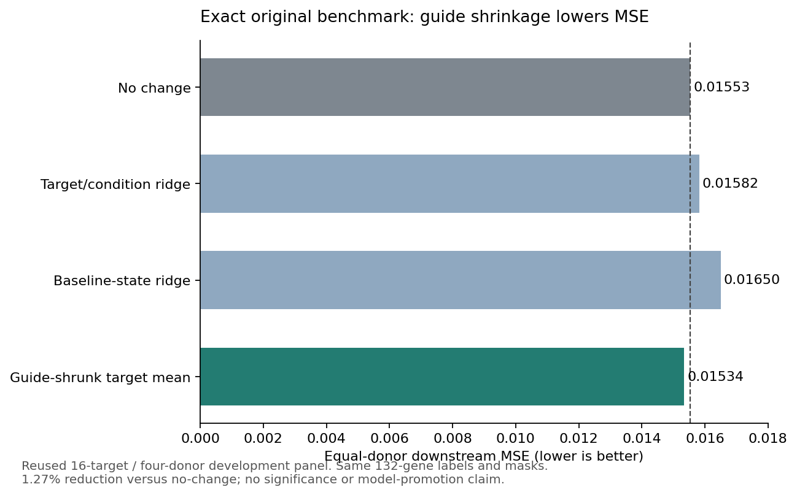

# Guide/run audit and independent-source continuation — 12 September 2026

## Completed source design checks

The 278,684 pseudobulk rows have no duplicate guide/donor/condition keys. Each of the 12 donor/condition groups belongs to exactly one processing run, so existing donor/condition-matched controls already match run. There is no within-group cross-run replication or separately identifiable run correction. Two donors have only R2; the other two have R1 at Rest/Stim8hr and R2 at Stim48hr.

The frozen 16 targets have exactly two guides each, with no additional guides available in this source. Genome-wide, targets have 1/2/3/4 guides in 511/12,200/17/2 cases. Basic cell/count QC yields 3,322 targets with at least two complete guides across all 12 donor/condition groups, and only one target with at least three. These are coverage-selected counts, not prospective generalization evidence.

Independent metadata reconstruction verified these counts and the exact fresh-panel selection.

## Cell-support sensitivity

Requiring both guides to have at least 0/10/25/50/100 cells retains 192/182/128/71/24 pairs and 16/16/16/15/9 targets. Complete 12-group targets fall from 16 to 10/1/0/0. Higher support does not reveal strong positive downstream guide agreement; at 50 and 100 cells, mean all-gene disjoint-reference Pearson is negative. Changing target/donor composition confounds threshold comparisons. No preferred threshold was selected.

Independent verification reconstructed 1,536 correlations, checked 4,776 filtered metric entries and 40 summary means, and verified eligibility and coverage.

## Fresh basic-QC panel

A fixed hash rule selected 16 targets outside the prior 117-target panel, two guides each, with basic-QC coverage across 12 groups. It did not consult efficacy/test-gene/DE filters or expression values. Extracted 384 profiles across 18,129 genes; full-library sums verified against source metadata.

All 384 selected profiles nevertheless pass the source DE eligibility flags. Therefore, this panel broadens targets but does not measure what happens for efficacy-excluded profiles. Four donors, the control pools and the source experiment are reused.

| Panel | Mean disjoint-reference Pearson, forward/swapped |
|---|---:|
| Frozen 132 genes | 0.05370 / 0.04389 |
| All 18,129 genes | 0.03331 / 0.03350 |
| 10,729 control-expressed genes | 0.03308 / 0.03318 |

Independent metric reconstruction is recorded in `basic_qc_panel/verification.json`. This is descriptive guide reliability, not a fitted-model validation.

## Independent-source triage

S3 already contains ShifrutMarson2018: metadata identifies human primary T cells,52,236 cells, two patient labels and four donor/stimulation samples,20 CRISPR targets plus controls. Assigned-guide annotations cover 25,094 cells;27,142 missing-guide cells must not be treated as controls. Its `nperts` values track stimulation in this file and are not a CRISPR guide-count filter. An initial filter on `nperts==1` was caught and removed before producing final aggregates. Independent source metadata checks found zero inconsistencies between patient/sample, sample/stimulation, target/perturbation, and guide/target.

CuiHacohen2023 contains mouse primary immune cells with cytokine interventions, including 86 named cytokines plus control. It is relevant to a separate cytokine-response lane, but cannot substitute for human CRISPR target replication. Metadata replicate labels alone do not establish independent donor counts.

External count aggregation and the subsequent descriptive replication results are recorded under `shifrut_replication/`. No new trained model is promoted by these audits. All source access is read-only; private code was not uploaded.

## External guide and donor replication results

The Shifrut count preparation produced 192 guide/donor/condition pseudobulks from 25,094 annotated-guide cells across 33,694 genes. Every included cell's count sum matched `ncounts`; raw count values were finite, nonnegative integers. Source ETag/size remained unchanged. All 20 target symbols match the source gene schema; no alias substitution was needed.

Across 80 guide pairs, all-gene disjoint-reference Pearson is 0.02144/0.01127; the 12,072 control-expressed genes give 0.02108/0.01093. Shared-reference Pearson is much higher, 0.21037/0.24528. This is another example of why expression-profile or shared-reference agreement is insufficient.

Transferring aggregated known-target observed effects between the two donor labels gives downstream MSE 0.00091605, versus no-change 0.00049218, condition mean 0.00058641 and cyclic target mismatch 0.00096648. True and mismatched target genes are excluded from all arms. This is observed-effect transfer within a separately stored experiment, not a trained model's cross-study prediction test. Cross-study donor identity and cohort disjointness have not been established from these metadata labels.

Training-donor-only variance selection (control CPM >=1; own-target labels excluded per readout) gives matched transfer Spearman 0.1610/0.1137 for fixed top128/top512 panels, but MSE remains worse than no-change. Selection lists and metrics were independently reconstructed, with no held-out outcome use found. The dataset is reused for development; both settings are reported without choosing a winner.

Verification: 3,666 guide/transfer metric and summary comparisons; a further 1,992 selected-readout comparisons and all eight selected gene lists. Eight adversarial checks changing held-out effects by 1e9 leave selection and train means unchanged.

## Training-guide attenuation baseline

An exploratory baseline fits one nonnegative zero-intercept slope per training donor/condition from symmetrized guide effects using disjoint reference pools, clipped to [0,1]. It scales the training donor's aggregated observed effect before transfer. All 20 target genes are excluded from fit and scoring. Fixed all/top128/top512 variants remain separate; no held-out outcomes fit coefficients or choose genes.

| Panel | No-change MSE | Shrunk matched MSE | Relative MSE reduction |
|---|---:|---:|---:|
| All downstream genes | 0.00049134 | 0.00049020 | 0.23% |
| Training-selected top128, excluding all targets | 0.01360254 | 0.01302522 | 4.24% |
| Training-selected top512, excluding all targets | 0.00603842 | 0.00585434 | 3.05% |

Both donor directions improve in these three comparisons. These are small, exploratory improvements from only two donor labels after inspecting unattenuated errors, not significance, prospective confirmation or a model-promotion gate. Gene selection can bias the training-guide attenuation estimate. Zero coefficients create undefined correlations, so valid correlation counts are reported and changes in their conditional averages must not be interpreted as performance improvement. Comparisons above use MSE over every row.

The same attenuation design is being checked on the original and fresh CZI panels; its results and independent verification are separate artifacts. No production immune prediction route is enabled by this work.

## CZI attenuation replication and exact benchmark integration

The CZI replication uses all NT controls for aggregated effects, with disjoint pools only for coefficient fitting. It excludes the union of 32 targets across both panels and uses three training donors per held-out fold. This deliberately differs from the older model's reference-pool-only labels.

| Dataset | All-readout MSE reduction vs no-change | Top128 | Top512 |
|---|---:|---:|---:|
| Original CZI panel | 0.24% | 0.78% | 0.81% |
| Fresh basic-QC CZI panel | 0.15% | 0.85% | 0.52% |

All four donor summaries improve in each setting. Independent reconstruction verified all 72 coefficient fits and gene lists, 1,152 prediction rows and 18,846 metric/summary/count comparisons. All 72 held-out mutation checks passed. These small changes do not establish statistical confidence or production readiness.

A separate implementation adds attenuation to the exact original benchmark: same reference-only labels, frozen132 genes, four donor splits and per-row direct-target masks. Original labels and baseline predictions are checked against saved artifacts. The previous ridge models are not refit.

| Exact benchmark arm | Equal-donor downstream MSE |
|---|---:|
| No change | 0.015534 |
| Condition mean | 0.016095 |
| Target/condition ridge, previous run | 0.015821 |
| Baseline-state ridge, previous run | 0.016501 |
| Target/condition mean | 0.018534 |
| Guide-shrunk target/condition mean | 0.015336 |

The new baseline improves MSE by 1.27% versus no-change and improves each donor summary. It estimates coefficients from training-donor guide pairs, with all target readouts excluded from coefficient fitting; evaluation retains the original downstream mask. Four held-out count corruption checks leave fitted coefficients unchanged. Three focused unit tests cover known attenuation, clipping/zero denominators, invalid arrays, and held-out/direct-readout invariance.

## Current decision and next gate

Preserve attenuation as a required baseline for subsequent immune model comparisons. The earlier statement that no learned arm beat no-change described the earlier runs; this new simple baseline now beats it modestly on reused development data. It does not establish a reliable immune foundation model, unseen-target prediction or causal efficacy.

Next training should compare against no-change, condition mean, observed-target transfer and guide shrinkage under the same labels/masks. Freeze the attenuation and readout-selection rules before evaluating a further untouched dataset or donor cohort. Require target-specific benefit beyond mismatched-target controls, adequate independent replication and stable performance across conditions. Do not use this small mean improvement as permission to scale the neural model or enable production inference. The control-expression filters from descriptive analyses must not become evaluation-wide training filters.

Final exact-benchmark verification independently reproduced 12 coefficients, all 16 prediction arrays and 128 metric/count checks. All 192×132 labels and the prior baseline predictions match bitwise. The installed benchmark module and related evaluators passed 19 focused tests. The baseline source is `research/immune_llm_baseline/evaluate_guide_shrinkage.py` in the immune training worktree; raw artifacts and reproducible scripts are retained under the review evidence directories and the training output snapshot.
