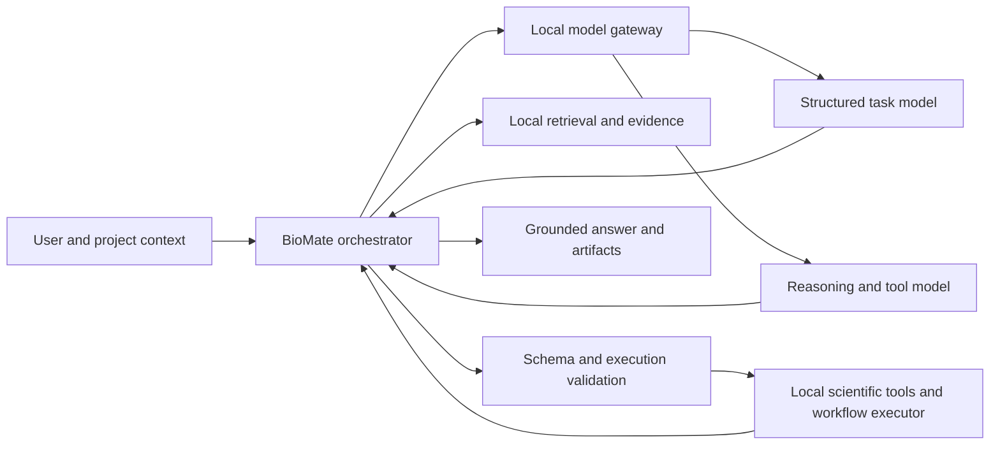

# BioMate: replacing external LLM APIs for on-premise deployment

**Scope correction:** The implementation and training target is the main BioMate assistant, not the IND model. T22/T23 and IND datasets/adapters are excluded. See [BioMate trial scope](BIOMATE_SCOPE.md). This overrides earlier conditional IND references.

**Resource strategy update:** [Using correction logs, commits, knowledge, teachers and controlled harness improvement](RESOURCE_STRATEGY.md), with [measured local knowledge inventory](RESOURCE_AUDIT.json). This adds the verified experience pipeline and data-quality fixes to the urgent deployment plan.

**Decision brief and implementation plan — 12 September 2026**

## Recommendation

**Confirmed constraints: maximum 32B local LLM; deliver as soon as possible.** Treat the cap as total model parameters, not active MoE parameters. Start with one shared model and a narrow, tested local release. The [accelerated execution plan](/Users/kky/biomate-review/docs/20260912_onprem_llm/FAST_TRACK.md) supersedes the original broad model search and release schedule. Target a limited pilot in 48–72 hours after usable hardware/access is available; this is a planning target, not a deployment or quality guarantee.

Build a **locally hosted BioMate assistant by adapting an existing instruction-tuned model**, while keeping BioMate's retrieval, workflow engines, scientific software, validators and execution controls. First establish a credible baseline and repair the provider integration. Then use supervised fine-tuning on verified BioMate task traces; add preference training only where reviewed corrections show a remaining problem. Training a foundation model from scratch is not justified by the urgent deployment need or the evidence available here.

The replacement must cover an **agent system**, not merely scientific question answering. A model that writes good biomedical prose can still fail at selecting workflows, preserving a dataset identifier, using tools, asking for a missing parameter, or distinguishing a proposed run from a completed run.

**Terminology assumption pending customer confirmation:** “closed” means execution within the customer's environment with no external LLM APIs, and open-weight models may be used privately. Open-weight is a licensing/distribution property; external API is a hosting boundary. If open weights are prohibited, the immediate path is procurement of a proprietary model licensed for on-premise inference and, if needed, adaptation. The same task catalog and evaluation apply, but the proposed Qwen/LoRA path would not meet that policy.

## Deliverables and evidence

- [Task and process catalog](/Users/kky/biomate-review/docs/20260912_onprem_llm/TASK_CATALOG.md): LLM responsibilities, prompt locations, inputs, outputs, surrounding non-LLM steps, and task-specific data/evaluation needs.
- [Exact prompt source appendix](/Users/kky/biomate-review/docs/20260912_onprem_llm/PROMPT_APPENDIX.md): extracted source expressions and prompt builders, including dynamic placeholders and branches.
- [Machine-readable prompt registry](/Users/kky/biomate-review/docs/20260912_onprem_llm/prompt_registry.json), [callsite candidates](/Users/kky/biomate-review/docs/20260912_onprem_llm/callsite_inventory.json), [audit manifest](/Users/kky/biomate-review/docs/20260912_onprem_llm/audit_manifest.json), and [dataset profile](/Users/kky/biomate-review/docs/20260912_onprem_llm/data_profile.json).
- [Proposed trace schema and annotation guide](/Users/kky/biomate-review/docs/20260912_onprem_llm/DATA_CONTRACT.md).

The review began at base commit `b9db5e60fb7f1cca300e3923741cb517895372bf`; the final extraction records `7971127cbca05a4d6c3ba53ff83e64ea9ba4a355` plus the local working tree. This is a static review of the local checkout, including frontend/server, backend AI/API/job modules and selected maintenance/evaluation directories. It is **not a production deployment audit or a measured model benchmark**. Unrelated concurrent workspace edits/commits were observed and left alone; source-file and expression hashes identify the extracted content. No customer conversations were exported, external inference called, training launched, or application configuration changed by this audit. See [validation results](/Users/kky/biomate-review/docs/20260912_onprem_llm/VALIDATION.md).

“Implemented” below means code was found and inspected. A registered route supports reachability, but feature flags, credentials, deployment versions and actual traffic must still be checked. Static call counts include wrappers and optional/maintenance paths and must not be presented as a count of production tasks. Prompts internal to third-party libraries, installed runtime skills, and final dynamically assembled requests require runtime capture.

## Findings that change the plan

| Finding | Evidence | Consequence |
|---|---|---|
| Shared backend routing exists, but direct frontend/provider paths remain. | [Shared frontend client](/Users/kky/biomate-review/frontend/server/llm-client.ts:57); [chat routing](/Users/kky/biomate-review/frontend/server/galaxy-assistant.ts:8587); [Flash wrapper](/Users/kky/biomate-review/frontend/server/gemini-flash.ts:39). | Editing the YAML alone cannot guarantee local execution. |
| The configured shared fallback chain reaches multiple cloud vendors before Ollama. | [Provider configuration](/Users/kky/biomate-review/backend/config/llm_providers.yml:10); [fallback implementation](/Users/kky/biomate-review/backend/lib/galaxy/ai/llm_client_fallback_implementation.py). | On-premise mode must remove external fallback and fail explicitly when all permitted local services fail. |
| The current Ollama chat adapter has no tool execution loop. | [Ollama adapter](/Users/kky/biomate-review/frontend/server/galaxy-assistant.ts:2916). | A local answer can appear successful while code execution and tool chaining are absent. Adapter parity precedes quality comparison. |
| The main intent prompt is very large and highly specific to BioMate. | [Intent prompt](/Users/kky/biomate-review/frontend/server/galaxy-assistant.ts:5850), through line 6973. | Measure actual token lengths with the candidate tokenizer; preserve rare routing rules and validate prompt compression. |
| Response/report prompts contain cloud-environment assertions. | [Chat prompt](/Users/kky/biomate-review/frontend/server/galaxy-assistant.ts:8201); [report route](/Users/kky/biomate-review/frontend/server/routes.ts:5567). | Generate capability and execution-environment blocks from the deployed configuration. Do not train the model to falsely claim AWS or live database access. |
| Regulatory inference can use a frontier override, Modal, vLLM, or local Transformers, and can subsequently fall back to Gemini. | [Routing](/Users/kky/biomate-review/backend/lib/galaxy/ai/drug_discovery/ind_assembly.py:398); [quality-triggered fallback](/Users/kky/biomate-review/backend/lib/galaxy/ai/drug_discovery/ind_assembly.py:861). | A variable called “local” or an adapter name is not evidence that inference stayed on premise. Record the actual provider and enforce the boundary. |
| Per-organization LoRA training is a stub; other trainers are real code paths. | [Worker](/Users/kky/biomate-review/backend/lib/galaxy/ai/drug_discovery/regulatory_training_worker.py:89); [SFT script](/Users/kky/biomate-review/scripts/finetune_regulatory_llm.py); [TRL trainer](/Users/kky/biomate-review/backend/lib/galaxy/ai/ml_training/trl_trainer.py). | Do not rely on a job's `succeeded` status as evidence of a trained adapter. Validate saved weights and measured behavior. |
| Existing regulatory train/test splits overlap exactly. | [Reproducible profile](/Users/kky/biomate-review/docs/20260912_onprem_llm/data_profile.json). | Rebuild independent holdouts before interpreting local-vs-API scores. |
| External dependencies extend beyond text generation. | [PaperQA route](/Users/kky/biomate-review/backend/lib/galaxy/webapps/galaxy/api/ai_assistant.py:6049); [embedding selection](/Users/kky/biomate-review/backend/lib/galaxy/ai/cryo_em_knowledge/rag_index.py:226). | Local embeddings, paper indexing, figure processing and data access need separate deployment decisions. |

These are source-derived findings. Claims in existing comments about model quality, deployed model versions, “always works” fallbacks, or benchmark readiness have not been accepted as measured facts.

## Target architecture and immediate containment

Use a single local model gateway and **one shared model with no more than 32B total parameters** initially. Structured tasks and reasoning/tool use use task-specific prompts and budgets on that same model. Defer extra specialist models; consider a small model later only if measured throughput requires it. Enable vision only after its local path passes separately. Keep embeddings in a separate local service.

The gateway contract must retain system/user/assistant/tool roles, tool schemas, tool-call IDs, images when supported, streaming, JSON/schema constraints, cancellation, usage, actual model identity and explicit failures. The existing `llmGenerate` interface carries prompt/system text and is insufficient by itself for full agent parity. Neither flattening tool messages into prose nor interpreting text that resembles a tool call is an adequate substitute.

### First 48 hours: engineering work before training

1. Define `onprem` as an explicit deployment policy, with an allowlist of local inference endpoints and no external-provider fallback. This is a proposed design, not an existing guaranteed switch. Enforce egress at the environment/network boundary as well as in code.
2. Migrate direct calls: main chat/intent/ranking, Flash helpers, dataset validation, evidence/notes/findings/reporting, error analysis, workflow-ops clients, regulatory generation/auditing and PaperQA. Include background session memory and summaries. Audit customer BYOK/OpenRouter overrides so they cannot defeat the deployment policy.
3. Replace cloud-key presence checks with local-capability readiness checks. Today some error/title paths test `ANTHROPIC_API_KEY` before calling Gemini; chain composition may select a deterministic stub when no cloud key exists. Removing keys alone can silently disable functionality.
4. Implement and test local tool-call/observation loops against BioMate's real tool schemas. Verify `run_code`, history lookup, output reuse and chained calls, including multiple tool calls, malformed arguments, timeouts and bounded retries.
5. Build environment-derived prompt blocks: accessible databases, installed workflows/tools, actual executor/storage, available images and permitted actions. Missing local data should produce a truthful limitation or request for input.
6. Test all major paths with external LLM egress blocked. Deliberately fail the local server and return malformed/truncated outputs to exercise every fallback. Check frontend, backend, background jobs and subprocesses; attach network-denial evidence to release results.
7. Decide the broader offline boundary. A ban on external LLMs does not necessarily ban PubMed or other data APIs. For a fully air-gapped product, mirror approved datasets, references, model weights, tokenizer files, packages, containers and workflow assets, and implement local storage/compute. Training cannot replace those systems.

## Model selection: baseline first, fine-tune second

Time-box selection to **Qwen3.8-27B first and Qwen3.5-27B as the comparison/fallback**. The newer official release was verified after the initial shortlist and supersedes the earlier recommendation.

| Priority | Candidate | Decision |
|---|---|---|
| First | Qwen3.8-27B | Evaluate official post-trained weights for the shared assistant, then fine-tune on BioMate traces if needed. |
| Comparison/fallback | Qwen3.5-27B | Same development tasks and runtime checks; use if 3.8 is blocked or underperforms. |
| Defer | Qwen3-30B-A3B-Instruct-2507; existing 8B adapters | Not part of the initial two-candidate comparison. |
| Exclude under strict cap | Qwen3-32B | Officially 32.8B total parameters despite its name. |

[Qwen3.8's official card](https://huggingface.co/Qwen/Qwen3.8-27B) identifies post-trained weights and local serving. There is no need to seek a separate Instruct suffix: start with the assistant checkpoint, not raw pretrained weights. Its published scores are not BioMate validation. See the [accelerated plan](/Users/kky/biomate-review/docs/20260912_onprem_llm/FAST_TRACK.md) for selection and task-mode details. Count every shipped model component against the 32B ceiling, including optional vision components, and pin the exact weights, processor/tokenizer, template and runtime. Quantization does not reduce parameter count.

vLLM supports [structured outputs](https://docs.vllm.ai/en/latest/features/structured_outputs/) and [tool calling](https://docs.vllm.ai/en/latest/features/tool_calling/), but tool parsing and chat templates are model-specific. An API-compatible server does not automatically make BioMate's caller compatible. Pin a validated server/model combination rather than copying flags from an old deployment script.

Run three comparisons: **current API system**, **unadapted local system with adapter parity**, and **fine-tuned local system**. Attribute failures to retrieval, orchestration, model behavior, parsing or execution. Train only on the model-behavior gaps. Keep a no-LLM/rule baseline for short deterministic tasks.

### Hardware decision

The model ceiling is now fixed at 32B and delivery priority is ASAP. GPU model/count/VRAM, concurrency and latency requirements remain unknown. Choose precision and capacity from a measured load test; do not equate a parameter cap with a VRAM budget. Approximate weight storage alone is parameter count × bytes per parameter: an 8B model is roughly 16 GB at 16-bit, a 32B model roughly 64 GB; raw 4-bit storage is about one quarter of that. Quantization metadata, KV cache, runtime workspaces and allocator overhead add memory; training requires additional memory. These are sizing arithmetic, not runnable VRAM guarantees.

Measure p50/p95 input/output token lengths and concurrent active sequences. The chat adapter currently specifies a 32K local context, whereas the main intent and response prompts plus history/retrieval can be substantial. Test the largest observed inputs, not only short demonstrations. Test quantized and unquantized candidates separately. Customer hardware must also support the chosen CUDA/runtime architecture; comments mentioning GB10/128 GB do not establish customer availability.

## Data collection and quality plan

### Reuse what exists, after auditing it

The files currently contain the following row counts, measured without printing raw examples:

| Existing asset | Measured size | Treatment |
|---|---:|---|
| Original regulatory split | Train 1,727; dev 212; test 227 | Rebuild splits; 60 distinct dev message sequences and 68 test sequences also occur in train. |
| v6 regulatory split | Train 5,892; dev 326; test 326 | Rebuild splits; 224 distinct dev sequences and 218 test sequences also occur in train; dev/test share 34. |
| Regulatory DPO merged pairs | 2,659 rows | Mostly overlaps the 2,658-row synthetic file; verify quality/provenance and do not add the counts together. |
| `combined_sft.jsonl` | 1,197 rows | Overlapping export, not an additional independent corpus. |
| Existing evaluation suite | Adapters, task datasets, runners and results directories present | Audit each loader/scorer and split lineage; README “ready” and result-file presence do not establish a clean benchmark. |

Overlap is equality of canonical serialized `messages`, including responses where present, excluding metadata; it counts distinct matching sequences. The profile is not a semantic leakage detector. Shared studies, compounds, prompts, augmentations and source documents may create additional leakage. The older `dataset_stats.json` does not match current row counts and should not be used as the source of truth.

Reuse the intent/parameter/history regression tests, chain-composer queries, prerequisite recovery cases, code-execution fixtures, output-grounding tests and workflow repair failures as **seeds**. Existing regulatory data covers a narrow part of BioMate; it is not a training set for the general assistant.

### Collect full transitions, not only user/assistant text

For every task invocation record the rendered request, stable task ID, prompt version/hash, preceding state, supplied tools/schema, retrieved evidence and source versions, model output, parsed output, validator decisions, tool observations and terminal outcome. Preserve retries and failures. A final successful answer alone cannot teach recovery or reveal that a different cloud provider rescued the run.

Use the [data contract](/Users/kky/biomate-review/docs/20260912_onprem_llm/DATA_CONTRACT.md). Keep raw records local and access-controlled; redact secrets and unnecessary personal identifiers before annotation. Maintain reversible dataset/run-ID mappings only within the permitted boundary. Preserve scientifically material units, structures, sequences and file relationships. Record tenant ownership and training permissions before promoting any customer trace into a shared corpus; keep organization-specific adaptation data separate by default.

Generate synthetic tasks from installed schemas, workflow catalogs and local fixtures. Include wrong-but-plausible alternatives, missing inputs, negation, corrections and unavailable capabilities. Use public or permissioned evidence. External-teacher outputs are optional only where the data policy and applicable use rights permit them; do not send customer material out to make a local model. Local teachers, verified tool results and expert-written corrections are viable alternatives. No synthetic response becomes a gold target without validation.

### Initial collection targets — proposed budgets, not guaranteed sufficiency

| Task group | Initial accepted training target | What makes it useful |
|---|---:|---|
| Intent/domain/entity/parameter extraction and modifications | 8,000–12,000 transitions | Cover every enabled intent and high-use workflow schema, bilingual traffic if observed, ambiguity, aliases and correction turns. |
| Workflow/tool selection, prerequisite resolution and chain construction | 4,000–6,000 transitions | Candidate lists with hard negatives; grounded IDs; valid DAGs and I/O contracts. |
| Scientific reasoning with tool use and code | 2,000–4,000 complete trajectories | Executed local fixtures and checked numerical/file outputs; multi-turn tool observations retained. |
| Evidence synthesis, findings, reports and regulatory drafting | 3,000–5,000 tasks | Supplied source passages/artifacts, claim-level checks and reviewed corrections. |
| Workflow diagnosis and repair | 1,000–2,000 episodes | Actual error, proposed change, execution result and bounded recovery sequence. |
| Memory, summaries, notes and clarification | 1,000–2,000 transitions | Facts preserved, outdated facts superseded, no invention, exact file/run references. |

This is approximately **19,000–31,000 accepted items/trajectories**; trajectories contain multiple training turns. Start with a 2,000-item, balanced pilot and learning curves before funding the full collection. Allocate by observed call frequency × consequence of error, while setting minimum coverage for rare critical tasks. Reserve an independent evaluation budget; do not obtain a “large test set” by paraphrasing training prompts.

For the pilot, include meaningful shares of missing/invalid inputs, follow-up corrections, tool failures and adversarial content. Deliberately include long histories and large schemas. Track source diversity and token volume as well as row count; avoid making a long report outweigh many routing decisions solely through token length.

### Annotation and split rules

1. Assign a domain reviewer and a task owner. Label correctness against evidence, schema and execution; fluency is secondary.
2. Separate observed data, inferred conclusions, assumptions and unresolved questions. Reject fabricated citations, numbers, run status or artifacts.
3. Retain accepted and rejected responses with a concise, evidence-linked reason. Double-review critical regulatory/safety and execution-permission cases, and a sample of ordinary items; adjudicate disagreements.
4. Split by tenant/project/study and source document, then by near-duplicate family. All augmentations of one root example remain together. Where applicable add compound scaffold, biological target, workflow family and temporal holdouts.
5. Fit data transforms and select prompts/checkpoints using train/dev only. Freeze and hash test manifests; hold test labels apart from training generation and retrieval exemplars. A public benchmark may be contaminated by base-model pretraining, so it is supporting evidence only.

## Training sequence

**Stage 0 — unchanged local baseline.** Complete adapter parity, rebuild holdouts and record task-specific failure categories. Keep existing deterministic validators and retrieval. Rework capability prompts and reduce unnecessary prompt payload before fine-tuning; evaluate each prompt revision separately.

**Stage 1 — supervised fine-tuning (SFT).** Train one shared adapter on balanced task mixtures, with explicit task identifiers and the exact serving chat/template format. Preserve tool calls and tool results. Train on assistant outputs and valid tool actions, masking user inputs and tool observations as targets as appropriate to the trainer. Use verified execution observations and concise decision explanations; do not rely on hidden reasoning traces. TRL's [SFT trainer](https://huggingface.co/docs/trl/sft_trainer) supports conversational/tool-oriented training formats; verify the chosen version and label masking with a small batch inspection.

Use LoRA first; evaluate QLoRA if memory demands it and the actual loader uses quantization. A configuration label alone is insufficient: the generic TRL loader currently creates a LoRA configuration for both `lora` and `qlora` without visibly configuring 4-bit loading. The dedicated regulatory script has a different quantization path. Pin dependencies and prove adapter save/reload before a full run.

Proposed pilot search: LoRA rank 16 or 32; learning rates 5e-5 and 1e-4; 1–3 epochs with early stopping on task metrics; sequence lengths based on measured distributions. These are experiments, not chosen production settings. Start short-task runs at manageable context, then include long tool trajectories explicitly. Keep a general instruction/code retention set and check catastrophic forgetting after every candidate checkpoint.

**Stage 2 — preference training.** After SFT, use reviewed same-context chosen/rejected pairs for unnecessary clarification, wrong workflow selection, ungrounded claims and poor recovery. Start with approximately 1,000–3,000 high-quality pairs if collection supports them. Use an SFT checkpoint and compare with the unmodified checkpoint; [TRL DPO](https://huggingface.co/docs/trl/dpo_trainer) is an available implementation. Do not equate synthetic negative generation with reliable preferences.

**Stage 3 — task specialization only if measured.** After the first release, optionally move routing/extraction to a smaller local model if it passes independently; the main model must remain within the 32B total-parameter ceiling. Do not use a larger-model escalation path. Keep a regulatory adapter only if its independent specialist evaluation improves. Consider an adapter per task group before a separate full model per biological domain; biology domains share many operational skills.

**Stage 4 — execution-based optimization, optional.** Consider RL only after safe sandboxes and robust rewards exist. Reward validated scientific results, artifact integrity and task success. The generic TRL file's example rewards for response length, keyword presence and containing a number do not measure BioMate scientific competence and should not drive this project.

Do not begin continued pretraining merely because the domain is biomedical. Consider it later only if a rights-cleared corpus and evaluation show a knowledge deficit not resolved by retrieval or SFT. It would not solve missing tool loops, stale databases or broken workflow wiring.

## Evaluation and release gates

Evaluate the **model and the complete system separately**. For component tests replay identical context, schemas and evidence. For full-system tests allow the model to choose actions, then score actual execution and artifacts. Compare both raw model outputs and outputs after validators/repair; count fallbacks explicitly. A passing system score with a cloud rescue is a failure of the on-premise acceptance test.

Use existing [evaluation runners](/Users/kky/biomate-review/evaluation/runners), [local vLLM integration test](/Users/kky/biomate-review/tests/integration/test_vllm_client_path.py), and frontend regression tests as infrastructure starting points. A skipped GPU test is not a pass; a prose/citation-shape assertion is not scientific validation. Do not launch the entire runner suite until endpoint routing, dataset access and scorer behavior are reviewed.

### Proposed initial acceptance criteria

These are proposed release gates for the customer pilot, to ratify before comparing candidates. They are not measured BioMate results.

| Capability | Gate and measurement |
|---|---|
| Deployment boundary | Zero external inference/embedding calls in covered normal, retry, fallback and background paths; local outage yields explicit failure or a documented deterministic result. Network policy remains enforced after release. |
| Structured outputs | At least 99.5% schema-valid outputs before repair; report repair rate separately. No unknown tool/workflow IDs accepted by the application. |
| Routing | Macro-F1 ≥0.95 overall and ≥0.90 on each sufficiently sampled enabled domain; critical execution-vs-question and correction slices reviewed separately. |
| Parameter extraction | ≥0.98 field-level exact/normalized match where normalization is allowed; 100% preservation of explicit user overrides and identifiers in the critical fixture suite. Missing-required and illegal-enum detection measured independently. |
| Tool use | ≥0.98 valid tool name/argument rate; ≥0.90 successful enabled end-to-end tasks with local tools, subject to comparison below. Zero unauthorized executions in the critical suite. |
| Workflows | No invalid DAG/schema/I/O contract passed to execution; ≥0.90 success on supported executable fixtures. Scientific correctness assessed separately from exit code. |
| Evidence/findings/reports | ≥0.98 checked claim support on an independently annotated set; zero invented numbers, citations or completed-run claims in the critical suite. Track evidence completeness so omission cannot game the metric. |
| Regulatory | Pass deterministic structural/numeric checks; no critical unsupported safety or regulatory conclusions in the reviewed suite; independent expert sign-off on target document types. A generator must not be its only judge. |
| Memory | ≥0.98 factual precision; 100% preservation of required file/run handles and explicit corrections in the critical suite. |
| Vision, if enabled | Correct extraction of labels/units/values and panel references on a dedicated local image set; unreadable inputs yield uncertainty. Set quantitative thresholds after defining modalities and tolerances. |
| Latency/capacity | Meet agreed p95 turn latency, tool-loop duration and concurrency on customer hardware; measure cold start and long-context cases. Numerical SLA remains open until hardware/workload are known. |

In addition to absolute gates, propose an end-to-end **non-inferiority margin of 3 percentage points** versus the current API system on identical supported tasks: the lower 95% confidence bound of local minus API success must exceed −0.03. Use paired comparisons and bootstrap at project/trajectory level, not individual correlated turns. Plan sample size from baseline rates and expected discordant pairs; a 200-task smoke suite alone cannot establish a narrow margin. Report sample sizes, intervals, exclusions and abstention rate by task and domain. Zero observed critical failures is a suite result, not a mathematical claim that future risk is zero.

Use deterministic checks for JSON, IDs, units, DAGs, file existence/content and numerical outputs. Use blinded domain experts for evidence sufficiency and scientific conclusions, with independent model judges only as triage. Track both judge disagreement and disagreement with humans. If evaluators must also be offline, select a separate local judge and retain human adjudication.

Critical cases should include: no input data; invalid IDs; stale/contradictory memory; unsupported workflow; planted instructions in papers/tool outputs; failed tool execution; references to a prior run; hidden cloud fallback; long-context truncation; false success claims; ungrounded numerical interpretation; incompatible assay/sample types; and genuine uncertainty requiring clarification.

## Work packages and schedule

The accelerated schedule below replaces the original 4–6 week first-release horizon. Timing begins when hardware/access and minimum reviewers are available. A limited pilot and full parity are different milestones; quality gates remain in force.

| When | Owner role | Concrete output / exit condition |
|---|---|---|
| Hours 0–24 | Platform lead + ML lead | Pin candidate/runtime; close external-provider bypasses on enabled routes; prove local JSON/streaming/tool loop; freeze an independent 200-case smoke suite. |
| Hours 24–72 | Platform + QA + domain reviewers | Target a limited local pilot for passing capabilities; verify external-egress denial, real outputs, failure handling and rollback. This is not a full-parity release. |
| Days 2–5 | Data/evaluation + ML engineer | Collect/review a 2,000-item training pilot, separate 300-item dev set and 500-item locked evaluation set; repair regulatory split lineage. Training does not gate the first local pilot if the base already passes. |
| Days 5–10 | ML engineer + QA | Target first validated SFT/LoRA candidate, conditional on trainer compatibility and measured GPU throughput. Compare against the unchanged local base; ship the adapter only if it improves held-out task outcomes. |
| Following releases | Platform + scientific reviewers | Expand domain/task coverage as gates pass; DPO, extra specialists and advanced repair remain driven by evidence. Full parity has no defensible date until baseline failures are measured. |

Suggested staffing: one platform/backend engineer, one ML engineer, one data/evaluation engineer or QA partner, and scheduled biomedical reviewers with a regulatory specialist for the IND slice. Estimate cost after the pilot: annotation cost = accepted items × review minutes × reviewer rate, plus rework; compute cost = measured GPU-hours × available internal capacity/rate. Do not extrapolate GPU cost from old comments or equate synthetic row generation with annotation completion.

A restricted early deployment can expose only the tasks that pass, with clear availability indicators. Never claim full BioMate parity while silently dropping tool use, vision, retrieval or workflow repair. Roll back to a prior approved **local** artifact or disable the affected capability; an external API rollback would violate the premise.

## Decisions still needed

1. Does “closed” prohibit open weights, or only external inference? Are embeddings, data APIs and outbound telemetry also prohibited?
2. What GPU model/count/VRAM, CPU/RAM, concurrent-user target and latency target are available? Delivery priority is confirmed as ASAP; maximum model size is confirmed as 32B.
3. Which tasks are mandatory for the first customer: core chat/workflows, scientific code, paper/figure reasoning, IND, repair, and which biological domains/languages?
4. Which historical traces, edited documents and successful execution artifacts have training rights, and may any be shared across customers?
5. Who owns scientific acceptance and regulatory review, and what non-inferiority margin is acceptable?

The next implementation milestone is the **local gateway plus frozen baseline suite and trace collection**, followed by the first small SFT experiment. Time-box the two-candidate comparison and deliver passing capabilities first; keep the 32B ceiling throughout serving and local training.
