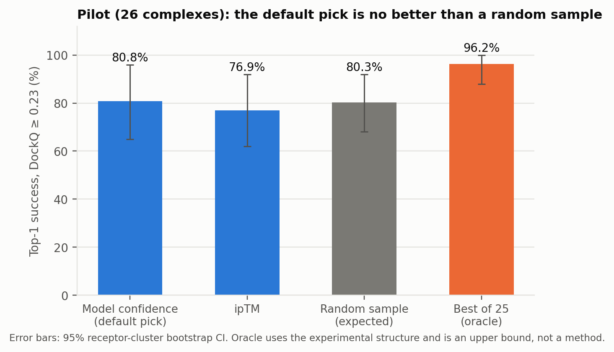
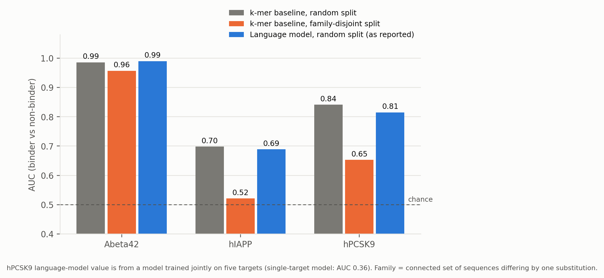
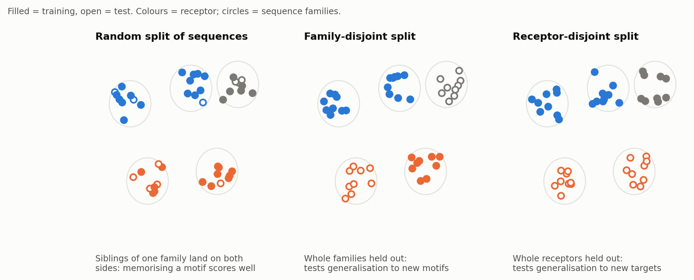

## Abstract

Co-folding models generate many candidate structures per complex, and users usually take the one the model ranks first. For cyclic peptides this choice is fragile: covalent ring closure is not enforced by the model (about 75% of sampled structures in our pilot had a valid ring), non-canonical residues enter as chemical modifications, and the best of 25 samples can be far better than the one the model prefers. In a 26-complex pilot, the model's own top pick succeeded (DockQ ≥ 0.23) in 80.8% of complexes, indistinguishable from a randomly chosen sample (80.3%), whereas the best of 25 samples succeeded in 96.2%. We developed a ground-truth-free selector that scores each sample from model confidences, ring-closure geometry, steric clashes and agreement among samples, and we evaluated it once, under a protocol fixed in advance, on experimental cyclic-peptide complexes deposited after the training cutoff, against six fixed baselines, with uncertainty estimated by bootstrapping over receptor clusters. **[Primary result: to be inserted from the final evaluation — selector vs strongest baseline on all test complexes and on receptors absent from training.]** Separately, applying the same evaluation discipline to a previously reported display-based binder predictor, we found that a bag-of-k-mers logistic regression matched the language model on random splits (AUC 0.986 vs 0.990 on Abeta42; 0.698 vs 0.689 on hIAPP) and fell sharply when whole mutant families were held out (hIAPP 0.52, hPCSK9 0.65). Reliability claims for peptide predictors therefore need split-appropriate evaluation against trivial baselines before they can be used to drive design decisions.

## 1. Introduction

Cyclic peptides bind protein surfaces that are difficult for small molecules to address, and modern co-folding models can now predict peptide–protein complexes from sequence [1]. In practice a user draws several samples from such a model and keeps one, typically the sample with the highest model confidence. The quality of that single choice determines whether a predicted pose is usable for design and ranking.

Cyclic peptides make this choice harder than it is for linear peptides or protein–protein complexes. The model's cyclisation flag does not enforce a covalent closure, many deposited cyclic peptides carry non-canonical residues that must be supplied as chemical components, and the fraction of samples that are already acceptable can be high, which hides selection error behind a ceiling effect. Confidence-versus-quality relationships have been studied for protein–protein and linear protein–peptide complexes [2,3]; here we ask the question for experimentally determined cyclic-peptide complexes, using ring geometry as an explicit selection signal and evaluating on receptors the selector has not seen.

We make four contributions. (i) A post-cutoff set of experimental cyclic-peptide complexes defined from deposited covalent-link records. (ii) A selector that uses only information available without the experimental structure. (iii) A one-shot evaluation with a fixed claim rule, six fixed baselines, bootstrapping over receptor clusters, and an analysis restricted to receptors absent from training. (iv) An audit showing that the same discipline changes the conclusion for a previously reported display-based binder predictor, which we include because the failure mode (near-duplicate sequences on both sides of a random split) is common in peptide machine learning.

## 2. Results

### 2.1 Study design

Figure 1 summarises the study. Complexes deposited before 2023-10-01 were used only to fit the selector; complexes deposited on or after that date were used once for evaluation. For each complex, 25 structures were sampled from a co-folding model given the receptor sequence and the peptide sequence with its ring topology, never the experimental coordinates. Each sample was scored with features that do not use the experimental structure, and the selector chose one sample per complex. Success was defined as DockQ [4] of the chosen sample ≥ 0.23 (acceptable) or ≥ 0.49 (medium).

### 2.2 The model's default pick is no better than a random sample in a pilot

In a pilot of 26 complexes (25 samples each), the sample with the highest model confidence succeeded in 80.8% of complexes (95% CI 65–96), ipTM-ranked selection in 76.9%, and a randomly chosen sample in 80.3% in expectation, whereas the best of 25 samples succeeded in 96.2% (88–100; Figure 2). The oracle-minus-default gap was 15.4 percentage points (CI 3.8–30.8), which exceeded the pre-specified 10-point threshold for proceeding. The whole gap came from four complexes in which the default pick failed but another sample succeeded. ipTM discriminated weakly within complexes (mean within-complex AUROC 0.56), and its pooled AUROC (0.68) largely reflects differences in difficulty between complexes. Only 75% of all samples had a valid closed ring, and the proportion was as low as 24% in some complexes.

Fourteen of 40 planned pilot complexes did not run (two input-typing errors, since corrected; eight whose chemical components are absent from the model's bundled library; four exceeding GPU memory), and the missing complexes are not random: they skew toward the newest depositions and the largest receptors. The pilot is therefore a feasibility estimate and not evidence about the whole population.

### 2.3 Primary evaluation of the selector

**[To be completed from the final evaluation: Table 1 (top-1 success at DockQ ≥ 0.23 and ≥ 0.49 for the selector, each baseline, random and oracle; paired bootstrap difference between the selector and the strongest baseline with 95% CI), Figure 3 (the same, all test complexes and receptors absent from training), the strict-canonical versus non-canonical tiers, selector coefficients, and a failure analysis of complexes where no sample succeeds and where the selector loses to the default.]**

### 2.4 Split design determines how reliable a binder predictor appears

A display-conditioned language model had been reported to rank held-out binders in phage and mRNA display pools with AUC between 0.69 and 0.99. That evaluation used a random split of unique sequences. Display pools contain families of near-identical sequences, so a random split places family members on both sides. We measured this directly. In the Abeta42 pool, 99.6% of test binders had a training binder within one substitution; in hIAPP, 35%; in hPCSK9, 10%. A bag-of-1/2-mer logistic regression, which has no capacity for sequence context, reached AUC 0.986 on the Abeta42 random split (language model: 0.990), 0.698 on hIAPP (0.689), and 0.841 on hPCSK9. When families (sets of sequences connected by single substitutions) were held out, the same baseline fell to 0.957, 0.521, and 0.653 respectively (Figure 4). In other words, on these splits the language model offered no measurable advantage over a trivial baseline, and on family-disjoint splits predictive signal was weak or absent for two of three targets. Figure 5 illustrates why: the random split rewards memorising a motif; only family-disjoint and receptor-disjoint splits test the generalisation a designer needs.

**[To be completed: the same audit for the remaining targets (PADI4, FIKK13) and the language model re-evaluated on family-disjoint splits.]**

### 2.5 Retrospective closed-loop evaluation on measured permeability

**[To be completed from the pre-specified run: a retrospective design–test–learn loop on the CycPeptMPDB permeability data [5], in which each assay result is revealed only after the loop selects the peptide. Greedy and uncertainty-aware policies are compared with random selection in an in-distribution start and a scaffold-shifted start; Figure 6.]**

## 3. Discussion

The pilot indicates that the model's default confidence is a weak guide to the best sample for cyclic peptides, with ring closure not guaranteed, and it identifies where a selector could help (about 15 percentage points of headroom in a population with a high base rate). **[Interpretation of the primary evaluation to be written from the final result.]**

The binder-prediction audit makes a general point that applies beyond this study. A predictor's apparent reliability depends on how test examples relate to training examples. When the data come as families of near-duplicates, random splits measure memorisation. Because design decisions are made on new families and often on new targets, reliability should be measured under splits that match that question, and every learned model should be compared with a trivial baseline on the same split. The numbers in Figure 4 are a reminder that a high AUC on a random split can be reproduced without any learning beyond residue counts.

### Limitations

(1) A single co-folding model was used. (2) Computational limits restricted the evaluation to complexes of at most 1,200 tokens and the training set to at most 600 tokens; the excluded complexes are listed in the supplement, and the evaluated set is biased toward smaller complexes. (3) The model's training cutoff was taken from secondary sources, and residual leakage through homologous receptors deposited earlier is possible; receptor-cluster overlap is reported. (4) Complexes whose chemical components are absent from the model's library could not be run, and these skew toward the newest depositions. (5) The pilot contains 26 complexes and has wide intervals. (6) DockQ success measures agreement with a deposited structure, not binding affinity. (7) The retrospective loop and the display audit use previously measured data and do not replace prospective experiments. Experimental validation will be added in the next version, together with predictions recorded in advance.

## 4. Methods

**Complexes.** Experimental complexes were defined from deposited covalent-link records in the Protein Data Bank (884 complexes in the source list). Receptors were grouped at 40% sequence identity (receptor clusters). Two tiers were kept separate: peptides with canonical residues only, and peptides containing non-canonical residues supplied as chemical components. Training used complexes deposited before 2023-10-01; evaluation used complexes deposited on or after that date.

**Structure sampling.** A co-folding model [1] (version 2.2.1) generated 25 diffusion samples per complex (seed 0), with receptor alignments from a public server, no peptide alignment, no templates and no pocket or contact conditioning. Receptor chains and the peptide (non-canonical residues as chemical-component modifications; cyclisation as head-to-tail or as explicit bonds) were renamed to single-letter chains identically in prediction and reference. Sampling ran on 16 GB cloud GPUs and on a 128 GB unified-memory workstation; DockQ for one complex was identical on both platforms.

**Metrics.** DockQ v2 [4] with the peptide as ligand against the receptor chain with the most native contacts. Primary: top-1 success, DockQ of the selected sample ≥ 0.23; secondary: ≥ 0.49.

**Features and selector.** Twenty-six features per sample were computed without the experimental structure: model confidences (confidence score, ipTM, pTM, interface pLDDT and related), ring-closure bond-length and angle deviations from ideal, steric clash counts, interface contact density, and consensus features (mean peptide RMSD to the other samples of the complex and the size of the largest pose cluster). Features were z-scored within each complex. An L2-regularised logistic regression was trained on the training complexes to predict DockQ ≥ 0.23; at evaluation, the highest-scoring sample per complex was chosen. Any column derived from the experimental structure was rejected by an explicit check.

**Baselines.** Model confidence (higher is better), ipTM, pTM, interface pLDDT (higher), ring strain and clash count (lower), with directions fixed in advance. Reference rows: the expected success of a randomly chosen sample, and the oracle (best of 25 by DockQ), which is not a method.

**Statistics and claim rule.** Paired bootstrap (4,000 resamples) over receptor clusters, 95% percentile intervals. The strongest baseline was chosen on the test set (conservative). The statement "the selector is best" required the interval of the selector-minus-strongest-baseline difference to exclude zero on all test complexes and on the subset of receptors absent from training, at DockQ ≥ 0.23. Otherwise the result is reported as not supported.

**Protocol and amendments.** The protocol, selector, baselines and claim rule were fixed before any structure was generated. Subsequent amendments were made before any evaluation sample was scored and are listed in Supplementary Table S1.

**Display-based binder audit.** Display pools for five targets (public sequencing data) were reduced to unique sequences of 6–14 residues. We reproduced the original split (shuffled unique sequences, 20% test), measured the distance from each test binder to the nearest training binder (Hamming distance), trained a logistic regression on 1- and 2-mer counts, and repeated the analysis on a family-disjoint split in which sequences connected by single substitutions form one group and whole groups are held out.

**Retrospective loop.** Permeability measurements from CycPeptMPDB [5] (PAMPA assay, duplicate structures averaged) served as the assay. Starting from 100 labelled peptides, a loop ran for 10 rounds of 50 selections with an ensemble of gradient-boosted regressors retrained each round, comparing random, greedy and uncertainty-aware selection over 30 seeds. A hit was defined as the top 10% of measured permeability.

## Data and code availability

Complex lists, the amendment log, the evaluation outputs and the analysis code will be deposited in a public repository on publication of this preprint.

## References

1. Boltz-2 co-folding model. Passaro S. et al. bioRxiv (2025).
2. Benchmark of AlphaFold-Multimer and AlphaFold3 with scoring functions for protein complexes. bioRxiv, doi:10.1101/2024.11.11.622992.
3. Benchmark of AlphaFold-like methods for protein–peptide complexes. bioRxiv, doi:10.1101/2025.06.18.660495.
4. Mirabello C, Wallner B. DockQ v2: improved automatic quality measure for protein multimers, nucleic acids and small molecules. Bioinformatics (2024).
5. Li J. et al. CycPeptMPDB: a comprehensive database of membrane permeability of cyclic peptides. J. Chem. Inf. Model. (2023).
6. Related work on cyclic-peptide design and multi-fidelity or agentic pipelines: arXiv:2402.10387; arXiv:2508.14765; bioRxiv doi:10.1101/2026.10.20.760329; Nat. Chem. Biol. doi:10.1038/s41589-025-01929-w; Nat. Commun. doi:10.1038/s41467-025-59940-7.

## Supplementary Table S1. Amendments to the protocol (all made before any evaluation sample was scored)

| ID | Change | Reason |
|---|---|---|
| A1–A2 | Selector specification, claim rule and predictions recorded in full before generation of evaluation data | Remove analyst freedom |
| A3 | Compute strategy changed to use two hardware platforms | GPU memory and spot-capacity limits |
| A4 | Evaluation set limited to complexes of ≤ 1,200 tokens; training set to ≤ 600 tokens (4 test and 34 training complexes excluded; listed) | Run time grows faster than linearly with size; not outcome-dependent |
| A5 | Evaluation triggered when all evaluation complexes finished, or after a fixed 6-hour window; training uses all training complexes finished by then; missing evaluation complexes reported | Fix the timing of the one-shot evaluation |
