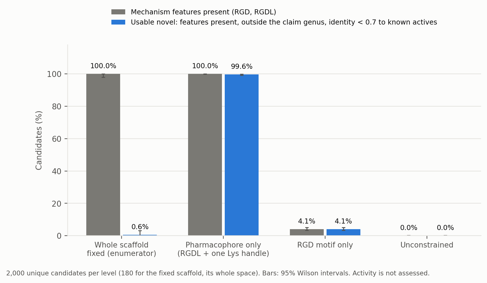

## Abstract

Design of cyclic peptides combines prior knowledge (mechanism rules, liability alerts, physicochemical heuristics), a requirement for novelty (distinct from known actives and from patented chemical space), and feedback from measurements. We give one formal framework in which these are a single object: knowledge enters a generative model as an exponential tilt of a base distribution, novelty is a distance-and-freedom-to-operate functional, relaxation of knowledge is a nested chain of constraint sets with a computable frontier, and feedback is a hierarchical observation model with source-specific offsets. We then measure the pieces that can be measured without wet-laboratory data. (i) On αvβ6-binding cyclic peptides, a design space that fixes the whole published scaffold yields 0.6% candidates that carry the mechanism features, lie outside the patented claim and differ from known actives (95% CI 0.1–3.1%); relaxing to the pharmacophore alone (the RGDL motif plus a single lysine handle) raises this to 99.6% (99.1–99.8%), and to 97.3% (95.7–98.4%) when restricted to the claim's own nine-residue form; relaxing further loses the mechanism (4.1% with the RGD motif only, 0% unconstrained). (ii) On 6,960 measured permeabilities, 78% of top-decile peptides come from a single literature source, so pooled hit rates mostly measure finding one laboratory's series; we show this for a one-line N-methylation rule (98.5% of its hits from that source) and re-state the feedback evaluation within source. (iii) The knowledge base's N-methylation heuristic points the right way in 7 of 8 laboratories but with a modest within-laboratory effect. Activity of relaxed designs, and the benefit of knowledge priors in the feedback loop under source-normalised outcomes, are specified as pre-registered next experiments.

## 1. Introduction

Medicinal-chemistry practice is a loop: propose candidates under accumulated knowledge, test them, and update. Three tensions run through it. Knowledge improves the hit rate but, applied too tightly, forces new candidates into the neighbourhood of what is already known and patented. Novelty is needed for freedom to operate, but unconstrained generation rarely produces candidates that engage the mechanism at all. Feedback corrects knowledge but arrives from different laboratories and assays whose systematic offsets can be mistaken for chemistry. We state these tensions formally, measure what can be measured on public data without a wet laboratory, and mark clearly what remains hypothesis.

## 2. A formal framework

**Design space and knowledge.** Let $\mathcal{X}$ be the set of cyclic peptides (all-atom molecular graphs with a macrocycle closure). A knowledge base is a triple $\mathcal{K}=(\mathcal{C},\Phi,\mathcal{A})$: hard constraints $\mathcal{C}=\{x:\,c_k(x)=1\ \forall k\}$ given by verifiable predicates (valid ring closure, mechanism motif, absence of liability alerts); soft features $\Phi=(\phi_1,\dots,\phi_m)$ with literature-signed directions (for example N-methylation count); and a reference set $\mathcal{A}$ of known actives and claimed compounds.

**Knowledge as an exponential tilt.** Let $p_\theta$ be a base generative model. Among distributions that satisfy the hard constraints and match prescribed feature expectations $\mathbb{E}_q[\phi_j]=\mu_j$, the one closest to $p_\theta$ in Kullback–Leibler divergence is
$$q^\star(x)\;\propto\;p_\theta(x)\,\mathbf{1}[x\in\mathcal{C}]\,\exp\!\big(-\lambda^\top\phi(x)\big),$$
a standard result of information projection (the multipliers $\lambda$ are set by the matching conditions). The same distribution is the optimum of the KL-regularised objective $\max_q\ \mathbb{E}_q[r]-\beta\,\mathrm{KL}(q\Vert p_\theta)$, which is $q\propto p_\theta\exp(r/\beta)$, with $r=-\beta\lambda^\top\phi$ plus an infinite penalty outside $\mathcal{C}$. Constrained decoding, verifiable-reward reinforcement learning and conditioning priors are therefore three approximations of one target, and can be compared against each other and against an untilted model under a single criterion.

**Novelty.** For a distance $d$ (one minus Tanimoto similarity, or sequence identity) define $N_{\mathcal{A}}(x)=\min_{a\in\mathcal{A}}d(x,a)$ and a freedom-to-operate indicator $F(x)=\mathbf{1}[x\notin\text{claimed genus}]$. With a mechanism predicate $M(x)$ (the features that make the compound act), the usable-novel set is
$$\mathcal{U}_\delta=\{x:\ M(x)=1,\ F(x)=1,\ N_{\mathcal{A}}(x)\ge\delta\}.$$

**Relaxation of knowledge is a nested chain.** Let $\mathcal{C}_0\subset\mathcal{C}_1\subset\dots\subset\mathcal{C}_L$ order constraint sets from strictest to loosest. For uniform sampling within each set define mechanism retention and usable novelty
$$m(s)=\Pr_{x\sim\mathcal{C}_s}[M(x)=1],\qquad u(s)=\Pr_{x\sim\mathcal{C}_s}[x\in\mathcal{U}_\delta].$$
The design question "how much knowledge to keep" is the optimisation $s^\star=\arg\max_s u(s)\ \text{s.t.}\ m(s)\ge m_{\min}$. The solution is the tightest relaxation that still preserves the mechanism, which we call the pharmacophore closure; nothing about it is specific to one target, because only $M$, $\mathcal{C}$ and $\mathcal{A}$ change.

**Feedback with source effects.** Measurements $y_{ij}$ of peptide $i$ from source (laboratory or batch) $s(i)$ follow
$$y_{i}=f(x_i)+b_{s(i)}+\varepsilon_i,\qquad b_s\sim\mathcal{N}(0,\tau^2),\ \varepsilon_i\sim\mathcal{N}(0,\sigma^2),$$
so a pooled outcome confounds $f$ with $b_s$. Within-source standardisation is the corresponding fixed-effects estimator and is the primary outcome in our feedback analysis; the same model covers batch effects in future wet-laboratory rounds.

**Knowledge as a prior in the learning loop.** Place a Gaussian-process prior on $f$ with mean $m_0(x)=\alpha\,\psi(x)$, where $\psi$ is a knowledge score. After $n$ observations the posterior mean is $m_0(x)+k_n(x)^\top(K_n+\sigma^2I)^{-1}(y-m_0)$: the data correct the prior, and knowledge dominates when $n$ is small. A simpler fusion of a model prediction $\hat f_n$ with the knowledge score, $w_n\,\psi+(1-w_n)\,\hat f_n$ with $w_n=n_0/(n_0+n)$, is the posterior mean of a conjugate normal model with prior strength $n_0$ pseudo-observations. Acquisition is $a(x)=\mu_n(x)+\kappa\,\sigma_n(x)$. Knowledge used only as extra input columns of a regressor (the usual practice) is a different and weaker role, and we test the roles separately.

**Evaluation functional.** For a policy $\pi$ over $T$ rounds, the primary outcome is the yield $H_T(\pi)=\mathbb{E}\big[\sum_{t\le T}\mathbf{1}\{\tilde y(x_t)\ \text{in the top fraction}\}\big]$ using source-standardised outcomes $\tilde y$, compared by paired differences with random selection and with a zero-learning knowledge rule.

## 3. Results

### 3.1 The frontier between knowledge and novelty (measured)

We drew 2,000 unique candidates from each member of the chain (180 for the fixed scaffold, which is its entire space): $\mathcal{C}_0$ the whole published scaffold with free flanking positions; $\mathcal{C}_1$ the pharmacophore (contiguous R-G-D-L and one lysine handle, ring size 7–11); $\mathcal{C}_2$ the RGD motif only; $\mathcal{C}_3$ unconstrained. Mechanism features were the RGD and RGDL motifs; the claimed genus was the structured patent claim mapped by an automatic claim mapper; $\delta$ corresponded to nearest-reference identity below 0.7.

The fixed scaffold retained the mechanism in every candidate ($m=1.00$) but only 0.6% were usable-novel (95% CI 0.1–3.1%): its free positions escape the literal claim in 90% of candidates but stay within 0.7 identity of known actives. The pharmacophore-only set retained the mechanism ($m=1.00$) and was usable-novel in 99.6% (99.1–99.8%). Because most of those candidates differ in ring size from the claim's nine-residue form, which a claim mapper treats as outside by form and cannot assess for equivalents, we repeated the comparison within the claim's own nine-residue form: 97.3% (95.7–98.4%) were literally outside the claim and below 0.7 identity, against 0.6% for the fixed scaffold. Relaxing further lost the mechanism ($m=0.041$ for the RGD motif alone, $0$ for unconstrained). The pre-specified frontier claim, that the pharmacophore closure exceeds both the fixed scaffold and the unconstrained set with non-overlapping intervals, was supported. This is a design-space characterisation; it does not say that relaxed designs are active, which is the question for the simulated-assay experiment that follows.

### 3.2 Measured outcomes are dominated by one laboratory (measured)

In 6,960 cyclic peptides with measured PAMPA permeability, 878 peptides from one literature source account for 557 of the 711 top-decile peptides (78%); outside that source only 2.5% of peptides are hits. Its peptides average 5.7 N-methylated amides against 1.9 elsewhere. A zero-learning rule that selects the most N-methylated peptides found 276 and 304 top-decile peptides in 500 selections (in-distribution and scaffold-shifted starts), but 272 of 276 and 301 of 304 of these came from that source. A learned loop with fingerprints found 397 and 367 with the same pooled outcome and is likewise confounded. By the observation model of Section 2, the pooled outcome estimates $f+b_s$; we therefore re-state the feedback comparison with within-source standardised outcomes, which is the pre-specified primary analysis. **[Within-source loop results to be inserted when the pre-specified run completes.]**

### 3.3 Does the knowledge base's heuristic hold within laboratories? (measured)

The knowledge base encodes that backbone N-methylation raises passive permeability. Within laboratories with at least five peptides in each arm, more N-methyl groups ($\ge2$) gave higher mean permeability in 7 of 8 laboratories (6 of 10 for $\ge1$); the median within-laboratory Spearman correlation between N-methyl count and permeability was 0.10 (11 of 19 laboratories positive). The heuristic is directionally right but modest within a laboratory, and its pooled enrichment is partly between-laboratory. Small-molecule rules in the same base (Lipinski, Veber) were satisfied by only 1.7% and 7.8% of cyclic peptides and are not usable as hard filters here; the PAINS domain flagged no peptide.

## 4. Generalisation and what is pre-specified next

The framework is target-agnostic because the target enters only through $(\mathcal{C},M,\mathcal{A})$ and $\Phi$; the evaluation (nested chain, source-standardised outcomes, zero-learning rule baselines, cluster- and source-disjoint splits) is independent of target and of modality. Three experiments are pre-specified: (KN-2) a simulated assay (metal-aware co-folding anchored to published control compounds) over the chain, to estimate activity retention along $s$; the learning-loop comparison of knowledge roles (extra columns, prior mean, fusion) under source-standardised outcomes; and an atom-level generative model in which the tilt of Section 2 is implemented as constrained decoding, verifiable reward and conditioning, evaluated by recovery of held-out laboratories' high-permeability peptides.

## 5. Limitations

Section 3.1 characterises the design space and does not measure activity; novelty is judged against a claim mapper that cannot assess equivalents and, for candidates of a different ring size, only by form. The literature permeability data are heterogeneous in assay and laboratory; the outcome dominance of one source limits what can be learned about within-laboratory structure. The framework's derivations are standard results used as organising principle, and the claim that the pharmacophore closure is the best trade-off is tested here only for novelty and mechanism retention, not for potency. No wet-laboratory data are used; prospective validation is planned for the next version.

## References

1. Csiszár I. I-divergence geometry of probability distributions and minimization problems. Ann. Probab. (1975).
2. Li J. et al. CycPeptMPDB: a comprehensive database of membrane permeability of cyclic peptides. J. Chem. Inf. Model. (2023).
3. Biron E. et al. Improving oral bioavailability of peptides by multiple N-methylation. Angew. Chem. Int. Ed. (2008).
4. Doak B. C., Over B., Giordanetto F., Kihlberg J. Oral druggable space beyond the rule of 5. Chem. Biol. (2014).
