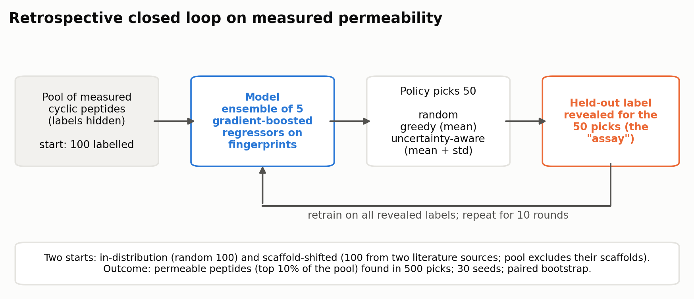

## Abstract

Closed-loop design cycles that propose compounds, measure them and retrain are widely proposed for cyclic peptides, but claims of benefit are rarely tested against measured outcomes. We evaluated a design–test–learn loop retrospectively on 6,960 cyclic peptides with measured membrane permeability (PAMPA), revealing each peptide's measurement only after the loop selected it. Starting from 100 labelled peptides, the loop retrained a bootstrap ensemble of gradient-boosted regressors on fingerprints for 10 rounds of 50 selections, from an in-distribution and a scaffold-shifted start. An earlier analysis that used a pooled top-decile label was confounded by one laboratory's series (78% of hits came from a single source) and is superseded (Supplement S1); the primary analysis normalises permeability within each source, and its protocol was amended before the re-run. In a pre-registered, audited re-run (chirality-aware features, PAMPA labels, source-standardised knowledge; 30 seeds, 810 runs), the greedy loop found far more top-decile peptides than random selection from an in-distribution start (236.1 vs 49.8 hits in 500 selections; mean paired difference +186.3, 95% bootstrap CI of the mean 181.1 to 191.5) and with near-duplicates removed (+163.4, 155.5 to 171.2); under scaffold shift the gain was smaller (+22.2, CI of the mean 17.7 to 26.5), and the pre-registered rule, which used the per-seed spread of the differences (-1.6 to 44.1), was not met. A zero-learning physchem rule matched the loop under scaffold shift (52.8 vs 52.3 hits) and reached 77% of its yield in-distribution. Knowledge priors or fusion gave small, mostly non-significant changes on this fixed dataset (five of 15 comparisons have a mean-based 99% lower bound above zero, a post hoc analysis; none passed the pre-registered rule), and no knowledge claim is made pending a shuffled-descriptor control and confirmatory seeds. Within-source standardisation did not remove source concentration: the loop took 69% of its in-distribution picks from the largest source (41% of peptides).

## 1. Introduction

Optimising permeability is a central difficulty for oral cyclic peptides, and experiments are expensive, so selecting which peptides to test next matters. A model-guided loop is attractive, but its benefit depends on the data it starts with and on whether the next compounds resemble those already measured. Published permeability models are typically evaluated on held-out compounds, which does not test the thing a loop depends on: the cumulative yield of useful compounds as labels accumulate and the model is retrained. We ask a narrow question with measured data: does a model-guided loop find more permeable cyclic peptides per experiment than random selection, and does that survive a start on unfamiliar scaffolds?

## 2. Methods

**Data.** The public CycPeptMPDB database [1]: PAMPA permeability (log Papp) for cyclic peptides, with detection-floor values removed and duplicate structures averaged (6,960 peptides). Features were Morgan count fingerprints (radius 2, 2,048 bits).

**Loop.** Each run starts with 100 labelled peptides and a pool of the rest. In each of 10 rounds a policy selects 50 pool peptides, their measured values are revealed, and the model is retrained on all revealed labels. The model is a bootstrap ensemble of five gradient-boosted regressors. Policies: random; greedy (highest predicted mean); uncertainty-aware (mean plus one ensemble standard deviation); and an oracle that selects the true best (an upper bound, not a method).

**Regimes.** (A) In-distribution: the initial 100 are random. (B) Scaffold-shifted: the initial 100 are drawn only from the two largest literature sources, and the pool excludes all peptides sharing a Murcko scaffold with them.

**Knowledge-augmented arm.** A second loop used the fingerprints plus ten literature permeability descriptors (molecular weight, topological polar surface area, hydrogen-bond donors and acceptors, lipophilicity, rotatable bonds, N-methylated amide count, largest ring size, heavy-atom count, fraction of sp3 carbons), declared before the main result was read.

**Exploratory rule baseline.** After the main result, we ranked the pool once by a single descriptor (N-methyl count, low polar surface area, high lipophilicity or low donor count) and took the top 500, on the same seeds and pools, to ask how much a one-line rule achieves without learning.

**Outcome and statistics.** A hit is a peptide in the top 10% of measured permeability in the dataset (threshold fixed in advance). The primary outcome is the number of hits among the 500 loop selections, over 30 seeds (the seed fixes the initial set and bootstrap), with paired differences between policies using the same initial set and 95% percentile intervals over seeds. The claim that the loop beats random required the interval of (greedy or uncertainty-aware minus random) to exclude zero in both regimes.

## 3. Results

### 3.1 Primary result (amendment L5, pre-registered; 810 of 810 runs, 30 seeds per arm and regime)

Regimes: A, in-distribution start; B, scaffold-shifted start; C, in-distribution start with every stereo-free duplicate of the initial set removed from the pool (sensitivity). Hit = top 10% of the within-source standardised PAMPA label; 500 selections per run.

**Loop versus random selection.** Greedy fingerprint loop 236.1 hits vs random 49.8 in A (mean paired difference +186.3; 95% bootstrap CI of the mean 181.1 to 191.5; central 95% range of the per-seed differences 158.5 to 209.0); 52.3 vs 30.1 in B (+22.2; CI of the mean 17.7 to 26.5; per-seed range -1.6 to 44.1); 212.5 vs 49.2 in C (+163.4; CI of the mean 155.5 to 171.2; per-seed range 128.1 to 196.3). **Interval types.** The intervals used by the pre-registered rules C1 and C2 were the central range (spread) of the 30 per-seed paired differences, i.e. a description of run-to-run variability; they were mislabelled confidence intervals in earlier drafts. By that pre-registered rule C1 (loop beats random in both A and B) was **not met**, because the B spread includes zero. A bootstrap confidence interval of the MEAN difference over seeds, which is the inferential quantity (and the primary interval from amendment L7k on), excludes zero in B; this analysis is post hoc relative to the rule and exploratory. Seeds resample the initial set and the model's bootstrap on one fixed dataset: they do not resample laboratories or chemical series, so neither interval is evidence about new laboratories (regime L, below, is the test of that). Under the second, within-group hit definition (sensitivity), B is +41.7 (23.4 to 61.6); the two definitions disagree on this regime, and the earlier L3 estimate for B (+32.6, 15.7 to 51.8) used chirality-blind features and the generic label column and is superseded.

**Zero-learning rule baselines (same seeds, ties broken at random).** Loop minus rule, mean paired difference with the bootstrap CI of the mean and, separately, the per-seed range. Regime A: N-methyl rule +105.4 (CI of the mean 100.2 to 110.7; per-seed range 78.3 to 131.6); physchem rule K_z +53.6 (CI of the mean 48.2 to 58.7; per-seed range 25.1 to 77.0). Regime B: N-methyl rule +31.5 (CI of the mean 27.6 to 35.2; per-seed range 10.7 to 47.8); K_z -0.5 (CI of the mean -4.2 to 3.2; per-seed range -20.0 to 17.2) (rule 52.8 hits vs loop 52.3: the loop does not exceed the physchem rule under scaffold shift on either interval). Regime C: N-methyl rule +73.3 (CI of the mean 67.3 to 79.2; per-seed range 40.5 to 101.3); K_z +53.7 (CI of the mean 49.0 to 58.4; per-seed range 30.9 to 74.3); both intervals of both types lie above zero.

**Knowledge as prior or fusion (H3).** Differences from fingerprints alone, total hits, 99% intervals: regime A: kn +5.1 (-18.3, 32.6); resid_nme +1.9 (-19.9, 34.1); resid_z +6.0 (-16.1, 33.8); fuse_nme +5.2 (-17.7, 41.6); fuse_z +8.0 (-14.7, 48.0). regime B: kn +23.8 (-4.0, 54.0); resid_nme +3.9 (-19.9, 29.4); resid_z +1.6 (-19.4, 15.9); fuse_nme +7.5 (-17.7, 40.7); fuse_z +13.9 (-8.7, 46.6). regime C: kn +1.9 (-48.5, 20.4); resid_nme -0.7 (-33.3, 29.6); resid_z +5.1 (-21.5, 29.1); fuse_nme +4.0 (-19.1, 32.6); fuse_z +3.1 (-23.1, 32.1). All 15 spread-based 99% ranges include zero, so the pre-specified claim C2 was **not supported by its own rule**. Recomputed as bootstrap CIs of the mean paired difference (exploratory), five of the 15 comparisons have a 99% lower bound above zero (A: resid_z +6.0 [0.3, 12.2], fuse_z +8.0 [1.8, 14.7]; B: kn +23.8 [17.2, 30.0], fuse_nme +7.5 [0.8, 14.3], fuse_z +13.9 [7.3, 21.0]); under a Bonferroni correction for the 30-comparison family (15 arms-by-regimes times 2 hit definitions) only the larger effects survive (B kn, B fuse_z; secondary definition: A kn +11.1, B kn +25.0, B fuse_z +6.9). These are small effects on a single fixed dataset; the descriptor arm has not yet been checked against a shuffled-descriptor control, so **no knowledge claim is made**. The confirmatory test of knowledge is the paired contrast K_phys minus K_shuffled on fresh seeds (Section 3.3).

**Where the gain comes from.** Mean picks from the largest source (2020_Townsend, 41% of peptides): loop 346 of 500 in A against 206 for random, 324 in C against 205; in regime B 55 against 60 (no concentration there). The in-distribution gain is therefore largely concentration on the largest laboratory's series, consistent with the label audit (52.8% of hits from that source after standardisation).

The pooled analysis below is retained for transparency and is superseded by 3.1 as the primary outcome.

The earlier pooled-label analysis (top decile of the pooled label, original protocol) is retained for transparency in Supplement S1 under a 'superseded' banner and is not used for any claim in this paper.

### 3.3 Knowledge contrasts on the development seeds (GBM, `_sub` protocol, 10 seeds; confirmatory seeds 10–29 pending)

Paired by seed, 99% bootstrap CI of the mean difference, cumulative hits in 500 picks. K_phys minus K_shuffled (a knowledge-shaped channel carrying no information): A +5.8 [3.0, 8.3005], B +3.2 [0.7, 6.1], L (held-out laboratories) +7.1 [3.1, 11.1]. K_phys minus none: A +2.4 [-1.1, 5.4005], B +4.9 [1.6995, 7.8], L -0.1 [-4.0, 4.6]. The contradicted channel (K_phys sign-flipped) costs yield in every regime (A -7.7, B -5.4, L -5.7). The channel therefore helps relative to a no-information channel on yield, but relative to no channel at all the gain is small and inconsistent, and the E-AUROC contrasts are mixed; these are development-seed results and carry no claim until the pre-registered confirmatory seeds (10–29, Holm-corrected over three regimes) are analysed. **Regime L caption.** Held-out laboratories are redrawn per seed from the same 18 eligible laboratories (the two largest sources are never held out; 8 distinct held-out sets over seeds 0–9, each of the 18 eligible laboratories held out in 6–10 of the 10 seeds; the sets are in `results/regime_L_heldout_sets.json`). The number of held-out laboratories ranges from 6 to 18 per seed and the held-out share of peptides from 25% to 34% (the eligible laboratories hold only 34% of all peptides, so the 25% target is overshot); in 3 of the 10 seeds (0, 7, 9) every eligible laboratory is held out, so those seeds train on the two largest laboratories and the sources under 20 peptides only. The source-cluster analyses use the 11 laboratories evaluated in at least 3 seeds with at least 15 evaluation peptides, so regime-L contrasts are seed-based over a small fixed laboratory pool and are not evidence about laboratories outside it. **K_phys in the loop, one statement for all documents (learner, metric and interval type all matter).** Plain chirality-aware GBM, development seeds 0–9: K_phys beats a no-information channel on yield in all three regimes (A +5.8, B +3.2, L +7.1; mean-based 99% CIs exclude zero), and improves model E-AUROC over that channel in regime B on the seed-based interval (+0.0326 [0.011, 0.055]); on the held-out-laboratory ranking metric (within-source Spearman on E) with a source-cluster bootstrap, K_phys minus K_shuffled and K_phys minus none include zero in A, B and L (B: −0.0049 [−0.037, 0.032], 9 labs). Physchem-descriptor GBM: no yield gain over no channel, and on held-out-laboratory ranking K_phys is WORSE than shuffled knowledge in B (−0.0387 [−0.090, −0.0012]) and L (−0.0351 [−0.069, −0.0071]) and than no channel in B (−0.0396 [−0.091, −0.0003]), with cluster intervals excluding zero on the negative side; this is not explained (a hypothesis, untested, is that the descriptors K_phys is built from are already inputs of that model). Confirmatory seeds 10–29 (plain GBM) are pending, so no knowledge claim is made. Shuffled-label controls: the global-draw shuffled arm loses 23.6 hits (A) and 32.7 (L) against the true-label loop, but only 1.4 [-1.0, 4.4] in B, where the `_sub` protocol's yield barely depends on labels.

## 4. Discussion and limitations

**What was measured.** In a pre-registered, audited retrospective replay on 6,960 cyclic peptides, a greedy fingerprint loop finds far more top-decile peptides than random selection when the start is in-distribution (about 5 times as many; Section 3.1), and still finds more under scaffold shift (about 1.7 times as many on the mean-based interval; the pre-registered spread rule was not met). Much of the in-distribution gain is concentration on the largest laboratory's series (69% of picks against 41% of peptides), and a zero-learning physchem rule matches the loop under scaffold shift (52.8 against 52.3 hits) and reaches 77% of its in-distribution yield. The honest reading is that a feedback loop adds value over random selection but that, on this dataset, simple physchem knowledge captures much of what the loop learns.

**Yield versus model improvement.** The outcome here is cumulative yield of selected peptides. It is not a measure of model improvement: a loop can raise yield by exploiting a known series without the model becoming better elsewhere. Model quality is measured separately on held-out slices (Section 3.3); the two should not be conflated.

**Controls and baselines still missing from this section.** Source-restricted random selection and a source-prior baseline (always pick from the highest-yield source) are not yet reported and would test how much of the loop's gain is source identity; the specification of the shuffled-label and shuffled-knowledge controls was corrected during this work (the shuffled-knowledge arm is judged by the paired contrast, not by the shuffled-label rule).

**Limitations.** Retrospective: peptides were measured in different laboratories under different conditions; seeds vary the initial set but not the dataset; PAMPA permeability only; fingerprint models are a deliberately simple baseline; chirality is only partly represented even with chirality-aware fingerprints (RDKit's chiral Morgan separated 48 of 64 stereoisomers of a test macrocycle); re-estimating each source's mean and SD from a random 30% subsample changes the hit status of 99.7 of 6,960 labels on average (1.4%; hit-set Jaccard 0.867 over 697 hits, i.e. about 7% of hits), an upper bound on the sensitivity to using all-label statistics; a prospective test with newly synthesised peptides is planned.

## References

1. Li J. et al. CycPeptMPDB: a comprehensive database of membrane permeability of cyclic peptides. J. Chem. Inf. Model. (2023).

## Supplement S1 — SUPERSEDED pooled-label analysis (do not cite)
> **Superseded.** This analysis used the pooled top-decile label (78% of hits from one source), chirality-blind fingerprints and a rule baseline with dataset-order tie-breaking (the 'N-methyl rule 276/304' figures, including the zero-variance 304 [304-304], are a tie-break artefact; within source the rule reaches 130.7/236.1 = 55% in A and 20.8/52.3 = 40% in B). The statements about concentration percentages (89%/93%, 272 of 276, 301 of 304) have no committed artifact and are withdrawn. Kept only to document the correction.

Caveat (pooled labels): The top-decile outcome is dominated by one source (Figure not shown): 557 of 711 hits come from 878 peptides of a single laboratory, so the loop and the N-methyl rule largely locate that series (the N-methyl rule's top 500 selections were 89% from it in-distribution and 93% scaffold-shifted; 272 of 276 and 301 of 304 hits). The tables and figure below are retained for transparency and must not be read as within-laboratory permeability gains.

**Selection with a model beat random selection by a wide margin from both starts (Figure L2, Table 1).** From the in-distribution start, the greedy loop found 396.7 top-decile peptides in 500 selections on average, against 49.9 for random selection (difference +346.8 (95% CI 280 to 389)). From the scaffold-shifted start it found 366.7 against 106.6 (difference +260.1 (95% CI 125 to 318)). The uncertainty-aware policy behaved similarly (+345.4 (95% CI 312 to 377) and +265.0 (95% CI 210 to 314)). The pre-specified claim, that a loop policy beats random with an interval excluding zero in both regimes, was met.

| Policy | In-distribution start | Scaffold-shifted start |
|---|---|---|
| Random selection | 49.9 (34–71) | 106.6 (84–125) |
| N-methyl-count rule, no learning (exploratory) | 276.3 (269–283) | 304.0 (304–304) |
| Greedy loop, fingerprints | 396.7 (341–423) | 366.7 (234–415) |
| Uncertainty-aware loop, fingerprints | 395.4 (373–415) | 371.5 (318–411) |
| Greedy loop, fingerprints + rule features | 418.0 (378–444) | 327.0 (146–417) |
| Uncertainty-aware loop, fingerprints + rule features | 411.5 (368–436) | 347.2 (203–414) |
| Oracle (upper bound) | 500 | 500 |

**Table 1. Top-decile peptides found in 500 selections** (mean over 30 seeds, with the 2.5–97.5% range across seeds in parentheses). The oracle selects the best 500 by construction.

**Adding literature permeability descriptors to the fingerprints did not help.** Relative to fingerprints alone, the knowledge-augmented loop changed the yield by +21.3 (95% CI -11 to 63) from the in-distribution start and -39.7 (95% CI -211 to 113) from the scaffold-shifted start (greedy policy; uncertainty-aware: +16.1 (95% CI -17 to 45) and -24.3 (95% CI -177 to 54)). All intervals include zero, so the pre-specified claim that the added rules help was not supported.

**A single classical rule recovers most of the yield without any learning (exploratory).** Ranking the pool by N-methylation count alone selected 276 top-decile peptides in the in-distribution setting and 304 in the scaffold-shifted setting, that is 70% and 83% of the greedy loop's yield. Rules based on TPSA, lipophilicity or hydrogen-bond donors alone did much worse (93, 30 and 34 in the in-distribution setting). The learned loop's advantage over the N-methyl rule is clear in-distribution (+120) but smaller and uncertain after the scaffold shift (+63, with seed-to-seed range 234–415).

