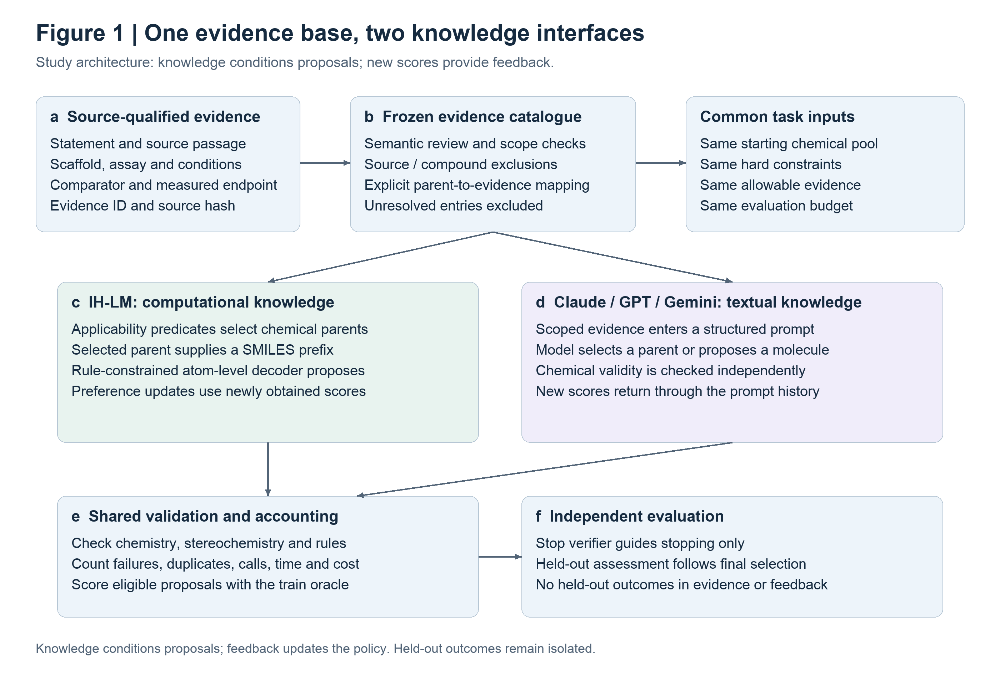

# Method architecture revision audit

This is an internal source audit, not manuscript text. No experiment or numerical analysis was run for this revision.

## Scientific corrections

- Active architecture: causal SMILES backbone, query/value LoRA, symbolic output mask, scoped chemical-parent selector and continuous-score pairwise DPO.
- No active PeptideCLM encoder, learned evidence encoder, cross-attention or chemical-edit executor.
- Rank-advantage utility is not called by integrated DPO; score gaps filter pairs but do not weight loss.
- Prefix bounds do not prove that a valid macrocycle completion exists. Full constraints are checked at EOS.
- Standalone masked-likelihood adapters differ from integrated adapters and are not automatically loaded.
- Stop monitor recommends a prior round; orchestrator currently halts without restoring it.
- Training SD-AUC and final held-out scores are distinct; the historical margin wording needs a prospective protocol resolution.

## Placement

Section 3 now contains mathematical definitions and computational operations; Section 4 endpoint definitions; Section 5.1 checkpoint, corpus, knowledge eligibility and comparison setup. Relevant standalone monitor simulation numbers moved to component Results. The old structure-tier DockQ comparisons and uncorrected structural census/statistics were removed from the manuscript because they do not evaluate this model and are not admitted conditioning inputs. Their old text is preserved below for provenance, not as validated results.

## Code inspected

`hybrid/model.py`, `hybrid/sampling.py`, `hybrid/adapters.py`, `hybrid/knowledge_parent.py`, `hybrid/run_stage1.py`, `rules/constraint.py`, `rules/tracker.py`, `rules/lora_mask_smoke.py`, `retrieval/retriever.py`, `feedback/preference_updater.py`, `feedback/stop_monitor.py`, `orchestrator/loop.py`, `pmo_harness.py`, under `research/guangzhou_all_atom/cyclic_llm/allatom_paper/`.

## Validation

A parallel read-only implementation review checked the mathematical formulation. Corrections included EOS termination, rule-state indexing, row-vector adapter notation, and explicit final-score versus training-AUC separation. The architecture image was rendered and visually inspected. Document checks confirmed both linked images exist, equation labels run consecutively from 1 to 15, section references resolve, and the unrelated DockQ values are absent from the manuscript. No model tests, fitting or scientific aggregation ran locally. LoRA citation metadata was checked at https://arxiv.org/abs/2106.09685.

## Superseded architecture and knowledge material (verbatim archival record)

## 3. IH-LM

### 3.1 Architecture

**Backbone.** IH-LM represents molecules as atom-level SMILES; it does not directly generate three-dimensional atomic coordinates. The backbone is a decoder-only transformer of about 970 million parameters with 22 layers, hidden size 2,048, rotary position embeddings, a vocabulary of 320 atom-level tokens and 512 positions. The vocabulary is a SMILES atom tokenisation in which bracket atoms carry chirality (`@`, `@@`), charge and explicit hydrogens, ring closures are digit tokens and branches are parenthesis tokens, so stereochemistry, N-methylation, D-residues and macrocycle topology are explicit in the token stream.

**Adapters and conditioning.** The implemented integration uses rank-eight adapters on the query and value attention projections. ChemFM has an atom-level vocabulary and does not directly read prose, assay descriptions or provenance-tagged quotations. The current retrieval adapter selects a chemical parent and supplies a partial SMILES prefix; it does not implement trained natural-language conditioning. The proposed knowledge interface therefore acts first on parent or proposal selection through explicit applicability checks (Section 3.3.4). Prototype source code does not establish a tested knowledge-on arm. Sampling and preference training use the same temperature-scaled logits, soft potentials and hard mask.

**Decoding automaton.** A token-level parser over the 320-token vocabulary tracks ring closures, atom counts and weights, N-methyl amide counts and branch depth, and masks logits to reject prefixes its bounds identify as infeasible (Section 3.2). The finite test set does not prove that every surviving prefix admits a completion.

**Encoder.** A frozen PeptideCLM-2 encoder (31.7 million and 114 million parameter models; weights loaded into our own implementation with strict key and shape matching, zero missing and zero unexpected keys) provides embeddings for the retrieval index and for novelty and diversity measures. Frozen embeddings were not detectably different from fingerprints for ranking in our pilot analyses, so no claim rests on them.

**Structure tier (prospective candidate audit).** Final study candidates are intended to be scored against targets by Boltz-2 [45] and BoltzGen [46] cofolding and UniMoMo [47], used for verification only, and by our molecular-mechanics and free-energy pipelines. A cyclic fine-tune of BoltzGen that we tried lost to the base model on three of three comparisons, and UniMoMo's cyclic DockQ (0.759) exceeded that fine-tune's (0.506), so the structure tier is used unmodified.

**Figure 1 | Knowledge interfaces and evaluation.** Audited evidence is represented by its source, scope, comparator and endpoint. IH-LM uses this evidence through applicability checks and chemical-parent selection, whereas the general-purpose language-model comparison supplies the corresponding evidence as text. Both interfaces lead to chemical proposals evaluated under shared validation and budget accounting. New oracle scores provide feedback; held-out outcomes are excluded from proposal selection and policy updates. This is a method schematic, not a performance result. The general-purpose-model comparison is specified in Section 4.11.

### 3.2 Rule-compiled decoding

**Rule set.** The hard constraint set C is: a single connected sanitisable molecule; largest ring of at least 12 atoms; between 2 and 6 N-methyl amides (SMARTS `[CX3](=O)[NX3;!H1]([CH3])`); molecular weight in [600, 1,400]; topological polar surface area at most 300; no PAINS match (RDKit catalogue). The set is identical to the one used in the pilot of Section 5.1, and a test asserts equality with the pilot checker on a large string set.

**Compilation.** The tracker maintains ring-closure bookkeeping (open labels and ring sizes), a running molecular-weight sum, and lower bounds on the number of N-methyl amides still required and on the tokens needed to finish. The intended admission criterion is that a completion can still satisfy C. The implementation approximates this with conservative bounds: an additive molecular-weight bound that uses the remaining-token minimum, the N-methyl window, and feasibility of closing a macrocycle of at least 12 atoms. Inadmissible tokens receive −∞ logits. End of sequence is admitted only if the complete string satisfies C, so every finished sample satisfies C by construction. The prefix look-ahead is the property that matters: a mask without it can steer decoding into a prefix with no rule-satisfying completion. Preservation of satisfying strings (no false pruning) is tested on a golden set of enumerated satisfying, violating and invalid strings with a required false-prune rate of zero; a reference implementation and a vectorised one are compared on the same strings. Results are in Table 5.

**Soft rules (prospective, audit-gated).** Optional log-linear potentials can add to the logits (a product of experts). Their weights have three possible sources, treated as an experimental factor: none (hard rules only; the primary configuration), literature priors from the knowledge layer (Section 3.3.4), and the per-laboratory directions measured on the two training laboratories (data-descriptive priors). Weights are an untuned uniform prior, and the size and D-residue rules carry weight zero (Section 3.3.4). Mining validated rules on the training laboratories alone yielded none: the unmodified criteria require at least three sources (and half-split agreement for pair rules) and the training group has two. The per-source directions nevertheless agree between the two laboratories and with textbook directions (TPSA −0.470 and −0.485, HBD −0.439 and −0.527, logP +0.287 and +0.488 within-source Spearman; N-methylation mean within-source z-effect +0.623 and +0.483, pooled +0.554 [0.373, 0.735], I² = 0.95). A leak guard rejects any rule file mined from laboratories that fit a stop or held-out verifier.

**Fine-tuning under the mask.** Masked decoding changes the sampling distribution relative to the unmasked model. To keep the learned distribution conditional on the rules, the proposed adapter study will apply the same mask to the logits and compute likelihood under the constrained softmax. The planned diagnostics are masked-versus-unmasked divergence, validity, uniqueness and diversity of 5,000 model samples, and the effect of 200 adapter steps. These cells in Table 5 remain unmeasured; the six-step smoke does not substitute for them. A post-hoc-filter arm (no mask; rule failures discarded after generation) is retained as an ablation that also reports the proposal/time overhead from rule failures.

### 3.3 Knowledge augmentation

The proposed conditioning layer separates mined evidence from instructions that the chemical generator can execute. Every statement carries a source and a verbatim quotation of at most 30 words. After whitespace normalisation the quotation must be an exact substring of the stored full text of the cited paper, and an entry that fails is discarded, never repaired. This guarantees attribution of the sentence, not correct reading, so extraction precision is measured separately on judged samples. The layer is reusable outside this model; its construction, coverage and extraction quality are given in the knowledge-base paper, and this section states what is needed to replicate the present study.

**3.3.1 Contents and schema.** The layer holds rules and fundamentals (directional relations, windows and mechanisms with effect sizes where the source states them: beyond-rule-of-5 windows, intramolecular hydrogen bonding, N-methylation, ring size, lipophilicity and polarity, solubility, permeability mechanisms), cautions (limits, data-bias and counter-evidence statements), cards for design campaigns and methods (what was designed, hit rates, failure modes), and structure-derived knowledge (Section 3.3.5). Each entry records a direction (plus, minus, multi, window, context, caution, conflict), a scope, the outcome concerned, an effect size where given, an evidence tier, the source identifier (PMCID, arXiv identifier or DOI), a confidence level and the extractor. Tier T1 marks a quotation where the quoted statement reports a result or method from the source's own experiment, simulation or data analysis; T2 marks a review's summary of others' work, a restated result, a textbook rule, background or a project goal, and is the default when the stored text cannot show that the number is the source's own; T-internal marks project documents; P marks patent-derived statements. The original metadata eligibility screen permitted a weight only if its tier is T1 or T2, it is a rule or fundamental with a verified quotation and a weighted direction, and it maps to a feature computable from the two-dimensional structure (TPSA, hydrogen-bond donors and acceptors, molecular weight, cLogP, rotatable bonds, heavy atoms, N-methyl count, D-residue count, cyclic flag). These metadata conditions are insufficient for actual use: scoped semantic review, feature mapping and leakage clearance are additionally required (Section 3.3.4). No reviewed unconditional literature token prior is currently admitted.

**3.3.2 Sources.** (a) *Existing collections* are imported by identifier: CycPeptMPDB, CREMP, CyclicPepedia, Macrocycle-DB and SweMacrocycleDB for structure-property data, and BioLiP2 for complexes, joined on stereo-aware InChIKey or PDB identifier with parse and join rates recorded. Propedia and PepBDB were not imported; they derive from the same deposited structures and carry no cyclic-specific annotation, which is a scoping decision and not a verified equivalence. (b) The *hand-verified set* holds 107 entries (44 rules, 24 fundamentals, 11 cautions, 28 cards) in tiers T1 (60), T2 (36) and T-internal (11), from 45 external sources (41 open-access articles and 4 preprints) and 5 internal documents. In this set all 107 quotations are machine-verified against stored full text, and an initial metadata screen flagged 32 entries as weight-eligible (14 T1 and 18 T2; 28 permeability, 1 stability, 1 solubility, 2 other). That designation is historical and does not establish eligibility for a global token-level prior. The file's SHA-256 begins `293688072468…`. (c) *Scaled extraction* runs an eight-billion-parameter open-weight instruction model over open-access full text with 40 queries over four topics (structure-property rules, fundamentals, prior-work statements, target-structure statements); every surviving entry passes the exact-quotation check, and planted-quote and altered-quote controls must all be rejected. Acceptance thresholds were fixed before extraction: judged precision of at least 0.80 on a 100-entry audit sample drawn with a fixed seed, and scaling only if the pilot projects at least 60% of the property-by-substructure coverage cells filled, a cell being filled with at least three verified entries from at least three papers. (d) *Patent mining* is extraction only, without any freedom-to-operate analysis: candidate patents are selected from the SureChEMBL snapshot by a peptide-macrocycle filter (molecular weight 500 to 2,600, a ring of at least 12 atoms, at least three amide bonds in or attached to the ring), full texts are retrieved from public patent pages with a fixed delay, and statements are extracted with the same schema and the same exact-quotation check into the separate tier P. (e) *Structure mining* re-detects cyclisation (disulfide, head-to-tail, amide-like, thioether, ester-like, carbon-carbon link; ring size in residues), D residues and N-methylation from the deposited coordinates by distance and geometry tests, independently of any resource label, from BioLiP2 peptide-ligand entries and our earlier coordinate-based miner (30,773 candidate complexes, 28,789 parsed; 90% are linear peptides and are removed). After the original automated filters and removal of duplicates (best resolution per target, sequence and closure class), the uncorrected library contains 888 cyclic-peptide complexes over 451 targets, 802 of them with non-antibody receptors (closure: 366 disulfide, 187 head-to-tail, 140 amide-like, 78 carbon-carbon link, 69 thioether, 48 ester-like; 765 X-ray, 110 cryo-EM and 13 NMR structures; median resolution 2.2 Å; 527 with non-standard residues, 226 with at least one D residue, 118 with at least one N-methyl and 134 with a cis amide).

**3.3.3 Leak safety and direction check.** Knowledge derived from labelled evaluation data must not enter a prior that is evaluated with that data. Data-derived priors are mined from the train group only (Section 4.2), and the guard `assert_priors_clean` refuses a prior mined from any source that fits a stop or held-out verifier; the earlier rule file mined from all laboratories fails it. Literature priors use no labels in their creation or weights. The scaled extraction flags an entry as a possible benchmark source when the first author and year of its paper match a CycPeptMPDB source, and flagged entries are excluded from priors used with held-out verifiers. Priors computed from a target's structures or ligands are excluded for that target in the retrospective arm. As a consistency check, the direction of each literature rule was compared with the train laboratories only (2020_Townsend, 2,881 peptides; 2021_Kelly, 1,518; within-source Spearman against the raw PAMPA label, cluster bootstrap over stereoisomer groups, descriptive, no multiplicity correction). Of the 107 entries, 17 agree, 7 are mixed, none disagrees and 83 cannot be tested (cards, cautions and context entries make no directional claim, and non-permeability rules cannot be tested against a permeability label). N-methyl count (+0.50 and +0.53), HBD (−0.44 and −0.53), TPSA (−0.47 and −0.49) and cLogP (+0.29 and +0.49) agree in both laboratories; molecular weight and heavy-atom count change sign between them (−0.12 and +0.48), and D-residue count shows no signal at the count level (−0.04 and +0.02).

**3.3.4 Use in the model.** A quotation may be faithful while its conversion into a global reward is unsound. The subsequent scientific review of the 32 flagged entries allowed none as an unconditional monotone token prior: ten remain provisional for scoped use and 22 are excluded from that use. In particular, exposed backbone NH is not interchangeable with total hydrogen-bond-donor count, and the effect of N-methylation can reverse with position and scaffold. Agreement with the two training laboratories does not remove those conditions. The earlier configuration of 15 direction-agreeing literature rules is therefore not admitted as a validated prior, and no such ablation result is reported.

The current integration implements stereo-aware retrieval of chemical neighbours and selection of a chemical parent for prefix completion. This supplies molecular context but does not demonstrate that mined prose changes generation. The prospective knowledge interface carries each statement's source, quotation, scope, outcome, applicability predicates and counter-evidence into an explicit selection layer. Only statements whose predicates are satisfied, whose source exclusions are met and whose intended intervention has been reviewed may change parent or proposal selection. A statement with no implementable predicate remains contextual evidence rather than a numerical reward. Matched knowledge-off, knowledge-on and inapplicable-evidence controls are required, with evidence identifiers and prefix hashes logged and identical oracle budgets. An empty accepted catalogue means that the knowledge arm has not been instantiated; it must not be relabelled as an equivalent knowledge-on condition.

The underlying retrieval tools include a stereo-aware index (Morgan radius 2, 2,048 bits, chirality on) with deterministic tie-breaking. Separate blind-rule tests reject document identifiers, answer-set structure keys and year cut-offs that could expose held-out information. On the arm-G store (4,634 exact rows from 230 documents spanning 1991 to 2025 and eight integrin targets), the newest held-out document was excluded in five of five queries. A wider store of 21,575 rows over 724 targets lacks document identifiers and cannot support that blind arm. These component checks do not establish an integrated knowledge-conditioning result.

**3.3.5 Structure-derived candidates and target cards (annotation audit unresolved).** The following counts and statistics are retained as historical outputs of the uncorrected annotation pipeline, not validated chemical priors. Independent review found systematic linker-ring errors, CCD/D-residue discrepancies and N-methylidene ambiguity. Leave-one-target-out stability cannot detect a systematic annotation error. Ring, D-residue and N-methyl statistics require reviewed correction/filtering and recomputed values and hashes before use in a knowledge arm. From the library of Section 3.3.2(e) we compute bound-conformation priors on the primary set of 802 complexes over 378 targets (a target is the UniProt set of the receptor chains). Each prior is tested for stability by leave-one-target-out: the total-variation distance (categorical priors) or the largest absolute change (rates) when one target is removed, with thresholds fixed before the run (at least 20 targets, median deviation at most 0.05, maximum at most 0.25). The original pipeline classified the following statistics as stable: ring spans by closure type (disulfide median 10 residues, interquartile range 8 to 13, n = 301; head-to-tail 8, 7 to 11, n = 174; amide-like 7, 5 to 10, n = 137; thioether 12, 9 to 12, n = 67); the frequency of beta-turn types (a type I turn in 56.5% of disulfide-closed complexes, type I′ 9.0%, II 6.3%, II′ 7.3%); the position rates of N-methylation (4.7% at positions in contact with the target against 2.2% elsewhere) and D residues (5.3% against 6.9%, not enriched); and the fate of backbone NH groups (47% intramolecularly hydrogen-bonded, 10% bonded to the receptor only, 43% free). Interface-residue enrichment is not stable under leave-one-target-out (maximum deviation 0.50 in log2 units) and is exported with weight zero. Every prior carries the SHA-256 of the target set it was computed from (`419f8bf3d8dc…` for the primary set), and the computation accepts a list of accessions to exclude: for the retrospective arm the αvβ6 and PD-L1 accessions are removed, which also removes the αvβ3 targets that share the αV accession. The proposed structure interface represents these priors as provenance-tagged records and ring-size soft potentials (log-probability tables per closure class, default weight 0.5 where stable, untuned). This is a proposed interface, not an enabled validated prior. The historical stability checks measured sensitivity to removal of one target, not annotation correctness or transfer to new targets; use of no affinity labels does not resolve those limitations. Contaminated ring tables remain excluded pending reviewed repair.

The 17 historical target cards, which inherit the annotation limitations above, report, for each target, the reference structure, the number of cyclic-peptide complexes in the library and the best template. Five targets have cyclic-peptide complexes (BAFF 5, FcRn 5, IL-17A 1, PD-L1 9, TNF-α 1). CD20's single complex is an antibody-epitope complex and the card says so. The library holds no cyclic-peptide complex for α4β1, α4β7, αvβ6, C5, CD40, IL-17F, IL-23, IL-2Rα, IL-6R, LFA-1 or GRPR; their cards carry an explicit no-structure flag, and any prior for them is transferred from other targets. For αvβ6 this does not prove that no such complex exists in the PDB, because complexes in which the macrocycle is deposited as a hetero-ligand fall outside both resources.

### 3.4 Training IH-LM

#### 3.4.1 Initialisation and data

The implemented integration loads the ChemFM-1B checkpoint [1]. The proposed adapter corpus will draw public peptide and macrocycle SMILES from CREMP [31], NPAtlas [38], COCONUT [39], a capped generated-peptide pool and ChEMBL (at most 10% of tokens), with every CycPeptMPDB structure (7,334 peptides in its publication [30]) and every compound of the frozen binding benchmark excluded by flat-structure key and Tanimoto ≥ 0.9 (the corresponding union filter removed 8,983 molecules, 0.312%, from the ChEMBL corpus used for earlier work). Corpus composition, counts and exclusion checks remain unfilled in Table 6. The exclusion policy is prospective and must be verified against the actual training corpus; it is not a demonstrated no-overlap claim. The verifiers of Section 4.2 are fitted on CycPeptMPDB labels. The need for this stage is measured: an earlier 25.5-million-parameter atom-level model trained mostly on ChEMBL (1.7% macrocycles) generated molecules that were 66.4% valid, 10.2% macrocycles, with a mean of 0.078 N-methyl amides per molecule against 2.67 in real peptides; the corresponding content of the initialisation checkpoint remains unmeasured in Table 5.

#### 3.4.2 Fine-tuning under the mask

The planned adapter study will train with the decoding mask applied (Section 3.2), after the corpus and exclusions in Table 6 are frozen. The recorded six-step standalone smoke reduced masked negative log-likelihood from 0.8933 to 0.8075. No verified 200-step completion, full-corpus training result or integrated real-model M1 acceptance is available; Table 5 retains those diagnostics as unmeasured.

#### 3.4.3 Preference stage

*Diagnosis.* Two earlier feedback runs barely moved their policies. A group-relative policy-gradient run had a fraction of zero-standard-deviation reward groups of about 0.95 to 1.0 and a KL divergence from the reference of about 0.001: a binary reward combined with a start policy that is consistent per prompt gives no within-group variance, so the update learns from roughly 5% of the batch. In a direct-preference run the relative weight change was 0.00096 and 0.0017 for two variants, and 70.8% of the valid samples of the unified peptide model were memorised training peptides. These diagnostics motivate repairing the learning signal; they do not establish the capability of the proposed method.

*Update.* The preference updater (i) computes graded rewards from continuous train-verifier scores; (ii) forms rank-based group advantages (ties averaged, no division by the group standard deviation); (iii) requires a minimum number of valid members per group and a non-trivial score spread and reports dropped groups; (iv) forms pairs of the i-th best against the i-th worst with a score margin and applies a DPO loss against the frozen reference; and (v) applies a gate from round 3: if the recorded policy-change diagnostic or relative adapter-weight change is below its threshold, an escalation or stop is applied. The latest integration proposal uses a one-time learning-rate multiplication by two, not a rank change; its exact gate and context-averaged next-token KL definition must be frozen before study execution. A control that can fail is built in: on a tabular toy policy with a concentrated start, the legacy binary recipe has more than 90% zero-variance groups, a gain near zero and KL near zero, whereas the graded updater has a gain above 0.10 and KL above 0.01; on a broad start the legacy recipe learns, so the stall comes from the variance structure and not from a defective legacy implementation. Both directions are asserted in tests. The group-size parameter counts valid members: a nominal group size does not ensure the required number of valid members; the rule automaton guarantees constraint satisfaction only for completed samples; dead ends and length-limited failures remain in the denominator and may still prevent a preference update.

#### 3.4.4 Goodhart-gap stopping

The monitor tracks the best-so-far set by train score (size set from the first batch) and the independent stop-verifier score of that set, smooths both, and stops when the gap, in units of the round-0 standard deviation, exceeds a threshold for consecutive rounds; the restore point is the maximum of the stop-verifier gain. The held-out verifier does not appear in its signature. Parameters were fixed on development simulations before test seeds were run: top fraction q = 0.10, threshold τ = 1.0, patience 4, tolerance 0.05, warm-up 2, smoothing 3.

*Operating characteristics on planted environments* (simulations; 400 test seeds per environment; evolution-strategy optimisation in ten dimensions with a hackable proxy). In the hackable environment the monitor retained 0.794 [0.776, 0.811] of the peak held-out gain against 0.560 [0.556, 0.563] without a monitor, stopping a median of 3 rounds before the held-out peak, with a missed-hack rate (retained fraction below 0.75) of 0.273. In the benign environment it retained 0.999 with a false-stop rate of 0.000 (Wilson 95% upper bound 0.010). A simpler monitor retained 0.447 in the hackable environment. When the stop verifier shares the train verifier's exploit the monitor behaves like no monitor (0.560). The pre-registered verdict was INCONCLUSIVE: the missed-hack rate exceeded the 0.20 criterion and the median delay of −3 rounds fell outside the [−2, +4] window; criteria were not changed after test results. A documented limitation is the winner's curse: best-so-far statistics grow by selection alone when the train score is noisy, so a plateau can look like a widening gap, and the monitor assumes the train and stop verifiers measure related quantities. Its effect in the peptide loop remains unmeasured in Table 8.

### 3.5 Loop orchestration

In the prospective protocol, a round consists of sampling from the compiled decoder (the earlier protocol specified 100–200 proposals per round; the staged integration specifies 64 and requires a prospective amendment), querying the train verifiers within the remaining budget (duplicates, invalid molecules and rule failures are not charged), forming preference pairs, updating the adapter, adding scored molecules to the retrieval store, and updating the monitor. Checkpoints are atomic. Exact oracle-log replay was tested for the deterministic toy loop; real-model resume additionally stores optimizer, CPU/CUDA random-generator and sampling-configuration state, but its numerical replay has not yet been demonstrated. Oracle-call logs contain molecule hashes; final candidate files and resumable oracle checkpoints retain structures. Periodic upload is an execution-wrapper responsibility. On a planted-optimum test problem (ten seeds, 300-call budget) the loop found the optimum in 7 of 10 seeds against 1 of 10 for random search, and a shuffled-reward control gave no gain (−0.0015, t-interval [−0.020, 0.017]); this verifies the harness, not anything about peptides.

---
