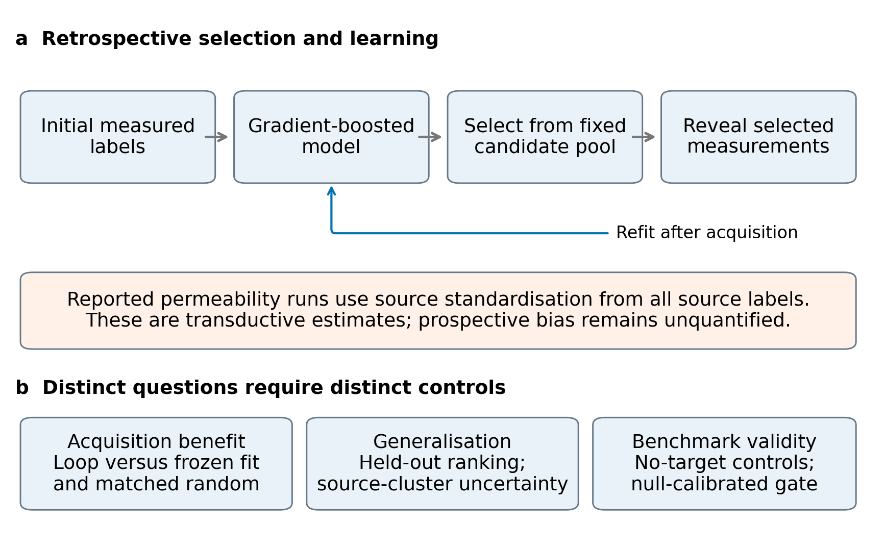
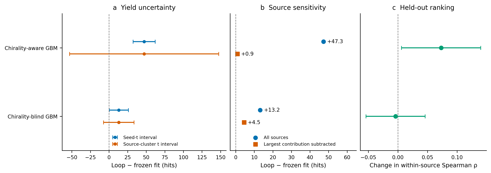
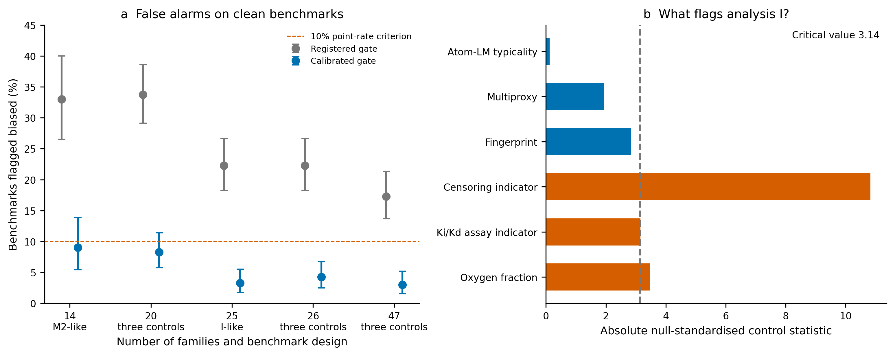
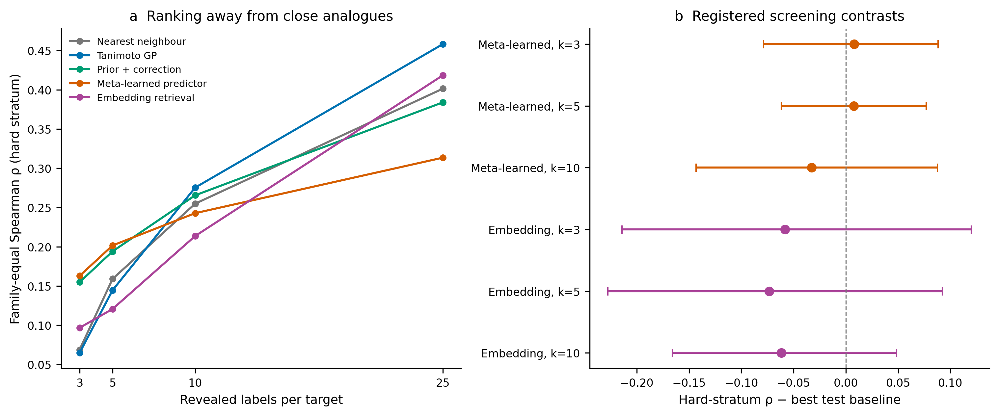

# A benchmark framework to guide automated cyclic peptide discovery

## Abstract
Reliable benchmarks are a foundation for automated cyclic-peptide discovery, in which models guide repeated rounds of synthesis, measurement and candidate selection. Such benchmarks must establish whether learning from each new batch improves subsequent selection and whether those gains extend beyond familiar chemical series and experimental sources. We introduce an integrated benchmark framework that tests the contribution of model updating, transfer across experimental sources and the reliability of benchmark-validity decisions through retrospective permeability replay and binding analyses. In the permeability replay, a chirality-aware gradient-boosted learner gained 8.0 hits per 500 selections over its frozen initial fit in-distribution. A larger full-pool gain of 47.3 hits was reproducible across initialisation seeds but concentrated in one literature source; its source-cluster interval was −53.0 to 147.6. Using transductive source standardisation, these retrospective yields identify source-sensitive acquisition effects and inform prospective validation. In a separate candidate-subset evaluation on held-out sources, ranking improved over the frozen model (Spearman correlation gain, 0.075; 95% source-bootstrap interval, 0.037–0.115), although the advantage over shuffled feedback remained unresolved. Benchmark validity also required calibration: the original gate falsely flagged 24.5–32.5% of clean benchmarks, whereas a calibrated gate flagged 3.0–8.3% at 20–47 families and detected shortcuts at the tested AUROCs of 0.65 and 0.70. On measured-inactive binding data, the calibrated verdict was driven by censoring and assay type, rather than the primary compound-only controls. By combining learning controls, source-aware evaluation and calibrated validity testing, the framework provides a foundation for evaluating automated cyclic-peptide discovery and suggests principles for testing learning-driven experimentation across other drug modalities.

## Introduction
Cyclic-peptide discovery requires choosing which molecules to make and which properties to measure. For intracellular targets, a candidate must combine target activity with sufficient membrane permeability; these properties require distinct assays. Combinatorial synthesis and screening can identify active cyclic peptides and support subsequent optimisation of permeability [12]. Automated synthesis can also generate experimental datasets for learning about synthetic feasibility, as demonstrated for peptide cyclisation [13]. These advances create opportunities for automated discovery platforms that connect computational selection, synthesis and experimental testing. Building such platforms requires a reliable way to evaluate the models that decide which experiments to perform next.

In a model-guided design–make–test–learn cycle, an initial model is fitted to peptides with known measurements. It ranks or proposes candidates, a batch is selected for synthesis, and assays measure properties such as target binding, functional activity or membrane permeability. The resulting measurements, together with their assay conditions and quality checks, are added to the training data. The model is then updated and used to select the next batch. This return of experimental results to the model is what we call *feedback*. Automating this cycle offers the prospect of directing experimental capacity towards increasingly informative or promising peptides. Its success depends on whether each round of measurements improves subsequent decisions, and whether the relationships learned remain useful as the platform encounters new chemistry and experimental conditions.

A reliable benchmark provides a foundation for developing this decision-making capability before committing to repeated laboratory campaigns. It must test whether model updates improve candidate selection, identify the chemical and experimental settings in which those improvements hold, and establish whether its own scoring procedures reward the intended capability. Three challenges motivate our study: distinguishing learning from the advantage of an initial predictor or a close measured analogue; evaluating transfer across heterogeneous experimental sources; and detecting dataset shortcuts without incorrectly rejecting a sound benchmark.

Cyclic peptides combine a large chemical design space with sparse and heterogeneous measurements. Public datasets offer an opportunity to evaluate computational design, but they also contain related compounds measured within a small number of experimental series. CycPeptMPDB, for example, was introduced with 7,334 peptides from 45 papers and two patents [1]. Published permeability benchmarks show substantial losses when evaluation moves from random to scaffold splits, and strong kernel methods remain competitive with learned molecular representations [2]. A model that ranks members of a familiar series can therefore appear effective without learning a relationship that transfers to a new chemical or experimental setting.

The central evaluation question is whether updating the model after each batch improves the choice of subsequent peptides. Better yield than random selection does not by itself establish this: the initial model may already identify a productive series. Nor does an improvement after a few labels establish transfer, because a nearby measured analogue can provide most of the useful information. Comparisons of molecular representations [3], activity-cliff prediction [4] and virtual-screening benchmarks [5–7] illustrate why simple baselines and controls for dataset structure are essential. Assay heterogeneity adds a further difficulty: measurements from different sources need not be interchangeable [8,9]. Recent peptide benchmarks [10] and work on inter-laboratory generalisation in other molecular tasks [11] reinforce the need to identify the unit over which a result generalises.

Addressing these challenges requires evaluating the benchmark itself. A control intended to detect shortcuts can also flag a sound dataset if its decision threshold is poorly calibrated. The evaluation must therefore measure both sensitivity to known shortcuts and the rate of false alarms.

Here we introduce a controlled benchmark framework to support the development of automated cyclic-peptide discovery. It connects three questions: whether learning from new measurements improves selection beyond the initial predictor and predictions based on similar measured peptides, whether learned rankings transfer across experimental sources, and whether the benchmark can distinguish target-relevant performance from dataset shortcuts. We evaluate these questions through retrospective permeability replay and binding analyses.

The study makes three methodological contributions. First, a coordinated set of frozen-model, data-matched one-shot, shuffled-feedback and retrieval comparisons tests competing explanations for apparent learning gains. Second, separate acquisition and held-out-source ranking analyses, with uncertainty over both seeds and experimental sources, identify which gains persist under a change in the unit of inference. Third, planted-valid and planted-shortcut experiments measure the false-alarm and detection rates of the benchmark-validity gate itself, and calibration identifies the controls responsible for its verdicts. Together, these components make benchmark interpretation an empirical object of study and provide a design for testing claims of transferable learning.

Together, these analyses provide an evidence base for designing and evaluating future automated discovery campaigns: they identify the baselines a learning system should improve upon, the experimental units over which gains should be tested, and the checks needed to interpret benchmark scores. The retrospective design and source-standardisation assumptions are specified in Methods; prospective campaigns can build on these findings by testing candidate selection under new chemical and independently identified laboratory conditions.

## Results

### Most of the selection advantage precedes feedback
The permeability replay began with 100 labelled peptides and selected 50 more in each of ten rounds. We evaluated histogram gradient-boosted learners using chirality-aware fingerprints, chirality-blind fingerprints or physicochemical descriptors. In addition to a full-pool protocol, a candidate-subset protocol limited each round to 150 candidates so that competing policies faced the same selection opportunity. Initialisation was either in-distribution (regime A), scaffold-shifted (B), or paired with evaluation on held-out literature sources (L). In regime L, acquisition still occurred in training sources; only the ranking evaluation tested unseen sources (Fig. 1).

In the candidate-subset protocol, the chirality-aware loop gained 8.0 hits over its frozen initial fit in regime A (95% percentile-bootstrap interval over ten development seeds, 3.6 to 12.5). The corresponding gain under scaffold shift was 1.5 (−1.9 to 4.8). In regime L it was 8.4 (5.8 to 11.2), compared with 29.3 (25.4 to 33.3) over shuffled feedback. Learner-specific results are retained separately in Supplementary Table 1; pooling them would obscure the dependence on representation and evaluation regime.

Full-pool selection produced a larger apparent advantage in regime L. The chirality-aware loop selected 248.6 hits, compared with 201.3 for its frozen initial fit and 62.5 for random feedback. Thus, 75% of the loop's advantage over random selection was already present before feedback; the corresponding proportion for the chirality-blind learner was 92%. The aware loop-minus-frozen gain was 47.3 hits, but its source-cluster t-interval was −53.0 to 147.6 across 14 source clusters. One source, 2020_Townsend, accounted for 88.7% of the sum of absolute source contributions. Subtracting its observed contribution left a net gain of 0.9 hits; this descriptive calculation did not rerun training or acquisition without that source. For the blind learner, the gain was 13.2 hits with a source-cluster interval of −7.3 to 33.7. Reproducibility across initialisation seeds therefore did not establish reproducibility across sources (Fig. 2).

The registered 30-seed replay also illustrates the distinction between a decision rule and a post hoc summary. The loop-minus-random difference was 186.3 hits in regime A and 22.2 in regime B. The registered central spread of paired differences was 158.5 to 209.0 in A and −1.6 to 44.1 in B, so the criterion requiring improvement in both regimes was not met. Post hoc bootstrap intervals for the mean were narrower: 181.1 to 191.5 and 17.7 to 26.5, respectively. The loop did not detectably outperform a label-free physicochemical rule under scaffold shift: the loop-minus-rule difference was −0.5 hits, with a registered spread of −20.0 to 17.2.

These yields depend on how hits are defined. The replay uses within-source standardisation and a threshold calculated from all labels of a source, including labels not yet revealed to the policy. In regime A, 346 of the loop's 500 selections came from 2020_Townsend. An indicative single-seed comparison gave 251 hits with the transductive convention, 151 with standardisation based on labelled peptides alone and 47 for random selection. This diagnostic is not a replicated estimate of the leakage effect. These are transductive estimates; their prospective bias remains unquantified. A causal-normalisation arm and a source-matched random control remain unevaluated.

### Cross-source evaluation identifies ranking gains and their limits
Acquisition yield and transfer need not move together. On the held-out evaluation slice, sequential feedback did not detectably outperform a data-matched one-shot update: the aware learner's loop-minus-one-shot AUROC gain was −0.006 (95% seed-bootstrap interval, −0.033 to 0.025), with an approximate minimal detectable difference of 0.04. The blind learner's corresponding contrast was +0.003 (−0.034 to 0.037).

Within-source Spearman correlations were more dependent on learner and regime. In regime L, under the candidate-subset protocol, the aware loop exceeded its frozen initial fit by 0.075 (95% source-bootstrap interval, 0.037 to 0.115), but its contrast with shuffled feedback was 0.034 (−0.063 to 0.120). The descriptor learner exceeded both controls, whereas the blind learner exceeded neither on this measure. The random-feedback contrasts used the full-pool protocol; none of the three learners showed a clear regime-L advantage on that comparison (Supplementary Table 2). Figure 2c separately shows the full-pool aware loop-minus-frozen ranking contrast, 0.073 with a source-t interval of 0.006 to 0.140; it is not the candidate-subset bootstrap contrast above. These intervals involve only 6–11 source clusters, for which percentile bootstrap inference can be anti-conservative; approximate detectable differences for the cluster contrasts were 0.13–0.19.

Random feedback ranked held-out sources better than active selection for the descriptor learner in regimes A and B. The cause remains unresolved: a diagnostic excluded an evaluation artefact, but restricting label ranges explained less than the registered fraction of the gap. More broadly, fingerprint-model correlations declined from 0.67–0.71 with flat-structure grouping to 0.21–0.22 with source holdout. Literature sources are proxies for laboratories rather than independently identified assays, and two sources were held out in every development seed. These evaluations provide retrospective evidence about transfer to held-out literature sources and identify the comparisons that merit prospective validation in independently identified laboratories.

### A benchmark validity gate requires its own controls
A benchmark can reward compound properties that separate positives from decoys without requiring target-specific information. We tested for these shortcuts with no-target controls and an equivalence-based validity gate. A VALID verdict required evaluable controls, no flagged deviation from chance and sufficiently narrow primary-control intervals. However, a gate that cannot pass a clean benchmark is not a useful certifier.

Positive-control experiments exposed this problem. The original gate falsely flagged 24.5% of clean analysis-I-type benchmarks with 26 families and 32.5% of clean M2-type benchmarks with 14 families, exceeding its registered 10% limit. Its probability of declaring a planted-valid benchmark VALID was 61% and 2.5%, respectively. The fixed equivalence margin and multiple control tests made the original instrument particularly restrictive at small family counts (Supplementary Note C).

We therefore calibrated a maximum statistic of standardised control deviations against null records and derived the equivalence margin from the design's minimal detectable difference. Constants were frozen before validation records were generated. Across validation cells with 20–47 families, the calibrated gate's false-alarm rate was 3.0–8.3%, compared with 17.2–33.8% for the original gate applied to the same records. Detection was 100% for the tested single-property shortcuts at AUROC 0.65 and 0.70, with 60 records per cell and an exact lower 95% bound of approximately 0.94. No shortcut record at 0.65 was certified VALID; the upper 95% bound was approximately 0.060 per 60-record cell, so zero observations do not establish a zero population rate (Fig. 3; Supplementary Note D). Censoring was tested only at 0.65 in the 25-family design; the other shortcut types were tested at both levels in the 20-, 25- and 47-family designs.

Calibration did not remove the sample-size limit. On the 14-family M2 application set, the calibrated probability of certification was only 17.0%. Nor do the tested shortcuts cover every form of bias: detection below AUROC 0.65 was not measured, and nulls derived from label permutations cannot reproduce every dependency in real data. The calibrated gate is an instrument with measured operating characteristics over specified conditions, rather than a universal guarantee of benchmark validity.

### Censoring drives the measured-inactive binding verdict
Analysis I used measured inactives from the same target as positives, with Pfam-family-disjoint folds. It contained 9,432 rows representing 6,619 compounds; 11.6% of rows shared a compound with another fold. In the original analysis, the primary no-target fingerprint control achieved AUROC 0.584 (95% family-cluster interval, 0.533 to 0.636; 26 families), compared with 0.503 (0.458 to 0.550; 25 families) for atom-language-model typicality and 0.559 (0.499 to 0.619; 25 families) for a multi-proxy control. These intervals describe the original gate analysis; calibration used separately recomputed intervals. These values triggered the original gate, but all three primary statistics fell within the calibrated null.

The calibrated verdict was dominated by censoring, with the Ki/Kd assay indicator and oxygen fraction also exceeding the calibrated threshold. Right-censored values accounted for 63.6% of inactives, whereas only 3.1% of positives carried any censoring relation. A censoring indicator alone produced family-mean AUROC 0.206 (95% interval, 0.159 to 0.253), equivalent to 0.794 when its direction was inverted. Analysis I remained flagged by the calibrated gate, as did M2, with permutation p-values of 0.0025 and 0.005, respectively—the smallest attainable with their permutation counts. On M2, the verdict depended on secondary physicochemical controls and the permutation test, rather than any single primary control.

These distinctions matter for model interpretation. The zero-shot pretrained model's analysis-I AUROC was 0.539 (0.478 to 0.605); no paired comparison established an advantage over the fingerprint control. The original analysis-M fingerprint value of 0.315 was a label-inversion artefact and corrected to 0.461 (0.423 to 0.498). Removing censored values did not yield a viable exact Ki/Kd classification benchmark, leaving 1,473 positives and only 72 inactives. We consequently treat model comparisons on the flagged binding benchmark as conditional diagnostics, not evidence of transferable target recognition.

### Few-label performance is largely reproduced by lookup
Nearest-neighbour retrieval on analysis I reached AUROC 0.753, 0.822 and 0.869 after 5, 10 and 25 revealed labels, respectively. Fitting on the revealed labels gave similar values, while the gain over zero-shot prediction was concentrated among compounds close to a revealed analogue. Because analysis I is flagged, these are relative comparisons within a confounded benchmark.

A separate exact-potency screening analysis avoided the censoring indicator by evaluating ranking rather than binary activity. Its test half contained 86 targets in 21 families. Nearest-neighbour and Tanimoto Gaussian-process baselines led overall from five labels onward; at 25 labels, the Gaussian process reached family-equal Spearman correlation 0.628 overall and 0.458 in the hard stratum. At three labels, however, a target-agnostic potency prior with correction exceeded both lookup methods in the hard stratum, showing that compound-only information remained useful. Embedding retrieval and the meta-learned predictor did not establish a hard-stratum gain (Fig. 4). With detectable differences of 0.13–0.19 against a +0.03 margin, the screen was inconclusive rather than evidence that such gains are absent (Supplementary Note B).

An independent retrospective binding-loop rerun supported the same narrower interpretation. Across 40 targets in 23 families, learned acquisition exceeded random selection by 0.149 in family-mean yield (95% family-cluster interval, 0.102 to 0.197), but exceeded nearest-neighbour acquisition by only 0.014 (−0.018 to 0.047). Together, these analyses identify analogue lookup as an essential comparator while leaving open whether additional learning helps in better-powered, more distant chemical settings.

## Discussion
This study develops a benchmark framework to guide the progression from predictive models to automated cyclic-peptide discovery. It tests the source of an apparent gain, its transfer across literature sources and the reliability of the benchmark used to judge it. The distinctive contribution is the connection between these assessments. A gain reproducible across seeds can remain uncertain across sources, a held-out ranking improvement can depend on its comparator, and a validity test can require calibration before its verdict is interpretable. These are experimentally testable properties of an evaluation framework, with direct consequences for how subsequent methods should be assessed.

Retrospective feedback gains combine several effects: an informative initial predictor, access to nearby analogues, the composition of the candidate pool and learning from newly revealed measurements. In the public cyclic-peptide datasets studied here, these effects could not be inferred from comparison with random selection alone. Frozen-model controls accounted for much of the apparent selection advantage, source-level inference exposed concentration that seed-level replication concealed, and strong lookup baselines reproduced much of the gain under shift.

The same discipline applies to the evaluation instrument. A validity gate can expose shortcuts while still falsely rejecting clean benchmarks. Measuring its false-alarm and certification rates changed the interpretation of analysis I: the primary fingerprint signal alone was compatible with the calibrated null, whereas censoring and assay type supported the biased-benchmark verdict. Reporting effect sizes, operating characteristics and the controls responsible for each decision is more informative than reporting a pass/fail label alone.

For an automated cyclic-peptide platform, these findings translate into a proposed sequence of validation. Historical data can first be used to compare model updating with a frozen initial predictor, data-matched fitting and selection based on nearby measured analogues. A prospective campaign can then use only measurements available at each decision, record synthesis failures and assay quality alongside successful outcomes, and evaluate candidate selection under a fixed experimental budget. Testing across independently identified laboratories would assess whether gains persist under changes in measurement conditions. This sequence connects the benchmark to platform development while leaving laboratory throughput, synthesis reliability and prospective discovery yield as separate outcomes to establish.

The evaluation principles could also inform other drug modalities. For small molecules, linear peptides, proteins or oligonucleotides, an analogous design would compare updating with appropriate similarity baselines, hold out relevant chemical or sequence groups, and assess transfer across assay batches or experimental sites. The representations, biological endpoints and independent units would need to be defined for each modality. We propose these as adaptations of the framework; their effectiveness is not established by the cyclic-peptide results.

More broadly, experiment-planning benchmarks such as Olympus already support evaluation for autonomous chemistry and materials research [14]. Our framework offers a complementary emphasis: determining what an apparent improvement can be attributed to, over which independent units it holds, and how reliably a benchmark detects misleading signals. These questions can inform the evaluation of the decision-making component of an automated laboratory. Extending the framework to end-to-end laboratory performance would additionally require measurements of execution failures, elapsed time, resource use and reproducibility, with validation under the intended operating conditions.

Several limits constrain these conclusions. The permeability yields use transductive standardisation; a revealed-label-only implementation remains necessary before causal claims about feedback. Each task draws on one fixed public library, and literature-source identifiers imperfectly represent laboratories. Small numbers of independent sources and families restrict detectable effects. Some comparisons and margins were specified after earlier results, and percentile cluster intervals can be anti-conservative. The exact-potency screen retains cross-assay heterogeneity and unchecked pretraining overlap for embedding retrieval. No prospective compounds or generated molecules were tested.

These findings motivate a practical order of evaluation: first establish what the data and controls can distinguish, then ask whether feedback improves on an initial fit and strong retrieval, and finally test whether the improvement transfers across independent experimental units. The present results concern retrospective simple-learner replay and supporting ranking analyses. They neither demonstrate nor rule out advantages from language-model feedback loops, new architectures or prospective generative design.

## Figures

Figure 1 | Separating acquisition, generalisation and benchmark validity. a, Retrospective replay reveals measurements after selection and refits a gradient-boosted learner. The reported permeability replay nevertheless uses full-source label statistics for normalisation; it is not a demonstrated causal, revealed-label-only normalisation experiment. b, Acquisition yield, held-out ranking and benchmark validity answer different questions and are assessed with separate controls. This is a protocol schematic, not an experimental result.

Figure 2 | Seed replication does not establish cross-source yield gain. Regime L, full-protocol replay, 10 seeds per learner. a, Loop-minus-frozen yield with 95% t intervals across seeds (blue) or source clusters (orange; 14 aware and 16 blind). b, Descriptive omission of the largest contributing source: 2020_Townsend for the aware learner (88.7% of absolute source contributions), 2021_Kelly for the blind learner (53.7%). Shares divide the absolute contribution of that source by the sum of absolute source contributions. Omission subtracts the observed contribution; it is not a rerun without that source. Omission points have no plotted uncertainty and are not independent tests. c, Full-pool loop-minus-frozen change in held-out within-source Spearman correlation, with 95% t intervals across 11 evaluable sources. Yield is measured in the acquisition pool; ranking is evaluated separately.

Figure 3 | Calibration reduces false alarms and identifies the basis of the real-benchmark verdict. a, Registered and calibrated rules are evaluated on the same planted-valid null benchmarks (permuted real benchmark structures and synthetic family structures) within each displayed design (200 replicates at 14 families; 400 otherwise). Bars are 95% binomial intervals. These matched comparison rates differ from the earlier, independent gate-positive-control experiment. Acceptance also requires an upper 95% bound no greater than 15%; it does not establish a population rate below 10%. The 14-family setting remains too weak to establish certification despite reduced false alarms. b, Absolute null-standardised statistics for selected analysis-I controls; dashed line is the calibrated critical value. Orange bars exceed the threshold: censoring, the Ki/Kd assay indicator and oxygen fraction. No primary compound-only control exceeds it. A gate verdict is not evidence of a model advantage.

Figure 4 | Few-label transfer remains unresolved beyond strong lookup controls. Exact-potency benchmark, test half: 86 targets in 21 families, equal weight per family. a, Descriptive hard-stratum learning curves; uncertainty is omitted from this panel for readability. b, Registered screening contrasts against the best baseline on the test half, with 97.5% family-cluster intervals at k=3,5,10. All six intervals include zero. These underpowered screening results do not establish equivalence or absence of benefit; they are distinct from the censoring-biased analysis-I classification benchmark.

## References
1. Li J, Yanagisawa K, Sugita M, Fujie T, Ohue M, Akiyama Y. CycPeptMPDB: a comprehensive database of membrane permeability of cyclic peptides. J Chem Inf Model 2023, 63(7), 2240–2250. doi:10.1021/acs.jcim.2c01573.
2. Amirahmadi A, Geylan G, De Maria L, Etminani F, Ohlsson M, Tibo A. A decoupled alignment kernel for peptide membrane permeability predictions. arXiv:2511.21566 (2025); J Cheminform 18, 108 (2026). doi:10.1186/s13321-026-01276-5.
3. Praski M, Adamczyk J, Czech W. Benchmarking pretrained molecular embedding models for molecular representation learning. arXiv:2508.06199.
4. van Tilborg D, Alenicheva A, Grisoni F. Exposing the limitations of molecular machine learning with activity cliffs. J Chem Inf Model 2022, 62, 5938–5951. doi:10.1021/acs.jcim.2c01073.
5. Chen L, Cruz A, Ramsey S, Dickson CJ, Duca JS, Hornak V, Koes DR, Kurtzman T. Hidden bias in the DUD-E dataset leads to misleading performance of deep learning in structure-based virtual screening. PLoS ONE 2019, 14(8), e0220113. doi:10.1371/journal.pone.0220113.
6. Huang A, Knight IS, Naprienko S. Data leakage and redundancy in the LIT-PCBA benchmark. arXiv:2507.21404.
7. Sieg J, Flachsenberg F, Rarey M. In need of bias control: evaluating chemical data for machine learning in structure-based virtual screening. J Chem Inf Model 2019, 59(3), 947–961. doi:10.1021/acs.jcim.8b00712.
8. Kalliokoski T, Kramer C, Vulpetti A, Gedeck P. Comparability of mixed IC50 data: a statistical analysis. PLoS ONE 2013, 8(4), e61007. doi:10.1371/journal.pone.0061007.
9. Landrum GA, Riniker S. Combining IC50 or Ki values from different sources is a source of significant noise. J Chem Inf Model 2024, 64(5), 1560–1567. doi:10.1021/acs.jcim.4c00049.
10. Zhang J, Wang R, Zhou K, Xiao T, Zhu L, Min Y, Wang Y. PepBenchmark: a standardized benchmark for peptide machine learning. arXiv:2604.10531 (ICLR 2026).
11. Klamt T, Nejdl W, Tang M. Decomposing the generalization gap in PROTAC activity prediction: variance attribution and the inter-laboratory ceiling. arXiv:2605.11764 (preprint).
12. Merz ML, Habeshian S, Li B, et al. De novo development of small cyclic peptides that are orally bioavailable. Nat Chem Biol 2024, 20, 624–633. doi:10.1038/s41589-023-01496-y.
13. Pan Y, Hu C, Li J, Wan F, Hong X, Li C. CycloPepper: a machine learning platform for predicting cyclization outcomes and optimizing synthesis of therapeutic cyclopeptides. Nat Commun 2026, 17, 2803. doi:10.1038/s41467-026-69441-w.
14. Häse F, Aldeghi M, Hickman RJ, Roch LM, Christensen M, Liles E, Hein JE, Aspuru-Guzik A. Olympus: a benchmarking framework for noisy optimization and experiment planning. Mach Learn Sci Technol 2021, 2, 035021. doi:10.1088/2632-2153/abedc8.

## Methods

### Data and experimental units
The CycPeptMPDB dataset used in this study contained 8,466 rows, 7,991 unique structure identifiers and 7,298 PAMPA values. Filtering yielded 6,960 labelled peptides from 41 literature sources. Source and year were taken from the PAMPA measurement row. Twenty sources contained at least 20 labelled peptides, accounting for 6,784 peptides; the remaining 176 peptides from 21 sources were pooled as one standardisation group. Throughout, “laboratory” denotes a literature-source identifier; it is not an independently verified experimental laboratory or assay.

The binding collection contained 16,195 compounds, 14,599 flat structures, 793 targets with labelled pairs and 24,583 labelled pairs (20,562 positive and 4,021 inactive). Registered folds were Pfam-family-disjoint. Analysis I included 46 targets from 26 families and used same-target measured inactives. Cross-target decoy designs M, M2 and M3 were used to diagnose benchmark validity. A protein-level fold assignment with 298 families, including 23 in analysis I, provided a sensitivity analysis. Benchmark lists were frozen with SHA-256 hashes.

### Replay, controls and evaluation regimes
Each replay began from 100 labelled peptides. At each of ten rounds, a policy selected 50 pool peptides, observed their measured labels and updated its model. Histogram gradient-boosted regressors used 2,048-bin, radius-2 Morgan count fingerprints with or without chirality, or physicochemical descriptors. Each prediction averaged five regressors fitted to bootstrap samples of the revealed labels, with 150 boosting iterations and learning rate 0.1; the ensemble was refitted from scratch at each update. Primary feedback comparisons selected the highest predicted scores with stable tie ordering. Other estimator settings followed the recorded software defaults. The frozen control was fitted once to the initial 100 labels; it was not a pretrained model. Other controls comprised data-matched one-shot learning, random feedback, globally shuffled pool labels and a knowledge-off arm. Candidate-subset rounds selected 50 peptides from a random subset of 150 candidates; full-pool rounds selected from the entire eligible pool.

Hits were defined by the top decile of the within-source standardised label. Both the standardisation and threshold used all labels within a source, including unrevealed labels. Label access by the acquisition policy was sequential, but the outcome convention was transductive. No replicated revealed-label-only normalisation arm or source-matched random control was run. The single-seed normalisation comparison is therefore an indicative diagnostic, not a confirmatory effect estimate.

Regime A used an in-distribution random start. Regime B excluded shared scaffolds between the initial set and pool while retaining the same dominant sources, and therefore shifted scaffold rather than laboratory. Regime C excluded identical structures but retained close analogues: 26.9% of pool compounds had Tanimoto similarity at least 0.9 to an initial peptide. Regime L held out sources for ranking evaluation while drawing acquisitions from training sources. The two dominant sources were never held out; 2013_CHUGAI and 2016_Furukawa were held out in every seed. Held-out sets contained 6–18 sources and 25.2–34.3% of peptides per seed, with all 18 eligible sources held out in three of the ten development seeds. These constraints prevent interpreting regime-L acquisition yield as yield in unseen laboratories.

Ranking was evaluated separately from acquisition yield. Within-source Spearman correlation and top-decile AUROC were computed on held-out evaluation peptides. A one-shot arm received the same revealed labels in a single update. Frozen ranking gains are zero by construction; a shuffled-label arm can appear acceptable when the reference gain is negative. These controls assess specific failure modes and must be interpreted relative to the reference gain.

### Uncertainty, multiplicity and power
Development analyses used seeds 0–9; designated confirmatory analyses used seeds 10–29. Seeds vary the initial labelled set within one fixed library. Seed t-intervals and percentile-bootstrap intervals for the mean quantify that variation, not generalisation to new sources. Source-cluster t-intervals use one fewer degree of freedom than the number of source clusters. Binding and screening analyses use family- or source-cluster bootstraps as stated alongside each result. The registered 30-seed replay criterion instead used the central 95% spread of paired seed differences; this spread is not a confidence interval for a mean. Post hoc mean intervals are labelled separately.

The source-bootstrap ranking results involve 6–11 clusters and may be anti-conservative; their full numerical record is retained in Supplementary Table 2. No multiplicity correction was applied to the main loop contrasts. Holm correction was used only for the explicitly defined comparison families in supporting analyses. Approximate minimal detectable differences were calculated as 2.8 times the interval half-width divided by 1.96, with the uncertainty source and independent unit specified. An interval containing zero was treated as a non-detection at the available precision, not as evidence of equivalence.

Exploratory screens and confirmatory analyses were distinguished by the timing of decision criteria and the available statistical precision. Effect margins are reported alongside detectable differences. Criteria specified after inspection of results were treated as exploratory. Small-cluster bootstrap uncertainty and uncorrected comparisons limit confirmatory interpretation; inconclusive screening results do not establish absence of an effect.

### Registered and calibrated validity gates
The registered gate required every control to be evaluable, no control to exclude chance under its specified interval, and each primary interval to lie within the equivalence margin. Unevaluable controls were explicitly unverifiable. Its ±0.05 margin was chosen post hoc, and the gate was designed after initial benchmark failures were known. Positive-control evaluation measured its false-alarm and certification rates rather than assuming the gate itself was validated.

The calibrated gate uses the maximum standardised deviation from AUROC 0.5 across controls. Dispersion and critical values were fitted on null records, with critical values 3.145 for same-target-inactive benchmarks and 3.052 for cross-target-decoy designs. The equivalence margin is δ(F) = 0.5 × 2.8 × 0.2014 / √F, where F is the number of families: 0.0754 at 14 families and 0.0553 at 26. Constants were frozen before validation records were generated. Dispersion and critical values are pooled across family counts within benchmark type. False-alarm acceptance required an observed rate at most 0.10 and an upper 95% confidence bound at most 0.15. Detection acceptance required observed rates at least 0.80 at planted AUROC 0.65 and 0.90 at 0.70; the observed VALID rate on 0.65 shortcuts had to be at most 0.05. These criteria apply to the tested cells, not all possible shortcut designs. Separately, real-benchmark permutation p-values use a raw maximum statistic with 400 permutations for I and 200 for M2, and the add-one formula (1 + number of null statistics at least as large as observed)/(1 + number of permutations). Supplementary Notes C and D give the operating characteristics and their limits.

### Supporting analyses
The exact-potency few-shot benchmark used only relation “=” and evaluated potency ranking because exact inactives were insufficient for classification. Its eligible collection comprised 141 targets, 16,926 rows and 47 families; the test half contained 86 targets in 21 families. Outcomes were family-equal mean Spearman correlations, evaluated overall and in a hard stratum. For each target, reveal seed and label budget, the hard stratum comprised queries at or below the bottom-tercile threshold of maximum Tanimoto similarity to the revealed set; it was not a fixed absolute similarity cutoff. Strata with fewer than five queries were unevaluable. Models and lookup baselines received the declared label budgets, with ten nested reveal seeds. The lookup arm labelled nearest neighbour used Tanimoto similarity cubed as weights over revealed labels, with a 0.001 times maximum-similarity tie term. The Tanimoto Gaussian process used signal variance 1.5², noise variance 0.5² and the mean revealed potency as its prior mean. The selected prior-correction arm used similarity exponent 6 and regulariser 0.3; embedding retrieval used ridge regularisation 1,000 with the same correction settings. Planted-series and shuffled-potency controls, inspection of model inputs and static code analysis assessed the pipeline. Supplementary Note B describes test-data exposure during implementation, an evaluation-code correction, assay composition and potential pretraining overlap.

A separate retrospective binding-loop rerun acquired 65 compounds per target and defined hits as the top 20% of target pAff. Initial estimates were excluded after a ten-target reproducibility check failed; only the independently recomputed estimates are reported. The rerun comparison used 40 targets in 23 families with a family-disjoint background and family-mean yield. Targets were aggregated within families before calculating the reported contrasts.

### Data availability
The analyses use measurements from [CycPeptMPDB](http://cycpeptmpdb.com/download/), [BindingDB](https://www.bindingdb.org/) and [ChEMBL](https://www.ebi.ac.uk/chembl/). Original data are available through the respective providers. Aggregate figure source data accompany the reproducibility package.

### Code availability
Figure-generation code, aggregate results and reproduction instructions are available at [https://github.com/bioMate-AI/cyclic-peptide-benchmark](https://github.com/bioMate-AI/cyclic-peptide-benchmark).

### AI-assisted research and manuscript preparation
Claude Code (Anthropic) and Codex (OpenAI) assisted with research-software development, code and result checks, and manuscript drafting and editing. The authors take responsibility for the final manuscript.

## Supplementary numerical records

### Supplementary Table 1. Permeability selection yield

Hits among 500 selections over ten development seeds. Intervals are 95% percentile-bootstrap intervals for the mean over seeds from the permeability replay analysis. Learners and full versus candidate-subset protocols remain separate. The aware full-pool loop-minus-frozen interval 34.6–58.2 is the estimate from the permeability replay analysis; a separate source-cluster recomputation gives a seed-bootstrap interval of 34.2–58.2. Figure 2 uses t-intervals from that recomputation rather than either bootstrap interval.

| learner | regime | loop − frozen (sub protocol) | loop − shuffled-label (sub) | loop − frozen (full) | loop − random feedback (full) |
|---|---|---|---|---|---|
| chirality-aware GBM | A | +8.0 (3.6 to 12.5) | +21.3 (15.8 to 27.4) | – | – |
| chirality-aware GBM | B | +1.5 (−1.9 to 4.8) | +0.9 (−1.1 to 2.8) | – | – |
| chirality-aware GBM | L | +8.4 (5.8 to 11.2) | +29.3 (25.4 to 33.3) | +47.3 (34.6 to 58.2) | +186.1 (179.5 to 192.9) |
| chirality-blind GBM | A / B / L | +8.5 (5.9 to 11.1) / +1.4 (−1.8 to 4.1) / +3.1 (−0.6 to 6.9) | +23.6 / +1.4 / +32.7 | L: +13.2 (2.9 to 23.9) | L: +165.0 (156.0 to 175.7) |
| descriptor GBM | A / B / L | +0.9 (−2.2 to 4.1) / +3.2 (1.5 to 5.1) / +3.1 (1.3 to 5.2) | +20.1 / +5.9 / +22.1 | +15.0 / +9.3 / +4.9 (−4.4 to 14.1) | +123.8 / +20.0 / +153.2 |

### Supplementary Table 2. Held-out within-source ranking

Within-source Spearman contrasts, with 95% percentile-bootstrap intervals over 6–11 sources after averaging seeds within source. Loop-minus-shuffled and loop-minus-frozen columns use the candidate-subset protocol; loop-minus-random-feedback uses the full-pool protocol. These small-cluster intervals may be anti-conservative. ▲ and ▼ denote intervals excluding zero above and below, respectively.

| learner | regime | loop − shuffled-label | loop − frozen | loop − random feedback |
|---|---|---|---|---|
| chirality-aware | A | +0.293 (0.203 to 0.369) ▲ | +0.236 (0.176 to 0.296) ▲ | – |
| chirality-aware | B | +0.283 (0.199 to 0.387) ▲ | +0.210 (0.056 to 0.333) ▲ | – |
| chirality-aware | L | +0.034 (−0.063 to 0.120) | +0.075 (0.037 to 0.115) ▲ | −0.021 (−0.072 to 0.029) |
| chirality-blind | A | +0.278 (0.189 to 0.367) ▲ | +0.134 (0.063 to 0.207) ▲ | – |
| chirality-blind | B | +0.255 (0.144 to 0.372) ▲ | +0.235 (0.150 to 0.324) ▲ | – |
| chirality-blind | L | +0.071 (−0.079 to 0.181) | +0.011 (−0.071 to 0.080) | −0.032 (−0.089 to 0.016) |
| descriptor | A | +0.267 (0.190 to 0.357) ▲ | +0.142 (0.041 to 0.249) ▲ | −0.120 (−0.216 to −0.028) ▼ |
| descriptor | B | +0.389 (0.268 to 0.512) ▲ | +0.292 (0.129 to 0.465) ▲ | −0.132 (−0.228 to −0.043) ▼ |
| descriptor | L | +0.155 (0.071 to 0.241) ▲ | +0.077 (0.028 to 0.132) ▲ | −0.018 (−0.084 to 0.050) |

### Supplementary Table 3. Precision of supporting screens

These screening analyses provide context for detectable effects; they do not establish a model contribution in this paper.

| screening analysis | usable held-out units | MDE (80 % power) | interpretation |
|---|---|---|---|
| hard-stratum comparison, single split (11 test laboratories) | 7 / 6 / 4 laboratories at k = 5 / 10 / 25 | 0.21 to 0.55 across budgets and sizes (post hoc) | Inconclusive; 0 of 50 repeated halves met the registered criterion |
| N-methyl edit effect, leave-one-source-out | 5 sources | 0.191 | Inconclusive |
| D-flip edit effect, leave-one-source-out | 7 sources | 0.089 | interval (−0.079 to +0.026 against the best baseline) excludes a gain of +0.05 under this analysis (subject to the 7-cluster bootstrap caveat) |
| simulated-ensemble features, leave-one-laboratory-out | 5 laboratories, two of about 50 peptides; Townsend 2,761 and Kelly 1,396 of 4,918 joined peptides | not estimable | Underpowered; no detectable gain; Townsend accounts for 56 % of peptides with simulated-ensemble coverage |

## Supplementary Note A. Frozen initial-fit model, chirality-aware against blind (40 seeds)
The mean frozen-model yield difference (chirality-aware minus chirality-blind) was −0.5 hits in regime A (95 % t-interval −2.4 to 1.3) and −1.1 in regime B (−2.5 to 0.3). Both intervals lay within the ±10-hit equivalence margin. This margin was specified after observing a difference of −13 hits in seeds 0–9 and was large relative to the corresponding yields: 13 % of 78 hits and 45 % of 22 hits. The equivalence comparison is therefore exploratory.

In regime L, the mean difference was −16.4 hits (seed-level 95 % t-interval −23.9 to −8.9; Holm-adjusted p = 0.0002). The source-cluster bootstrap interval was wider (−64.8 to 17.4 across 20 sources). The largest source contribution was −21.0 hits from 2020_Townsend, indicating that the seed-level result did not establish a difference across sources. The planted control in which chirality was uninformative also failed the regime-L equivalence criterion (difference −5.7 hits; 90 % t-interval −21.5 to 10.1). These results do not support attributing the regime-L difference to chirality-aware features.

## Supplementary Note B. Registered screening of new-target few-shot learning on exact potencies
This screening analysis did not establish a model gain. Exact potencies only (relation '='): 21,575 rows over 724 targets, but only 1,559 exact inactives and no target with 10 or more, so the specified classification design was infeasible; the task is potency ranking, which avoids the censoring indicator that dominates analysis I. Eligible targets: 141 targets, 16,926 rows, 47 families (protein-level fold assignment); the test half has 86 targets in 21 families (family-equal aggregation, family-cluster bootstrap).
**Family-equal mean Spearman, overall / hard stratum, test half**:

| method | k = 3 | k = 5 | k = 10 | k = 25 |
|---|---|---|---|---|
| nearest neighbour | 0.224 / 0.069 | 0.361 / 0.159 | 0.479 / 0.255 | 0.582 / 0.401 |
| Tanimoto GP | 0.229 / 0.065 | 0.351 / 0.145 | 0.491 / 0.275 | 0.628 / 0.458 |
| target-agnostic prior + correction | 0.237 / 0.155 | 0.322 / 0.194 | 0.425 / 0.266 | 0.564 / 0.384 |
| meta-learned predictor | 0.228 / 0.163 | 0.295 / 0.202 | 0.367 / 0.243 | 0.474 / 0.314 |
| PeptideCLM-2 embedding retrieval | 0.237 / 0.097 | 0.337 / 0.121 | 0.453 / 0.214 | 0.586 / 0.418 |

From k = 5 the lookup methods (nearest neighbour, GP) lead overall, with GP best at k = 10 and k = 25. In the hard stratum at k ≤ 5 the target-agnostic potency prior (with correction) is ahead of lookup (k = 3: 0.155 against 0.065 and 0.069), so part of small-k skill is a compound-only shortcut; lookup catches up by k = 10. The embedding retrieval and the meta-learned predictor neither help nor hurt detectably (the registered hard-stratum intervals include 0 and 0 of 50 repeated family splits pass; overall, the meta-learned predictor is detectably below the best lookup method at k = 10, −0.124, −0.199 to −0.049).

MDE (80 %) is 0.13 to 0.19 against a +0.03 margin, so the screen is not evidence of no gain.

The planted-series control recovered the expected signal, and shuffled potencies produced correlations near zero. Input inspection and static code analysis, including a negative control, found no label leakage through the tested input paths.

Measurements for one test-half target were visible during implementation testing but were not used for model or parameter selection. An evaluation-code correction after the registration addendum left development-target outputs unchanged and did not alter model selection or the evaluation metric.

The assay composition was IC50 53 %, Ki 24 %, EC50 11 %, mixed 8 % and Kd 4 %. Analogue-rich series favour retrieval, and overlap with PeptideCLM-2 pretraining data was not assessed. The screen was inconclusive (all six gate intervals include 0; the meta-learned predictor is +0.008, +0.008, −0.033 and the embedding retrieval −0.058, −0.073, −0.062 against the best baseline at k = 3, 5, 10). The confidence intervals leave gains at the specified margin unresolved.

## Supplementary Note C. Gate positive control
The registered gate was run on planted benchmarks. **Detection** of planted shortcuts is reliable: 1.00 at planted AUROC 0.60 to 0.65 for the TPSA, typicality, censoring and diffuse shortcuts, and 0.69 (TPSA), 0.81 (typicality), 0.94 (censoring) and 0.95 (diffuse) at 0.55. **False alarms and certification**, on exchangeable benchmarks constructed under the clean null (Wilson 95 % intervals):

| benchmark size | NOT_VALID_BIASED on clean benchmarks (limit 10 %) | VALID on clean benchmarks | false-alarm criterion (at most 10 %) |
|---|---|---|---|
| analysis-I type, 26 families | 24.5 % (18.7 % to 31.1 %) | 61 % (54 % to 68 %) | not met |
| M2 type, 14 families | 32.5 % (26.1 % to 39.5 %) | 2.5 % (0.8 % to 5.7 %) | not met |

The registered margin (±0.05) was chosen post hoc and alone decides the certification result: at ±0.03 P(VALID) is 0.035 (26 families) and 0.000 (14); at ±0.10 it is 0.755 and 0.63. On the family-count curve for planted-valid benchmarks the smallest size with P(VALID) ≥ 0.8 is 47 families. The original gate exceeded its registered false-alarm criterion (at most 10 %), with observed rates of 25 % to 33 % at 14 to 26 families (the percentile family-cluster bootstrap is anti-conservative, and about 24 controls are tested per benchmark). The analysis-I verdict rests on effect sizes, not flags alone. Supplementary Note D reports a calibrated version of the gate.

## Supplementary Note D. Calibrated validity gate
The constants (dispersion, critical values q, margin rule) were fitted on null records only and frozen before the validation records were generated; all criteria were registered before validation. All three registered criteria were met in their applicable tested cells: false-alarm point rate ≤0.10 with upper 95% bound ≤0.15; detection point rate ≥0.80 at AUROC 0.65 or ≥0.90 at 0.70; and VALID point rate ≤0.05 on 0.65 shortcuts. Passing the false-alarm rule does not establish a population rate below 10%: the 20-family cell has an upper 95% bound of 0.114. False alarms on exchangeable, planted-valid benchmarks, with the registered gate on the same records:

| validation cell (400 records each) | P(BIASED) calibrated (95 % CI) | P(BIASED) registered | P(VALID) calibrated | P(VALID) registered |
|---|---|---|---|---|
| analysis-I permutations, 25 evaluable families | 0.033 (0.017 to 0.055) | 0.223 | 0.835 | 0.603 |
| synthetic, 20 families | 0.083 (0.057 to 0.114) | 0.338 | 0.917 | 0.662 |
| synthetic, 26 families | 0.043 (0.025 to 0.067) | 0.223 | 0.958 | 0.777 |
| synthetic, 47 families | 0.030 (0.016 to 0.052) | 0.172 | 0.970 | 0.828 |

Detection was 1.00 in all tested shortcut cells (60 records per cell; exact lower 95% bound approximately 0.94). TPSA, typicality and diffuse shortcuts were tested at AUROC 0.65 and 0.70 in the 20-, 25- and 47-family designs; censoring was tested only at 0.65 in the 25-family design. The observed VALID rate was 0.00 in the tested 0.65 cells, with upper 95% bound approximately 0.060 per cell; this is not proof of a population probability of zero. On the application set M2 (14 families, 200 permutations; not judged against the criteria) P(BIASED) is 0.090 (0.054 to 0.139) and P(VALID) is 0.170 (0.121 to 0.229), so the calibrated gate cannot certify at 14 families (registered: 0.015). The real-benchmark verdicts are described in Results.

An evaluation-code correction to the assignment of validation cells did not change the data, fitted constants or decision thresholds.

The nulls are label permutations of real benchmark structure and synthetic family structures sharing the real compound pool; real benchmarks can be biased in ways no permutation reproduces. The dispersion and q are pooled over family counts within a benchmark type. Planted shortcuts use single known properties at the tested AUROCs of 0.65 and 0.70; detection at 0.55 to 0.60 was not tested for the calibrated gate.
