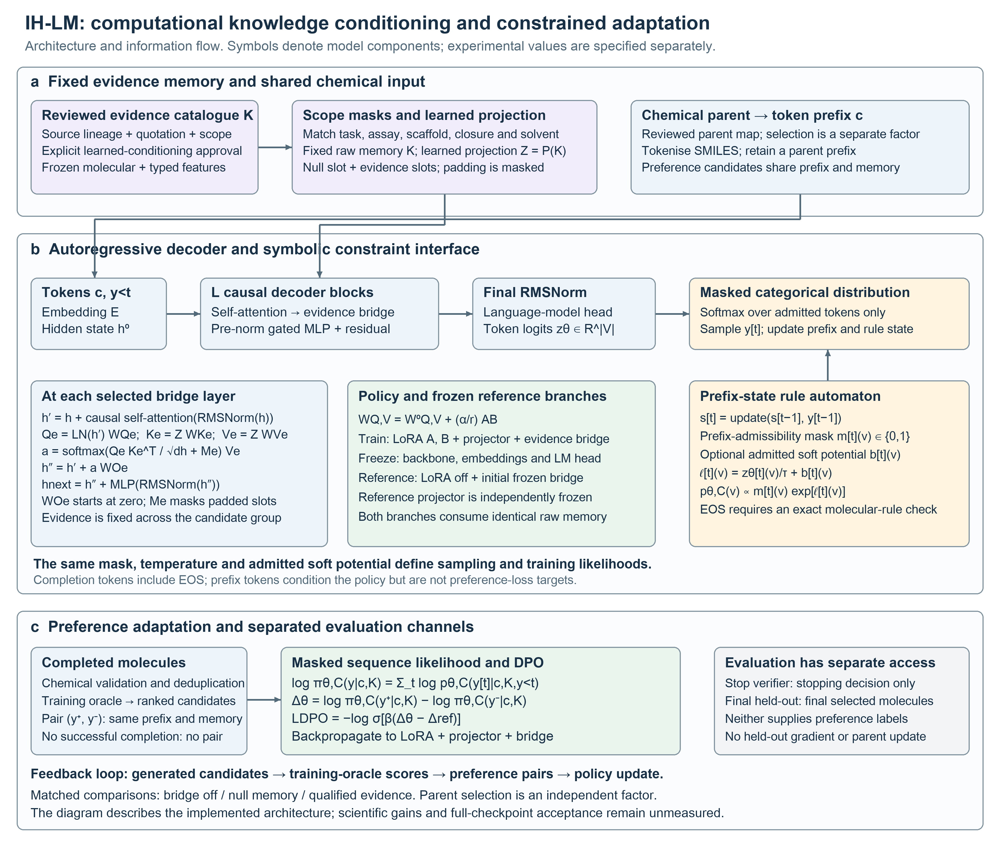
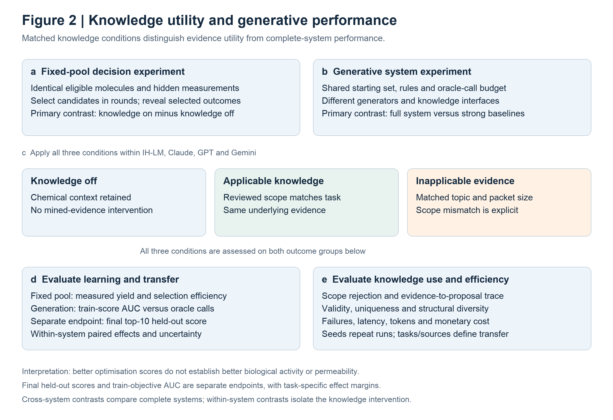

# A knowledge-integrated architecture for cyclic-peptide design

**Study status (30 October 2026).** Draft with measured baseline/component results and an implemented method whose full-size model evaluation remains pending. Learned static-evidence projection, decoder cross-attention, preference updates and checkpoint restoration have been exercised with small synthetic models; these checks do not establish scientific benefit. The 200-step masked-adapter study, 5,000-model-sample diagnostics, full-checkpoint M1 acceptance, stage-1 comparisons and real-evidence knowledge ablations have no verified completed result. An em dash denotes unmeasured evidence, never zero. Tables 8–12 remain unmeasured. The earlier predictive IH-LM branch is distinct from the causal generator described here. Figure 1 depicts the learned evidence branch, causal backbone and rule-constrained learning path described in Sections 3.2–3.4. Figures 1–2 contain no performance results.

## Abstract

Cyclic peptides bind extended protein surfaces and a subset is orally available, but generative models for them are usually judged by distribution metrics, by a predictor that is also the reward, or by docking-style scores, and rarely against tuned search baselines at an equal oracle budget. We propose IH-LM, an architecture that integrates atom-level molecular generation, scoped chemical knowledge, rule-constrained decoding and iterative preference learning for cyclic-peptide design. Its central hypothesis is that source-qualified, chemically scoped knowledge improves adaptation and design beyond the same pretrained model without that knowledge. The generator operates on atom-level stereochemical SMILES with causal token prediction. To support controlled comparisons, we compile design rules for macrocyclic peptides with non-canonical residues (macrocycle closure, ring size, N-methyl count, molecular-weight bound, structural alerts) into a token-level decoding automaton with prefix look-ahead, and propose fine-tuning with the same mask applied. Only a six-step standalone adapter smoke is recorded; the planned 200-step study is unmeasured. We implement a provenance-linked interface that converts approved, parent-specific evidence into categorical and frozen molecular features, projects them into a learned memory and injects that memory through residual cross-attention in the causal decoder. The mined layer exists, but its effect on generation has not yet been established; exact quotation matching alone does not validate a directional prior. The proposed training procedure combines graded preference updates and a gap-based stopping monitor; component and simulation results do not establish their benefit in the integrated peptide loop. In a pre-registered pilot, unconditioned language models produced 237 to 294 constraint-satisfying unique novel molecules per 1,000 samples against 705 for monomer-library enumeration (Table 3), which is why the comparison is moved to objectives that the rules do not determine. The hypothesis under test (H-AA) is that, at a fixed oracle budget, IH-LM improves search efficiency, improves the independent final-candidate assessment relative to tuned simple optimisers, and recovers more held-out known binders in a blind retrospective arm. Search AUC and final held-out score are separate endpoints whose effect margins must be defined separately. The held-out evidence is bounded by verifier quality: the physics family has no admissible held-out verifier, so the pilot gate cannot exceed INCONCLUSIVE for that family, and the permeability held-out verifier is a weak ranker (Section 5.3). Matched ablations are required to distinguish rule compilation, chemical retrieval and mined-knowledge conditioning; the integrated comparisons remain unmeasured.

---

## 1. Introduction

Cyclic peptides occupy a chemical space between small molecules and biologics. Design is difficult for reasons specific to the space: non-canonical residues, N-methylation and D-residues change conformation and permeability in context-dependent ways; macrocyclisation imposes topological constraints on any generator; and the measured property data that exist are small, assay-heterogeneous and dominated by a few laboratories. The companion paper quantifies the last point: held-out-source skill of fitted models on the largest public cyclic-peptide permeability collection is a fraction of random-split skill, and public source-shift tests contain too few independent sources to detect effects of the size usually reported.

We propose IH-LM, a knowledge-conditioned generative framework for this setting. It is a decoder-only transformer over atom-level SMILES in which chirality and ring closures are explicit tokens, so that stereocentres, N-methylation, D-residues and macrocycle topology are represented directly. Its design follows from a diagnosis. In a pre-registered pilot, unconditioned language models used as seeded generators, including the unaugmented base model, produced fewer constraint-satisfying unique novel molecules than a monomer-library enumerator (704.6 per 1,000 samples for the enumerator against 237.2 to 294.3 for three language models), because the constraints (macrocycle, N-methyl count, molecular weight, polar surface area, PAINS) are satisfied almost by construction when molecules are assembled from monomers. A language model validated only on constraint yield cannot win; the rules must be removed from the model's burden and the comparison moved to objectives that the rules do not determine. Two earlier feedback runs also barely moved their policies, which pointed to a defect in how the learning signal was constructed. The proposed IH-LM study follows from these two findings; it has not yet established an integrated model advantage.

**Architectural contribution.** IH-LM connects molecular representations, source-qualified knowledge, chemical constraints and outcome-driven learning through explicit computational interfaces. Scoped evidence changes molecular conditioning, the rule-state module controls admissible generation, and newly acquired scores train the molecular policy. The central hypothesis is that this integrated design uses chemical knowledge to improve adaptation and discovery. The architecture and its information flow are described in Section 3; the provenance of individual components and the weights used to initialise them are specified separately in the experimental setup.

The intended training sequence starts from public molecular-model weights, adapts them to eligible peptide chemistry, and continues from that adapted checkpoint during knowledge-conditioned preference learning. Knowledge conditions decoder hidden states through a learned evidence memory; an orthogonal intervention can also change which chemically appropriate parent supplies the molecular prefix. It does not replace measured outcomes with unqualified literature-derived labels. The implementation connects these components, but full-checkpoint validation and an accepted real-evidence comparison remain prerequisites for demonstrating the method’s scientific benefit.

The principal knowledge contrast holds the backbone, peptide corpus, bridge architecture, trainable parameter budget, optimiser and oracle budget fixed while replacing null memory with scoped evidence. A separate bridge-off control measures the contribution of the additional trainable module. Additional controls distinguish immediate guidance during generation from changes retained in the fine-tuned model. Improvements must therefore be attributable to knowledge use rather than a stronger initial checkpoint or extra training. The experimental setup separates those factors explicitly.

---

## 2. Related work

**Chemical and peptide language models.** ChemFM-1B is a general chemistry causal language model (Llama architecture, about 970 million parameters; Cai et al. [1]). It provides fluent SMILES generation but no peptide-specific design knowledge, and its content of N-methylated, D-configured and macrocyclic molecules is not documented (Section 5.1.1 and Table 5 identify the pending checkpoint diagnostics). PeptideCLM-2 is a family of masked language models over SMILES pretrained on peptides and small molecules [2]; its model cards describe property prediction and document no generation procedure. Both leave open how rule satisfaction, retrieved series and verifier feedback should enter a peptide generator. The IH-LM design combines rule-constrained decoding with a proposed provenance-linked evidence interface (Sections 3.3 and 3.4). The implementation supports chemical retrieval and learned, scoped evidence conditioning; full-size model performance and a scientific knowledge benefit remain unvalidated.

**Peptide generators and design tools.** PepINVENT extends REINVENT [3] with non-natural amino acids by reinforcement learning [4]; PepGLAD designs full-atom peptides by geometric latent diffusion [5]; PepTune guides discrete diffusion with multiple objectives [6]; PepMLM generates binders by span masked language modelling [7]; AfCycDesign and RFpeptides use structure-prediction networks for cyclic-peptide and macrocycle design, and RFpeptides reports wet-lab outcomes including designs that failed [8, 9]; BindCraft provides filters that are reused in peptide work [10]; EvoBind searches peptide space by mutation with an AlphaFold-based loss [11]. These works demonstrate that cyclic and non-canonical peptides can be designed computationally and sometimes experimentally. In the sources we read, however, success is often defined by a threshold that most designs pass (a Rosetta ΔG below zero in PepGLAD), the optimised predictor is also the reported metric (PepINVENT, PepTune), and no generator is compared with a mutation or genetic-algorithm baseline at an equal oracle budget. IH-LM is therefore intended to be evaluated against tuned search baselines at a fixed budget, on verifiers it did not optimise (Section 4).

**Benchmarks and search baselines.** GuacaMol and MOSES standardised distribution-learning and goal-directed evaluation for small molecules [12, 13]. Their distribution metrics can be gamed: a random sampler scores close to the ceiling on KL divergence and Fréchet ChemNet distance, and a trivial "add a carbon" perturbation scores near 100% on validity, novelty and uniqueness (Tripp and Hernández-Lobato [14], Table 1). The PMO benchmark fixes the oracle budget at 10,000 calls, scores the area under the top-10 mean curve and finds that older methods outperform newer ones [15] (REINVENT 14.196, Graph GA 13.751, Gaussian-process Bayesian optimisation 13.156). A tuned genetic algorithm later summed to 14.708 on the same suite ([14], Table 2), and adding property and diversity filters re-orders the ranking [16]. DOCKSTRING reports that optimisers drift toward large lipophilic molecules when docking score is the objective [17]. MolLEO uses chemistry-aware language models as crossover and mutation operators in evolutionary search [18], and Saturn reports sample-efficient reinforcement learning with a Mamba model and experience replay [19]. These establish the protocol and the strength of the baselines; none addresses peptides with non-canonical residues or held-out verifiers fitted on disjoint sources. We adopt the protocol and include a language-model-as-operator arm because "a language model helps a genetic algorithm" is already established.

**Constrained decoding and validity by construction.** The Grammar VAE guarantees syntactically valid output through a grammar [20]; SELFIES guarantees validity at the string level [21], with no consistent advantage over SMILES outside genetic algorithms in PMO; finite-state and context-free-grammar guided decoding is established for language models [22] and has been extended to diffusion language models [23]. Validity is cheap to guarantee and cannot distinguish generators, and these methods target syntax, not the chemical property windows and macrocycle topology that define cyclic-peptide design. IH-LM compiles property-level and topology-level rules into the decoder with prefix look-ahead and specifies training under the mask as a prospective study (Section 3.3).

**Preference optimisation, verifiable rewards and over-optimisation.** Direct preference optimisation [24] is the objective implemented for the proposed real-model update. Reinforcement learning with verifiable rewards has been applied to chemistry language models, for example ether0 (a 24-billion-parameter model trained on 640,730 experimentally grounded problems, with documented reward-hacking patterns and plausibility filters against them; [25]), LLMol [26] and RePO [27]; these report the sparse-feedback problem under similarity constraints but not peptide generation with independent held-out verifiers. The divergence between a proxy and a gold reward during optimisation is measured for language-model reinforcement learning [28], and constrained formulations address it with composite rewards [29]. Stopping on an independent validation signal is therefore an established idea; the training procedure of IH-LM applies it with a stop verifier that is fitted on sources disjoint from those of the training verifier (Section 3.7).

**Knowledge and retrieval.** Curated collections cover structure-property data (CycPeptMPDB [30], CREMP [31], CyclicPepedia [32], Macrocycle-DB [33], SweMacrocycleDB [34]) and peptide-protein complexes (PepBDB [35], Propedia [36], BioLiP2 [37]); they do not provide structured design rules with provenance, a campaign ledger, or a cyclic-annotated complex set. Natural-product collections (NPAtlas [38], COCONUT [39]) and patent chemistry (SureChEMBL [40]) supply macrocycle structures and design statements that these collections lack. In our own data nearest-neighbour lookup was the strongest few-label baseline and analog retrieval the only module of an earlier model ladder with a consistent effect (companion paper), which is why retrieval is a component with an ablation arm and not a claimed contribution. The knowledge layer builds on the existing collections by identifier and adds the missing layers (Section 3.4).

**Simple baselines for peptide properties and evaluation practice.** In one published benchmark on 5,826 PAMPA samples (5,758 peptides plus 68 duplicate measurements; 6-, 7- and 10-mers), every method in the comparison lost ROC-AUC from random to scaffold splits (for example AttentiveFP 86.2 to 66.1, with baseline values taken from the protocol the authors adopt rather than re-run), and a Gaussian process with a Tanimoto fingerprint kernel had the highest ROC-AUC on both splits (89.7 and 80.4), tied with a kernel mixture (Amirahmadi et al. [41], Tables 3 and 6 of the arXiv v1). PepBenchmark reports random forest on ECFP6 leading on non-canonical peptide tasks and small sets [42]. Requiring physical validity changes the ranking of docking methods [43] and generated poses show related failures [44]. We therefore include a kernel-based optimiser among the baselines and apply orthogonal physical checks to final candidates (Section 5.1.13).

---

## 3. Model and learning procedure

The earlier IH-LM predictor organised numerical knowledge fusion, symbolic constraints, memory adapters, preference adaptation and uncertainty into modules M1–M5. It is a separate predictive model, not an alternative name for the causal decoder below. The generative evidence branch reuses the residual cross-attention pattern, but does not import the predictor’s scalar fusion rule, property head or uncertainty calibration. The full-model acceptance check also named M1 is an experimental validation gate, not that predictor’s first architectural module.

### 3.1 Representation and conditional generation

IH-LM integrates an atom-level causal molecular model with a rule-state tracker, a learned scoped-evidence memory and an iterative preference-learning procedure (Fig. 1). Causality specifies the token-prediction order; atom-level representation specifies the chemical resolution. The implemented neural model generates stereochemical SMILES, not Cartesian coordinates. Its molecular graph includes backbone and side-chain heavy atoms, bond orders, stereocentres and cyclisation bonds, with hydrogens largely implicit. This is distinct from a residue-sequence-only representation and from explicit three-dimensional all-atom generation. A molecular string is tokenised as \(x=(x_1,\ldots,x_T)\in\mathcal V^T\); atom and bracket-atom tokens represent element, charge and stereochemistry, while bond, branch and ring-label tokens represent connectivity. The token sequence specifies a molecular graph after parsing. It does not uniquely specify a conformer, and a token-level chirality mark is not by itself a residue-level D/L annotation.

Let \(\mathcal D_r=\{(m_i,f_{\mathrm{train}}(m_i))\}\) be the molecules evaluated by round \(r\), \(\mathcal P_r\) the eligible chemical-parent pool, \(u\) the task scope and \(\mathcal E\) the reviewed evidence catalogue. The selector samples a parent \(p\), a deterministic function \(c(p)\) retains its token prefix, and the decoder generates a suffix \(y\) that includes its terminating EOS token. The conditional distribution is

\[
P_{\phi}(y\mid\mathcal P_r,u,\mathcal E,C)
=\sum_{p\in\mathcal P_r}q_{\mathcal E}(p\mid\mathcal P_r,u)
\prod_{t=1}^{|y|}\pi_{\phi}^{C}\!\left(y_t\mid c(p),y_{<t},K(p,u,\mathcal E)\right).
\tag{1}
\]

Equation (1) assigns probability to completed suffixes; under finite-length decoding, remaining probability can lead to failed proposals rather than successful molecules. Here \(C\) is the chemical constraint specification and \(\phi\) includes trainable low-rank adapters, evidence-feature embeddings, the memory projector and evidence-attention parameters. The inherited backbone weights remain frozen. After parent selection, \(K(p,u,\mathcal E)\) is an immutable snapshot of qualified evidence for that parent and task. The parent selector is external and non-differentiable; its knowledge setting is independent of whether the neural evidence branch is enabled. The task scope controls eligibility rather than entering a free-text encoder. All candidates in a preference group share the same realised prefix and raw evidence snapshot. No generated suffix, current-group score, stop score or held-out outcome is used to construct that snapshot.

### 3.2 Causal transformer and trainable adapters

For an input prefix of length \(n\), token lookup produces \(H^{(0)}\in\mathbb R^{n\times d}\). Each of \(L\) pre-normalised decoder blocks applies causal self-attention and a gated feed-forward transformation with residual connections:

\[
\begin{aligned}
U^{(\ell)}&=\operatorname{RMSNorm}(H^{(\ell)}),\\
\widetilde H^{(\ell)}&=H^{(\ell)}+\operatorname{Attn}_{\ell}(U^{(\ell)}),\\
H^{(\ell+1)}&=\widetilde H^{(\ell)}+
\left[\operatorname{SiLU}(R^{(\ell)}W_g)\odot(R^{(\ell)}W_u)\right]W_d,\\
R^{(\ell)}&=\operatorname{RMSNorm}(\widetilde H^{(\ell)}).
\end{aligned}\tag{2}
\]

For attention head \(h\), define \(Q_h=UW_{Q,h}\), \(K_g=UW_{K,g}\) and \(V_g=UW_{V,g}\), where \(g=g(h)\) is the shared key/value group. Rotary position transformations act on query and key vectors:

\[
A_h=\operatorname{softmax}\!\left(
\frac{\operatorname{RoPE}(Q_h)\operatorname{RoPE}(K_{g(h)})^\top}{\sqrt{d_h}}+M_{\mathrm{causal}}
\right)V_{g(h)},\qquad
\operatorname{Attn}(U)=\operatorname{Concat}_h(A_h)W_O.
\tag{3}
\]

The causal mask is zero at available positions and \(-\infty\) at future positions. It controls information flow inside attention and is distinct from the chemical vocabulary mask applied after the output projection. A final RMS normalisation and language-model head produce next-token logits \(z_t\in\mathbb R^{|\mathcal V|}\). Grouped-query attention shares keys and values across query heads; the checkpoint determines the number of heads and groups.

Low-rank adapters [46] modify the query and value projections. In the row-vector convention used above,

\[
W_j=W_j^{(0)}+\frac{\alpha}{r_A}A_jB_j,
\quad A_j\in\mathbb R^{d_{\mathrm{in}}\times r_A},\quad
B_j\in\mathbb R^{r_A\times d_{\mathrm{out}}},\quad j\in\{Q,V\}.
\tag{4}
\]

Within the inherited backbone, only \(A_j,B_j\) receive gradients. The added evidence projector and cross-attention branch are also trainable when enabled. Token embeddings, key and output projections, feed-forward layers and the output head retain pretrained weights. One factor is initially zero, giving the initial pretrained forward function. The backbone therefore adapts through a low-rank parameter subspace; the additional evidence branch is described below. The checkpoint, widths, adapter rank and optimiser settings are experimental choices specified in Section 5.1.1.

At selected decoder layers, evidence attention is inserted after the self-attention residual and before the feed-forward sublayer. With projected memory \(Z_\phi(K)\in\mathbb R^{M\times d}\) and eligibility mask \(a\in\{0,1\}^{M}\), define affine query, key and value projections

\[
Q_h^K=\operatorname{LN}(\widetilde H)W_{Q,h}^K+b_{Q,h}^K,\quad
K_h^K=Z_\phi W_{K,h}^K+b_{K,h}^K,\quad
V_h^K=Z_\phi W_{V,h}^K+b_{V,h}^K,
\]
\[
B_h=\operatorname{softmax}\!\left(Q_h^K(K_h^K)^\top/\sqrt{d_h^K}+M_a\right)V_h^K,
\qquad \Delta_\phi^K=\operatorname{Concat}_h(B_h)W_O^K+b_O^K,
\tag{4a}
\]

where \((M_a)_j=0\) for admitted slots and \(-\infty\) otherwise. The evidence branch uses LayerNorm; the inherited decoder retains RMSNorm. For a selected layer, Eq. (2) becomes

\[
\bar H^{(\ell)}=\widetilde H^{(\ell)}+\Delta_\phi^K,\qquad
H^{(\ell+1)}=\bar H^{(\ell)}+
[\operatorname{SiLU}(\bar R^{(\ell)}W_g)\odot(\bar R^{(\ell)}W_u)]W_d,
\quad \bar R^{(\ell)}=\operatorname{RMSNorm}(\bar H^{(\ell)}).
\tag{4b}
\]

Thus evidence changes both the feed-forward input and its residual path. The evidence output matrix and bias initialise to zero, preserving the initial backbone function. Queries depend only on the causal token state, and keys and values depend only on the fixed pre-generation evidence. There is no attention to future generated tokens. A null slot remains admitted when no evidence is supplied; a trained null-only branch can nevertheless produce a nonzero residual through learned affine terms, making it an explicit capacity control rather than equivalent to removing the branch.

**Figure 1 | Learned evidence conditioning and constrained molecular generation.** After a chemical parent is selected, qualified parent-specific evidence is packed into categorical and frozen molecular features. A trainable projector supplies a masked memory to residual cross-attention after selected self-attention sublayers and before their feed-forward transformations. The inherited backbone remains frozen except for query/value low-rank adapters. A separate chemical-state tracker constrains the output vocabulary. Continuous training scores form preference pairs with the same prefix and raw evidence snapshot. The reference disables preference adapters and uses frozen initial copies of both the projector and evidence-attention branch. Stop scores control termination; final held-out scores have no path to optimisation. Explicitly supplied peptide-adaptation weights can initialise the shared inherited backbone, but full-size sequential training and comparative performance remain unverified. The diagram describes operations, not measured performance.

### 3.3 Chemical-state tracking and constrained token probabilities

The tracker state \(s_t\) is updated deterministically from the molecular prefix:

\[
s_1=\operatorname{ParsePrefix}(c),\qquad
s_{t+1}=F(s_t,y_t),\qquad
m_C(s_t,v)\in\{0,1\}.
\tag{5}
\]

The state records open ring labels and branch/bracket state, accumulated atom mass, peptide-related local patterns and bounds on tokens required to complete the string. Prefix screening rejects transitions that violate its upper bounds or cannot close outstanding syntax within the remaining length. These are tractable necessary checks, not an exact decision procedure for the existence of a chemically acceptable completion. In particular, the current prefix bounds do not establish that a sufficiently large macrocycle can always be completed. Complete-molecule properties, including ring size, lower mass limits, polar surface area and structural alerts, are enforced by the terminal checker.

Given temperature \(\tau>0\), optional token potential \(b(s_t,v)\) and mask \(m_C\), the sampling distribution is

\[
\pi_\phi^C(v\mid c,y_{<t},K)=
\frac{m_C(s_t,v)\exp\{z_{\phi,t,v}/\tau+b(s_t,v)\}}
{\sum_{w\in\mathcal V}m_C(s_t,w)\exp\{z_{\phi,t,w}/\tau+b(s_t,w)\}}.
\tag{6}
\]

The hard-rule configuration sets \(b=0\). A soft-potential interface exists, but an implemented interface is not evidence that any mined statement is scientifically eligible to supply its coefficients. Such potentials are separate from both parent selection and the learned evidence memory; the latter changes hidden states rather than adding a prescribed numerical token prior.

End of sequence is permitted only when the decoded molecule passes the complete constraint function \(C(m)=1\). If no token is admissible, or the length limit is reached without accepted termination, the proposal fails. Thus every *accepted completed* molecule passes the checker, whereas completion rate remains an empirical property. Likelihood evaluation replays the tracker over the recorded prefix and suffix; a training token forbidden by its replayed mask is an error. The no-mask ablation generates from unconstrained logits and applies the identical complete checker afterwards.

### 3.4 Evidence admission, feature projection and parent selection

Each evidence record contains source identity, exact quotation offsets, a source-text hash, extraction and review provenance, an approved parent mapping, and a chemical and experimental scope:

\[
e=(\mathrm{id},\mathrm{source},\mathrm{quote},\mathrm{scope},\mathrm{parents},\mathrm{lineage},\mathrm{review},\mathrm{categories}).
\tag{7}
\]

Scope specifies property, assay, scaffold, closure, solvent and endpoint, with target or site where applicable. Exact quotation matching establishes attribution; scientific review determines whether the statement, comparator, direction and chemical mapping are justified. A statement must be explicitly approved for learned conditioning. Permission to select a parent does not confer permission to enter neural memory. Source, compound, scaffold and target exclusions apply before packing. Contradictory parent/task annotations are rejected. Unknown selected parents, including new retrieved molecules without an approved mapping, halt the learned-conditioning run rather than trigger resampling or an unrecorded fallback.

For the selected parent \(p\), the admitted evidence set is

\[
\mathcal E_K(p,u)=\{e\in\mathcal E:\ a_K(e,p,u)=1\},
\tag{8}
\]

where \(a_K\) requires the learned-conditioning permission, resolved review flags, matching scope, approved parent membership and exclusion compliance. Eligible statements are ordered by identifier and truncated to a declared memory capacity. Position-specific edits are excluded because residue/site alignment is not implemented. The first slot is always an admitted null; unused slots are masked padding. An evaluated evidence-on study requires at least one admitted non-null statement for its selected parent.

Each admitted slot combines an externally supplied frozen molecular embedding \(v_i\), its availability flag \(m_i^v\), categorical IDs \(c_{ij}\), category-availability flags \(m_{ij}\), and a channel indicator \(t_i\). The categorical fields are property, endpoint, assay, closure, scaffold, solvent, edit type, direction, evidence type and matched-comparison status. Missing and unknown categories have distinct IDs. With trainable category embeddings \(E_j\) and channel embedding \(E_t\), the projector is

\[
 f_i=\operatorname{Concat}\!\left(m_i^v v_i,m_i^v,
       (m_{ij}E_j(c_{ij}),m_{ij})_{j=1}^{J},E_t(t_i)\right),\qquad
 z_i=\operatorname{GELU}(f_iW_1+b_1)W_2+b_2.
\tag{8a}
\]

The rows \(z_i\) form \(Z_\phi(K)\). Null and padding rows are explicitly set to zero after projection. Frozen molecular embeddings receive no gradients; categorical embeddings and projector weights do. Source IDs, quotation text, hashes, reviewer identity and review timestamps remain provenance metadata and are not predictive features. Neither numerical literature priors nor observed-outcome memory is included. This interface is computational conditioning, not a natural-language prompt or quotation encoder.

The raw memory is fixed before generating a group, replicated across its sampling batches, and reused for policy and reference scoring. Projection is recomputed for each training forward pass so that gradients update the projector without reusing a consumed computation graph. Memory, schema, provenance and configuration digests bind the sampled group to its likelihood evaluations and checkpoint. Attention caches cannot be reused across different evidence, policy/reference branches or changed weights.

Parent selection remains an orthogonal intervention. Its separately approved catalogue defines \(\mathcal A=\{p\in\mathcal P:\exists e,\ a_{\mathrm{parent}}(e,p,u)=1\}\). The selector samples uniformly from the distinct members of \(\mathcal A\) when applicable, otherwise from the original parent pool; multiple matching statements do not add weight. For neural knowledge contrasts, this selector setting is held fixed. The learned memory is constructed only after the parent has been chosen, so the null and evidence-on conditions do not obtain different parents merely because their evidence masks differ. Parent-selection fallback does not override the stricter mapping requirements of learned conditioning.

### 3.5 Masked molecular likelihood training

For an eligible molecular corpus \(\mathcal X\), the preparatory adapter objective is the mean token negative log-likelihood under the constrained distribution:

\[
\mathcal L_{\mathrm{ML}}(\phi)=
-\frac{1}{N_{\mathrm{tok}}}\sum_{x\in\mathcal X}\sum_{t\in I_x}
\log\pi_\phi^C(x_t\mid x_{<t}).
\tag{9}
\]

Here \(I_x\) contains non-padding prediction positions, including accepted termination, and \(N_{\mathrm{tok}}=\sum_x|I_x|\). Masks are computed from each ground-truth prefix, rather than from a separately sampled trajectory. This normalises likelihood over the admitted vocabulary and prevents a mismatch between an unmasked training objective and constrained decoding. The standalone training implementation uses a large finite negative masking constant; the integrated sampling and preference code uses \(-\infty\). Their numerical equivalence requires verification for the selected precision.

Preparatory masked-likelihood training and online preference learning are distinct procedures. The constructor supports an explicitly identified compatible peptide-adaptation checkpoint merged into the inherited backbone before fresh preference adapters are attached. Omitting that checkpoint retains the original pretrained backbone. Sequential training therefore requires verified checkpoint identity and compatibility; it is not implied by enabling evidence conditioning. The standalone smoke result cannot be described as the initialisation of an integrated preference run without that transfer.

### 3.6 Continuous-score preference learning

At round \(r\), completed candidates with a common prefix and raw evidence snapshot \((c_r,K_r)\) receive continuous scores \(f_{\mathrm{train}}(m)\). Invalid or unscored proposals are excluded from pairing and counted. Groups must contain enough scored members and non-negligible score variation. Within a retained group, candidates are sorted by score; the highest is paired with the lowest, the next highest with the next lowest, up to a fixed cap. A pair \((y^+,y^-)\) is retained only if

\[
f_{\mathrm{train}}(m^+)-f_{\mathrm{train}}(m^-)\ge\delta_{\mathrm{pair}}.
\tag{10}
\]

For each completion, the sequence log-likelihood sums suffix-token probabilities, including EOS but excluding the fixed prompt. Direct preference optimisation [24] uses

\[
\begin{aligned}
\ell_\phi(y\mid c,K)&=\sum_t\log\pi_\phi^C(y_t\mid c,y_{<t},K),\\
D_\phi(c,K,y^+,y^-)&=[\ell_\phi(y^+\mid c,K)-\ell_\phi(y^-\mid c,K)]
-[\ell_0(y^+\mid c,K)-\ell_0(y^-\mid c,K)],\\
\mathcal L_{\mathrm{DPO}}(\phi)&=-\frac{1}{|\mathcal B|}
\sum_{(c,K,y^+,y^-)\in\mathcal B}\log\sigma\!\left(\beta D_\phi(c,K,y^+,y^-)\right).
\end{aligned}\tag{11}
\]

The reference \(\pi_0^C\) uses the frozen inherited backbone with preference adapters disabled, together with separate frozen copies of the initial memory projector and evidence-attention modules. If peptide adaptation was explicitly merged, that adapted backbone is inherited by both branches. Policy and reference receive the same prefix, raw evidence snapshot, temperature, chemical mask and any enabled token potential. Their projected memories can differ after training because only the policy projector changes. Disabling low-rank adapters alone would not reproduce this reference. With zero-initialised evidence output projections, the initial reference has no evidence-dependent residual; this is an initial-condition definition, not evidence of prior knowledge competence.

Gradients from the scored molecular preferences update both the low-rank adapters and the policy evidence branch. Literature statements are not substituted for measured preference labels. Scores determine ordering and pair eligibility; neither the score gap nor a rank-based advantage weights the DPO loss. Reference parameters remain frozen across updates and are saved separately in checkpoints.

To detect an update that leaves the policy effectively unchanged, the implementation monitors categorical token KL divergence on the visited pair contexts \(\mathcal H\),

\[
\widehat D_{\mathrm{token}}=\frac{1}{|\mathcal H|}
\sum_{h\in\mathcal H}\sum_{v:\,m_C(s(h),v)=1}
\pi_\phi^C(v\mid h)\log\frac{\pi_\phi^C(v\mid h)}{\pi_0^C(v\mid h)},
\tag{12}
\]

and the relative Frobenius norm of effective adapter updates, \(\left(\sum_j\|\Delta W_j\|_F^2/\sum_j\|W_j^{(0)}\|_F^2\right)^{1/2}\). Here \(h\) includes the fixed raw evidence snapshot, and \(s(h)\) is its replayed chemical tracker state. An additional absolute parameter-distance diagnostic measures the evidence projector and attention branch against their frozen initial copies; it is reported separately from the relative low-rank adapter change. Equation (12) averages selected contexts; it is not a full sequence-distribution KL or an unbiased rollout estimate. Token KL and relative low-rank adapter change control the existing update-stall check, separately from verifier-based stopping. The evidence-branch distance is diagnostic and does not redefine those thresholds. Their thresholds and response are experimental settings.

### 3.7 Iterative search and independent stopping

A round retrieves chemical neighbours, selects a parent, generates suffixes, validates completed molecules, evaluates previously unseen eligible structures, forms preference pairs and updates the trainable policy parameters. Scored structures enter the chemical store for later retrieval. Retrieval supports stereochemistry-aware fingerprints and explicitly configured frozen-embedding or hybrid similarity. The encoder identity and retrieval configuration are separate from the learned evidence branch; enabling one does not enable the other.

Let \(\mathcal T_r\) be the cumulative top-\(k\) set by training score. The stopping monitor evaluates this same set with \(f_{\mathrm{stop}}\), and computes normalised gains

\[
g_r^{\mathrm{train}}=\frac{\overline f_{\mathrm{train}}(\mathcal T_r)-\overline f_{\mathrm{train}}(\mathcal T_0)}{s_{\mathrm{train},0}},\qquad
g_r^{\mathrm{stop}}=\frac{\overline f_{\mathrm{stop}}(\mathcal T_r)-\overline f_{\mathrm{stop}}(\mathcal T_0)}{s_{\mathrm{stop},0}},\qquad
d_r=\operatorname{MovingMean}(g_r^{\mathrm{train}}-g_r^{\mathrm{stop}}).
\tag{13}
\]

The denominators are initial supplied-score standard deviations, with the implementation's unit fallback for zero dispersion. After a warm-up, the run stops when stop-verifier improvement remains below a tolerance for a patience interval and \(d_r\) exceeds its running minimum by a specified amount. The integrated wrapper supplies the current cumulative top set once per round; it does not repeatedly pool that already-selected set. The monitor records a recommended earlier round, but the current orchestrator halts and returns its current top set without restoring that earlier model. Resuming interrupted execution is a separate checkpoint operation.

Training scores affect pair selection, adapter updates and search history. Stop scores affect termination but not the DPO loss. The held-out verifier is called only on final selected candidates and has no input to retrieval, pairing or stopping. Structure prediction and molecular-mechanics audits are external candidate assessments, not neural layers or feedback modules in this architecture.

---

## 4. Evaluation principles and endpoints

### 4.1 Search efficiency and independent final assessment

Let \(m_1,\ldots,m_B\) denote the valid, unique molecules charged to a run, and let \(f_T\) be its training oracle. Standardisation uses a fixed reference sample, independent of the search trajectory: \(z_T(m)=[f_T(m)-\mu_T]/\sigma_T\). With \(\mathcal T_b\) the best \(\min(k,b)\) molecules by training score after \(b\) calls, the discrete search-efficiency endpoint is

\[
A_T=\frac{1}{B}\sum_{b=1}^{B}\frac{1}{|\mathcal T_b|}\sum_{m\in\mathcal T_b}z_T(m).
\tag{14}
\]

Early stopping and budget curves require a declared padding convention. The current harness carries the final attained best-set mean forward through the remaining budget. Invalid proposals and duplicates do not earn extra oracle evaluations; their counts and computational cost are reported separately. A method that obtains a higher \(A_T\) has optimised its training objective more efficiently, which does not alone establish better biological properties.

The final independent endpoint evaluates the set chosen by training scores with a held-out verifier \(f_H\),

\[
H=\frac{1}{|\mathcal T_{\mathrm{final}}|}\sum_{m\in\mathcal T_{\mathrm{final}}}z_H(m).
\tag{15}
\]

The held-out verifier is not used to rerank proposals or choose a checkpoint. Equation (15) is a final-set mean, not an area under a held-out learning curve. A practical-effect margin estimated for Eq. (14) cannot be transferred to Eq. (15) without a separate definition. A computational held-out verifier provides a model-transfer check; an improvement in measured activity or permeability requires a corresponding experimental endpoint.

### 4.2 Attribution of knowledge and model components

The learned-conditioning comparison uses three arms with the same inherited checkpoint, rule specification, chemical-parent pool, parent-selection setting and oracle budget. **Off** omits the evidence branch. **Null** retains the trainable projector and attention architecture but admits only the null slot. **On** uses the identical architecture with qualified evidence. The principal evidence contrast is \(\Delta_K=Y_{\mathrm{on}}-Y_{\mathrm{null}}\); \(Y_{\mathrm{null}}-Y_{\mathrm{off}}\) measures the effect of added capacity and its optimisation. Only null and on have matched bridge parameter budgets. Paired seeds control initial stochastic choices, but online trajectories may diverge after evidence changes proposals; fixed-parent comparisons isolate the immediate conditioning effect.

Parent-selection knowledge is varied separately, with its setting held constant in each learned-conditioning contrast. Inapplicable-evidence tests check rejection or null equivalence rather than licensing a study-on run with no eligible evidence. Removing the token mask tests constrained decoding; disabling preference updates tests learning; removing chemical-neighbour retrieval tests retrieval. The no-monitor condition removes verifier-gap monitoring while retaining the learning-stall check. A proposed transfer analysis evaluates knowledge-trained parameters with null memory at assessment and compares them with frozen-parameter evidence-conditioned inference; it distinguishes retained learning from immediate guidance and remains unmeasured. These interventions answer different questions.

In a fixed candidate pool with existing measurements, define a hit threshold before observing the hidden evaluation outcomes and let \(Y\) be the number of selected compounds meeting it at a common selection budget. This measures evidence-guided selection. De novo generation instead measures Eq. (14), Eq. (15), chemical validity, uniqueness, diversity and resource use. Comparing these settings does not turn a fixed-pool selector into a validated molecular generator.

### 4.3 Uncertainty and qualification of claims

Replicate seeds estimate stochastic run variability; independent tasks, sources or targets determine the scope of transfer. Paired seed intervals therefore support a conditional comparison on a task, not a claim of cross-laboratory generalisation. Effect margins, primary contrasts, multiplicity handling, verifier-quality floors and decision rules must be specified for their own endpoints. The concrete pilot protocol and its limitations are given in the experimental setup. In particular, the existing training-AUC margin and final held-out score definitions require reconciliation before an integrated success verdict can be issued; this manuscript does not retrospectively redefine a registered gate.

---

## 5. Results

### 5.1 Experimental setup

#### 5.1.1 Model initialisation and optimisation configuration

The intended sequential initialisation uses inherited weights at each compatible stage:

| Stage | Initial weights | Adaptation and output | Current evidence |
|---|---|---|---|
| Molecular foundation | Public ChemFM checkpoint and its original tokenizer | General chemical representations inherited without retraining from scratch | Loader and expected checkpoint identity exist |
| Peptide-domain adaptation | The same foundation checkpoint | Masked molecular likelihood on the eligible peptide corpus; save a compatible adapted checkpoint | Separate short component smoke; complete corpus adaptation unverified |
| Knowledge-conditioned fine-tuning | The verified peptide-adapted checkpoint | Learned scoped-memory projection and decoder cross-attention; scored comparisons update adapters and the evidence branch through DPO | Generator and reference/checkpoint interfaces implemented; full-size transfer and real-evidence evaluation unverified |
| Independent evaluation | Frozen final model and declared inference settings | Compare with the same initialisation and training budget without knowledge | Integrated comparison remains unmeasured |

The sequential initialisation interface merges an explicitly identified compatible peptide adapter into the inherited backbone, freezes that adapted model as the DPO reference backbone and attaches fresh preference adapters. Without the adaptation checkpoint, both branches inherit the original ChemFM weights. A stage transition resets optimiser state and is distinct from exact checkpoint resumption. The interface is implemented, but no full-size sequentially trained result is reported. This distinction prevents a stronger initial checkpoint from being mistaken for a knowledge effect.

The integrated implementation initialises from ChemFM-1B [1], loading the causal language model and its tokenizer from a local checkpoint directory. The available checkpoint configuration describes a Llama decoder with 22 blocks, hidden width 2,048, feed-forward width 5,632, 32 query heads and four key/value heads (head width 64), a 320-token vocabulary and a maximum context of 512 tokens. It uses rotary positions, RMS normalisation and SiLU-gated feed-forward layers. These are configuration-file attributes; they do not establish the identity of a completed training run. A reproducible run binds the checkpoint weights, tokenizer and code revision by hash. No verified integrated trained checkpoint is reported here.

The integrated adapter configuration is rank 8, scaling \(\alpha=16\), query/value projections only, no adapter dropout and no trainable biases. CUDA inference uses bfloat16. AdamW updates adapters and, when enabled, the policy evidence projector and attention parameters at an initial learning rate of \(10^{-4}\), with gradient norm clipped to 1.0. Sampling temperature is 1.0. Each round requests 64 proposals in sampling batches of 16. A parent prefix retains approximately half the parent-body tokens; sufficiently long prefixes are rounded down to a multiple of eight tokens. The sampling implementation caps the total token sequence at 500 and generates at most 300 continuation tokens. A round is one shared-prefix preference group: 16 is the minimum number of valid scored members, not the number of independently conditioned groups. Pair formation uses a score standard-deviation floor of \(10^{-6}\), at most two best–worst pairs, minimum score gap 0.02 and DPO coefficient \(\beta=0.1\). These settings describe the current integration configuration; completed comparative results are not implied. Paired null/on runs must initialise the low-rank adapters, categorical embeddings, memory projector and evidence-attention weights identically under the same seed; their frozen reference copies must also match. Only admitted evidence differs at the start of the contrast. The bridge-off control shares the inherited backbone and low-rank adapter initialisation but has no evidence-branch parameters.

The policy-change check starts at zero-based round index 3. Token-context KL below 0.01 or relative adapter change below 0.005 triggers one learning-rate doubling. Persistent failure at a check at least two rounds later halts the run; adapter rank is unchanged. The independent score-gap monitor uses patience 4, gap-rise threshold 1.0, stop-gain tolerance 0.05, warm-up 2 and smoothing over three rounds. Its integrated input is the cumulative top-10 set, distinct from the standalone simulation's top fraction of 0.10. Evaluation seeds and model-selection rules are specified below.

#### 5.1.2 Molecular corpus, retrieval and hard constraints

The proposed preparatory corpus comprises peptide or macrocycle SMILES from CREMP [31], NPAtlas [38] and COCONUT [39], a capped generated-peptide pool, and ChEMBL capped at 10% of training tokens. CycPeptMPDB compounds and the frozen binding benchmark are excluded by flat-structure key and a fingerprint-similarity threshold of 0.9. Table 6 distinguishes planned sources from verified corpus counts; no full assembled-corpus training result or completed exclusion audit is available. The optional adaptation input must identify a completed compatible checkpoint; the proposed corpus and its intended training schedule do not themselves supply one.

The separate masked-likelihood smoke used library peptides and a different adapter implementation that targets query, key, value and output projections. Its training script exposes rank and optimiser settings separately. It is a component experiment, not evidence that its weights initialise the query/value-only integrated model. Table 5 reports its measured scope and loss values.

For the principal learned off/null/on comparison, the parent pool is fixed before the first round from the same approved parent map, task scope and source/compound/scaffold/target exclusions. Pool admission does not depend on whether applicable evidence is present. The chemical constraint C applies to completed proposals; the full molecule supplying a prefix is not required by this protocol to satisfy C. Parent approval instead requires the specified provenance, applicability and exclusion checks. Prefix feasibility and completion validity are evaluated separately. The ordered pool and its exclusions are identical across arms and bound to the experiment identity. Every round selects from this pool. Generated molecules remain in the scored history but are not promoted into the parent pool, and retrieval does not rank parents in this protocol. A newly generated structure therefore cannot acquire an unsupported evidence mapping merely by receiving a high score. This comparison measures evidence-conditioned generation from approved parents, not adaptive expansion of the parent set or a retrieval benefit.

A separate retrieval configuration uses Morgan fingerprints of radius 2 with 2,048 bits and chirality enabled. It queries the best currently scored molecule and retrieves up to five neighbours, with deterministic tie-breaking and exclusions before ranking; scored molecules are added online. Frozen PeptideCLM embedding and hybrid retrieval are optional, separately identified configurations. The contribution of retrieval-based parent ranking requires a separate experiment with its own admissible-parent protocol. No executed full-size embedding-retrieval comparison is reported.

All compared generators use the same complete chemical predicate: one connected sanitizable molecule; a largest ring of at least 12 atoms; 2–6 N-methyl amides as detected by `[CX3](=O)[NX3;!H1]([CH3])`; molecular weight 600–1,400; topological polar surface area at most 300; and no RDKit PAINS match. These thresholds define the experimental search space rather than the general architecture. Accepted completion is distinct from successful decoding within the token cap. The primary configuration uses hard rules only, with no numerical literature or structure-derived token potential.

#### 5.1.3 Knowledge inputs and eligibility

The learned intervention requires a frozen bundle containing an approved evidence catalogue, categorical feature schema, frozen molecular-embedding snapshot and architecture configuration, together with a chemical-parent map and an explicit source-policy task record. The architecture fixes the selected decoder layers, evidence-attention head count, category/channel embedding widths, projector hidden width and memory capacity. No layer selection or embedding model is inferred from the parent-selector configuration. Each reported arm must identify these choices and their hashes. Learned-conditioning permission is required independently of parent-selection permission; evidence tiers and exact quotations alone confer neither. Source text and provenance remain outside the neural feature array. Molecular features must identify their frozen encoder and approved parent mapping.

| Material | Available evidence | Role in this method study |
|---|---|---|
| Initial literature collection | 107 quotation-checked records from external sources and internal documents; the original metadata screen flagged 32 as potential numerical priors | Candidate statements for semantic and scope review; none of the 32 is admitted as an unconditional token prior |
| Scaled open-access literature extraction | Provenance-linked statements; record-level audit identified endpoint, direction, comparator and attribution errors | Only individually reviewed, source-cleared statements with approved parent mappings can enter the conditional catalogue; extraction output is not itself an accepted intervention |
| Measured property collections | CycPeptMPDB labels and source membership | Fit the designated verifiers; no held-out labels or outcome-derived statements may enter the knowledge input |
| Chemical-neighbour store | Eligible stereochemical structures and permitted prior observations | Shared molecular context in knowledge-on and knowledge-off conditions, independent of mined prose |
| Patent extraction | Quotation-linked records with unresolved structure-quality limitations | Excluded from method priors and the current knowledge-on catalogue |
| Structure-derived annotations and target cards | Historical annotations with unresolved closure, D-residue and N-methyl assignment errors | Excluded from this method's conditioning and token potentials |

The source of the initial collection is identified by SHA-256 `29368807246824222aa8ea860ff69adce1393ef9976a5c8fbb6091c5d0fe6951`; it is not the hash of an accepted conditional-parent catalogue. No frozen real catalogue with approved learned-conditioning permissions and parent mappings has been evaluated in a completed knowledge-on study. Consequently, the manuscript specifies the interface and admissible inputs but cannot yet name an executed set of knowledge interventions or report its benefit. Synthetic catalogue fixtures test software behaviour only. The complete checkpoint, evidence bundle, parent map, task/source policy and architecture must match the full-model acceptance evidence before an evaluated learned-conditioning study. Small-model interface tests cannot establish that acceptance.

Benchmark-source exclusion must reconcile source identifiers and compound/scaffold/target membership; a first-author/year match alone is insufficient. For retrospective binding recovery, answer-set documents and structures are excluded before retrieval, and target-derived evidence is excluded for the evaluated target. The exact same underlying eligible evidence would be supplied as textual packets in the proposed general-purpose-model comparison. The knowledge-base construction study reports extraction coverage; those coverage counts are not model-performance endpoints here.

#### 5.1.4 Oracle-budget protocol

*Budget and metric.* Each optimiser interacts with a train verifier (the oracle) for at most B calls; the pilot uses B = 1,000 and the primary study B = 3,000. *Scale.* Every verifier returns a z-score against the generation space, z = (raw − μ_ref)/σ_ref, where μ_ref and σ_ref are computed from 1,500 random rule-satisfying draws of the library sampler under the hard rules C; scores are not clipped. Stop and held-out verifiers use the same construction with their own raw scores. The score of a run is the AUC-top-10 in these reference standard-deviation units (SD-AUC): the area under the curve of the mean of the ten best oracle scores seen so far against the number of oracle calls, divided by B (a run that finds its best molecules early scores higher). A percentile scale against natural peptides saturates: on tuning seeds, tuned baselines reached top-10 mean percentiles of 0.979 to 0.986 at B = 1,000 and random library sampling 0.886 to 0.944, which leaves no room for a margin of practical size; the generation-space scale does not saturate. SD-AUC measures improvement over blind sampling from our own library sampler, not an absolute chemical quality. *Charging rules.* A call is charged only for a valid, rule-satisfying, previously unseen molecule; invalid molecules, duplicates (by canonical isomeric SMILES) and proposals that fail the hard rules are not charged but are counted, and the number of proposals is capped at 20 × B. All methods apply the same hard-rule filter C (Section 3.3). *Starting set.* Seed molecules are 300 rule-satisfying peptides from the train group, drawn deterministically. *Outputs per run.* The oracle log (hashes only), the final top-10, the held-out verifier's score of the final top-10 (applied once, after the run) and the stop verifier's score of the same set (the Goodhart-gap diagnostic).

#### 5.1.5 Verifier ladder, source groups and verifier quality

Each objective family has a *train* verifier (the budgeted oracle), a *stop* verifier (used only by the stopping monitor, never as an oracle) and a *held-out* verifier (applied only to the final top-10). A consistency check enforces distinct names, correct roles and disjoint fitting-source sets across the three, and the harness refuses to use a held-out verifier as an oracle.

**Table 1. Pilot-stage verifier families.**

| family | train (oracle) | stop | held-out |
|---|---|---|---|
| F1 physicochemical rule | fixed formula: −0.01·TPSA − 0.15·HBD + 0.20·logP − 0.10·max(0, rotatable bonds − 10), no fitting | random forest fitted on group S | minimum polar SASA over four ETKDG and MMFF conformers |
| F2 permeability model | gradient-boosted trees fitted on group A (within-source z-scored PAMPA; Morgan counts and descriptors) | random forest fitted on group S | Tanimoto-kernel ridge fitted on group B |

A structure family (Boltz confidence against a target) and a free-energy audit are stage 3 and outside the pilot.

**Source groups (version 2).** Sources are the laboratory or paper identifiers of CycPeptMPDB with at least 20 labelled PAMPA peptides after correction of source assignments (20 sources, 6,784 peptides). The two largest, 2020_Townsend (2,881 peptides, 42.5%) and 2021_Kelly (1,518, 22.4%), form the train group A (4,399 peptides, 64.8%); under the first grouping the train, stop and held-out verifiers were each effectively a single-laboratory model (Townsend 90% of train, Kelly 80% of stop, two papers 91% of held-out). The remaining 18 sources are assigned by a snake draft on size to the stop group S (nine sources, 1,269 peptides, 18.7%; 2013_CHUGAI is 69.2% of it) and the held-out group B (nine sources, 1,116 peptides, 16.5%; 2016_Furukawa is 59.3% of it). Membership has SHA-256 `be8a9945f504…`. A laboratory is a paper identifier here, so two papers from one laboratory can fall in different groups. A robustness arm re-runs the baselines on the first grouping with the same tuned configurations and evaluation seeds only; nothing is selected on it (Table 12).

**Verifier-quality floors.** Floors were fixed before any baseline ran: the stop and held-out permeability verifiers must reach a mean leave-one-source-out Spearman of at least 0.15 over at least five evaluable sources, and the physics held-out at least +0.10 against measured z-scores on a fixed 120-peptide sample. They derive from the leave-labs-out skill measured earlier for gradient-boosted models (about 0.22 to 0.25), discounted for smaller fitting groups. A verifier below its floor is declared too weak to rank and its family contributes no stop or held-out evidence. For the physics held-out, which did not reach its floor, one replacement attempt was registered before it ran: a Boltzmann-weighted polar solvent-accessible surface area over 60 ETKDG conformers per peptide (298.15 K), evaluated on all group-B peptides within a fixed time box with a per-molecule limit of 120 s. It passes if the pooled Spearman against the within-source z-score is at least +0.10 and the lower bound of a 95% source-cluster bootstrap interval exceeds 0; it is evaluable only if at least 600 peptides covering at least 7 of the 9 sources complete, and otherwise the test is VOID. Its stated consequence for a failed or void test is that the family has no admissible held-out verifier and the pilot gate is INCONCLUSIVE by design. No further replacement was allowed. The measured outcomes are in Section 5.3.

#### 5.1.6 Baselines and fair tuning

The other generators and optimisers are baselines: a random library-sampling floor; library enumeration with a gradient-boosted surrogate ranking; an edit-operator genetic algorithm (N-methyl add and remove, D-flip, residue swap, ring change) with the same filter; a SELFIES genetic algorithm [21]; and Tanimoto-kernel Gaussian-process Bayesian optimisation with an upper-confidence acquisition (kappa 1). A REINVENT-style reinforcement-learning arm [3] and a language-model-as-operator arm (an unfine-tuned model proposing crossover and mutation) complete the set. *Tuning protocol.* Every method is tuned on the other family's train objective (configurations for F1 are chosen on F2's train objective and vice versa), which keeps the tuning objectives disjoint from the evaluation objectives of each family. Tuning uses seeds 100 to 102 with grids of three to eight configurations per method (33 configurations and 99 tuning runs per objective family; 198 tuning runs in total); the best mean SD-AUC at B = 1,000 wins; the chosen configurations are frozen in a file before any evaluation seed runs, and Table 7 reports the tuning-seed SD-AUC. IH-LM hyperparameter selection is intended to follow the same separation; no completed integrated tuning result is reported.

#### 5.1.7 Controls and what each can detect

**Table 2. Controls.**

| control | construction | detects | pass rule |
|---|---|---|---|
| shuffled reward | hash-noise verifier | a method that "improves" without a signal; harness bias | the paired seed t-interval for each method minus random library sampling contains zero |
| planted optimum | its own [0, 1] score = max(0, 1 − (\|N-Me − 4\| + \|ring − 20\|/4)/4) | an optimiser or decoder that cannot find a known optimum | every non-floor method reaches at least 0.9 of the optimum top-10 mean within B |
| copy-seed | the oracle sees only the seeds | counting errors in the budget curve | plateau at the best seed score |
| randomly initialised model | same architecture, no pretrained weights | value of the initialisation | reported with the verdict |
| no rule compilation | post-hoc filtering; failed proposals and overhead counted | the effect of the mask | reported |
| no mined-knowledge conditioning | same chemical retrieval and hard constraints; evidence-based parent selection disabled | the effect of scoped evidence | reported |
| no chemical retrieval | retrieved neighbours removed; permitted seeds retained | the effect of molecular-neighbour context | reported |
| no preference stage | frozen adapters, best-of-B | the effect of feedback | reported |
| no stopping monitor | training to the end | the effect of the monitor | reported |
| unaugmented backbone | initialisation checkpoint, no adapter, mask, retrieval or feedback | total gain over the base model | reported |

A control that fails is reported with the verdict. A control fixed at zero by construction, or with a threshold below the null standard error, is not a control (companion paper).

#### 5.1.8 Seeds, unit of inference and intervals

Evaluation uses seeds 0 to 9 per method per family. The unit of inference is the objective family; with two families in the pilot, family-cluster inference is not available (n = 2) and conclusions are conditional on those constructions; the primary study uses three families (physicochemical rule, permeability model, structure) and an objective-cluster bootstrap. Within a family, paired contrasts (same seed) use the wider of two intervals: the percentile bootstrap interval of the mean over seeds (5,000 resamples) and the t-interval on n − 1 degrees of freedom. Interval types are labelled everywhere. The primary contrast is IH-LM minus the best baseline on the held-out verifier, with the best baseline selected on the evaluation seeds (conservative for IH-LM), and the train-verifier contrast reported beside it.

#### 5.1.9 Registered search margin and inferential limitations

The following registered margin is in training SD-AUC units. It does not define a final held-out-score margin; the original cross-endpoint wording is unresolved, and no integrated success claim is made from it.

*Margin.* In each family the margin is m_f = 0.10 × (SD-AUC of the best baseline − SD-AUC of random library sampling), computed from the baseline evaluation seeds and committed before any IH-LM run: a method that closes less than a tenth of the gap that the best baseline closes over random search would not change which method we recommend. *Detectable difference.* With n paired seeds and a paired standard deviation SD of the method differences, SE = SD/√n and the minimal detectable difference at 80% power and two-sided α = 0.05 is MDE80 ≈ 2.8·SE. The historical pass rule summarised in Section 5.1.10 requires the mean to be at least m_f and the lower bound of the interval to exceed 0, so its effective margin is max(m_f, t·SE) with t ≈ 2.26 for n = 10 (about 0.7 to 0.8 × MDE80). *Pass probability.* For an illustrative sensitivity analysis, suppose a true gain δ is attenuated to λ_H·δ. This linear attenuation is an assumption; a verifier's Spearman correlation does not establish such a mapping. Under the additional normal-location approximation, the probability of passing is P(Z > (max(m_f, t·SE) − λ_H·δ)/SE) for a standard normal Z. The pre-registration fixes, before any IH-LM number is read, the SD from the baselines, m_f, MDE80 for ten seeds, the effective margin, and this probability for δ equal to one and two margins and λ_H in {0.229, 0.10, 0} (Table 7); at λ_H = 0 the probability of a held-out pass equals the false-positive probability whatever the true gain. If MDE80 exceeds twice the margin, the screen is declared low-power in advance and a miss is worded "no gain detectable above the minimal detectable difference", never "no gain".

#### 5.1.10 Gate and frozen vocabulary

The original registration used three outcomes: GO required a point estimate above a practical margin and a confidence-interval lower bound above zero; NO-GO-detectable required an upper bound below that margin in at least one family; other outcomes were INCONCLUSIVE. It additionally specified controls, wins in at least two of three families and retrospective recovery for the full claim H-AA. However, its wording applied an SD-AUC margin to both training and held-out comparisons, whereas the executable held-out measurement is a final-set mean (Eq. 15). Those endpoint-specific definitions must be resolved prospectively before the gate can yield an integrated success verdict. The historical definition is not treated as an executable final-score criterion here.

The verifier-admissibility consequence is unchanged: a family without an admissible held-out verifier cannot support a GO. F1 has no admissible held-out verifier (Section 5.3), giving the current pilot an INCONCLUSIVE ceiling. F2 supplies an independent model check, not a measurement of real permeability. No integrated IH-LM success or failure verdict has been established.

#### 5.1.11 Arm G: blind retrospective recovery

Arm G needs no verifier. For each target with enough exact potency measurements, the top-quartile binders by potency form the answer set and are held out; the context contains a few non-answer binders; the metric is the fraction of answer-set compounds with a generated stereo-aware near neighbour (Tanimoto ≥ 0.5) among N = 1,000 samples, plus scaffold-level recovery. Baselines are seeded identically. Retrieval stores and knowledge priors are rebuilt without the held-out documents under the blind rule of Section 3.4, and any prior computed from a target is excluded for that target. Models pretrained on large chemistry corpora may have seen most ChEMBL binders (the cut-off is unverified), so arm G uses post-cutoff documents only (the data carry document years to 2025) or is reported as contaminated.

#### 5.1.12 The calibrated validity gate

The companion paper's validity gate tests whether the labels of a binding benchmark can be predicted from compound-only features (no-target, typicality, censoring and assay-source controls, about 24 per benchmark) and returns BIASED, UNVERIFIABLE, NOT_EQUIVALENT or VALID. The calibrated gate replaces the percentile bootstrap by a null-calibrated maximum statistic: each control's departure from 0.5 is standardised by its interval, its dispersion is calibrated on permutation-null records of the same benchmark type, the verdict statistic is the maximum standardised departure, and its critical value is the 0.95 empirical quantile of that maximum under the null; the equivalence margin is derived from the design's own power as half the minimal detectable difference at F families (0.0553 at F = 26) in place of the registered ±0.05 chosen post hoc. Acceptance criteria were fixed before any validation run, on fresh seeds and constructions separate from the calibration data: a false-alarm rate on planted-valid benchmarks of at most 0.10 (exact 95% upper bound at most 0.15) at 20, 26 and 47 families; detection of at least 0.80 at planted AUROC 0.65 and at least 0.90 at 0.70; and P(VALID | shortcut at 0.65) at most 0.05. Measured values are in Table 13.

#### 5.1.13 Audits of final candidates and staging

Stage 3 applies orthogonal checks never used as rewards: conformer-ensemble 3D polar surface area on the top-10 of each run; Boltz-2 confidence [45] on the final top-5 against a target; and a free-energy audit of the best arm against the best baseline on one target, only if the primary study passes. These external audits have not been completed for IH-LM candidates and are not part of the model architecture. Earlier structural-model comparisons do not establish IH-LM performance. Stage 0 measures timing, the backbone's own content, mask correctness and baselines; stage 1 is the pilot (B = 1,000, two families, ablations first for no-rules and no-feedback); stage 2 is the primary study (B = 3,000, three families, ten seeds); stage 3 is the audits.

---

#### 5.1.14 Knowledge-conditioned comparisons across model interfaces

The proposed extension separates evidence utility from end-to-end generation (Fig. 2). It compares IH-LM with one fixed model version each from Claude, GPT and Gemini. The same underlying evidence is supplied through each system's supported interface: computational applicability checks followed by learned evidence-memory conditioning for IH-LM generation, and scoped textual context for the general-purpose models. The separate fixed-pool IH-LM selector evaluates a parent-selection mechanism rather than the neural evidence branch. Knowledge conditioning is distinct from feedback, which consists of newly revealed assay or verifier outcomes.

**Fixed-pool selection.** All systems receive the same eligible candidate pool, initial observations and task definition. Candidate outcomes remain hidden until selection. Within each system, three conditions compare no mined knowledge, audited applicable knowledge and topic-matched evidence whose scope does not match the task. Chemical examples and ordinary retrieval remain available in the knowledge-off condition. Evidence identifying evaluation compounds or their outcomes is excluded before candidate decisions. The primary contrast is knowledge-on minus knowledge-off in final measured hit yield at a common selection budget; the hit definition is fixed from training data or an assay-specific criterion rather than from unrevealed evaluation labels. Selection efficiency across rounds and rejection of inapplicable evidence are secondary outcomes. IH-LM's selector in this experiment evaluates the computational knowledge interface, not the generative capability of its decoder.

**Generative comparison.** The systems begin from the same chemical starting set and use the same hard constraints and oracle-call accounting. The existing pilot specification uses 1,000 valid, unique oracle evaluations and ten paired seeds, with failed or duplicate proposals counted separately. IH-LM produces atom-level SMILES using its evidence-conditioned, rule-constrained decoder, with null and bridge-off controls as defined in Section 4.2; general-purpose models propose structures through a structured response interface. Molecules are validated independently of the proposing model. Fixed-pool selection and de novo generation are analysed separately. Train-objective SD-AUC measures optimisation efficiency, while the held-out verifier evaluates the final top-10 molecules once after selection. These are distinct endpoints: a margin derived from train AUC is not applied directly to final held-out scores. Held-out effect margins and the commercial-model extension require a prospectively specified protocol before results are obtained. Existing verifier-quality exclusions remain in force.

**Attribution and inference.** Within-model comparisons quantify the effect of the knowledge intervention. Cross-model comparisons evaluate complete systems, including differences in representations, decoding and adaptation. Additional IH-LM ablations remove rule compilation or preference updates while retaining the other components. Both knowledge and feedback effects are assessed against frozen-policy and strong non-language-model search baselines. Paired seeds measure run-to-run variability; transfer is evaluated over independent tasks, sources or targets. Where independent units are too few for reliable aggregate inference, results remain task-specific. The collection of model-by-condition contrasts is declared before analysis, with multiplicity handled within that family.

**Knowledge use and cost.** Each intervention records the evidence identifier, applicability result and selected parent or candidate. Scope rejection and changes in actual decisions are assessed separately from the model's explanation. Chemical validity, uniqueness, diversity, proposal failures, wall time, token use and monetary cost are reported alongside oracle efficiency. Equal oracle budgets do not imply equal computational cost. Prompts, evidence packets, model versions and response handling are fixed on development tasks; browsing and model-specific retrieval are excluded from the initial comparison. The final task inventory, fixed-pool budget and precision assessment must be specified before this extension can support confirmatory claims.

**Figure 2 | Knowledge utility and generative performance.** The fixed-pool experiment isolates the effect of evidence on candidate selection, whereas the generative experiment compares complete design systems. Knowledge-off, applicable-knowledge and inapplicable-evidence conditions are paired within each system. Outcome quality, evidence applicability and computational efficiency are assessed separately. The diagram specifies comparisons; it contains no measured performance results.

---

### 5.2 Unconditioned language models against simple generators (pilot)

In a pre-registered pilot, three language models, none trained for this constraint set, were used as seeded generators and compared with tuned simple generators on the number of constraint-satisfying, unique, novel molecules per 1,000 samples (Y) under the constraint set C.

**Table 3. Constraint yield of seeded generators.**

| generator | seeds | Y per 1,000 | t-interval | validity |
|---|---|---|---|---|
| monomer-library enumeration | 5 | 704.6 | 681.8 to 727.4 | 1.000 |
| edit-operator GA | 5 | 414.2 | 396.4 to 432.0 | 1.000 |
| ChemFM-1B, unaugmented (reduced allocation) | 3 | 294.3 | 281.8 to 306.8 | 0.980 |
| earlier in-house 25.5 M atom-level model | 3 of 5 | 284.0 | 232.7 to 335.3 | 0.775 |
| PeptideCLM-2 (masked infilling) | 5 | 237.2 | 226.9 to 247.5 | 0.847 |

Each language model differs from the enumerator by −408 to −467 per 1,000, with intervals far below zero (paired by run seed). Controls behaved as registered (copy-seed Y = 0; randomly initialised models validity 0). The result is a property of the metric as much as of the models, and it motivates the rule-compiled decoder and the choice of objectives that the rules do not determine.

### 5.3 Verifier quality

The stop verifier met its floor (mean leave-one-source-out Spearman 0.363 over nine sources). The held-out permeability verifier met the registered mean-based floor (mean 0.229 over nine sources) only through small sources and ranks its largest laboratory essentially not at all (sample-size-weighted Spearman −0.005). The physics held-out verifier did not reach its floor (−0.008 against +0.10 on a 120-peptide sample). The train verifier ranks the held-out sources better (mean Spearman 0.302) than the held-out verifier ranks its own.

The registered replacement test for the physics held-out (Section 5.1.5) was VOID: 528 of the 1,116 group-B peptides completed (588 failed or reached the per-molecule limit) and they covered 5 of the 9 sources, against the required 600 peptides and 7 sources. The failures are systematic, not random: the peptides that could not be embedded are larger (median 67 heavy atoms against 51 for those that completed), and no peptide completed for four sources. Consequently the physics family has no admissible held-out verifier, the pilot gate is INCONCLUSIVE by design (Section 5.1.10), and the held-out evidence rests on the permeability family, a weak ranker. On the completed subset the pooled Spearman between the score and the label is 0.225 (95% source-cluster bootstrap 0.163 to 0.418); this number is descriptive, is biased by the selection of smaller peptides from five sources, and is not a pass. It differs markedly from the −0.008 of the random 120-peptide sample, so the relation of the physics score to the label depends on which peptides can be embedded at all; this reflects coverage and selection and is not a verified property of the verifier.

**Table 4. Verifier quality (leave-one-source-out Spearman).**

| verifier | mean | sample-size-weighted | sources | floor | met |
|---|---|---|---|---|---|
| stop (random forest, group S) | 0.363 | 0.357 | 9 | 0.15 | yes |
| held-out F2 (kernel ridge, group B) | 0.229 | −0.005 | 9 | 0.15 | yes (mean-based) |
| held-out F1 physics (120-peptide sample) | −0.008 | — | — | 0.10 | no |
| held-out F1 physics, Boltzmann-weighted replacement (528 of 1,116 peptides, 5 of 9 sources; descriptive, selection-biased) | 0.225 | — | 5 | 0.10 | void |
| train F2 on group B sources | 0.302 | — | — | — | — |
| train F2 on group S sources | 0.298 | — | — | — | — |

### 5.4 Rule-compiled decoding and fine-tuning under the mask

Earlier component records report fifteen retrieval tests and thirty-eight orchestrator/harness tests, including blind-rule controls, and preference-updater controls in both directions. These are not an M1 integrated real-model pass. The latest independently inspected U1 result reports 19 passed and one skipped, with the skip reason unresolved. Its tested source matched staged worktree files but was not committed before that run. Guided walks completed 37/150 with eight novel strings; these are not the planned 5,000 model samples. The standalone monitor simulation is reported below; it does not establish performance in the integrated peptide loop.

*Operating characteristics on planted environments* (simulations; 400 test seeds per environment; evolution-strategy optimisation in ten dimensions with a hackable proxy). In the hackable environment the monitor retained 0.794 [0.776, 0.811] of the peak held-out gain against 0.560 [0.556, 0.563] without a monitor, stopping a median of 3 rounds before the held-out peak, with a missed-hack rate (retained fraction below 0.75) of 0.273. In the benign environment it retained 0.999 with a false-stop rate of 0.000 (Wilson 95% upper bound 0.010). A simpler monitor retained 0.447 in the hackable environment. When the stop verifier shares the train verifier's exploit the monitor behaves like no monitor (0.560). The pre-registered verdict was INCONCLUSIVE: the missed-hack rate exceeded the 0.20 criterion and the median delay of −3 rounds fell outside the [−2, +4] window; criteria were not changed after test results. A documented limitation is the winner's curse: best-so-far statistics grow by selection alone when the train score is noisy, so a plateau can look like a widening gap, and the monitor assumes the train and stop verifiers measure related quantities. Its effect in the peptide loop remains unmeasured in Table 8.

**Table 5. Decoding automaton and fine-tuning.**

| quantity | value |
|---|---|
| golden set | 900 satisfying, 700 valid but violating, 600 invalid strings |
| false-prune rate on satisfying strings (required 0) | 0 of 900 strings (126,195 prefix positions) |
| agreement of reference and vectorised implementations | identical masks on 40 strings at every fifth prefix position |
| N-methyl lower bound exceeds the true count | never |
| end-of-sequence gate | exact on all valid strings; 383 of 600 invalid strings are cut by the mask before their end and the rest are never accepted at end of sequence |
| mask overhead per decoding step, tightened look-ahead | 2.33 ms (fast) against 3.52 ms (reference), 110 measured steps, 4-vCPU cloud instance |
| rule satisfaction of completed masked samples (required 1.0) | 1.0 by construction (exact end-of-sequence gate) |
| validity / uniqueness / diversity of 5,000 masked samples | — |
| KL divergence, masked to unmasked model | — |
| initialisation checkpoint: mean N-methyl amides, D-residue fraction, macrocycle fraction | — |
| adapter smoke run under the mask (6 steps, batch 2, 1,701 library peptides, 102 held out): masked negative log-likelihood | 0.8933 to 0.8075 |
| after 200 adapter steps under the mask: validity, diversity, KL | — |

**Table 6. Fine-tuning corpus.**

| source | structures | real fraction | after exclusions |
|---|---|---|---|
| CREMP (without CycPeptMPDB-linked entries) | — | — | — |
| NPAtlas | — | — | — |
| COCONUT macrocycle subset | — | — | — |
| generated-peptide pool (capped) | — | — | — |
| ChEMBL (at most 10% of tokens) | — | — | — |

### 5.5 Comparison with baselines

**Table 7. Stage-0 baselines, margin and detectable difference.**

| method | tuning seeds, F1 train objective (SD-AUC) | tuning seeds, F2 train objective (SD-AUC) | F1 evaluation seeds: train / held-out (mean, wide interval) | F2 evaluation seeds: train / held-out (mean, wide interval) |
|---|---|---|---|---|
| random library sampling | 2.281 | 2.470 | — | — |
| library enumeration with surrogate | 2.784 | 3.115 | — | — |
| edit-operator GA | 2.981 | 5.717 | — | — |
| SELFIES GA | 4.001 | 5.152 | — | — |
| Tanimoto-kernel GP-BO | 2.846 | 5.418 | — | — |
| REINVENT-style RL | — | — | — | — |
| language model as operator | — | — | — | — |
| gap G (best baseline minus random library) | 1.720 | 3.247 | — | — |
| margin m_f = 0.10 G | 0.172 | 0.325 | — | — |
| paired SD / MDE80 (10 seeds) / effective margin | — | — | — | — |
| P(pass) at δ = m_f / 2 m_f for λ_H = 0.229 / 0.10 / 0 | — | — | — | — |

Tuning-seed values are means of the best configuration over seeds 100 to 102 at B = 1,000 on the train objective named in the column and are indicative; the margin that enters the gate is computed from the evaluation seeds. In the F1 train objective 6 of 9 edit-operator GA tuning runs stopped early through the low-yield guard, which lowers their SD-AUC; none of the runs reached the wall-clock cap.

**Table 8. Stage-1 comparison, IH-LM minus best baseline.**

| family | held-out verifier (wide interval) | train verifier (wide interval) | Goodhart gap | verdict |
|---|---|---|---|---|
| F1 | — | — | — | — |
| F2 | — | — | — | — |

### 5.6 Ablations

**Table 9. Ablations (final top-10 held-out score, difference from full IH-LM; unmeasured).**

| variant | F1 | F2 |
|---|---|---|
| full IH-LM | — | — |
| learned evidence off (bridge absent) | — | — |
| learned null memory (matched bridge capacity) | — | — |
| without rule compilation (post-hoc filter) | — | — |
| without the preference stage | — | — |
| without the stopping monitor | — | — |
| hard rules only | — | — |
| learned scoped evidence on (scientific comparison pending) | — | — |
| parent-selection knowledge, varied independently | — | — |
| structure-derived ring-size potentials | — | — |
| data-descriptive priors | — | — |
| unaugmented backbone | — | — |
| randomly initialised model | — | — |

### 5.7 Retrospective recovery

**Table 10. Arm G.**

| target | method | recovery fraction | scaffold recovery | contamination flag |
|---|---|---|---|---|
| each target | IH-LM and baselines | — | — | — |

### 5.8 Audits and robustness

**Table 11. Audits of final candidates.**

| audit | IH-LM | best baseline |
|---|---|---|
| 3D polar surface area, top-10 | — | — |
| Boltz confidence, final top-5 | — | — |
| free-energy audit | — | — |

**Table 12. Robustness on source-group version 1.**

| family | IH-LM minus best baseline (held-out) | verdict |
|---|---|---|
| F1 | — | — |
| F2 | — | — |

**Table 13. Calibrated validity gate (400 records per validation cell).**

| validation cell | P(BIASED) registered | P(BIASED) calibrated (95% CI) | P(VALID) registered | P(VALID) calibrated (95% CI) |
|---|---|---|---|---|
| analysis-I permutations, 25 evaluable families | 0.223 | 0.033 (0.017 to 0.055) | 0.603 | 0.835 (0.795 to 0.870) |
| synthetic, 20 families | 0.338 | 0.083 (0.057 to 0.114) | 0.662 | 0.917 (0.886 to 0.943) |
| synthetic, 26 families | 0.223 | 0.043 (0.025 to 0.067) | 0.777 | 0.958 (0.933 to 0.975) |
| synthetic, 47 families | 0.172 | 0.030 (0.016 to 0.052) | 0.828 | 0.970 (0.948 to 0.984) |
| criterion | | ≤ 0.10 (upper 95% ≤ 0.15) | | reported |

Detection is 1.00 in every tested shortcut cell (60 records per cell): TPSA, typicality and diffuse shortcuts at AUROC 0.65 and 0.70 in the 20-, 25- and 47-family designs, and censoring only at 0.65 in the 25-family design (exact lower 95% bound 0.94), against criteria of at least 0.80 and at least 0.90, with the registered gate equal; P(VALID | shortcut at 0.65) is 0.00 in every cell (upper 95% bound 0.060), against a criterion of at most 0.05. The acceptance outcome is SUCCESS. On the application set M2 (14 families, 200 permutations; not judged against the criteria) P(BIASED) is 0.090 (0.054 to 0.139) and P(VALID) is 0.170 (0.121 to 0.229), so the calibrated gate cannot certify at 14 families.

---

## 6. Discussion

**Rule-compiled decoding.** The pilot of Section 5.2 shows that a metric on which constraints hold by construction favours library enumeration over an unconditioned language model. Compiling the same constraints into the decoder gives IH-LM the same guarantee: with the exact end-of-sequence gate every finished sample satisfies C (Table 5), and the golden-set test found no satisfying string pruned. Masked fine-tuning is intended to adapt the model to this conditional distribution; its effect beyond the six-step smoke remains unmeasured. The comparison with baselines then turns on what the rules do not determine, which is what the held-out-verifier objectives measure; the ablation without rule compilation separates the effect on the objective from the proposal/time overhead from rule failures.

**Knowledge augmentation.** Scoped evidence can act directly on causal molecular hidden states through the implemented memory projector and residual cross-attention. The relevant test compares qualified evidence with null memory under the same architecture, parent-selection setting and optimisation budget; bridge-off isolates the contribution of additional capacity. Separate parent-selection contrasts test a different mechanism. Group-specific provenance and memory digests link evidence to generated candidates and both DPO likelihoods. These interfaces permit attribution but do not establish a benefit: no completed real-evidence knowledge comparison is reported. Numerical token priors remain unavailable until their scope and feature mapping are justified; none of the 32 initially flagged literature entries is approved as an unconditional token prior. Structure-derived inputs additionally require resolution of the audited ring, D-residue and N-methyl annotation errors.

**What the evaluation can support.** The held-out evidence is bounded by verifier quality. The physics family has no admissible held-out verifier and the permeability held-out verifier ranks its largest laboratory essentially not at all, so a gain on it supports an independent model comparison rather than a measured permeability improvement. The attenuation scenarios in Section 5.1.9 are illustrative assumptions. The calibrated validity gate (Table 13) and the minimal-detectable-difference vocabulary of Section 5.1.10 keep the wording of any outcome tied to what the screen could detect.

---

## 7. Limitations

**Scope of verifier-based evidence.** All verifiers are computational. The laboratory-fitted ones inherit the structure of one public database in which two laboratories dominate, and the physics verifier is correlated with the train formula by construction since both reward low polarity. A GO would not show that the designs are active, permeable or synthesisable, and the paper does not claim wet-lab validation. The monitor's operating characteristics (Section 5.4) come from simulations and do not describe real verifiers.

**Verifier quality limits held-out claims.** The held-out physics verifier did not reach its pre-registered floor, and its single registered replacement test was void because only 528 of 1,116 peptides (5 of 9 sources) could be embedded, with the failures concentrated on larger molecules. The physics family therefore has no admissible held-out verifier, the pilot gate cannot exceed INCONCLUSIVE, and the held-out evidence rests on the permeability family, whose held-out verifier ranks its largest laboratory essentially not at all while the train verifier ranks the held-out sources better than it does (Section 5.3). The quantitative relationship between improvement on the permeability verifier and improvement in experimentally measured permeability is unknown. This is a property of the available public data, stated before the comparison.

**The enumeration advantage.** The constraint-yield metric favours library enumeration because the constraints are satisfied almost by construction. Rule compilation and the choice of objectives address this, but enumerators remain strong on any objective that rewards the property classes they build in, so enumeration baselines (with and without a surrogate) appear in every comparison.

**Group structure.** The train verifiers are fitted on two laboratories, which makes the train objective laboratory-specific. The stop and held-out groups are each dominated by one laboratory (CHUGAI about 69% of stop; 2016_Furukawa about 59% of held-out). With two objective families the primary inference is conditional on those constructions, public permeability lab-shift tests are power-limited (companion paper), and a gain smaller than the minimal detectable difference cannot be excluded.

**Pretraining overlap.** The initialisation checkpoint was pretrained on large chemistry corpora whose overlap with CycPeptMPDB and with the binding benchmark has not been checked (no corpus snapshot was available to us). Novelty against those corpora is not checked. Arm G is intended to mitigate this with verified post-cutoff documents; the proposed adapter corpus must exclude labelled benchmark structures, but the verifiers' fitting sets overlap with public sources the backbone may have seen.

**Soft rules.** No mined soft rule met the validation criteria on the two training laboratories, so the primary configuration uses hard rules only. The literature priors are checked for direction against the same two laboratories, which are laboratories known for heavily N-methylated series; agreement is evidence of consistency, not of causation. The subsequent scientific review did not admit any of the 32 flagged entries as a global monotone token prior. The implemented learned-memory intervention represents scoped categories and frozen molecular features rather than global token coefficients. Its scientific evaluation against matched null and off controls remains necessary before Table 9 can establish whether mined evidence helps.

**Structure-derived knowledge.** Structure annotations and target cards are not admitted to this study's conditioning catalogue. The annotation audit identified closure, D-residue and N-methyl assignment errors; stability under target removal does not validate those assignments. Historical structure-model comparisons and uncorrected structural statistics do not provide evidence for the present method.

**Knowledge-layer quality.** Exact quotations guarantee fidelity of the source sentence, not correct interpretation. The statements of the hand-verified set were drafted with an AI assistant from opened sources and have not been independently judged against their quotations, and its 36 tier-T2 entries (reviews' summaries, restated results, textbook rules, background statements) rest on underlying primary sources that were not re-opened. The scaled extraction uses an eight-billion-parameter open-weight model, and its semantic accuracy requires adjudicated assessment of the audit sample. Source, compound and target exclusions must be reconciled before a rule is admitted to an evaluated knowledge intervention.

---

---

## 8. Data and code availability

Existing registrations, amendments, component code and measured-result records are maintained in the project repository and cloud artifacts. A complete accessible archive has not been established. Planned comparisons have no result files; corpus manifests, final study configuration, integrated-run records and reviewer access remain pending. SHA-256 of the source-group membership: `be8a9945f5042b97afa177d85c23f80b9343c933722c54f02188bd75b276db1c`; of the knowledge file: `29368807246824222aa8ea860ff69adce1393ef9976a5c8fbb6091c5d0fe6951`. Experiments ran on rented cloud instances with a single-writer storage prefix per run and a wall-clock cap.

---

## References

1. Cai F, Zacour K, Zhu T, Tzeng T-R, Duan Y, Liu L, Pilla S, Li G, Luo F. ChemFM as a Scaling Law Guided Foundation Model Pre-trained on Informative Chemicals. arXiv:2410.21422v3 (2025). https://doi.org/10.48550/arXiv.2410.21422.
2. Feller AL, Wilke CO. PeptideCLM-2: masked language models for therapeutic peptides, model cards and code. github.com/AaronFeller/PeptideCLM-2 and Hugging Face (accessed 2026).
3. Loeffler HH, He J, Tibo A, Janet JP, Voronov A, Mervin LH, Engkvist O. REINVENT 4: modern AI-driven generative molecule design. J Cheminform 16:20 (2024). doi:10.1186/s13321-024-00812-5.
4. Geylan G, et al. PepINVENT: generative peptide design beyond natural amino acids. arXiv:2409.14040 (Chem Sci 2025).
5. Kong X, et al. Full-atom peptide design with geometric latent diffusion (PepGLAD). arXiv:2402.13555 (2024).
6. Tang S, Zhang Y, Chatterjee P. PepTune: de novo generation of therapeutic peptides with multi-objective-guided discrete diffusion. arXiv:2412.17780 (2024).
7. Chen T, et al. PepMLM: target sequence-conditioned generation of peptide binders via masked language modeling. arXiv:2310.03842 (2023).
8. Rettie SA, et al. Cyclic peptide structure prediction and design using AlphaFold. bioRxiv 10.1101/2023.02.25.529956 (2023).
9. Rettie SA, et al. Accurate de novo design of high-affinity protein binding macrocycles using deep learning (RFpeptides). bioRxiv 10.1101/2024.11.18.622547 (2024); Nat Chem Biol (2025).
10. Pacesa M, et al. BindCraft: one-shot design of functional protein binders. bioRxiv 10.1101/2024.09.30.615802 (2024).
11. Bryant P, Elofsson A. EvoBind: in silico directed evolution of peptide binders with AlphaFold. bioRxiv 10.1101/2022.07.23.501214 (2022).
12. Brown N, Fiscato M, Segler MHS, Vaucher AC. GuacaMol: benchmarking models for de novo molecular design. J Chem Inf Model 59:1096 (2019). arXiv:1811.09621.
13. Polykovskiy D, et al. Molecular Sets (MOSES): a benchmarking platform for molecular generation models. Front Pharmacol 11:565644 (2020). arXiv:1811.12823.
14. Tripp A, Hernández-Lobato JM. Genetic algorithms are strong baselines for molecule generation. arXiv:2310.09267 (2023).
15. Gao W, Fu T, Sun J, Coley CW. Sample efficiency matters: a benchmark for practical molecular optimization. NeurIPS 2022 Datasets and Benchmarks. arXiv:2206.12411.
16. Thomas M, O'Boyle NM, Bender A, de Graaf C. Re-evaluating sample efficiency in de novo molecule generation. arXiv:2212.01385 (2022).
17. García-Ortegón M, et al. DOCKSTRING: easy molecular docking yields better benchmarks for ligand design. J Chem Inf Model 62:3486 (2022). arXiv:2110.15486.
18. Wang H, et al. Efficient evolutionary search over chemical space with large language models (MolLEO). arXiv:2406.16976 (2024).
19. Guo J, Schwaller P. Saturn: sample-efficient generative molecular design using memory manipulation. arXiv:2405.17066 (2024).
20. Kusner MJ, Paige B, Hernández-Lobato JM. Grammar variational autoencoder. ICML 2017. arXiv:1703.01925.
21. Krenn M, Häse F, Nigam A, Friederich P, Aspuru-Guzik A. Self-referencing embedded strings (SELFIES): a 100% robust molecular string representation. Mach Learn Sci Technol 1:045024 (2020). arXiv:1905.13741.
22. Willard BT, Louf R. Efficient guided generation for large language models. arXiv:2307.09702 (2023).
23. Mündler N, Dekoninck J, Vechev M. Constrained decoding of diffusion LLMs with context-free grammars. arXiv:2508.10111 (2025).
24. Rafailov R, Sharma A, Mitchell E, Ermon S, Manning CD, Finn C. Direct preference optimization: your language model is secretly a reward model. NeurIPS 2023. arXiv:2305.18290.
25. Narayanan SM, et al. Training a scientific reasoning model for chemistry (ether0). arXiv:2506.17238 (2025).
26. Ouyang M, et al. LLMol. arXiv:2607.19044.
27. Li X, et al. RePO. arXiv:2603.05900.
28. Gao L, Schulman J, Hilton J. Scaling laws for reward model overoptimization. ICML 2023. arXiv:2210.10760.
29. Moskovitz T, et al. Confronting reward model overoptimization with constrained RLHF. ICLR 2024. arXiv:2310.04373.
30. Li J, Yanagisawa K, Sugita M, Fujie T, Ohue M, Akiyama Y. CycPeptMPDB: a comprehensive database of membrane permeability of cyclic peptides. J Chem Inf Model 63:2240 (2023). doi:10.1021/acs.jcim.2c01573.
31. Grambow CA, Weir H, Cunningham CN, Biancalani T, Chuang KV. CREMP: conformer-rotamer ensembles of macrocyclic peptides for machine learning. Sci Data 11:862 (2024). doi:10.1038/s41597-024-03698-y.
32. Liu L, Yang L, Cao S, Gao Z, Yang B, Zhang G, Zhu R, Wu D. CyclicPepedia: a knowledge base of natural and synthetic cyclic peptides. Brief Bioinform 25:bbae190 (2024). doi:10.1093/bib/bbae190.
33. Jiang M, Liu T, Hussain M, Luo Y, Zheng R, Hou T, Lu X, Zhou Y. Macrocycle-DB: a comprehensive database for macrocycle-based drug discovery. Nucleic Acids Res 54:D1469 (2026). doi:10.1093/nar/gkaf1107.
34. Feng Q, De Chavez D, Kihlberg J, Poongavanam V. A membrane permeability database for nonpeptidic macrocycles (SweMacrocycleDB). Sci Data (2025). doi:10.1038/s41597-024-04302-z.
35. Wen Z, He J, Tao H, Huang S-Y. PepBDB: a comprehensive structural database of biological peptide-protein interactions. Bioinformatics 35:175 (2019). doi:10.1093/bioinformatics/bty579.
36. Martins P, Mariano D, Carvalho FC, Bastos LL, Moraes L, Paixão V, de Melo-Minardi RC. Propedia v2.3: a novel representation approach for the peptide-protein interaction database using graph-based structural signatures. Front Bioinform 3:1103103 (2023). doi:10.3389/fbinf.2023.1103103.
37. Zhang C, Zhang X, Freddolino L, Zhang Y. BioLiP2: an updated structure database for biologically relevant ligand-protein interactions. Nucleic Acids Res 52:D404 (2024). doi:10.1093/nar/gkad630.
38. Poynton EF, et al. The Natural Products Atlas 3.0: extending the database of microbially derived natural products. Nucleic Acids Res (2025). doi:10.1093/nar/gkae1093.
39. Chandrasekhar V, et al. COCONUT 2.0: a comprehensive overhaul and curation of the collection of open natural products database. Nucleic Acids Res 53:D634 (2025). PMC11701633.
40. Papadatos G, Davies M, Dedman N, et al. SureChEMBL: a large-scale, chemically annotated patent document database. Nucleic Acids Res (2016; online 2015). PMC4702887.
41. Amirahmadi A, Geylan G, De Maria L, Etminani F, Ohlsson M, Tibo A. A decoupled alignment kernel for peptide membrane permeability predictions. arXiv:2511.21566 (2025); J Cheminform 18:108 (2026). doi:10.1186/s13321-026-01276-5.
42. Zhang et al. PepBenchmark. ICLR 2026.
43. Buttenschoen M, Morris GM, Deane CM. PoseBusters: AI-based docking methods fail to generate physically valid poses or generalise to novel sequences. Chem Sci 15:3130 (2024). arXiv:2308.05777.
44. Harris C, et al. Benchmarking generated poses: how rational is structure-based drug design with generative models? (PoseCheck). arXiv:2308.07413 (2023).
45. Passaro S, Corso G, Wohlwend J, Reveiz M, Thaler S, Somnath VR, Getz N, Portnoi T, Roy J, Stark H, Kwabi-Addo D, Beaini D, Jaakkola T, Barzilay R. Boltz-2: towards accurate and efficient binding affinity prediction. bioRxiv 10.1101/2025.06.14.659707 (2025).
46. Hu EJ, Shen Y, Wallis P, Allen-Zhu Z, Li Y, Wang S, Wang L, Chen W. LoRA: Low-Rank Adaptation of Large Language Models. arXiv:2106.09685 (2021). https://doi.org/10.48550/arXiv.2106.09685.
