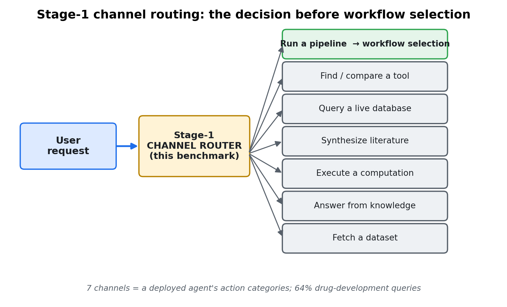
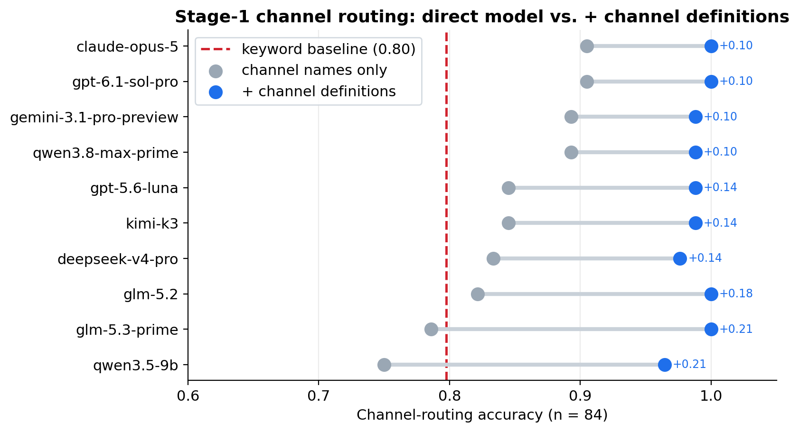

# Which Resource? An Open Pilot Benchmark for Stage-1 Resource-Channel Routing in Biomedical AI Agents

**Authors:** [Author names — to be completed]
**Affiliations:** [Affiliations — to be completed]
**Corresponding author:** [name, email — to be completed]

*Preprint, 2026. Benchmark items, ground truth, deterministic scorer, keyword baseline, and per-item predictions released under CC-BY-4.0; repository and archival DOI: [to be added].*

**Keywords:** benchmark; biomedical AI agents; intent routing; resource selection; policy adherence; language-model evaluation.

> **Scope.** This is a deliberately small **pilot** benchmark (84 items) that measures **adherence to a specified seven-channel resource-routing policy**, not the discovery of an intrinsically correct resource taxonomy. Its size supports a proof-of-concept and a matched ablation, not a definitive ranking; per-channel accuracy moves 8.3 points per item, so differences within the plus-definitions band are not individually significant.

---

## Abstract

Before a biomedical AI agent can choose *which analysis pipeline* to run, it must decide *which kind of resource* a request even belongs to — run a pipeline, find a tool, query a live database, synthesize literature, execute a short computation, answer from its own knowledge, or fetch a dataset. Benchmarks of agentic task selection almost always assume the request already needs a pipeline and measure *which* pipeline; the upstream **channel** decision is left unmeasured. We introduce an open, objectively-scored benchmark for this stage-1 routing decision, with seven channels grounded in the action set of a deployed biomedical agent and weighted toward drug-development queries. Using a matched **direct-model vs. model-with-channel-definitions** protocol across a roster of frontier and open models, and against a non-model keyword baseline, we find that a surface-cue keyword classifier already reaches 0.80, that direct models cluster in the same band (0.75–0.91), and that **supplying the channel definitions — not raw model scale — is what lifts routing into the 0.96–1.00 band**, most for the smallest model (0.75 → 0.96) and least for the strongest (0.91 → 1.00).

---

## 1. Introduction

Agentic systems for biomedical research route each user request to one of several destinations. Existing routing benchmarks test *workflow selection* — "given a pipeline request, which pipeline?" — but that presupposes an earlier decision: *is this a pipeline request at all, or a database lookup, a literature question, a quick calculation, or a direct answer?* This **stage-1 channel routing** is what a deployed agent's intent classifier does first, and getting it wrong sends the entire downstream chain to the wrong subsystem. It has not been measured in the open.

We contribute: (1) an objectively-scored channel-routing benchmark whose labels are the resource categories of a deployed biomedical agent; (2) a matched direct-vs-definitions protocol that isolates what the channel definitions buy; (3) a non-model keyword baseline; and (4) a drug-development-weighted item set (64% of queries), because channel ambiguity is acute in drug discovery — "what is the reported IC50 of this compound?" is a database lookup, "recommend a docking engine" is a tool search, and "dock this library" is a pipeline, all drug-development requests routing to three different channels (Figure 1).

**Figure 1. Study design.** A user request first hits the stage-1 channel router, which selects one of seven resource channels; only the "run a pipeline" channel proceeds to downstream workflow selection. The seven channels are the action categories of a deployed agent; 64% of items are drug-development queries.

## 2. Related work

The strongest agent benchmarks grade an executed outcome on a task **whose type is already fixed**:
**SWE-bench Verified** (OpenAI, 2024) hands the agent a code issue, **MLE-bench** (OpenAI, 2024) a modeling
competition, **ScienceAgentBench** (ICLR 2025) and **CORE-Bench** (Princeton, 2024) a data-analysis or
reproduction task, and **BixBench** (FutureHouse, 2025) a bioinformatics notebook. In every case the *kind of
work* — code, model, analysis — is given. Tool-selection suites grade *which tool* to use, but again only once
the task is known to need a tool. General-purpose query-classification and retrieval-routing datasets exist in
the natural-language-processing literature but not for a biomedical agent's resource taxonomy.

The decision *upstream* of all of these — **which kind of resource a request belongs to at all** — is what we
benchmark. To our knowledge it is the first open, objectively-scored test of the which-resource decision
grounded in a deployed biomedical agent's action set. We state this as a scoped novelty claim, not a universal
first, and we report a non-model keyword baseline so a reader can see exactly how much of the task is lexical.
Consistent with the field (MLE-bench's human baseline, PoseBusters' classical-method baseline in structural
drug discovery), we treat the non-model baseline as a required reference, not an afterthought.

## 3. The benchmark

**Seven channels** (gold labels), each a resource category of a deployed agent:

| Channel | What belongs here |
|---|---|
| Run a pipeline | execute a multi-step analysis pipeline on data |
| Find / compare a tool | recommend, compare, or modify a specific method |
| Query a live database | a live lookup against a structured biological/chemical database |
| Synthesize literature | an answer requiring synthesis of published evidence |
| Execute a computation | a short ad-hoc calculation best done by running code |
| Answer from knowledge | a direct factual/conceptual answer needing no tool |
| Fetch a dataset | find or retrieve an existing dataset or accession |

**Composition.** 84 items, 12 per channel (balanced), **64% drug-development** queries spanning every channel, the remainder cross-domain (transcriptomics, variant analysis, single-cell, proteomics, genomics, clinical, metagenomics, immunology) for breadth. Genuinely ambiguous items carry author-specified acceptable alternatives. The benchmark measures **adherence to a stated resource-routing policy** grounded in a deployed agent; where a request is legitimately policy-dependent (a factual question that could be answered from memory or verified against a database), the acceptable-alternatives mechanism records that, and independent adjudication of those items is planned.

## 4. Methods

One deterministic scorer grades an exact channel match (the gold channel or a listed acceptable alternative), reported overall, per channel, and on the drug-development subset, with a confusion summary. No model acts as judge. Two conditions, both reported per model: **direct** = the query plus the seven channel *names* only; **plus definitions** = the query plus the channel names *with their definitions*. The direct→definitions difference is the knowledge-layer gain. A **keyword baseline** — one modest trigger set per channel, not tuned per item — gives a non-model reference. Generation is empties-aware (token budget placed past internal reasoning, retry, low concurrency) so reasoning models do not emit spurious blanks.

## 5. Results

**Figure 2.** Channel-routing accuracy (84 items): each model direct (grey) and with channel definitions (blue); the dashed line is the non-model keyword baseline (0.80).

Three findings:

1. **The task has strong lexical signal.** The non-model keyword baseline reaches **0.80 overall** (0.82 on the drug-development subset). Direct models span 0.75–0.91; the strongest frontier models exceed the keyword baseline, while weaker models sit at or below it. The task is therefore not adversarially hard, and direct-model accuracy is not dominated by a keyword classifier for every model — a distinction we do not establish as statistically significant at this sample size (84 items; one error ≈ 1.2 percentage points overall).
2. **Direct models cluster with the keyword baseline** (0.75–0.91), from the smallest open model to the strongest frontier model.
3. **The channel definitions drive the gain.** With definitions, every model moves into the **0.96–1.00** band; the gain is largest for the smallest model (0.75 → 0.96, +0.21) and smallest for the strongest frontier model (0.91 → 1.00, +0.10). The pattern is a headroom effect (weaker models have more room), not an asserted inverse-scaling mechanism.

**Table 2 | Per-channel accuracy and confusion, on-premises model with definitions (n = 12 per channel).** Rows are the gold channel; columns are the predicted channel. Five of seven channels are perfect; the residual error is "find a tool" misrouted to "synthesize literature," plus one "run a pipeline" misrouted to "execute a computation."

| gold \ predicted | pipeline | tool | database | literature | code | knowledge | dataset | acc. |
|---|---|---|---|---|---|---|---|---|
| Run a pipeline | 11 | · | · | · | 1 | · | · | 11/12 |
| Find a tool | · | 9 | · | 3 | · | · | · | 10/12† |
| Query a database | · | · | 12 | · | · | · | · | 12/12 |
| Synthesize literature | · | · | · | 12 | · | · | · | 12/12 |
| Execute a computation | · | · | · | · | 12 | · | · | 12/12 |
| Answer from knowledge | · | · | · | · | · | 12 | · | 12/12 |
| Fetch a dataset | · | · | · | · | · | · | 12 | 12/12 |

†One of the three "find a tool → synthesize literature" items is credited by an acceptable-alternative label (a request that is genuinely answerable either way), giving 10/12 scored. Overall: 81/84 = 0.964. Without the definitions, errors are more diffuse and concentrate on channel *vocabulary* (non-answers, and workflow↔code-execution confusion).

## 6. Limitations

- **Seed scale.** 84 items balanced across seven channels is a seed set, not evidence of production channel prevalence; the acceptable-alternatives labels are author-specified and would benefit from independent, blinded adjudication.
- **Policy, not universal truth.** The benchmark measures adherence to a stated resource-routing policy; some items are legitimately policy-dependent, and we flag them rather than assert a single correct destination.
- **Single-intent.** Each item has one primary channel; genuinely multi-intent requests are a planned extension.
- **Scope of the gain.** "Supplying definitions helps" is a result about explicit task specification; it should not be read as a general claim that a knowledge layer confers intelligence.
- **Drug-development weighting** reflects the product's focus, not a claim about biomedical queries in general.

## 7. Discussion

Resource-channel routing is an early decision that determines which subsystem a request is sent to, and it has not previously been measured in the open as a standalone task. Within this pilot, the result is specific and bounded: the task carries substantial lexical signal (a keyword router and direct models reach ~0.80), and the increase toward near-perfect accuracy is associated with **providing the channel definitions**, an explicit task-specification effect rather than a demonstration about model scale or retrieval. For drug-development agents, where the same entity can route to a database lookup, a tool search, or a pipeline depending on the request's verb, we conjecture that correct stage-1 routing is a prerequisite for downstream task completion; the present data measure routing accuracy, not downstream completion, and do not establish that conjecture.

## 8. Data and code availability

The 84 items, their gold channels and acceptable-alternative labels, the deterministic scorer, the non-model keyword baseline, the matched-protocol runner, the exact prompts, and the complete per-item predictions are released under CC-BY-4.0 at [repository URL — to be added], archived at [DOI — to be added].

## Ethics and intended use

The benchmark contains no human-subjects data; all items are synthetic requests authored for this benchmark. It measures adherence to a specified routing policy and is not a clinical or operational decision tool.

## Author contributions, funding, and competing interests

Author contributions: [to be completed]. Funding: [to be completed]. Competing interests: the seven channels correspond to the action categories of a deployed agent developed by the authors; the items, labels, and scorer are released to enable independent adjudication. [Formal declaration to be completed.]

## References

1. SWE-bench: Can Language Models Resolve Real-World GitHub Issues? ICLR 2024 (arXiv:2310.06770); SWE-bench Verified, OpenAI, 2024.
2. MLE-bench: Evaluating Machine Learning Agents on Machine Learning Engineering. OpenAI, 2024 (arXiv:2410.07095).
3. ScienceAgentBench: Toward Rigorous Assessment of Language Agents for Data-Driven Scientific Discovery. ICLR 2025 (arXiv:2410.05080).
4. CORE-Bench: A Computational Reproducibility Agent Benchmark. 2024 (arXiv:2409.11363).
5. BixBench: A Comprehensive Benchmark for LLM-based Agents in Computational Biology. FutureHouse, 2025 (arXiv:2503.00096).
6. PoseBusters: Are deep learning docking methods ready for production? *Chem. Sci.* 2024.
