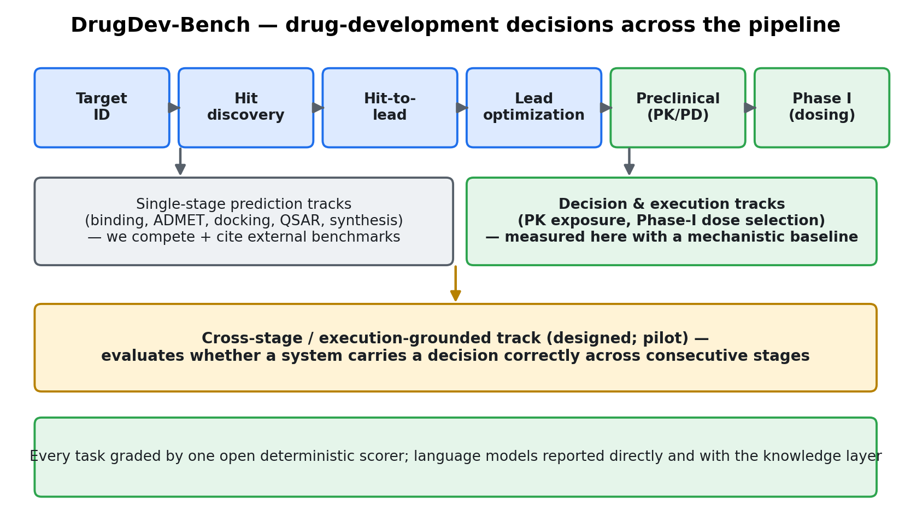

# DrugDev-Bench: Execution-Grounded Drug-Development Decision Tasks for AI Agents

### Version 1 — dose-finding and pharmacokinetics, with a cross-stage design

*Preprint — October 2026. Benchmark data and scorers released under CC-BY-4.0.*

---

## Abstract

The public benchmark landscape for AI in drug development is dominated by **single-stage prediction** (property/ADMET, docking and binding affinity, molecule generation, retrosynthesis). Two decisions that gate real programs — **Phase-I dose selection** and **pharmacokinetic exposure prediction** — have essentially no open, graded agent benchmark, and no existing benchmark grades whether a system carries a decision *correctly across consecutive development stages*. We introduce **DrugDev-Bench**, whose measured version-1 contribution is a pair of execution-relevant decision tasks graded against a mechanistic reference, and whose design includes a cross-stage, execution-grounded track reported here as a roadmap with a pilot, not as a measured headline. We report baselines unedited. On Phase-I dose selection, language models are weak (frontier 0.11–0.50) while a small on-premises model reaches 0.78; critically, the **established dose-selection rule applied to the true exposure–response curve scores 0.85**, so the task is far from solved by any language model and the mechanistic tool is the right instrument. On pharmacokinetic prediction, once the target endpoint is specified unambiguously, capable models reach only ~0.40–0.47 within two-fold. We make no claim of a model capability win; the contribution is an open, mechanistically-anchored decision benchmark on development stages the field has left unmeasured.

---

## 1. Introduction

Most public benchmarks for computational drug development score a single predictive step: a property, a binding pose, an affinity, a generated molecule, a synthetic route. These are valuable, and we compete on and cite them. But two decisions that determine whether a program advances are largely unbenchmarked in the open:

- **Phase-I dose selection** — choosing a maximum tolerated dose from an exposure–response model is a decision made in every oncology program; the design methodology is standard, yet there is no shared, graded agent benchmark for the *decision*.
- **Pharmacokinetic exposure prediction** — predicting peak plasma concentration from physicochemical and clearance inputs is a daily task with no open agent benchmark.

And no benchmark grades the property that most distinguishes an agent from a predictor: whether it carries a decision **correctly across consecutive stages** (Figure 1).

**Figure 1. Study design.** Single-stage prediction tracks (left) compete with and cite external benchmarks. The measured version-1 contribution (right) is the decision and execution tracks — pharmacokinetic exposure and Phase-I dose selection — graded against a mechanistic reference. The cross-stage, execution-grounded track (bottom band) is designed and piloted, reported here as a roadmap.

## 2. Scope and honesty statement

This version reports the **measured** decision tasks: Phase-I dose selection (20 scenarios) and pharmacokinetic exposure prediction (15 compounds). The single-stage prediction tracks (property, docking, binding free energy, structure–activity modeling, synthesis) exist in the benchmark to position against external work and are not the headline. The **cross-stage execution-grounded track is designed and piloted but not yet scored across a model roster**; we present it as the benchmark's roadmap and do not report it as a result. This scoping is deliberate: we would rather publish the mechanistically-anchored decision tasks we can defend than claim an execution-grounded capability we have not yet measured.

## 3. Methods

Each task is graded by one deterministic scorer. Language models are reported directly and, where a knowledge layer applies, with it. For context, every task is anchored to a **non-model mechanistic reference** so that a model's score is read against the right instrument, not only against other models.

- **Phase-I dose selection.** Each scenario provides pharmacokinetic and exposure–response inputs and a dose grid; the system must select the maximum tolerated dose. The grader holds the true per-dose toxicity curve, which the solver does not see. The **mechanistic reference** is the standard dose-selection rule (eliminate doses whose toxicity exceeds the target by more than the standard band; otherwise select the admissible dose whose rate is closest to target), applied to the true curve. This rule is the established methodology in the field (Liu & Yuan, 2015).
- **Pharmacokinetic exposure.** Each compound provides molecular weight, lipophilicity, ionization, plasma binding, and clearance inputs; the system predicts peak plasma concentration in micromolar, scored as the fraction of compounds within two-fold of the reference.

## 4. Results

### 4.1 Phase-I dose selection: models versus the mechanistic rule

**Figure 2.** Dose-selection (maximum-tolerated-dose) accuracy over 20 scenarios. Language models span 0.11–0.50 (frontier) with a small on-premises model at 0.78; the dashed line is the mechanistic rule applied to the true exposure–response curve (0.85).

Three readings:

1. **The mechanistic rule, on the true curve, scores 0.85 (17/20).** Its three misses are not curve errors but selection-rule edge cases — two "no safe dose" declarations that a fixed elimination band does not trigger, and one closest-dose-versus-higher-dose tie. These mark scenarios where "the maximum tolerated dose" is itself a judgment call, a useful signal about the benchmark's own hardest items.
2. **Frontier language models are weak here (0.11–0.50).** Dose selection from an exposure–response model is not something they do reliably.
3. **A small on-premises model reaches 0.78** — above every frontier model on this task, though below the mechanistic rule. We flag this as notable but do not over-read it: the proper solution is the mechanistic exposure–response calculation, which the benchmark exists to motivate, not a language model's unaided guess.

### 4.2 Pharmacokinetic exposure prediction

The originally reported near-zero scores came from a prompt that did not state **which** pharmacokinetic endpoint to predict (each compound has several reference values), so the grader matched the wrong one. With the endpoint specified unambiguously, capable models reach only **~0.40–0.47 within two-fold** (for example, a frontier model at 0.47). This is an honest construct-validity correction: the task is hard, but "near-useless" was partly a specification artifact; we do not claim a model wins, and no system reaches the two-fold bar reliably.

### 4.3 A metric caveat we surface rather than hide

An early ligand-ranking task reported a score that was nearly identical across every model. On inspection this was a **metric-resolution artifact**: the rankings had only three items, on which the rank-correlation metric can take just four values, and all models mis-ranked the same small subset. We report this transparently and demote that task to a low-resolution probe pending a rebuild with longer rankings; we do not fabricate longer reference rankings to inflate resolution.

## 5. Limitations

- **Statistical power.** The two measured tasks have 20 and 15 items; we report them as decision probes with the mechanistic anchor, not as high-precision model rankings, and we do not pool heterogeneous micro-tasks to manufacture power.
- **No wet-lab ground truth.** Exposure and toxicity references are modeled; we are explicit that modeled references are not experimental validity.
- **Cross-stage track unmeasured.** The execution-grounded cross-stage track is design and pilot only; its results are future work, and the abstract and title are scoped accordingly.
- **Mechanistic reference as oracle.** The 0.85 dose-selection reference uses the true exposure–response curve, which the solver does not see; it is an upper bound on rule-based selection, not an end-to-end system score.

## 6. Discussion

DrugDev-Bench's contribution is to put two gate-keeping drug-development decisions — dose selection and pharmacokinetic exposure — into an open, deterministically-scored benchmark anchored to the established mechanistic methods, and to lay out an execution-grounded cross-stage track as the next milestone. The headline finding is sober and useful: on dose selection, language models trail the standard mechanistic rule by a wide margin, which is exactly the argument for routing such decisions through the mechanistic tool rather than a model's unaided judgment. We release the items, references, scorers, and the mechanistic baseline so every number here can be reproduced and contested.

## 7. Data and code availability

Items, references, the deterministic scorers, and the mechanistic dose-selection baseline are released under CC-BY-4.0. Dose-selection methodology follows Liu & Yuan, *Journal of the Royal Statistical Society: Series C* (2015).
