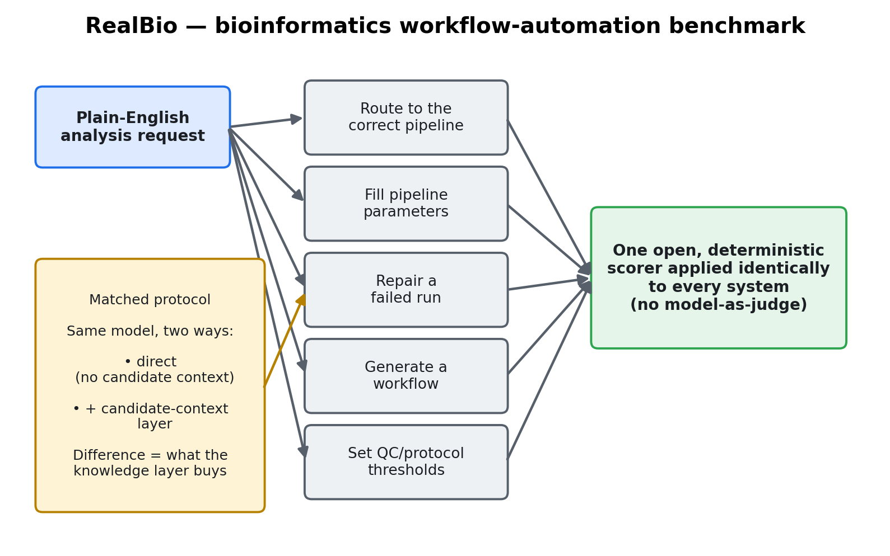
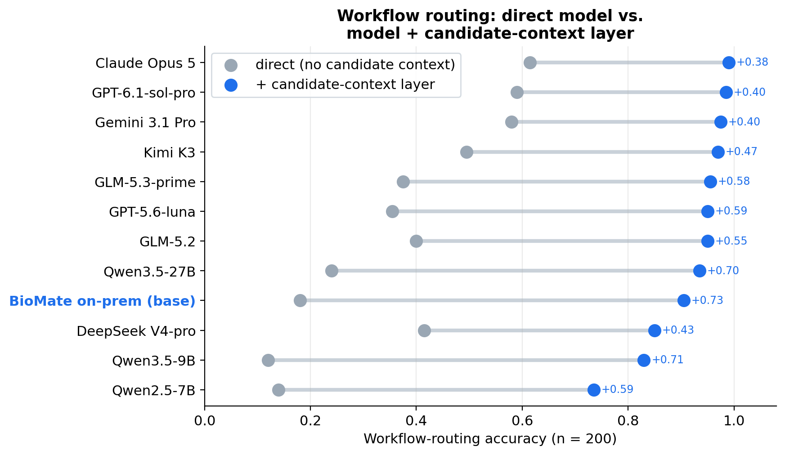
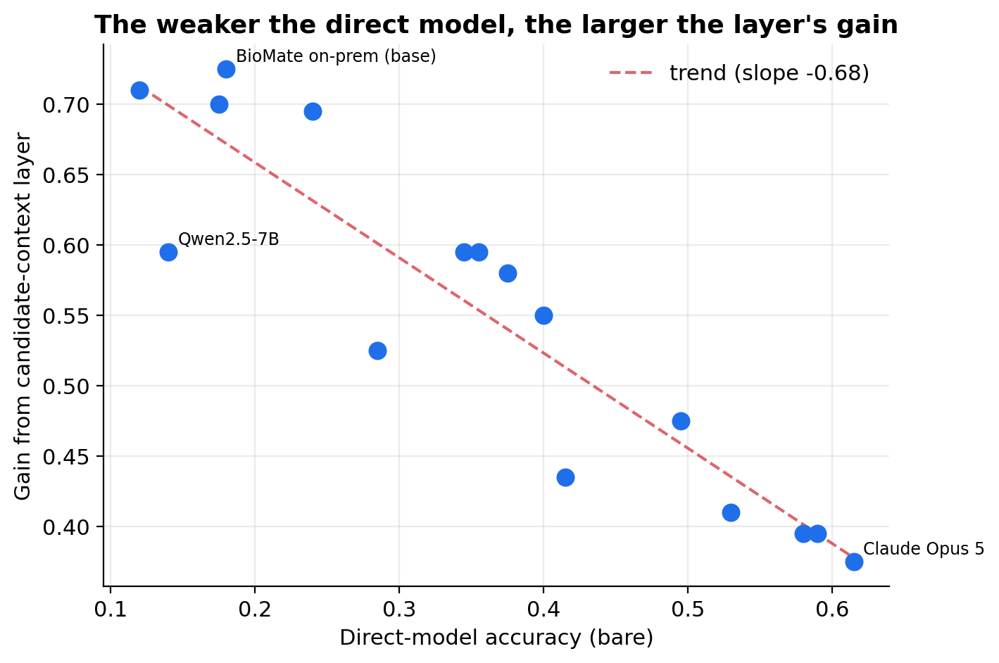
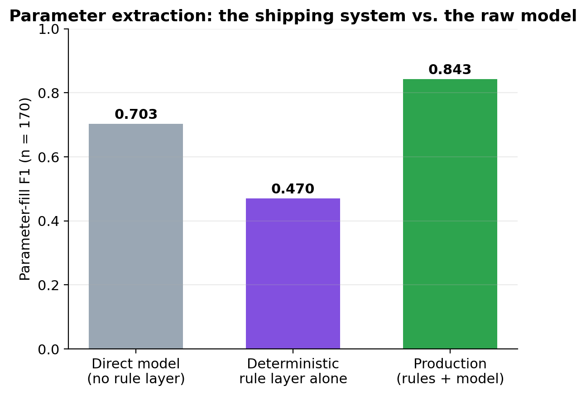
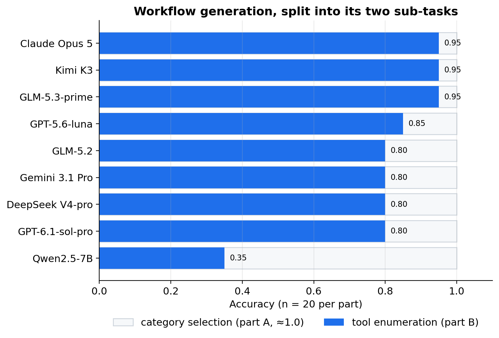

# RealBio: An Open, Objectively-Scored Benchmark for Real-World Bioinformatics Workflow Automation — and What the Knowledge Layer Buys

*Preprint — October 2026. Benchmark data and scorer released under CC-BY-4.0.*

---

## Abstract

Benchmarks for AI agents in biomedicine are often scored by each system's own judge on its own private task set, which makes cross-system numbers non-comparable and invites unintentional self-grading. We present **RealBio**, an open, cross-system benchmark for the operations a working bioinformatics analyst actually needs: route a plain-English request to the correct analysis pipeline, fill that pipeline's parameters, repair a failed run, generate a workflow, and set quality-control thresholds. Every system is graded by **one released deterministic scorer** applied identically to fixed, public items — no model acts as judge. Our primary analysis is a **matched comparison**: the *same* language model evaluated with and without a candidate-context layer (a short menu of retrieved candidate workflows with descriptions), which isolates what the knowledge/retrieval layer contributes rather than conflating it with raw model ability. Across frontier, open-weight, and privately-deployable models we find that **the candidate-context layer is the dominant measured lever on these selection and extraction tasks**: on workflow routing it lifts every language model, most of all the weakest ones — a small (~9B-parameter) on-premises model rises from 0.18 to 0.91, *approaching but not matching* the frontier band (0.94–0.99). A held-out audit shows these gains are not an artifact of tuning on the evaluation items. We release the protocol, items, and scorer so any team can place its own system on the leaderboard and check every number.

---

## 1. Introduction

Large-model "agents" now report strong results on biomedical tasks, but the evidence base has a structural weakness: the benchmark, the ground truth, and the judge are frequently owned by the same group that owns the system under test, and scores are reported on private or sub-sampled sets. A number produced by a system's own judge on its own private items cannot be compared across systems or independently verified.

RealBio takes the opposite stance. It **fixes the items, publishes the ground truth, and ships one open scorer** that anyone runs identically on any system. Its tasks are real-world bioinformatics *workflow automation*, not multiple-choice trivia. Crucially, RealBio's headline analysis is not a single-system ranking but a **matched ablation**: the same model scored with and without the benchmark's candidate-context layer, so a system-level result is never mistaken for a claim about a model's raw intelligence.

**Contributions.**
1. A public, objectively-scored, five-task benchmark of real bioinformatics workflow automation (Figure 1).
2. A matched **direct-model vs. model-plus-knowledge-layer** protocol that isolates the candidate-context contribution on the *same* model.
3. A cross-system leaderboard spanning current frontier models, open-weight models, a privately-deployable small model, and a published domain agent.
4. An open scorer and dataset (CC-BY-4.0) that make every number reproducible and refutable.
5. A held-out audit showing the deterministic components and the knowledge-layer gain generalize to unseen items.

**Figure 1. Study design.** A plain-English request is evaluated on five workflow-automation tasks; one open deterministic scorer grades every system identically, with no model acting as judge. The matched protocol runs each model two ways — direct, and with a candidate-context layer — and attributes the difference to the knowledge layer.

## 2. Related work and how RealBio differs

A strong line of agent benchmarks now scores a **hidden, executed outcome** rather than a described method.
**SWE-bench** and its expert-curated **SWE-bench Verified** subset (Princeton, 2023; OpenAI, 2024) place an
agent in a per-instance container and accept a code patch only if hidden tests that previously failed now pass
*and* previously-passing tests still pass. **MLE-bench** (OpenAI, 2024) grades agents on real Kaggle
competitions by each competition's own metric on a held-out split, against human leaderboard baselines.
**ScienceAgentBench** (ICLR 2025) requires a self-contained program drawn from peer-reviewed analyses and grades
the program, its execution output, and cost — and reports a *with/without expert knowledge* contrast in the
spirit of an ablation. **CORE-Bench** (Princeton, 2024) grades computational reproduction of published results
with difficulty tiers set by how much reproduction information is given. **PaperBench** (OpenAI, 2025) grades
paper replication against author-co-developed rubrics with a *validated* model judge. In bioinformatics
specifically, **BixBench** (FutureHouse, 2025) pairs real datasets and analysis notebooks with expert questions.

RealBio is complementary and differs on two axes that none of the above combine. First, it uses **one open,
fully deterministic scorer with no model judge** — shared with SWE-bench/MLE-bench/CORE-Bench, but unlike the
rubric/LLM-judged PaperBench and the open-answer BixBench. Second, its headline is a **matched direct-vs-
knowledge-layer ablation on the same model**, which isolates the product contribution rather than ranking raw
models; we are not aware of an agent benchmark that makes this matched ablation its primary result. We are
candid about where RealBio is *behind* this cohort: its current items score **recognition and selection**, not
executed operation. We therefore adopt the field's execution-grounded verification as RealBio's stated **v2**
direction (a failed workspace with the diagnosis withheld; the agent submits a configuration/code fix; a
resumed run plus hidden output checks decide the score), and present the current release as the deterministic,
matched-ablation foundation on which that execution layer is built.

**Table 1. RealBio versus representative agent benchmarks.**

| Benchmark | Open items | Deterministic scorer (no model judge) | Cross-system | Execution-grounded | Matched knowledge-layer ablation |
|---|---|---|---|---|---|
| SWE-bench Verified (2024) | yes | yes (hidden tests) | yes | yes | no |
| MLE-bench (2024) | yes | yes (competition metric) | yes | yes | no |
| ScienceAgentBench (2025) | yes | partial (program + execution) | yes | yes | partial (expert-knowledge contrast) |
| CORE-Bench (2024) | yes | yes | yes | yes | no (difficulty tiers) |
| PaperBench (2025) | yes | no (validated LLM judge) | yes | yes | no |
| BixBench (2025) | yes | partial (open-answer) | yes | yes (notebook) | no |
| **RealBio (this work)** | **yes** | **yes (CC-BY-4.0, no judge)** | **yes** | recognition now; **v2 planned** | **yes (direct vs. knowledge layer)** |

We claim the *combination* of a no-judge deterministic scorer and a matched knowledge-layer ablation; several
prior benchmarks match RealBio on individual axes and exceed it on execution grounding. We invite closed
co-scientist systems to place their own results on the open items.

## 3. The benchmark: five workflow-automation tasks

| Task | What it tests | Ground truth | Items |
|---|---|---|---|
| Workflow routing | plain-English request → correct pipeline | curated catalog + acceptable alternatives | 200 |
| Parameter fill | fill a pipeline's parameters from context | schema-validated expected values | 170 |
| Failure repair | classify a failed run into its fix category | fixed failure categories | 100 |
| Workflow generation | name the analysis category *and* the key tools | category match + key-tool recall | 40 |
| Protocol thresholds | decide the correct QC action (pass/warn/fail) | published protocol references | 100 |

Drug-development decision tasks (pharmacokinetic prediction, dose finding, docking, property prediction) and the upstream "which resource" decision are deliberately **out of scope** here; they are the subjects of two companion benchmarks.

## 4. Methods: scoring and conditions

**One deterministic scorer.** A single released scorer grades every system on the same items, using **semantic** matching rather than raw string identity: pipeline names match up to formatting (underscores versus spaces); parameter values match canonical aliases (equivalent genome-assembly identifiers; equivalent boolean spellings) and numeric-range containment. This measures semantic correctness and is applied identically to every system. Exact scoring rules, with worked examples, are released with the dataset.

**Three disclosed conditions.**
- **Direct:** the model receives the request only, with no candidate list.
- **Plus knowledge layer:** the model additionally receives a short menu of retrieved candidate workflows *with one-line descriptions*. This is the matched, same-model comparison and our **primary** result. The candidate menu is produced by the benchmark's retrieval step; we report selection accuracy conditional on the correct candidate being present, and separately note the end-to-end figure that folds in retrieval misses (≈0.80).
- **Retrieval-only system:** full production retrieval with no model in the loop, reported once as a system data-point (0.965), **not** as a headline, because it is not a model-controlled comparison.

**Empties-aware generation.** Reasoning models can return no content when their token budget is consumed by internal reasoning; such empties are a harness artifact and are handled by cause (truncation → re-run; content-filter refusal → scored as a genuine failure; a correct empty answer on parameter-fill → scored correct). Abstention is never credited as correct.

## 5. Results

### 5.1 Workflow routing (primary result)

The knowledge layer lifts every language model, and the absolute gain is largest for the weakest direct models — a ceiling/headroom pattern (Figures 2–3). The small on-premises model rises from 0.18 (direct) to 0.91 (plus layer), exceeding same-class open models and *approaching* the frontier band (0.94–0.99) without matching it.

**Figure 2.** Workflow-routing accuracy (200 items) for each model, direct (grey) and with the candidate-context layer (blue); the annotation is the gain. The layer lifts every model into a narrow high band.

**Figure 3.** The weaker the direct model, the larger the layer's gain. We report this as a headroom pattern, not as an asserted inverse-scaling mechanism.

### 5.2 Parameter fill: the shipping system vs. the raw model

The leaderboard's parameter column reports the **raw** model with no deterministic layer. The deployed system adds a rule layer (canonical unit, alias, and boolean normalization, plus a guardrail that drops hallucinated input values) and merges it with the model. Measured offline on the public items, this production configuration scores **F1 0.843** versus the raw model's 0.703 (Figure 4). The public benchmark therefore *under-measures* the deployed system because, by design, the direct condition bypasses the deterministic layer.

**Figure 4.** Parameter-fill F1 (170 items): the raw model, the deterministic rule layer alone (high precision, low recall), and the production combination.

### 5.3 Workflow generation, resolved into two sub-tasks

Workflow generation has two parts: naming the analysis **category** (20 items) and listing the **key tools** a pipeline requires (20 items). Capable models name the category essentially perfectly; tool enumeration is a genuine spread, from ~0.80–0.95 for frontier and mid-size models down to ~0.35 for the smallest 7B model (Figure 5). We report the two parts separately rather than as a single blended score.

**Figure 5.** Category selection (grey, ≈1.0 for capable models) versus key-tool enumeration (blue), 20 items each.

### 5.4 The other tasks

Failure-repair category accuracy ranges from ~0.77 to ~0.95 across systems; protocol-threshold accuracy is lower and more variable (~0.33–0.63), reflecting that the correct QC action is genuinely contested on some items. We report these without selective highlighting.

### 5.5 Synthesis

Across routing, parameter fill, and channel selection, the knowledge layer is the **dominant measured lever** on these selection and extraction tasks; a small, privately-deployable model plus the layer *approaches* frontier routing results, while supervised fine-tuning of that small model did **not** help (it regressed on routing). The defensible statement is: *the knowledge/retrieval layer substantially improves the evaluated tasks and is a higher-leverage investment than model weights here* — not "model-invariant," "frontier parity," or "selection solved."

## 6. Independence audit

Because the semantic scorer and the organism-to-genome normalization rules were refined after examining errors on the original items, we re-test them on a **fresh held-out set authored without reusing any tuned item**:

- **Deterministic components (no model):** on held-out items the rules plus semantic scorer generalize at **88% (15/17), with zero hallucinations**, and **abstain correctly** on out-of-coverage organisms rather than guessing.
- **Knowledge-layer gain (model, matched conditions):** reproduces on held-out queries with the same headroom pattern — the smallest model +0.80, a frontier model +0.33, the strongest frontier model +0.13.

The gains are therefore not an artifact of tuning on the evaluation items.

## 7. Limitations

- **Author conflict.** The scorer is open and deterministic, enabling independent audit — but the same group built the benchmark, the scorer, and one evaluated system. We claim *auditability*, not *fairness by construction*.
- **Direct ≠ deployment.** The direct condition is "model without the candidate list," not "how models are actually deployed" (deployment normally includes retrieval). It is the control that isolates the layer, nothing more.
- **Not parity.** The on-premises model *approaches* some frontier results with the layer; 0.91 versus 0.94–0.99 is not evidence of parity.
- **Headroom framing.** Weaker direct models show larger absolute gains on bounded-accuracy tasks; a ceiling effect can produce this without any inverse-scaling mechanism.
- **Selection is conditional.** Routing accuracy is high *conditional on correct retrieval*; the end-to-end figure is ≈0.80.
- **Serving provenance.** A subset of the plus-layer cells were re-run through a common serving provider while others came from each system's own harness — a uniform *condition* with differing serving provenance.

## 8. Discussion

RealBio's value is the open, deterministic, matched-ablation protocol: a reader can see, per task and per model, exactly what the knowledge layer buys. The consistent finding is that for bioinformatics workflow *selection and extraction*, the retrieval/rule layer — not model scale — carries the performance, with a practical corollary: a small, privately-deployable model behind a good knowledge layer is a cost- and compliance-friendly path that *approaches* (does not match) frontier agents on these tasks. Whether this holds beyond selection and extraction is open. We release everything so the claim is refutable.

## 9. Data and code availability

The items, ground truth, the deterministic scorer, and the matched-protocol runner are released under CC-BY-4.0. Any team can run its own system on the fixed items and reproduce every number in this paper.

## References

1. SWE-bench: Can Language Models Resolve Real-World GitHub Issues? ICLR 2024 (arXiv:2310.06770).
2. Introducing SWE-bench Verified. OpenAI, 2024.
3. MLE-bench: Evaluating Machine Learning Agents on Machine Learning Engineering. OpenAI, 2024 (arXiv:2410.07095).
4. ScienceAgentBench: Toward Rigorous Assessment of Language Agents for Data-Driven Scientific Discovery. ICLR 2025 (arXiv:2410.05080).
5. CORE-Bench: Fostering the Credibility of Published Research Through a Computational Reproducibility Agent Benchmark. 2024 (arXiv:2409.11363).
6. PaperBench: Evaluating AI's Ability to Replicate AI Research. OpenAI, 2025 (arXiv:2504.01848).
7. BixBench: A Comprehensive Benchmark for LLM-based Agents in Computational Biology. FutureHouse, 2025 (arXiv:2503.00096).
8. Liu, S. & Yuan, Y. Bayesian optimal interval designs for phase I clinical trials. *J. R. Stat. Soc. C* 64, 507–523 (2015).
