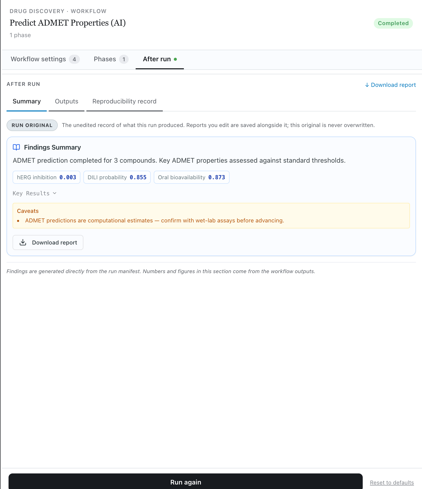

# BioMate: reviewing an ADMET result

**Internal review draft · 3 October 2026 · not approved for client distribution**

By the end of this lesson, a reader should be able to find a completed run, retrieve its outputs, distinguish predictions from measurements, and identify missing provenance.

## The example

This is a three-molecule ADMET demonstration. It is not a target-binding experiment or a JAK1 discovery campaign. The recorded input order is:

| Molecule | SMILES |
|---|---|
| Aspirin | `CC(=O)Oc1ccccc1C(=O)O` |
| Caffeine | `CN1C=NC2=C1C(=O)N(C(=O)N2C)C` |
| Ibuprofen | `CC(C)Cc1ccc(C(C)C(=O)O)cc1` |

A suitable request is: “Predict ADMET properties for these three SMILES. Keep one result per molecule and preserve the input order.” Confirm the selected workflow and input list before starting. This review reopened an existing run; it did not repeat the entire submission-and-execution journey after the configuration repair.

## Inspect the completed run

1. Open the example conversation and select **Predict ADMET Properties (AI)**.
2. Select **After run → Summary**. Confirm the workflow and completed state. Completion means the computation finished; it does not establish scientific validity.
3. Select **Outputs**. Open or download the prediction results, toxicity report and QC metrics. All six output downloads passed the live audit on 3 October.
4. Compare each result with its input molecule. The Summary highlights selected results; inspect the complete per-compound data before comparing molecules.
5. Open **Reproducibility record** and check completeness before sharing.

## A worked reading exercise

The `per_compound_admet_ai` section of `toxicity_report.json` records:

| Molecule | hERG classification score | DILI classification score |
|---|---:|---:|
| Aspirin | 0.0034 | 0.8548 |
| Caffeine | 0.1149 | 0.8746 |
| Ibuprofen | 0.0084 | 0.4868 |

These are **model outputs**, not experimental measurements, concentration values or a patient's probability of harm. Compare the same endpoint and source across molecules. A lower score on one endpoint does not establish overall safety or suitability for a particular research program.

The QC file records a DILI panel score of **0.875**, a configured threshold of **0.5**, and `admet_dili_probability_passes: false`. The rounded panel score is the largest DILI score in this three-compound set. This establishes a recorded screening flag; it does not prove an automatic stop, rerun, or remediation occurred.

### Checks to perform before advancing

- Identify the endpoint, units, prediction method and input molecule for every number.
- Keep hERG classification scores separate from IC50 estimates. A probability-to-concentration conversion needs its own validated relationship.
- The current report also contains descriptor-based and formula-derived hERG IC50 estimates. These are a **scientific review blocker for broad safety claims** and are not used as measurements in this lesson.
- Preserve the submitted SMILES list. This run's default reproducibility record has empty input bindings/tool parameters and null SHA-256 fields. A record title does not guarantee completeness.
- Choose follow-up assays with the relevant domain specialist. No clinical dose or safety conclusion follows from this demonstration.

For cardiac safety context, see the [FDA E14/S7B Q&A](https://www.fda.gov/regulatory-information/search-fda-guidance-documents/e14-and-s7b-clinical-and-nonclinical-evaluation-qtqtc-interval-prolongation-and-proarrhythmic), which addresses integrated evidence assessment.

## Review package

The bilingual storyboard and interactive slides are under `reference/claude_design/tutorials/review-pilot/`. The slide navigation uses left/right arrows. English and Chinese teaching slides are localized; product screenshots show the real English interface and are labeled accordingly. Narration is drafted; external speech generation is pending user authorization. No revised MP4 has passed audiovisual review.
