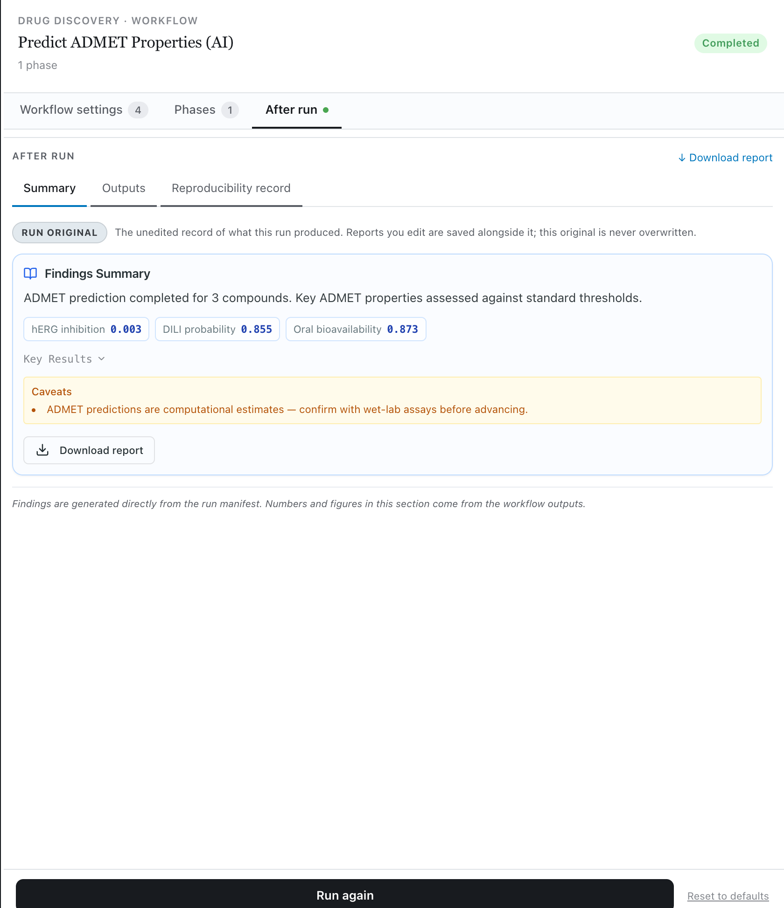

# BioMate：如何核查一份 ADMET 结果

**内部审阅稿 · 2026 年 10 月 3 日 · 尚未批准对外分发**

完成本节后，应能找到已完成的运行、下载输出、区分预测与测量，并识别可复现记录中的缺项。

## 示例使用了哪些输入？

这是一个包含三个分子的 ADMET 演示，不包含靶点结合实验或 JAK1 药物发现验证。输入顺序为：

| 分子 | SMILES |
|---|---|
| 阿司匹林 | `CC(=O)Oc1ccccc1C(=O)O` |
| 咖啡因 | `CN1C=NC2=C1C(=O)N(C(=O)N2C)C` |
| 布洛芬 | `CC(C)Cc1ccc(C(C)C(=O)O)cc1` |

可以这样提出请求：“预测这三个 SMILES 对应分子的 ADMET 性质。每个分子保留一组结果，并保持输入顺序。”启动前应核对所选工作流和输入清单。本次复核打开的是已有运行；配置修复后，尚未重新执行从提交到完成的全流程。

## 按什么顺序查看？

1. 打开示例对话，选择 **Predict ADMET Properties (AI)** 工作流。
2. 进入 **After run → Summary**，即运行后摘要。核对名称和完成状态。Completed 只说明计算结束，不代表科学结论已经成立。
3. 打开 **Outputs**，查看或下载预测结果、毒性报告和质控文件。本次复核已确认六个输出文件均可通过 BioMate 下载。
4. 将每个结果与对应输入分子核对。摘要仅突出部分结果；比较分子时应查看完整的逐分子数据。
5. 打开 **Reproducibility record**，即可复现记录，核查信息是否齐全后再分享。

## 结合真实数值练习解读

`toxicity_report.json` 中的 `per_compound_admet_ai` 部分记录了：

| 分子 | hERG 分类预测分数 | DILI 分类预测分数 |
|---|---:|---:|
| 阿司匹林 | 0.0034 | 0.8548 |
| 咖啡因 | 0.1149 | 0.8746 |
| 布洛芬 | 0.0084 | 0.4868 |

这些是**模型输出**，不是实验实测值、浓度值，也不是患者发生不良反应的概率。比较时要使用同一指标、同一来源。某一指标较低，不能直接推断分子整体安全，或适合某个具体研发项目。

质控文件中的 DILI 汇总分数为 **0.875**，本次配置阈值为 **0.5**，`admet_dili_probability_passes` 为 `false`。这个经过四舍五入的汇总值，对应三个分子中最高的 DILI 分数。它证明文件记录了一条筛选警示，但不能据此认定流程已经自动停止、重新运行或完成修复。

### 推进研究前，还要核查什么？

- 每个数值对应什么指标、单位、预测方法和输入分子？
- hERG 分类分数与 IC50 浓度估算必须分开解读；不能在缺少经验证关系式的情况下直接换算。
- 当前报告还包含基于分子描述符及公式推导的 hERG IC50 估算。它们是对外宣称安全性之前必须解决的**科学审查问题**，本教程不将其作为实测值使用。
- 请保留实际提交的 SMILES 清单。本例默认可复现记录中的输入绑定和工具参数为空，SHA-256 字段也为空。记录的名称不能代替完整性核查。
- 后续实验应由相关领域专业人员结合具体问题选择。本演示不能支持临床剂量或临床安全性结论。

心脏安全性背景可参考 [FDA E14/S7B 问答文件](https://www.fda.gov/regulatory-information/search-fda-guidance-documents/e14-and-s7b-clinical-and-nonclinical-evaluation-qtqtc-interval-prolongation-and-proarrhythmic)，其中讨论了多种证据的综合评估。

## 审阅材料

双语分镜和交互幻灯片位于 `reference/claude_design/tutorials/review-pilot/`，可用左右方向键翻页。教学文字已分别编写英文与中文版本；产品截图保留真实英文界面，并明确标注。旁白文稿已完成，外部语音合成仍等待用户授权。新版 MP4 尚未通过视听审阅。
