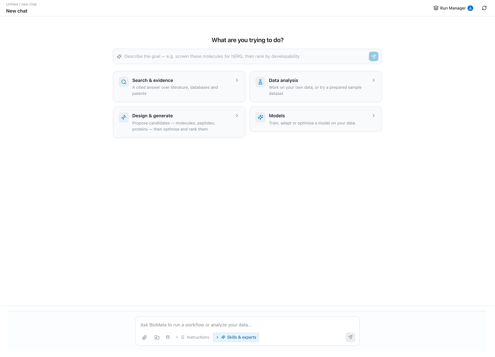

# Getting started — the cold start

> One-line promise: after this page you know how to start anything in BioMate from a blank chat, and
> how the router turns a sentence into the right kind of work. For everyone.

<!-- Code-verified (tier C); see coverage-ledger.md "## I.1 Cold start". -->

## What this is for

Every new conversation opens on the **cold start** — BioMate's doorway. Instead of a menu of tool names,
you get four **function-module** cards and an **intent router**: describe a goal and BioMate tells you
what kind of work it heard (an Instant answer or a Cloud workflow) before anything runs.

## Where it lives

The cold start renders in the **empty state of a new chat** — when a session has no messages yet
(`chat-interface.tsx:2126-2139`). Start a new chat (sidebar → New chat) to see it again. It is the
`ColdStartDashboard` component (`cold-start-dashboard.tsx`).

<!-- CAPTURE route=/ ; state=new/empty chat ; focus=full viewport ; note=intent bar + 4 module cards + composer (captured live from dev) -->
*The cold start, captured live from dev — the doorway to everything.*

## How to use it

**Two ways in — both seed the composer; neither sends on its own** (you always review and send):

1. **Type your goal in the intent bar.** Placeholder: *"Describe the goal — e.g. screen these
   molecules for hERG, then rank by developability"* (`cold-start-dashboard.tsx:544`). As you type, the
   router reads it and shows the **lane** (Instant / Cloud) and a **domain** label. Press Enter or the
   send affordance → your text is placed in the composer (`onSeed`, `:542, :560`), where you can edit
   it and send.
2. **Open a module card and pick an example.** Each card is collapsed by default; click its header to
   expand (`:748`). Inside, the module's **tracks** appear as tabs (`.trackbar`), each with example
   goals. Click an example (`ExampleRow`, `:639-646`) → it fills the composer with that goal **and
   attaches the example's prepared public demo dataset** (`prepareColdStartExample`,
   `chat-interface.tsx:2138-2155`), so it is ready to run as-is — no upload needed.
   - For **Design & generate**, the card also carries a **modality** (small-molecule / peptide /
     biologic); the picked modality is threaded into the seeded goal (`seedWithModality`, `:720-760`).

The four modules (Search & evidence · Data analysis · Design & generate · Models) and what each leads
to are described in the overview (`overview/00-what-is-biomate.md`) and their own chapters.

## The intent router (what it does — and doesn't)

- It **restates** what it heard as a lane + domain — e.g. "this reads like a Cloud workflow in
  Variant calling." The lane read reuses `laneForText` (`lane-preview.tsx`) so the front door can't
  contradict the composer's own lane preview; a domain pass (`DOMAIN_RULES`, `:448+`) adds the domain.
- It **never returns a count or a list of workflow names** — capability is legible through the modules
  and the restatement, not an inventory (design principle, `cold-start-dashboard.tsx` header §0.5).

## What you control

- **Review before sending** — the seeded goal **and its attached demo dataset** land in the composer;
  review, optionally edit the goal or swap in your own data, then send (I.2).
- **The lane** — if the router's Instant/Cloud read isn't what you want, override it in the composer
  (I.2 / the lane chip).

## Pitfalls & tips

> **Tip — the cards don't run anything.** Clicking an example *fills* your composer with the goal
> **and its prepared demo dataset** so you can run it as-is (or adjust it first); you still press
> send. Nothing launches behind your back.

> **Tip — get it back anytime.** The cold start is the empty-chat state — open a new chat to return to
> the doorway.

> **Tip — you don't need to pick a module.** Just type your goal in the intent bar; the router figures
> out the module/lane/domain.

## What's not covered

Verified against the current code — these design ideas are **not yet present** (→ Appendix E):
- The router seeds your **raw typed text**; there is no separate "Start" button that seeds a
  normalized/canonical phrasing (`:542` seeds `q.trim()` as-is).
- No **thin/collapsed launcher** for returning users (the full four-card grid always renders).
- No **in-project scope line** ("In *Project X* · its files and instructions are in context") on the
  cold start when a project is active.

---
_Verification: coverage-ledger.md "## I.1 Cold start" — tier C (cold-start-dashboard.tsx,
chat-interface.tsx, lane-preview.tsx)._
