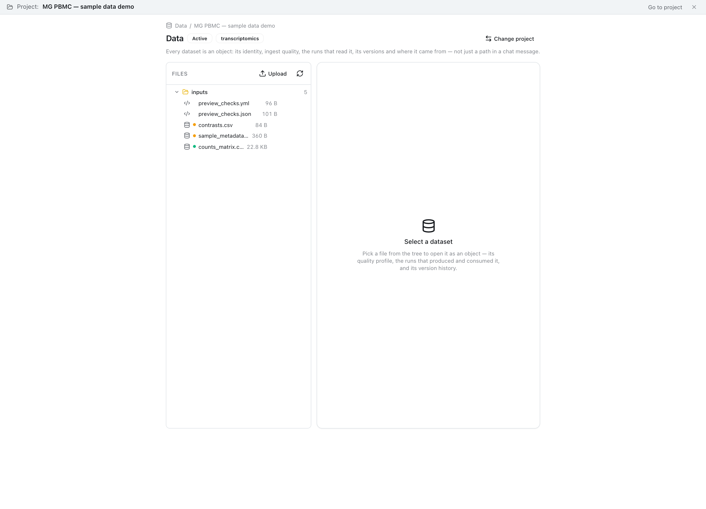
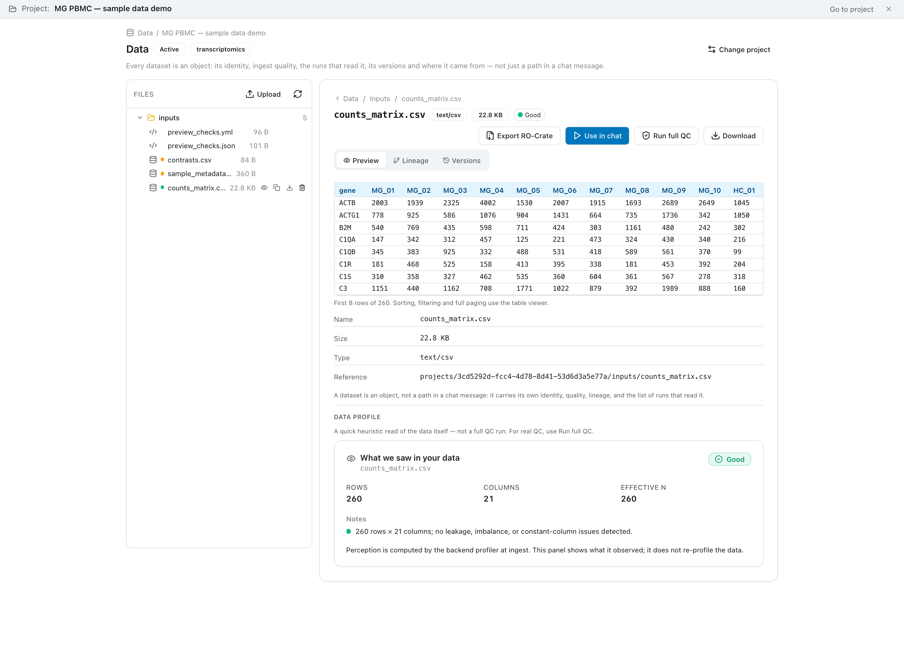

# Files & the dataset object

> One-line promise: after this page you know where your data lives, how to open any file as a
> first-class object (quality, lineage, versions, consumers), and how a reference to it resolves to
> the same object everywhere. For everyone.

<!-- Every claim here is code-verified (tier C); see coverage-ledger.md "## I.5 Files & the dataset object". -->

## What this is for

In BioMate a file is not a path buried in a chat message — it is an **object**. Every upload and every
run output opens in the **data hub** (`/files`) with its own identity, an ingest-**quality** verdict, a
**preview** of the actual data, the **lineage** of the run that produced it, the **consumers** that read
it, and its **version** history. This page is the map of that surface, and of the "one object
everywhere" handle that lets a reference to a dataset — in the composer, in an output, in a report —
resolve to exactly this object.

The data hub is project-scoped: data belongs to a project, so you pick a project first, then browse its
datasets (`data-hub.tsx:112-114`, `:242-243`).

## Where things live (the surfaces)

| Surface | Route | What it is |
|---|---|---|
| **Data hub** | `/files` | The two-pane hub — a persistent file tree on the left, a dataset detail pane on the right (`App.tsx:673-677`, `data-hub.tsx:247-278`). |
| **Deep-link to one dataset** | `/files?file=<id>` | Opens that dataset as an object directly — how a reference chip elsewhere resolves to the same object (`data-hub.tsx:167-168`, `project-file-tree.tsx:422-430`). |

There is no separate "upload manager" or "download center" — upload, download, preview, and delete all
live inline on the file tree (`project-file-tree.tsx:531-588`, `:301-326`).

## Use cases

| Goal (researcher's words) | How | Inputs | What you get | Lane |
|---|---|---|---|---|
| "Put my data where BioMate can use it" | Drag-drop or **Upload** onto the file tree | Any file | An uploaded input, listed under `inputs/`, downloadable and referenceable | Instant |
| "Is this file clean enough to run on?" | Open it → the header **quality pill** + the **Quality** tab | A CSV/TSV/VCF/FASTQ | Good / Watch / Blocked verdict + what the profiler saw (shape, class balance, notes) | Instant |
| "What did this run actually produce?" | Open a run's output folder in the tree | — | Each output as an object with its producing run/workflow/step in **Lineage** | Instant |
| "Where did this dataset come from and who uses it?" | Open it → **Lineage** / **Consumers** tabs | — | The producing run; the runs recorded as reading it (honest-empty when none) | Instant |
| "Record that I re-derived this dataset" | Open it → **Versions** → add a note | A short note | An append-only version-log entry | Instant |
| "Give a collaborator a portable metadata manifest" | Open it → **Export RO-Crate** | — | A downloaded `*-ro-crate-metadata.json` | Instant |

## The file tree

The tree (`ProjectFileTree`) fetches the project's files from `GET /api/projects/:id/files` and groups
them into two kinds of folder (`project-file-tree.tsx:64-101`):

- **`inputs/`** — everything you uploaded (`source === "upload"`).
- **one folder per run** — its outputs, labelled `"<workflow> · <date>"` so you can tell multiple runs
  apart (`project-file-tree.tsx:82-96`).

Each row shows a type icon, the file name (a button that opens the dataset object), the producing
**step** chip for outputs, the size, and — on hover — **Preview**, **Copy S3 path**, **Download**, and
(for uploads only) **Delete** (`project-file-tree.tsx:264-327`).

<!-- CAPTURE route=/files?file= ; state=a project with at least one uploaded CSV and one completed run's outputs ; focus=[data-testid="project-file-tree"] ; note=show the inputs/ folder expanded with quality dots on rows, and one run output folder labelled "<workflow> · <date>" -->

### The per-row quality dot

Every file row carries a small **quality dot** (`QualityDot`, `project-file-tree.tsx:154-187`). The
first time the row renders, it lazily calls `POST /api/perception/profile` with the file's S3 key and
colours the dot by the verdict: **green = Good, amber = Watch, red = Blocked**, and **grey = unknown**
(`project-file-tree.tsx:142-147`).

> **Pitfall — grey means "not profiled", not "bad".** The dot only profiles file types the backend
> profiler can read. The tree gates the call to a known-profilable set — `csv, tsv, txt, tab, vcf,
> fastq, fq, gz` (`project-file-tree.tsx:128-138`) — matching what the backend actually sniffs
> (delimited tables, VCF, FASTQ, with a content-sniff fallback; `data_perception.py:208-236`).
> Anything else stays honest grey with the tooltip "not profiled (unsupported file type)"
> (`project-file-tree.tsx:176-178`). Grey is the absence of a claim, never a claim of bad quality.

## The dataset object

Click a file name and it opens in the right pane as a `DatasetObject` (`dataset-object.tsx:102`,
`data-hub.tsx:258-263`). The **header** shows the name, the content type, the byte size, and — as soon
as the profile returns — a **quality pill** (Good/Watch/Blocked) and a **version-count chip**, so
identity reads at a glance rather than hiding behind tabs (`dataset-object.tsx:180-213`). The header
also carries **Export RO-Crate**, **Use in chat**, **Run full QC**, and **Download** actions
(`dataset-object.tsx:233-285`). **Run full QC** runs a real QC workflow through BioMate's engine (not the
ingest heuristic): it navigates to the chat with this file attached and a QC request pre-filled
(`?attachFile=…&draft=…`), so the user reviews before the billable run; the chat pipeline then selects the QC
workflow (FastQC/MultiQC, or the domain's QC), feeds the file, runs it and shows the report
(`data-hub.tsx:283-295`).

<!-- CAPTURE route=/files?file=<example-csv-id> ; state=a profiled CSV that returns quality=good and has at least one recorded version ; focus=[data-testid="dataset-object"] ; note=show the header row with the content-type badge, size badge, the [data-testid="dataset-header-quality"] pill, and the [data-testid="dataset-header-versions"] chip -->

Below the header are **three tabs** — **Preview**, **Lineage**, and **Versions**
(`dataset-object.tsx:295-320`). This is a consolidation of the earlier six: the former **Quality** tab folds
into Preview as a **Data profile** section (the header already carries the pass/watch/blocked pill), and the
former **Consumers** and **Origin** tabs fold into the **Lineage** tab as sections
(`dataset-object.tsx:301-310`).

### Preview

The default tab. When the profiler returned columns and sample rows, it renders the first rows of the
data as a table with a footnote of how many rows were shown out of the total; then a small identity
block (name, size, type, storage reference), and finally the **Data profile** section below
(`dataset-object.tsx:323-397`). This is the fastest "what is in this file" answer without downloading it.

### Data profile (a section inside the Preview tab)

Folded into Preview (no longer a separate "Quality" tab), it mounts the **perception panel**
(`DataPerception`) fed by the same `POST /api/perception/profile` profile (`dataset-object.tsx:372-397`,
`datasets-api.ts:45-66`). Its sub-line is explicit — *"A quick heuristic read of the data itself — not a full
QC run. For real QC, use Run full QC."* It answers two questions: *what did we see in your data?* (rows,
columns, effective N, class balance, leakage, signal summary, notes) and *how did that shape the plan?*
(`data-perception.tsx:118-278`). Effective-N below the row count is flagged as "correlation / imbalance
discounted it" (`data-perception.tsx:165-176`). It does **not** re-profile the file — it shows what the backend
profiler already observed at ingest. For a real QC run, use the header's **Run full QC** button (above).

The verdict comes from the backend profiler, not the UI — a FASTQ with mean Phred below 20 becomes
**Watch**, an unreadable file becomes **Blocked** (`data_perception.py:288-293`, `:160-190`). The panel
never fabricates a field it was not handed (`data-perception.tsx:14-21`).

> **QC gate — the quality pill is an ingest gate, not a workflow QC gate.** Good/Watch/Blocked
> describes what the profiler saw *at ingest* (readability, balance, obvious leakage). It is separate
> from the per-workflow QC gates that run during an analysis (see I.6). A Blocked file means "the
> profiler could not read this," so fix the file before you route it.

### Lineage

For a run output, shows the producing run, workflow, status, and step, fetched from
`GET /api/datasets/:ref/lineage` (`dataset-object.tsx:353-391`, `datasets-api.ts:132-142`). If the
backend has no surviving provenance record but the file is tagged as a run output, it falls back to the
run/workflow/step the file row already carried, stated honestly as "live provenance is no longer
retained for this run" (`dataset-object.tsx:374-385`). An uploaded file honestly says "no upstream
workflow produced this dataset" (`dataset-object.tsx:386-390`).

> **Pitfall — the run in Lineage is text, not yet a link.** The producing run id and workflow are
> shown as static rows (`dataset-object.tsx:361-367`, rendered by the plain `Row` helper at
> `:544-561`). There is no "Open run" action yet — you cannot click through to the run from here.
> To open the run, go to its chat session (see I.6).

### Consumers (a section within the Lineage tab)

Shows the runs recorded as reading this dataset as an input, from
`GET /api/datasets/:ref/consumers` (`dataset-object.tsx:394-434`, `datasets-api.ts:145-155`). When
nothing is recorded, it says so honestly: "No runs are recorded as reading this dataset yet"
(`dataset-object.tsx:425-428`). Consumer rows are static text, not links (same as Lineage).

### Versions

Shows version history from `GET /api/datasets/:ref/versions`, which returns at least a `v1 · current`
baseline (`dataset-object.tsx:437-486`, `datasets-api.ts:157-168`). Below the list is an **append-only**
note input: typing a note and pressing Add posts to `POST /api/datasets/:ref/versions`, which never
rewrites a prior entry (`dataset-object.tsx:488-525`, `datasets-api.ts:176-204`). Use it to record a
re-derivation or a sign-off.

> **Tip — versions are a log, not a rollback.** Adding a version records *that* the dataset changed and
> why; it does not snapshot bytes or let you revert. It is provenance, not object storage.

### Origin (a section within the Lineage tab)

The plain facts: source (`upload` / `run_output`), storage reference, and when it was added
(`dataset-object.tsx:529-537`).

## The "one object everywhere" handle

A dataset's identity is a stable id, and `/files?file=<id>` opens exactly that object
(`data-hub.tsx:167-168`). When the tree loads and finds that id, it opens the object **once** — so a
reference chip in the composer, an output, or a report can deep-link straight to the same object rather
than a fresh copy (`project-file-tree.tsx:388-430`). This is the mechanism behind "everything is a live,
referenceable object" (see the overview).

## Upload, download & export

- **Upload** — drag-drop onto the tree or click Upload; each file POSTs to
  `/api/projects/:id/files/upload` and the tree refreshes (`project-file-tree.tsx:439-459`,
  `:518-524`). On the desktop app a native picker is used (`project-file-tree.tsx:531-552`).
- **Download** — the row's Download (or the object's Download) fetches a presigned URL from
  `/api/projects/:id/files/:id/url` (`project-file-tree.tsx:479-498`, `data-hub.tsx:176-192`).
- **Copy S3 path** — copies the file's S3 key for use as a workflow input reference
  (`project-file-tree.tsx:500-508`).
- **Export RO-Crate** — downloads a portable metadata manifest (`*-ro-crate-metadata.json`) from
  `/api/datasets/:ref/ro-crate` (`dataset-object.tsx:136-147`, `datasets-api.ts:212-233`).
- **Delete** — only uploaded inputs can be deleted; run outputs have no delete control
  (`project-file-tree.tsx:317-326`).

## Pitfalls & tips

> **Tip — describe the file, don't hunt for its path.** You rarely need to copy an S3 key by hand;
> attach the file in the composer (see I.2) or reference it and BioMate resolves it. Copy S3 path is
> there for the cases where you want the raw handle.

> **Pitfall — data is project-scoped.** A file id from one project is meaningless in another; switching
> the active project clears the current selection (`data-hub.tsx:172-174`). If you can't find a dataset,
> confirm you're in the project that owns it.

> **Tip — read the preview before you run.** The Preview tab shows the real first rows without a
> download — the fastest way to catch a wrong delimiter, a header row that isn't a header, or the wrong
> file entirely.

## What's not covered

- **Clickable runs from Lineage/Consumers.** The producing run and consumer runs are shown as static
  text; there is no "Open run" click-through yet (`dataset-object.tsx:361-367`, `:400-413`). Open the
  run from its chat session (see I.6). → Appendix E.
- **Quality profiling for arbitrary file types.** The profiler reads delimited tables, VCF, and FASTQ
  (with a content-sniff fallback); other types stay honest-grey/unknown
  (`project-file-tree.tsx:128-138`, `data_perception.py:208-236`). → Appendix E.
- **Version rollback / byte-level snapshots.** Versions are an append-only *log* of notes, not a
  content store you can revert to (`dataset-object.tsx:488-525`). → Appendix E.
- **A cross-project data browser.** The hub is one project at a time; there is no "all my data across
  projects" view. → Appendix E.

---
_Verification: coverage-ledger.md "## I.5 Files & the dataset object" — all tier C (source-read of
data-hub.tsx, dataset-object.tsx, project-file-tree.tsx, datasets-api.ts, data-perception.tsx,
data_perception.py, App.tsx); no Batch runs fired._
