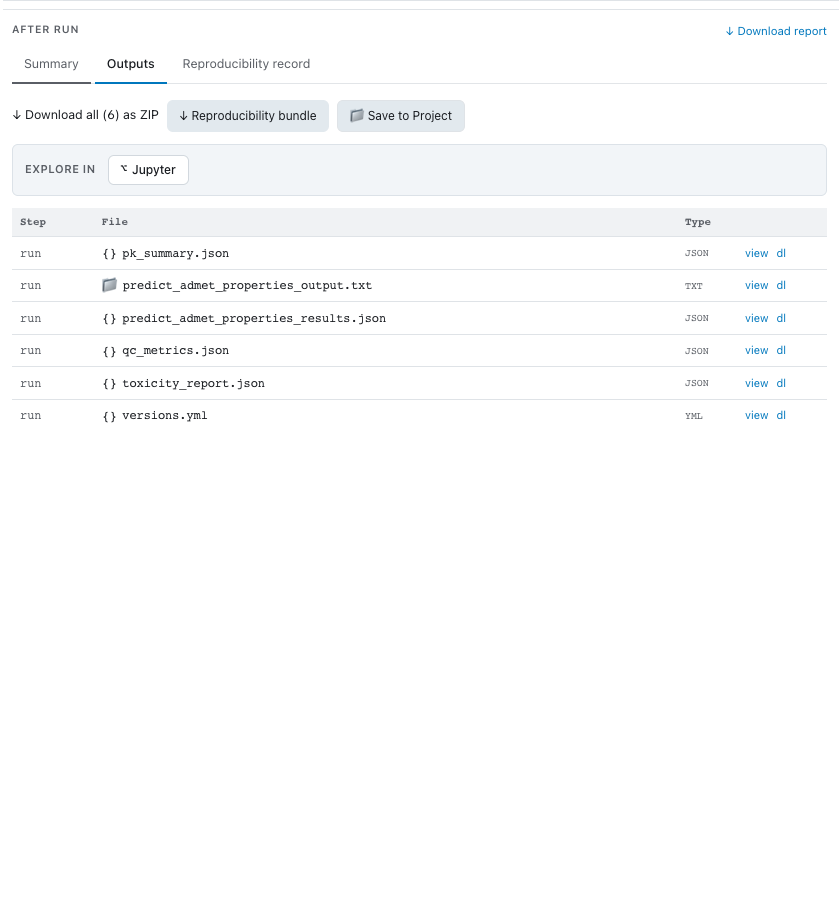

# Outputs, viewers & interactive panels

> One-line promise: after this page you know that BioMate renders almost every result **in-app** — a
> figure, a table, a 3-D structure, a UMAP — right where you're reading, and you know exactly when the
> optional interactive environments (RStudio / Jupyter / CellxGene) come into play. For everyone.

<!--
AUTHORING RULES: use-case-first; interpretation over statistics.
Every "supported" claim here is code-verified (tier C) unless marked ⏳ (needs pipeline sidecar to
populate → tier L). See coverage-ledger.md "## I.8 Outputs, viewers & interactive panels".
No Batch runs fired — source-read verification only.
-->

## What this is for

When a run finishes, its files land in the **Outputs** tab of the after-run report (see I.6, I.9). The
point of this page is simple: **you don't leave BioMate to look at your results.** A differential-
expression table, a QC figure, a called-variant list, a predicted protein structure with its
confidence colouring, a cryo-EM density map, a single-cell UMAP — BioMate resolves the right viewer for
each file type and renders it **inline**, in the same panel you're reading. Downloading a file and
opening it in a desktop tool is the exception, not the workflow.

The optional interactive environments (RStudio, Jupyter, CellxGene) are a **separate, deeper story**:
they're for open-ended, ad-hoc exploration *after* you've read the result — not the primary path, and
**they are not provisioned on the dev environment** (their buttons are hidden there). See "Interactive
panels" below for the honest scope.

## Where outputs live and how a viewer opens

Every completed run's files appear in the **Outputs** tab of `AfterRunReport`
(`AfterRunReport.tsx:875`, `OutputsTab`). Each row shows the step that made the file, the file name, its
type, and two actions — **view** and **dl** (download). Clicking **view** opens the file in an inline
overlay that mounts `StepOutputPreview` (`AfterRunReport.tsx:1211`), which picks the correct viewer for
that file type. The **view** action appears for every file type BioMate can render (`canPreview`,
`AfterRunReport.tsx:1050-1059`); anything else offers download only.

Two ways a viewer opens:

- **You click "view"** on a file (or read its inline preview) in the Outputs section.
- **A finding names its source file.** Each Key Result carries a `source_file` (the **Source** column), so "log2FC = 2.4" is traceable to the DEG table it came from — evidence, not a floating number. The file itself is previewed inline in the Outputs section on the same Results tab. (The findings→output click-to-jump navigation was removed when Findings and Outputs merged into one tab.)

<!-- CAPTURE route=/ (open a completed run's after-run report → Results tab, Outputs section) ; state=a completed run with several output files (table + figure) ; focus=output-files-table ; note=show the per-file table with "view" and "dl" actions and the "Explore in" interactive row above it -->

## The in-app viewer taxonomy (what renders inline)

`resolveViewer(ext)` (`step-output-preview.tsx:90-106`) maps a file extension to one of these inline
viewers. This is the "basic + rich visualisation, in-app" story — every type below renders **without**
launching any external tool:

| Output type | Extensions | In-app viewer | What you see |
|---|---|---|---|
| **Image** | png · jpg · jpeg · gif · svg | `InlineImageViewer` (`:286`) | The figure, with click-to-zoom lightbox |
| **PDF** | pdf | native `<iframe>` (`:961-971`) | Vector Bioconductor figures, sharp, full-page |
| **Table** | csv · tsv · json · tabular · **star** | `InlineTableViewer` (`:209`) | Sortable grid; auto-detects delimiter; parses STAR/RELION particle tables (`parseStar`, `:175`); first 200 rows |
| **Sequence** | fasta · fa · fastq · fq | `InlineSequenceViewer` (`:332`) | FASTA/FASTQ records with length, first 20 shown |
| **VCF** | vcf · bcf | `InlineVcfViewer` (`:364`) | Variant table (CHROM/POS/REF/ALT/…), first 100 rows |
| **Annotation** | bed · gff · gtf · gff3 | `InlineAnnotationViewer` (`:379`) | Feature table with the correct BED/GFF columns |
| **Structure** | pdb · mmcif · cif | `InlineStructureViewer` (`:1067`) — 3Dmol.js | 3-D cartoon/stick/sphere/line; **pLDDT** confidence chart for predicted structures (see below) |
| **Density** | mrc · map · mrcs · rec | `DensityMapViewer` (`:425`) | 3-axis slice viewer for cryo-EM maps |
| **Single-cell** | h5ad · loom · h5 | `SingleCellSummaryPanel` (`:589`) — UMAP + clusters + markers ⏳ | In-app single-cell summary (see below); falls back to interactive/download |
| **R object** | rds · rdata | `RObjectPreview` (`:461`) | Inline object summary (class, dims, assays, reductions) from a `.rds.json` sidecar if present; else RStudio launcher |
| **HTML** | html · htm | sandboxed `<iframe>` (`:973-976`) | MultiQC-style reports, script-sandboxed |
| **Text / log** | log · txt · sh · py · out · err | `InlineTextViewer` (`:393`) | Log with a "show tail (last 80 lines)" toggle; ANSI stripped |
| **Download** | anything else (incl. cryo `.cs`/`.csg`) | download link (`:1005-1012`) | Honest fallback for non-browser-renderable binaries |

### Structures carry their confidence (pLDDT)

When the structure is a **predicted** model (AlphaFold / ESMFold / Boltz), the per-residue confidence
lives in the PDB B-factor column. `parsePlddtFromPdb` (`step-output-preview.tsx:1032`) reads one value
per residue and, if the values are a real 0–100 confidence band, renders a **pLDDT chart** beside the
3-D view (`:1167`). Clicking a residue in the chart centres and highlights it in the 3-D structure
(`centreOnResidue`, `:1119`) — chart selection and structure selection are one selection. If the values
aren't a confidence band (e.g. a crystal structure's real temperature factors), no chart is shown
rather than a fabricated one (`:1048-1053`).

> **Tip — interpretation over the number.** pLDDT above ~90 is very high confidence (well-defined
> backbone); 70–90 is confident; 50–70 is low; below 50 is often disordered. Read the *colour* of the
> chart, not a single global score.

### Domain JSON sidecars → dedicated charts

Some workflows emit small JSON sidecars whose filename names a dedicated chart viewer, so a domain
result isn't dumped as raw JSON:

- **Cryo-EM QC** (`resolveCryoChartViewer`, `:629`): `*fsc_validation*` → FSC-curve chart, `*motion_report*`
  → motion histogram, `*ctf_report*` → CTF-quality chart.
- **DL-model evidence** (`resolveDlJsonViewer`, `:677`): `*seqtracks*`/`*_tracks*` → genomic score
  tracks (`SeqTracks`), `*hitgrid*`/`*_hits*` → ranked chemical hit grid (`HitGrid`).

Each of these viewers owns an **honest empty state** — a malformed or empty body shows "no data" rather
than a fabricated result (`:694`, `:713-731`).

## The single-cell in-app panel (new)

Single-cell `.h5ad` / `.loom` files are binary — historically that meant "download and open elsewhere."
BioMate now renders an **in-app single-cell summary** without launching any external tool
(`SingleCellSummaryPanel`, `viewers/single-cell-summary.tsx`). It reads a small JSON sidecar the
pipeline emits next to the file — `<h5ad path>.summary.json` (`single-cell-summary.tsx:54-56`) — and
draws:

- a **UMAP scatter** (dependency-free SVG, coloured by cluster; points pre-subsampled by the pipeline
  to ≤ ~2000) (`UmapScatter`, `:152`);
- **cluster composition** bars (cell counts per cluster) (`:107-126`);
- **top markers** per cluster (`:129-145`);
- the cell / gene / cluster counts header (`:89-99`).

> **QC gate / honesty (⏳) — the panel needs the sidecar.** The in-app panel is wired and verified in
> the frontend, but it only draws when the pipeline has written the `.summary.json` sidecar with useful
> content (clusters, UMAP points, or markers). If the sidecar is **absent or empty**, the panel
> self-hides and calls `onAbsent` (`single-cell-summary.tsx:66-71`), and the parent falls back to the
> interactive / download path (`step-output-preview.tsx:589`, `:618-623`). Until the single-cell
> pipelines emit that sidecar end-to-end, expect the fallback rather than the UMAP on a real run — this
> is tracked as **L / ⏳** in the ledger, not claimed as universally live.

## Interactive panels (RStudio / Jupyter / CellxGene) — the honest scope

These are the deeper, ad-hoc environments — a full RStudio session, a Jupyter notebook, or a CellxGene
browser — for open-ended analysis *beyond* what the in-app viewers show. Read this section carefully;
it is deliberately honest.

**They are not the primary path.** The in-app viewers above cover reading and interpreting a result.
The interactive tools are for when you want to write your own code against the outputs.

**They are gated on being provisioned, and hide when they're not.** The availability probe
`useInteractiveToolsAvailable` (`hooks/use-interactive-tools.ts`) calls `GET /api/interactive/available`
(`routes.ts:15108`), which asks the Galaxy toolbox whether `jupyter` / `rstudio` / `cellxgene` are
installed. The hook **fails closed** — a network error or missing config returns all-false
(`use-interactive-tools.ts:18-21, 29, 38`). In the file viewers, an "Open in RStudio / CellxGene"
button is shown **only** while the tool is optimistically unknown or known-available, and is replaced by
an `InteractiveUnavailableNote` (a download link) once the tool is known-unavailable
(`step-output-preview.tsx:535-550` for RStudio; `:592-623` for single-cell CellxGene/Jupyter). The
launch dialog itself also blocks: `InteractiveLauncher` shows a "not enabled in this environment yet"
alert and disables the launch button when the selected tool is unavailable
(`interactive-launcher.tsx:399-407, 413`).

> **Pitfall — on the dev environment these tools are NOT provisioned.** The dev Galaxy has no
> interactive-tool containers, so `/api/interactive/available` returns all-false and the "Open in
> RStudio / Jupyter / CellxGene" buttons in the file viewers **hide** (an attempt to launch would 400).
> This is expected. Use the in-app viewers to read results; use the **download** link if you want the
> raw file locally.

> **Pitfall — interactive tools do NOT auto-load your data.** Launching an environment opens an empty
> RStudio/Jupyter/CellxGene session. The launcher shows "quick-start code" and lists file paths, but
> the environment is a fresh workspace — you load the outputs yourself (the dialog copies loader
> snippets: `interactive-launcher.tsx:261-273`). Don't expect your DEG table to already be in the
> R global environment.

> **Note — the "Explore in" row in Outputs is a convenience, not a promise.** The `InteractiveToolsRow`
> at the top of the Outputs section (`AfterRunReport.tsx`, testid `afterrun-interactive-tools-row`)
> lists tools that *could* apply to your file types, but it does **not** itself check provisioning —
> the honest gate fires when you actually try to launch (the launcher's disabled button + alert, above).
> On dev, opening the launcher from that row will surface the "not enabled" alert.

## Bulk actions & saving

Beyond per-file view/download, the Outputs section offers: **Download all as ZIP** (async job,
`AfterRunReport.tsx:1066`), a **Reproducibility bundle** download (configs, command scripts, logs,
`versions.yml` — enough to re-run elsewhere; see I.9, `:1074-1081`), and **Save to Project** — which
copies the outputs into a project so they become first-class dataset objects in `/files` (quality,
lineage, versions; see I.5, `:1084-1144`).

## Pitfalls & tips

> **Tip — the viewer fetches the real file.** Every inline viewer reads from the same
> `/api/workflows/runs/:id/step-file` endpoint the Outputs sectionle already uses
> (`step-output-preview.tsx:811`); there's no separate "preview" data path that could drift from the
> real bytes. What you see is the file.

> **Tip — big files are truncated, not lied about.** Tables show the first 200 rows, VCFs the first
> 100, sequences the first 20 records, text the last 80 lines — each with an explicit "showing N of M"
> note. For the whole thing, download it or (where provisioned) open it interactively.

> **Pitfall — RDS/H5AD have no universal inline view.** They're binary. The R-object and single-cell
> viewers render a **summary sidecar** if the pipeline emitted one; otherwise they fall back to a
> launcher (when provisioned) or a download.

## What's not covered

- **Interactive RStudio / Jupyter / CellxGene sessions on dev** — not provisioned; buttons hide and the
  launcher blocks (see above). They are for deeper ad-hoc work in provisioned environments only, and
  they do not auto-load your outputs. → Appendix E.
- **The single-cell in-app UMAP panel on real runs** — the frontend panel is verified, but it depends
  on the pipeline emitting a populated `<h5ad>.summary.json` sidecar; until the single-cell pipelines
  do so end-to-end, the fallback path (interactive/download) is what you'll see. Tracked **L / ⏳**. →
  Appendix E.
- **BAM / large binary alignment viewing inline** — `.bam` is offered as download / interactive only
  (no inline genome-browser track in this viewer).
- **Batch (multi-sample fan-out) output aggregation views** — out of scope here.

---
_Verification: coverage-ledger.md "## I.8 Outputs, viewers & interactive panels" — tier C
(`step-output-preview.tsx`, `viewers/single-cell-summary.tsx`, `AfterRunReport.tsx`,
`hooks/use-interactive-tools.ts`, `interactive-launcher.tsx`, `routes.ts`), plus one **L / ⏳** row for
the single-cell sidecar dependency. No Batch runs fired._
</content>
</invoke>
