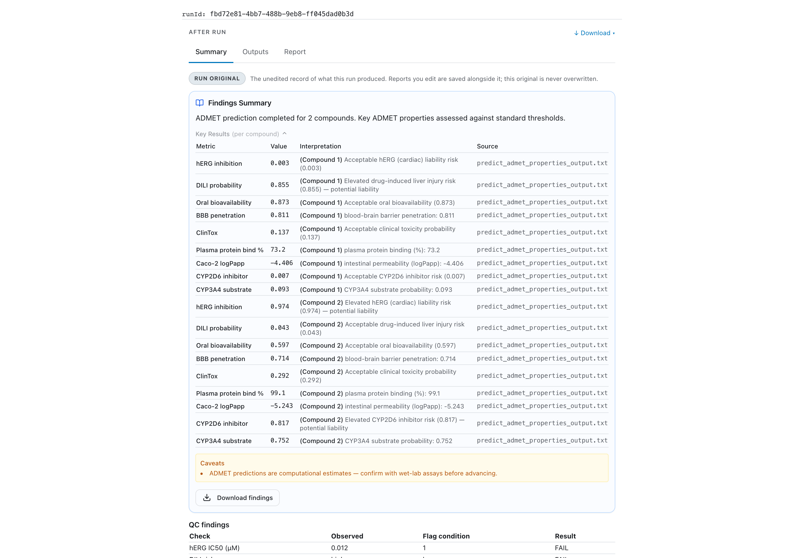
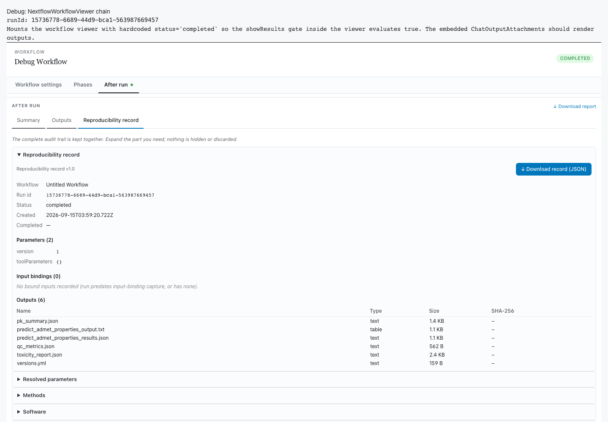

# Reports & reproducibility (the after-run report)

> One-line promise: after this page you know how a finished run turns into a readable report you can
> edit, version, and defend — and where the reproducibility evidence (parameters, software, citations,
> checksums) actually lives. For everyone; especially anyone who has to write up or reproduce a result.

<!-- Every claim here is code-verified (tier C) against frontend/client/src/v2/AfterRunReport.tsx and its
     backing routes/stores; see coverage-ledger.md "## I.9 Reports & reproducibility". No Batch runs fired. -->

## What this is for

When a Cloud run finishes, the run panel swaps to the **after-run report** (`AfterRunReport`,
`chat-with-artifacts.tsx:2371`). It is a **two-tab** surface — **Results** (findings on top, then every output previewed inline) and
**Reproducibility record** — that answers, in order: *what did the run find and produce, and how do I
trust or re-run it.* The report is not a throwaway view: the run's original
findings are kept as an immutable record, and any edits you make are saved as **versions** alongside it.

This chapter is about the Results tab's findings banner and the Reproducibility-record tab, plus report
versioning and download. The Outputs section (files, viewers, interactive tools) is covered in I.8.

## The two tabs

`AfterRunReport` renders two top-level tabs — Results (the landing tab, merging the findings banner and
the inline-preview outputs gallery) and Reproducibility record (`AfterRunReport.tsx:148-152`, tab bar `:224-240`). Everything that used to be a
separate tab (resolved parameters, methods, software, citations, QC report, trajectory) is now folded
into the Reproducibility record tab as expandable sections — nothing is hidden, just re-nested
(`:1500-1528`).

### Results — findings on top, outputs below

The Results tab opens with the run's answer at a glance. It renders the `FindingsCard` (`AfterRunReport.tsx:256`),
which shows:

- A **summary paragraph** generated from the run manifest.
- **Headline metric chips** — the top key-results as scannable chips, so the answer is legible without
  expanding the table (`findings-card.tsx:229-249`).
- **Source traceability**: each metric carries a `source_file` (shown in the Key Results **Source**
  column), so every number in the report is traceable back to the output file it came from. That file is
  previewed inline in the Outputs section just below, on the same Results tab. (The older click-to-jump
  findings→output navigation was removed when the tabs merged.)

Above the findings sits the **"Run original" badge** (`AfterRunReport.tsx:248`), with the standing
note: *"The unedited record of what this run produced. Reports you edit are saved alongside it; this
original is never overwritten."* A footnote reinforces that findings — numbers and figures — are
generated directly from the run manifest, not typed in (`:280-282`).

> **Tip — where a number came from.** Each headline metric and Key Result names its `source_file` in the
> Source column; that output is previewed inline in the Outputs section on the same tab.

### Outputs — the files (on the Results tab)

The Outputs section within the Results tab lists every output file with in-app viewers, bulk download, interactive-tool launchers
(Jupyter / RStudio / CellxGene), and Save-to-Project. It also carries the **reproducibility-bundle**
download link. See **I.8** for the full treatment.

### Reproducibility record — the audit trail

The third tab (`ReproducibilityRecordTab`, `AfterRunReport.tsx:1470`) is the unified audit trail. It
opens with the reproducibility record itself and folds the rest as expandable sections
(`:1500-1528`):

| Section | What it shows | Source |
|---|---|---|
| **Reproducibility record** (open by default) | Workflow identity, run id, status, created/completed times; resolved **parameters**; **input bindings**; and an **outputs** table with name / type / size / **SHA-256** | `GET /api/runs/:id/reproducibility-record` (`AfterRunReport.tsx:1545`; `reproducibility-record.ts`) |
| **Resolved parameters** | The parameter key/values the run actually used, plus a "Run again with edits" CTA | `ParametersTab` (`:1622`) |
| **Methods** | The methods report as an **editable, versioned** document (see below) | `MethodsTab` (`:1244`) |
| **Software** | Tool/version list (shown when the backend returns versions) | `useFetchSoftware` → `/api/invocations/:id/software` (`:724`) |
| **Citations** | Workflow/gate DOIs (shown when the backend returns ≥1) | `useFetchCitations` → `/api/workflows/:name/citations` (`:743`) |
| **QC report** | Gate events (time / gate / threshold / observed / result / action) + a chain-of-custody note | `useFetchQcEvents` → `/api/invocations/:id/qc-events` (`:706`) |
| **Trajectory** | The decision/tool-call log for the run | `useFetchTrajectory` (`:679`) |

You can download the record as JSON from the record section (`:1573`, "↓ Download record (JSON)").

<!-- CAPTURE route=/ (completed run, Reproducibility record tab open) ; state=a completed run ; focus=[data-testid="repro-tab"] ; note=show the identity table, Parameters, Input bindings, and the Outputs sectionle with the SHA-256 column (dash by default) -->

## Per-output checksums (SHA-256) — real, and honest about it

Each output row in the record has a **SHA-256** column. Checksums are computed with a real
`sha256Hex` over the output bytes (`reproducibility-record.ts:28`, `enrichOutputsWithChecksums:40-68`),
so a hash shown here is a genuine content hash you can verify.

They are **opt-in and bounded**, not always present:

- The backend only computes checksums when the record is requested with `?checksums=1`
  (`routes.ts:12232`); computing them is capped to at most 25 files and skips files over 25 MB so a
  record read never becomes an unbounded download (`reproducibility-record.ts:45-46`).
- In the default UI flow the record is fetched **without** that flag (`AfterRunReport.tsx:1545`), so the
  SHA-256 column shows **"—"** for outputs that haven't been hashed yet (`:1612`, tooltip
  *"not yet hashed"*).

The report is careful to say only what's true. The QC-report chain-of-custody note states the
tamper-evident guarantee **only for outputs that actually carry a checksum**: if all outputs are hashed
it says so; if some are, it says "N of M … the remaining outputs are not yet hashed"; if none are, it
explicitly says content-addressed / tamper-evident storage **is not asserted** for this run
(`AfterRunReport.tsx:1740-1743, 1882-1895`).

> **Pitfall — a dash is not a failure.** An empty SHA-256 means "not hashed yet," not "corrupt." The
> hash is computed on demand (via `?checksums=1`); the JSON record and the reproducibility bundle still
> let you re-verify outputs yourself.

## The report is a versioned object

The Methods report is treated as an editable **file with versions**, not a transient view
(`MethodsTab`, `AfterRunReport.tsx:1244`; model in `report-version.ts`, store in
`report-version-store.ts`).

- **Read** the report, or click **✎ Edit** to open it in the document editor (`:1364-1372`).
- **⤴ Save version** is **server-first**: it POSTs to `/api/runs/:id/report/versions`
  (`:1313`; route `routes.ts:12290`) and, on success, shows *"Saved as version vN (persisted)"*
  (`:1322`). If the server is unavailable (or there's no run id), it **falls back to a local markdown
  download** (`:1328`) — you never lose the edit.
- The version list (`data-testid="report-versions"`, `:1377`) shows every version oldest→newest.
  Version **v0** is labelled **"immutable run original"** and is never overwritten; later versions carry
  a note and a date (`:1382-1385`).

The immutability is enforced in the model, not just the UI: `makeRunOriginal` mints v0 as
`immutable: true` with a content hash and a `runId` back-link, and `appendReportVersion` is append-only,
inherits the run id, and can never replace v0 (`report-version.ts:50-88`). The store seeds v0 from the
report as it stood **before** the first edit, so the original is a faithful snapshot of what the run
produced (`report-version-store.ts:159-167`).

> **Tip — edit freely; the original is safe.** Editing and saving never touches v0. If you need the
> exact record of what the run produced, it's always there as the run original.

## Downloads: comprehensive report + reproducibility bundle

Two downloads serve two different needs:

- **↓ Download report** (top of the after-run panel, `AfterRunReport.tsx:190-206`) builds one
  comprehensive markdown document stitching every tab — summary/findings, parameters, methods, QC
  events, software, citations, and a reproducibility footer — via `buildFullReportMarkdown`
  (`:157, :2112`). It inlines the real findings prose and the real QC table, and ends with a
  reproducibility note referencing the parameters and software versions used (`:2320-2330`). Saved as
  `biomate-run-<runId>.md`.
- **↓ Reproducibility bundle** (in the Outputs section of the Results tab) links to
  `/api/nextflow/runs/:id/reproducibility` — configs, command scripts, logs, and `versions.yml`,
  enough to re-run elsewhere.
- **↓ Download record (JSON)** (record section, `:1573`) is the machine-readable version of the
  reproducibility record for programmatic checks.

## How to read the record for reproducibility

1. **Parameters** — the resolved values the run actually used (not what you typed; what the workflow
   ran with). Re-dispatching the same workflow with these values reproduces the run.
2. **Software** — the tool versions, when the backend reports them; pair with the parameters to pin the
   environment.
3. **Input bindings** — which datasets fed which step (blank for older runs that predate binding
   capture — the record says so honestly, `:1600`).
4. **Outputs + checksums** — the artifacts, with content hashes you can verify (request `?checksums=1`
   or use the JSON/bundle download to compute them).
5. **QC report** — the gate decisions, so a reviewer can see nothing was silently overridden.

## Pitfalls & tips

> **Tip — the report lives with its run.** Like the run itself (I.6), the after-run report belongs to
> the chat session. Reopen the session to get the report, versions, and record back.

> **Pitfall — "Software" / "Citations" sections may be absent.** They render only when the backend
> returns data for that workflow (`AfterRunReport.tsx:724, 743`). An empty section is hidden, not a bug —
> per the product's hide-when-empty rule, a missing section means "no data for this run," not "feature
> broken."

> **Tip — comprehensive report vs. bundle.** Use **Download report** for a human write-up (methods +
> findings + QC in one markdown file); use the **Reproducibility bundle** when you need the actual
> configs and scripts to re-run the pipeline somewhere else.

## What's not covered

- **Ask-BioMate-to-edit-the-report (chat edit with diff)** — *not built.* Report editing is hand-edit in
  the document editor + Save version only; there is no propose-diff / accept-reject flow. The scope note
  in the code is explicit that chat-propose-diff versioning is deferred (`AfterRunReport.tsx:1234-1242`).
  → Appendix E.
- **A manuscript "Stage 6."** There is no manuscript-generation stage after the report. (The flagship IND
  flow likewise ends at a DOCX with no Stage 6 — see the Drug-discovery chapter.) → Appendix E.
- **Checksums always-on in the UI.** The default record fetch omits `?checksums=1`, so SHA-256 is blank
  until hashed on demand. Automatic hashing of every output on completion is not wired. → Appendix E.
- **Software section for most workflows.** `/api/invocations/:id/software` is the wiring point; a v1
  reading `pipeline_info/software_versions.yml` is roadmap (`AfterRunReport.tsx:10-12`). → Appendix E.
- **Batch/multi-run reports.** A report is per-run; there is no cross-run or batch report view.
  → Appendix E.

---
_Verification: coverage-ledger.md "## I.9 Reports & reproducibility" — all tier C (source-read of
`AfterRunReport.tsx`, `report-version.ts`, `report-version-store.ts`, `reproducibility-record.ts`,
`routes.ts`); no Batch runs fired._
