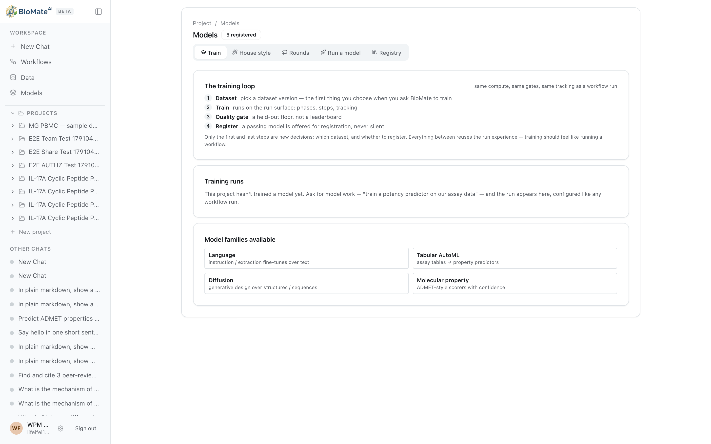

# Models (train, adapt, optimise — and run a pre-trained model)

> One-line promise: after this page you know what the `/models` surface actually does today — a model
> is presented like a dataset object (identity · evidence · lineage · consumers · versions), you can
> run a pre-trained model for inference, and you understand which of the design–make–test tracks are
> live vs. surfaces that read from stores you have not populated yet. For drug-discovery and
> design-minded users.

<!-- Every "supported" claim here is code-verified (tier C); see coverage-ledger.md "## I.10 Models". -->

## What this is for

Most of BioMate is about *running* things on your data. **Models** is the surface where a model is a
first-class object you can reuse: a scorer trained in one project is callable from any other, a
pre-trained open-source model can be run for inference, and the closed design–make–test loop (a
surrogate proposes, the bench measures, a refit runs as a tracked job) has a home. The guiding idea in
the code is explicit: *"A model is presented like a dataset — identity · evidence · lineage · used-by ·
interface · versions — never a leaderboard"* (`models-panel.tsx:11-14`).

The focused surface is at **`/models`** (`App.tsx:654-660` routes `/models` → `ModelsPanel`). Like
`/design` (I.11), it is a self-contained panel, not the chat run-panel of I.6.

*The `/models` surface: the project crumb, the "N registered" count, and the five track tabs —
Train · House style · Rounds · Run a model · Registry. (Live capture from dev.)*

> **Pitfall — this is a focused tool surface, not the chat.** `/models` does **not** open the workflow
> run-panel from I.6, does not stream SSE phase cards, and does not produce an after-run report. Two of
> its five tracks submit real work to the backend (Run a model; Registry); the other three
> (Train · House style · Rounds) are **read views over stores that already exist** and show an honest
> empty state until those stores have data — see the table below.

## The five tracks — what is live today

The panel has five tabs (`MODELS_TRACKS`, `models-panel.tsx:41-47`). The v2 vocabulary names a *job*,
not a technique: "Adapt" is shown as **House style**, "Optimise" as **Rounds**, "Run a pre-trained
model" as **Run a model** (`models-panel.tsx:4-8`).

| Track (tab label) | What it is | Backed by a live read/write today? |
|---|---|---|
| **Train** | List of training runs (each registered scorer is the artefact of one) + a fixed loop diagram + model-family catalog | Read-only — lists registered custom models per campaign; **no in-panel "start training" button** |
| **House style** (Adapt) | Learned before→after edit pairs you can switch on/off, cheapest-first adaptation ladder, "Re-train on my edits" | **Read + two writes** (toggle a pair, queue a retrain) — real, persisted |
| **Rounds** (Optimise) | The design–make–test–analyse loop as rounds, with surrogate links and a proposal table | Read-only — reads the Bayesian-optimiser proposal rounds; honest-empty when no loop is running |
| **Run a model** | Pick a domain, supply an input, run a pre-trained model for inference | **Live** — submits inference and polls the result |
| **Registry** | Account-level catalog of callable model objects; a row opens the model object | **Live** — lists BioNeMo + registered custom models |

> **Pitfall — the panel does not *start* a training run.** The Train track renders a description of the
> training loop (`TRAIN_LOOP`, `models-panel.tsx:364-369`) and a catalog of model families
> (`MODEL_FAMILIES`, `:371-376`) as **fixed design content**, plus a data-bearing list of training runs.
> There is **no button on this surface that launches a new training job.** The one path that *does*
> queue a real training job is **House style → "Re-train on my edits"** (below). To train a scorer from
> scratch today, the work happens through the drug-discovery campaign / custom-model registry, not a
> "Start training" control on `/models`. This is stated in the source: the Train/House-style/Rounds
> tracks are *"project-scoped surfaces with no WS1 read endpoint … they render descriptive track
> content (no fabricated data)"* (`models-panel.tsx:16-19`) — except for the specific reads and writes
> documented below, which were added.

## Registry — a model as an object

The **Registry** tab (`RegistryTrack`, `models-panel.tsx:50-112`) lists every callable model in the
account. It calls `GET /api/models` and shows a table of *Model · Family · Origin · Used by*; clicking
a row opens the **model object** — its identity, evidence, lineage, consumers, interface, and versions
(`GET /api/models/{id}`, `model-object.tsx`). A model trained in one project is callable from any
project — the catalog is account-scoped (`models-panel.tsx:80-83`).

What actually populates the registry (`_catalog`, `models_inference.py:250-251`):

- **BioNeMo-covered models** — enumerated from the BioNeMo client's function map, *not* a hardcoded
  parallel list, so the catalog stays in sync with the client (`_bionemo_catalog`,
  `models_inference.py:201-224`). Current entries: Boltz-2, AlphaFold2, OpenFold2 (structure); Evo2 7B,
  Evo2 40B (genomic) (`_BIONEMO_META`, `:77-120`). Origin `self-host`. (ESMFold was removed on
  2026-09-14 after NVIDIA deprecated the hosted function — the code documents this, `:93-97`.)
- **Registered custom scoring models** — read read-only from the per-campaign
  `custom_model_registrations` SQLite tables across all campaigns (`_iter_custom_registrations`,
  `:160-180`). `usedByCount` = how many campaigns registered a model of that name.

> **Tip — an empty registry is honest, not broken.** If no custom model has been registered and the
> BioNeMo client is unavailable, the Registry shows *"No models registered in this account yet"*
> (`models-panel.tsx:70-77`). Nothing is fabricated to fill the list.

> **Pitfall — the model object reports evidence honestly, including "not evaluated."** For a model with
> no measured eval gate in this thin layer, the object returns
> `gate: {measured: null, threshold: null, verdict: "not_evaluated"}` and empty lineage rather than a
> fabricated score (`models_inference.py:390-419`). A model card that says "not evaluated" is telling
> the truth about what this layer knows, not hiding a number.

## Run a model — the one track that submits inference

**Run a model** (`RunPretrained`, `run-pretrained.tsx`) is the live inference path. You pick a domain
(Structure · Genomic · Chemical), supply an input, and click **Run inference**. The flow
(`run-pretrained.tsx:8-11`, `models-api.ts:56-97`):

1. `POST /api/models/{id}/infer  {inputs}` → returns a `run_id`.
2. Poll `GET /api/inference/{run_id}/result` every 1.5 s until `status` is terminal
   (`useInferenceResult`, `models-api.ts:76-97`).
3. The result renders through the wave-1 viewers by evidence class (`InferenceResultView`).

The concrete model id is picked from the live catalog (first model whose family matches the domain);
if none matches, a domain default BioNeMo id is used so the request still exercises the real endpoint
(`pickModelId`, `run-pretrained.tsx:84-88`). The three domains (`DOMAINS`, `:45-82`):

| Domain | Input | Default model | Produces |
|---|---|---|---|
| **Structure** | protein sequence (one-letter) | `bionemo:boltz2` | a 3D structure, pLDDT and PAE |
| **Genomic** | nucleotide sequence | `bionemo:evo2_7b` | score tracks and flagged intervals |
| **Chemical** | SMILES (one per line) | a registered custom scorer | ranked hits by score, confidence, verdict |

> **Pitfall — nothing of yours is trained here.** The track's own copy says it plainly: *"A pre-trained,
> integrated open-source model · nothing of yours is trained"* (`run-pretrained.tsx:137-141`). Run a
> model is inference-only — the questions are what it can speak to and how far to trust the answer, not
> what it learned.

## The honesty contract for inference (stubs are labelled)

This is the most important thing to understand about **Run a model**: it depends on external model
backends (a BioNeMo NIM; an in-process custom scorer), and those may be unreachable in a given
environment. The backend never fabricates science to cover a gap.

- If the BioNeMo NIM is unreachable, or the client's effective mode is *stub* (nothing configured), the
  result is a **clearly-labelled stub of the correct shape** — top-level `stub: true` and `stub_reason`
  — never fabricated values presented as real measured science (`models_inference.py:33-37`, `:972-984`;
  the module header states the contract, `:33-37`).
- Real input-validation errors (missing `sequence`/`smiles`) are surfaced as client errors, **not**
  masked with a stub (`infer`, `models_inference.py:907-911`).
- ESMFold's empty-PDB case is explicitly labelled "backend unreachable" rather than shown as an
  empty-but-real prediction (`:996-998`).

> **QC gate — read `stub: true` before you trust a number.** A completed inference that carries
> `stub: true` and a `stub_reason` is a shape demonstration, not a measurement. On dev without a
> reachable NIM, expect stubbed structure/genomic results. Custom chemical scorers that are registered
> in-process return real scores; a custom model must be re-registered in-process to actually run
> (`models_inference.py:131-135`).

> **Pitfall — inference runs are cross-worker but ephemeral.** Run records are stored in the shared
> `RunStateStore` (Redis on dev) with an `inf-` prefix, so a POST on one gunicorn worker and a poll on
> another resolve to the same run (`models_inference.py:271-300`). They are not `/files` dataset
> objects and do not appear in the run history of I.6 — a Run-a-model result lives in the panel, like a
> `/design` run (I.11).

## House style (Adapt) — the tracks that also *write*

**House style** (`AdaptTrack`, `models-panel.tsx:546-663`) is where BioMate's outputs get tuned to how
your team writes. When you correct an output, the before→after pair is queued as a **switchable learned
rule** — never applied silently. This track has two real, persisted writes:

- **Toggle a learned pair on/off** — `POST /api/model-tracks/adapt/{pairId}/toggle`
  (`useAdaptToggle`, `models-api.ts:191-206`). This is persisted as an **append-only override log**
  that the compiler can consult; it **never mutates** the append-only DPO pair store the worker reads
  (`toggle_adapt_pair`, `models_inference.py:634-645`; the override design, `:561-627`).
- **Re-train on my edits** — `POST /api/model-tracks/adapt/retrain` queues a **real tracked training
  job** through `regulatory_training_jobs.submit` — the same store the Train track reads
  (`retrain_adapt`, `models_inference.py:652-672`; `useAdaptRetrain`, `models-api.ts:212-234`).

The read (`GET /api/model-tracks/adapt`) surfaces the customer before→after DPO pairs the pair recorder
appends; each row shows the correction (before, struck through → after) and its source
(`adapt_track`, `models_inference.py:521-558`). The adaptation-level ladder shown above the pairs
(prompt rule → few-shot index → trained adapter, cheapest first) is **fixed design content**
(`ADAPT_LEVELS`, `models-panel.tsx:540-544`).

> **Tip — nothing is learned silently.** Every learned rule appears in "What was learned" and can be
> switched off; when there are none, the honest empty state renders
> (`models-panel.tsx:653-658`). Cheapest-first: a prompt rule is preferred over an index, and an index
> over a trained adapter — the level in use is shown because it changes what "forget this" means.

## Rounds (Optimise) — the design–make–test loop, read-only

**Rounds** (`OptimiseTrack`, `models-panel.tsx:162-328`) is the closed loop as rounds: design · make ·
test · analyse. It reads the Bayesian-optimiser proposal rounds for the project
(`GET /api/model-tracks/optimise`, `models_inference.py:675-...`; `useOptimiseTrack`,
`models-api.ts:158-173`). When no loop is running it returns an honest empty state — no fabricated
rounds, proposals or scores (`models-panel.tsx:169-195`). When a loop *is* running it shows:

- the loop header (running / round N, budget, refit policy) and the **surrogate** model links (each
  opens its model object);
- the **rounds** list; and
- the **round proposal table** — candidate, score, confidence, verdict.

Two properties are load-bearing and are enforced in the code:

- **A rejected proposal stays visible with its safety-gate reason** — never silently dropped
  (`proposalVerdictColor` + the trailing note, `models-panel.tsx:156-160`, `:320-324`). You must be able
  to see what the loop *wanted* to do and why the gate refused it.
- **Censored values stay censored** — "IC50 > 30 µM is fitted as an inequality, never as 30"
  (the loop's own rules, listed in the empty state, `models-panel.tsx:183-185`); scores are text as
  reported by the loop and are *"never invented on the client"* (`OptimiseProposal`,
  `models-panel.tsx:138-145`).

> **Pitfall — there is no "start the loop" button on this surface either.** Rounds *reads* an
> optimiser that runs elsewhere. It is the window onto a running loop, not the control to launch one.

## Tools & workflows behind this

| Piece | What it is | Where |
|---|---|---|
| **`/models` panel** | The five-track surface + model-object viewer | `models-panel.tsx`, `model-object.tsx`, `run-pretrained.tsx` |
| **Node proxy** | `GET /api/models`, `GET /api/models/:id`, `POST /api/models/:id/infer`, `GET /api/inference/:runId/result`, `GET/POST /api/model-tracks/*` → Galaxy backend | `routes.ts:4911-4916` (`_dlProxyHandler`) |
| **`models_inference.py`** | FastAPI router; thin presentation/dispatch layer over existing capability (BioNeMo client, custom-model registry, DPO recorder, optimiser) | `backend/.../api/models_inference.py` |
| **BioNeMo client** | Self-host / NVCF NIM dispatch for structure & genomic inference | `galaxy.ai.bionemo_client` (`_FUNCTIONS`, `BioNeMoClient`) |
| **Custom-model registry** | Per-campaign registered scoring models (SMILES scorers) | `galaxy.ai.drug_discovery.custom_model_registry`, `custom_model_wrapper` |
| **DPO pair recorder** | The before→after edit pairs behind House style | `galaxy.ai.drug_discovery.regulatory_pair_recorder` |
| **Training jobs store** | The tracked jobs the Train track reads and "Re-train on my edits" queues | `galaxy.ai.drug_discovery.regulatory_training_jobs` |

> **Tip — `/models` reinvents nothing.** The router header is explicit: it is *"a THIN
> presentation/dispatch layer over capability that already exists … It does NOT reinvent the registry,
> the wrappers, or the optimizer"* (`models_inference.py:7-17`). Every track maps an existing store onto
> the panel contract.

## Outputs & visualization

Everything renders **inside the `/models` panel**. A Run-a-model result renders via the wave-1
inference viewers keyed to the evidence class (structure / genomic / chemical). A Registry row opens the
model object as a full-surface takeover (`models-panel.tsx:742-752`). There is no in-app 3D structure
viewer wired into this surface, no after-run report, and no `/files` dataset object for a model run.

## Pitfalls & tips

> **Tip — a model is an object, not a leaderboard.** Open a Registry row to read a model's identity,
> evidence gate (including "not evaluated"), lineage, consumers, interface and versions — the same
> object grammar as a dataset (`models-panel.tsx:11-14`, `model-object.tsx`).

> **Pitfall — three of five tracks are read views.** Train and Rounds only *display* work done
> elsewhere; House style additionally *writes* (toggle a pair, queue a retrain). Only Run a model and
> Registry submit/list live model work directly. There is no "train from scratch" or "launch the loop"
> control on this surface (`models-panel.tsx:16-19`).

> **Pitfall — on dev, expect stubbed structure/genomic inference.** Without a reachable BioNeMo NIM the
> result is a labelled stub (`stub: true`, `stub_reason`) of the correct shape — verify that flag before
> reading any pLDDT/score as real (`models_inference.py:33-37`, `:972-984`).

## What's not covered

- **Starting a training run from the panel.** There is no "Start training" control on `/models`; the
  Train track lists existing registered scorers, and the only retrain trigger is
  House style → "Re-train on my edits" (`models-panel.tsx:16-19`, `385-507`). → Appendix E.
- **Launching the design–make–test loop from the panel.** Rounds reads a running optimiser; it does not
  start one (`models-panel.tsx:162-195`). → Appendix E.
- **Guaranteed BioNeMo inference on dev.** Structure/genomic inference depends on a reachable NIM; when
  unreachable it stubs (labelled). Treat as environment-dependent, not a guaranteed measurement
  (`models_inference.py:33-37`). → Appendix E.
- **Measured evaluation gates / calibration for catalog models.** The thin layer reports
  `verdict: "not_evaluated"` and null gates rather than fabricating a metric
  (`models_inference.py:390-419`). A model-quality gate is roadmap, not present. → Appendix E.
- **A `/files` dataset object or after-run report for a model run.** Model runs live in the panel, like
  `/design` runs (I.11); they are not first-class run objects of I.6/I.9. → Appendix E.
- **Peptide/biologic training or adaptation.** No modality-specific training path is wired on this
  surface. → Appendix E.

---
_Verification: coverage-ledger.md "## I.10 Models" — all tier C (source-read: `App.tsx`,
`models-panel.tsx`, `run-pretrained.tsx`, `models-api.ts`, `model-object.tsx`, `routes.ts`,
`backend/.../api/models_inference.py`, `cold-start-dashboard.tsx`); no inference or training jobs fired
on dev._
