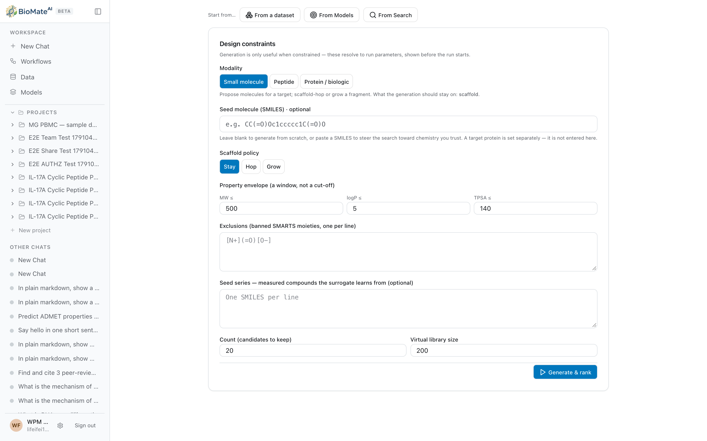
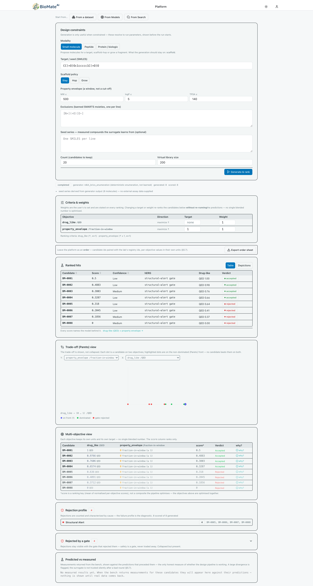

# Design & generate (proposing new candidates)

> One-line promise: after this page you know how BioMate proposes brand-new molecules from a seed —
> generate → predict & filter → optimise → rank — what the `/design` surface actually runs today, and
> where it honestly stops. For drug-discovery and design-minded users.

<!-- Every "supported" claim here is code-verified (tier C); see coverage-ledger.md "## I.11 Design & generate". -->

## What this is for

Everywhere else in BioMate you bring data and ask for an analysis. **Design & generate** is the one
module that produces *new objects*: it proposes candidate molecules you did not have before, predicts
their properties, filters the unsafe ones out (but keeps them visible), and ranks what survives. It is
the "cold-start" of the design–make–test loop — the step before you commit anything to synthesis.

The focused surface is at **`/design`** (`App.tsx:662-668` routes `/design` → `DesignGenerate`). It is
a single self-contained panel — not the chat run-panel of I.6. You fill in a constraint form, click
**Generate & rank**, and the results render in the same panel.

*The `/design` surface: the "Start from…" entry chips, the constraints composer (modality, seed SMILES,
scaffold policy, property envelope, exclusions, seed series, count), the compute-cost hint, and the
Generate & rank action. (Live capture from dev.)*

> **Pitfall — this is a focused tool surface, not the chat.** `/design` does **not** open the workflow
> run-panel from I.6, does not stream SSE phase cards, and does not produce an after-run report or a
> `/files` dataset object. It is a standalone panel that calls one backend endpoint and polls it
> (`DesignGenerate.tsx:170-185`). If you want a *pipeline* run (e.g. the `reinvent4_lead_design`
> Nextflow workflow), ask in chat instead — see "What's not covered."

## The four tracks (cold-start design)

The Design & generate module card on the cold start advertises four sub-abilities, per modality
(`cold-start-dashboard.tsx:290-397`):

| Track | What it means | Runs on `/design` today? |
|---|---|---|
| **Generate** | Propose new candidates from a seed / target | Yes — small molecule (BRICS enumeration) |
| **Predict & filter** | Score candidates and gate out the unsafe ones | Yes — QED + property-envelope predictors, structural-alert safety gate |
| **Optimise properties (one pass)** | One multi-objective round toward the property targets | Yes — one GP round (`DeNovoPipeline.run_round`) |
| **Rank candidates** | Order survivors and re-rank under your weights | Yes — client-side re-rank, no re-run |

All four happen inside **one** `/design` run: generate → predict → optimise → rank is a single closed
round, not four separate buttons (`generation.py:4-11`).

## Modalities — what actually runs

The composer offers three modalities as chips (`DesignGenerate.tsx:1350-1385`,
`cold-start-dashboard.tsx:290-397`):

| Modality | Constraint form shown | Generator wired? |
|---|---|---|
| **Small molecule** | seed SMILES, scaffold policy (stay/hop/grow), property envelope (MW/logP/TPSA), banned-SMARTS exclusions, seed series | **Yes — runs today** |
| **Peptide** | sequence + cyclisation (head-to-tail / disulfide / staple) | **No** — constraints captured, not executed |
| **Protein / biologic** | framework / sequence seed | **No** — constraints captured, not executed |

> **Pitfall — only small molecule runs today.** Selecting Peptide or Protein shows the right form and
> an amber "**Generator coming**" banner (`DesignGenerate.tsx:1747-1757`); the **Generate & rank**
> button is disabled (`canRun = modality === "small_molecule"`, `:1539`, `:1796`) and `onRun` returns
> early for any non-chemistry modality (`:1523`). Nothing is fabricated — the design decision was to
> capture the constraints honestly rather than invent a peptide/protein shortlist. The backend
> `GenerateRequest` schema does not carry a `modality` field at all (`generation.py:96-111`), so even
> if a peptide payload were sent, only the small-molecule chemistry path exists to run it.

## How to ask

The `/design` panel is a **form**, not a prompt box — you type constraints, not sentences. But the
cold-start examples ("How to ask") that route to this module read like this (`cold-start-dashboard.tsx:298-396`):

> "Generate 500 candidates for this target with drug-like properties."
> "Scaffold-hop away from this series but keep the binding pharmacophore."
> "Grow this fragment into a lead-like molecule."
> "Rank these candidates for developability and show me the top 20."

Clicking a cold-start example **seeds your composer** (it does not send) — see I.1. To actually run a
generation, open `/design` and fill the form.

**Disambiguation to avoid:** de-novo *generation* (this module) vs. *screening existing* compounds for
liabilities (the ADMET workflow in the drug-discovery chapter). The ADMET auto-loop **filters** a set
you already have; it does **not** generate new analogues (drug-discovery-ind.md:245-247). If you want
new molecules, that is this module.

## The constraints are the interface

Generation is only useful when constrained. The composer resolves every field to a run parameter that
is shown before the run (`DesignGenerate.tsx:1576-1804`, `generation.py:83-111`):

- **Target / seed (SMILES)** — the molecule the generator decomposes and rebuilds from. The BRICS
  generator *requires* a seed; with none it reports `no_seed_smiles` and returns nothing
  (`generators.py:151-168`).
- **Scaffold policy** — stay / hop / grow (carried to the generator spec).
- **Property envelope** — MW ≤ / logP ≤ / TPSA ≤. A *window*, not a hard cut-off: the
  `property_envelope` objective scores the fraction of the window a molecule satisfies
  (`generation.py:172-203`).
- **Exclusions** — banned SMARTS moieties, applied as part of the safety gate.
- **Seed series** — optional measured compounds the surrogate learns from; if you supply fewer than 8,
  the backend derives a seed series from the generator's own output and says so in the notes
  (`generation.py:327-338`).
- **Count** (candidates to keep) and **Virtual library size** (`n_generate`, the pool the GP scores).
- **Compute cost before run** — a transparent UI heuristic (`~N compute units`), not a billing figure
  (`DesignGenerate.tsx:266-270`, `:1787-1789`).

## Tools & workflows behind this

| Piece | What it is | Where |
|---|---|---|
| **`/design` panel** | The constraints composer + results viewer | `DesignGenerate.tsx` |
| **`POST /api/generate` / `GET /api/generate/:id`** | Node proxy → Galaxy backend | `routes.ts:4917-4918` (`_dlProxyHandler`) |
| **`generation.py`** | FastAPI router; wraps the wave-1 `DeNovoPipeline` | `backend/.../api/generation.py` |
| **BRICS generator** | RDKit BRICS decompose/reassemble — *deterministic enumeration, not a learned model* | `generators.py:140-215` (`name = "rdkit_brics_enumeration"`, `is_learned = False`) |
| **BioNeMo generator** | Learned NIM-backed generator (GenMol/MolMIM) — a wired *slot* | `generators.py:220-234` (needs a reachable NIM; else reports its status, fabricates nothing) |
| **`reinvent4_lead_design`** | A *separate* de-novo Nextflow workflow, routed via **chat**, not `/design` | `backend/.../subworkflows/drug_discovery/reinvent4_lead_design/` |

> **Tip — two generation paths exist, and they are different products.** The `/design` panel runs the
> lightweight in-backend `DeNovoPipeline` (BRICS + RDKit + one GP round, seconds). The
> `reinvent4_lead_design` REINVENT4 workflow is a full cloud pipeline you reach by *describing the goal
> in chat* (see I.6). This chapter documents the `/design` panel; the drug-discovery chapter's lead-design
> workflow is the chat path.

## QC gates & how to read them

Design has one hard gate and one advisory flag (`generation.py:237-262`, `:454-462`):

- **Safety gate (HALT for that candidate).** A structural-alert catalogue (Brenk + PAINS) plus your
  banned SMARTS. A candidate that trips it is **rejected — but stays visible** with the exact reason
  (`verdict: "rejected"`), never silently dropped (`generation.py:379-389`). Safety is a gate, never an
  objective traded away.
- **Drug-likeness flag (ADVISORY).** A QED below 0.5 marks the candidate `flagged`, not rejected — it
  is a warning, not a block (`generation.py:454-462`).

> **QC gate — read the rejection *profile*, not just the count.** The panel buckets every rejection by
> cause (structural alert / banned moiety / SA floor / invalid valence) and shows "N scored of M
> generated" (`DesignGenerate.tsx:957-1016`). A high rejection rate is the most useful early signal that
> your constraints or seed are wrong — that is the diagnostic, not a failure.

> **Pitfall — there is no honest affinity or hERG *number* here.** Affinity is deliberately **not** an
> offered objective — there is no trained target-conditioned predictor to stand behind, so it is
> reported as unavailable rather than fabricated (`generation.py:216-221`). The `herg` field reads
> `"structural-alert gate"`, not a µM value (`generation.py:445-451`). Only **QED (drug-like)** and
> **property-envelope fraction** are real, molecule-derived objectives.

## Worked example (what a completed run shows)

Give a seed SMILES (e.g. aspirin, `CC(=O)Oc1ccccc1C(=O)O`), keep the default envelope (MW ≤ 500,
logP ≤ 5, TPSA ≤ 140), Count 20, Virtual library 200, and click **Generate & rank**. The panel polls
every 1.5 s (`DesignGenerate.tsx:1505-1518`) and, on completion, renders (`:1852-1900`):

- **Status strip** — generator name, whether it was learned or deterministic, `generated` and `scored`
  counts (`:1813-1827`). For BRICS it explicitly says "deterministic enumeration, not learned."
- **Criteria & weights** — set a target/weight per objective; changing them **re-ranks without
  re-running** the predictions (`:1854-1859`, `reRank`/`rankKey` at `:601-626`).
- **HitGrid** — the ranked candidates; rejected ones stay in the grid with their verdict.
- **Trade-off (Pareto) view** — a 2-objective scatter with the non-dominated front highlighted; the
  trade-off is shown, not collapsed into one number (`:1872-1877`). With only one objective it says so
  and draws no front.
- **Multi-objective view** — each objective in its own units against its own target, a `score*` column
  labelled "ranking key only," and a per-row **why?** drill-in (model, version, confidence). Where no
  measured analogue exists it says so honestly rather than inventing one (`:381-491`).
- **Rejection profile** and **Rejected-by-a-gate** set — counts + reasons, collapsible.
- **Predicted vs measured** — empty until you feed back real bench measurements; a large divergence is
  flagged as a contradiction (`:1230-1342`). No refit runs here.
- **Export order sheet** — a CSV pairing candidate ids with registry ids and per-objective values, so a
  shortlist can leave the platform as an order (`:1037-1113`).

*A real `/design` run on dev (seed = aspirin, default envelope): the status strip (generator, generated/scored
counts), the editable Criteria & weights strip, the Ranked hits table (candidate id · score · confidence ·
SMILES · drug-like · verdict), the Trade-off (Pareto) view, the Multi-objective view with per-candidate
"why?", the Rejection profile, and the Predicted-vs-measured record. (Live capture, 2026-09-30.)*

> **QC gate — an empty result is an honest answer, but read *why* it's empty.** If nothing clears the
> pipeline the panel shows "No candidates cleared the pipeline" plus the rejection profile — not a
> fabricated shortlist (`DesignGenerate.tsx:1838-1850`; backend `_finish_empty`,
> `generation.py:465-474`). Distinguish two empties: a *constraints/seed* empty (things generated but all
> gated out — tune constraints) vs a *generator/infra* empty (nothing generated at all, e.g. RDKit or a
> NIM endpoint unavailable — an environment issue, not your inputs). The panel now says which
> (`DesignGenerate.tsx` dg-empty branch, 2026-09-30).

## Outputs & visualization

Everything renders **inside the `/design` panel** — the HitGrid, the inline SVG Pareto plot, the
multi-objective table, and the CSV order-sheet download. There is no in-app structure viewer, no
after-run report, and no `/files` dataset object for a design run (contrast I.8/I.9): the design run is
a self-contained, in-panel object. To keep results, use **Export order sheet**.

The three **"Start from…"** entry chips (`DesignGenerate.tsx:1136-1210`) navigate to real surfaces —
`/files` (dataset), `/models`, and `/` (search) with a `?from=design` marker — but those surfaces do
not yet *read* the marker back, so today the chips are navigate-only, not a live hand-off. This is
stated in the code and honestly reflected here.

## Pitfalls & tips

> **Tip — a seed is mandatory for small molecules.** BRICS needs something to decompose. No seed →
> `no_seed_smiles` → empty run (`generators.py:162-166`).

> **Pitfall — "generator" ≠ AI.** The default `brics` generator is deterministic RDKit enumeration and
> is labelled as such in the status strip and the "why?" provenance
> (`generators.py:96, 151-152`; `DesignGenerate.tsx:1562`). It is not a learned generative model. The
> learned BioNeMo slot exists but requires a reachable NIM.

> **Tip — re-ranking is free.** Adjust criteria and weights to re-order the shortlist instantly; it
> re-sorts the candidates already returned and never re-runs the predictions
> (`DesignGenerate.tsx:1543-1549`).

## What's not covered

- **Peptide and protein/biologic generation.** The forms and modality chips exist; the generators do
  not. Runs are gated off, not faked (`DesignGenerate.tsx:1523, 1539, 1747-1757`). → Appendix E.
- **Affinity / potency / hERG as predicted numbers.** No honest target-conditioned predictor is wired;
  only QED and property-envelope objectives are offered (`generation.py:216-221, 445-451`). → Appendix E.
- **The `/design` panel as a *pipeline* run.** It does not use the I.6 run-panel, SSE, after-run report,
  or `/files` object. For a full de-novo cloud pipeline, use the chat-routed `reinvent4_lead_design`
  workflow (see the Drug-discovery chapter and I.6).
- **A live hand-off from Dataset / Models / Search into a design run.** The entry chips navigate but the
  target surfaces do not yet consume the `?from=design` marker (`DesignGenerate.tsx:1115-1140`). → Appendix E.
- **Learned BioNeMo generation on dev.** The slot is coded but depends on a reachable NIM endpoint;
  treat as environment-dependent, not a guaranteed capability. → Appendix E.
- **Multi-round design–make–test / refit.** `/design` runs *one* round; the wet-lab refit loop is the
  Models module (I.10). Predicted-vs-measured here is a record only, not a refit trigger.

---
_Verification: coverage-ledger.md "## I.11 Design & generate" — tier C (source-read:
`App.tsx`, `DesignGenerate.tsx`, `routes.ts`, `backend/.../api/generation.py`,
`.../drug_discovery/generators.py`, `cold-start-dashboard.tsx`) **PLUS a live end-to-end run on dev
(2026-09-30)** — the first `/design` generation fired against the dev deployment. That run surfaced a
real infra bug: the dev Galaxy container (a hot-patched `:rollback` image, never rebuilt from
`backend/Dockerfile`) had **no RDKit**, so the BRICS generator returned `rdkit_unavailable` / 0 candidates.
Fixed by bootstrapping `rdkit==2024.3.5` into the gunicorn python in `scripts/sync_to_dev.sh`; re-run now
produces candidates (screenshot above)._
