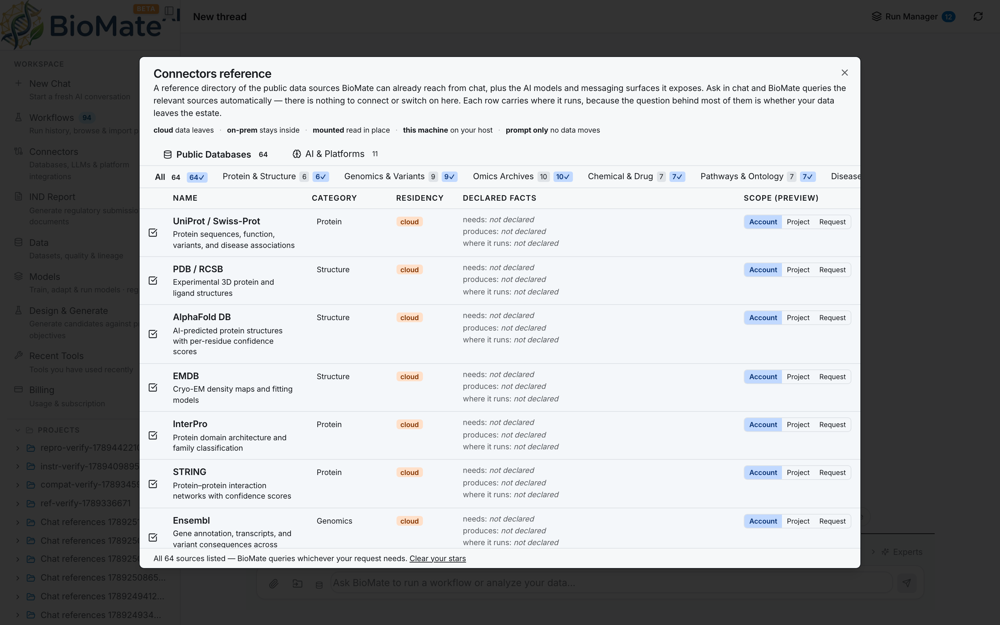

# Connectors & skills (external sources and expert reasoning)

> One-line promise: after this page you know where BioMate's external data sources and integrations
> are managed, what "residency" tells you before your data moves, and how expert/skill packs sharpen
> the AI's reasoning per request. For everyone.

<!-- Every claim here is code-verified (tier C); see coverage-ledger.md "## I.12 Connectors & skills". -->

## What this is for

BioMate reaches out to the world in two different ways, and this chapter covers both:

- **Connectors** — the catalogue of **external data sources and integrations** BioMate can draw on:
  scientific databases (protein/genomics/omics/chemical/pathway/disease/literature), LLM providers,
  and platform integrations (messaging, AI platforms). Managed in the **Connectors** dialog.
- **Skills / experts** — reusable **reasoning packs** that add deep domain expertise on top of the
  automatically-matched workflow. Toggled **per request** in the composer.

The distinction matters: connectors change *what data is reachable*; skills change *how the AI
reasons about your request*. Neither one selects a workflow — routing does that automatically
(see I.1).

## Where connectors live (a primary nav item)

You open the catalogue from the **Connectors** button in the app sidebar — a **top-level nav item**,
alongside Workflows, IND Report, and Data (`app-sidebar.tsx:251-262`,
`data-testid="button-connectors-nav"`; opens `ConnectorsDialog`, `app-sidebar.tsx:482`). Its subtitle
reads "Databases, LLMs & platform integrations."

> **Note — Connectors is a primary-nav item today, not a Settings sub-page.** The design spec placed
> connector management under Settings. The **current shipped reality** is a dedicated sidebar entry
> that opens a full-screen dialog (`connectors-dialog.tsx:535`, `data-testid="connectors-dialog"`).
> This chapter documents what is built; if you're looking for it under Settings, it isn't there.

<!-- CAPTURE route=/ ; state=logged in, sidebar visible, click "Connectors" ; focus=connectors-dialog ; note=Databases tab, residency legend, scope column -->

## What the Connectors dialog manages

The dialog has **two tabs** (`connectors-dialog.tsx:521-526`):

| Tab | What it holds | Count in code | Residency |
|---|---|---|---|
| **Scientific Databases** | Remote public databases / web APIs — UniProt, PDB, AlphaFold DB, Ensembl, gnomAD, ClinVar, GEO, SRA, ChEMBL, PubChem, KEGG, GTEx, Open Targets, PubMed… | `DB.length` (~64 rows, `DB_RAW` `:75-149`) | uniformly **cloud** (a query leaves the estate) `:151-154` |
| **AI & Platforms** | LLM providers (Anthropic Claude, Google Gemini, OpenAI GPT, self-hosted Ollama), AI platforms (ChatGPT GPT Actions, Cursor, Coze, Open-Claw), messaging (Slack, Telegram, WeChat/Feishu) | `AI.length` (`AI` `:176-198`) | **per-connector** (a hosted LLM is `cloud`; Ollama/Cursor are `local`) |

Each row carries **declared facts** — *residency*, *needs* (e.g. "API key"), *produces*, and
*where it runs* — rendered honestly: where a source declares nothing, the cell shows **"not declared"**
in italics rather than a guess (`DeclaredFact` `:203-217`; the databases list stamps `residency: cloud`
uniformly and leaves per-row `needs`/`produces` absent by design, `:151-154`).

### Residency — the question behind most connectors

The dialog header states the point plainly: *"each row carries where it runs, because the question
behind most of them is whether your data leaves the estate"* (`:572-575`). A five-value legend is
always visible (`:576-587`): **cloud** (data leaves), **on-prem** (stays inside), **mounted** (read in
place), **this machine** (never leaves the host), **prompt only** (no data moves).

### Per-user API keys and per-connector scope

- **LLM providers and platform integrations declare `needs: API key` / OAuth token** (e.g. Anthropic
  Claude, Slack workspace OAuth, Telegram bot token — `AI` `:177-197`). This is where per-user
  credentials for those integrations belong.
- **Each connector has a Scope** — Account / Project / Request (`ScopeSelector`, `:279-284`). The
  default is **Account** (connected, available to the whole workspace, not yet switched on anywhere —
  `DEFAULT_SCOPE = 'account'` `:50`). Your database selections and scope choices **persist in the
  browser** (`localStorage` keys `biomate-active-databases`, `biomate-connector-scopes` `:9-37`), so
  "connected once, switched per project" survives a reload.

> **Tip — you don't have to enable databases one by one.** By default **all** databases are selected
> (`loadActiveDbs` returns all names when nothing is stored, `:28-34`); the footer offers **Select all
> / Deselect all** (`dbFooter` `:558-562`). Routing already reaches the public sources it needs — the
> selector is for narrowing, not for turning the platform on.

## Skills / experts — reasoning packs toggled per request

Skills add **deep domain reasoning** on top of the workflow BioMate already matched for you. There are
two families in the data model: **expert roles** and **Bioconductor** domain skills
(`GET /api/skills` returns both, tagged by `source`; `skill_manager.py` via
`ai_assistant.py:6291-6319`).

### In the composer (the live surface)

The composer's **Experts** control is the `SkillsSelector` popover next to the Instructions
affordance (`skills-selector.tsx:75`, `data-testid="composer-experts-toggle"`):

- It fetches **`GET /api/skills`** when no packs are injected, normalises each entry to
  `{ id, label, description }`, and renders a per-pack on/off toggle (`skills-selector.tsx:83-103`,
  `212-264`).
- The packs you toggle on ride into the send payload as **`skillPackIds`** on the same context path as
  every other override, "so a run records which experts were applied" (`chat-input.tsx:271-287`). Empty
  selection adds nothing (honest-empty).
- The "**N on**" chip only counts selections that map to a **real, available** pack
  (`skills-selector.tsx:117-119`) — it can't show a phantom count.

> **Pitfall — the catalogue is honest-empty when unpopulated.** If the backend skills catalogue has
> no entries, the popover shows **"No expert packs available yet"** rather than fabricating toggles
> that do nothing (`skills-selector.tsx:204-209`, `data-testid="composer-experts-empty"`). An empty
> list is a legitimate state, not an error.

### In the Connectors dialog (a disabled tab)

The Connectors dialog **used to** carry a third "Skills" tab, but it is **commented out** because
`/api/skills` returned zero entries at build time (`connectors-dialog.tsx:65` and `:524-526`:
*"Skills tab commented out — /api/skills returns 0 entries; re-enable when backend is populated"*).
The dialog therefore ships **Databases + AI/Platforms only**; skill toggling lives in the composer.

> **Tip — skills are per-request, databases are per-workspace.** Toggle an expert pack for the one
> question that needs it (it's recorded on that run); leave your database scope set once and forget it.

## How it fits the run

- **Connectors** determine which external sources routing and the research agent may query (see I.3 for
  the literature/database sources actually hit during a Search answer).
- **Skills** are recorded on the run alongside your composer instructions and dataset references
  (I.2), so a result carries the reasoning context it was produced under.

## Pitfalls & tips

> **Tip — read the residency badge before you attach sensitive data.** Every connector row states
> where it runs; a `cloud` badge means a query leaves the estate. Ollama/Cursor rows are `local`.

> **Pitfall — database selections are browser-local.** Scope and selection persist in `localStorage`,
> not on the server (`connectors-dialog.tsx:9-19`). A different browser or a cleared cache resets them
> to the default (all databases, Account scope).

## What's not covered

- **A "Skills" tab inside the Connectors dialog** — intentionally disabled until `/api/skills` is
  populated (`connectors-dialog.tsx:524-526`). Skill toggling is available in the composer only. → Appendix E.
- **Connector management under Settings** — the spec's intended home; current reality is the sidebar
  nav item. → Appendix E (surface-placement note).
- **Live "connected/authenticated" state per integration** (OAuth handshake status, key validation) —
  the dialog declares *what each connector needs*, not a verified-connection indicator. → Appendix E.
- **Per-connector `needs`/`produces` for the database list** — declared uniformly as `cloud` residency
  only; per-source connection facts render "not declared" (`connectors-dialog.tsx:151-154`). → Appendix E.

---
_Verification: coverage-ledger.md "## I.12 Connectors & skills" — all tier C (source-read); no Batch
runs fired._
