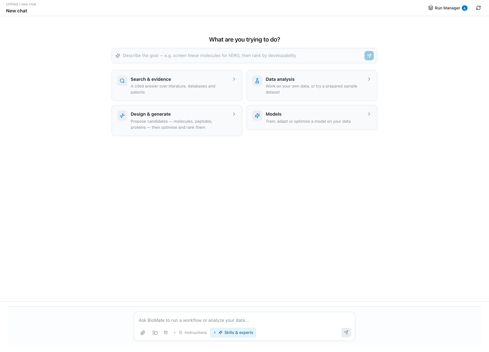

# What BioMate is — the abilities map

> One-line promise: after this page you know everything BioMate can do and how it's organized, so you
> can find your task fast. For everyone.

<!-- Code-verified (tier C) from cold-start-dashboard.tsx + App.tsx; see coverage-ledger.md "## Overview / navigation". -->

## The shape of the product

BioMate is a **conversation with an execution engine**. You describe a goal in plain language; BioMate
decides whether it can answer **instantly** or should run a **validated cloud workflow**, does it, and
brings the result back in the same place you were talking.

Everything starts at the **cold start** (`/`): four **function-module** cards plus an **intent router**
(`cold-start-dashboard.tsx`). The cards don't launch anything — clicking an example **seeds** your
composer with that goal **and attaches its prepared public demo dataset** (ready to run, no upload;
"onSeed — they do not send; you still review and send"). The router reads what
you typed and **restates it** as a lane + domain — it never dumps a list of workflow names.

## The two lanes (the consequence model)

Every goal resolves to one of two lanes (`laneForText`, `lane-preview.tsx`):

- **Instant** — a cited answer or an ad-hoc calculation, **in the conversation, in seconds**. Free-ish.
- **Cloud** — a **validated pipeline** on AWS Batch, **minutes to hours**, billed. Runs in the run
  panel beside the chat (see I.6).

Knowing which lane you're in is the whole point of the front door: you always know the consequence
before you commit.

## The four function modules (what BioMate can do)

| Module | What it's for | Lane | Tracks (sub-abilities) |
|---|---|---|---|
| **Search & evidence** | A cited answer over literature, databases and patents | Instant | Literature · Databases · Patents · Internal record |
| **Data analysis** | Work on your own data — ad-hoc or a validated workflow | Instant (ad-hoc) / Cloud (workflows) | Ad-hoc compute · Validated workflows (all domains) |
| **Design & generate** | Propose candidates — molecules, peptides, proteins — then optimise and rank | Cloud | Generate · Predict & filter · Optimise properties · Rank candidates (per modality: small-molecule / peptide / biologic) |
| **Models** | Train, adapt or optimise a model on your data | Cloud | Train · Adapt · Optimise (design–make–test loop) |

Source: `COLD_MODULES` in `cold-start-dashboard.tsx:225-429`.

<!-- CAPTURE route=/ ; state=new/empty chat ; focus=full viewport ; note=4 module cards + intent bar + composer (captured live from dev) -->
*The cold start — the four function modules and the intent router. (Live capture from dev.)*

### What each module leads to
- **Search & evidence** → an evidence answer with retrieval transparency + citations you can read and
  save (see I.3). Instant.
- **Data analysis → Validated workflows** → BioMate routes to one of the indexed workflows across ~34–36
  domains (transcriptomics, genomics, cryo-EM, drug discovery, proteomics, …) and runs it in the run
  panel (see I.6 and the Part III domain chapters). **Ad-hoc compute** runs short code in-conversation.
- **Design & generate** → generation + prediction/filtering + property optimisation + ranking, per
  modality (small molecule, peptide, biologic) (see I.11; focused surface at `/design`).
- **Models** → train/adapt/optimise a model on your data and gate a design loop on it (see I.10;
  focused surface at `/models`).

## Where things live (surfaces)

The platform is the chat (`/`). Focused tool surfaces you can also open directly:
`/files` (data hub — datasets as objects), `/models`, `/design`, `/ind-report`,
`/drug-discovery-cro`, `/capabilities`, `/billing`, and `/workflow/:id` (deep-link to a generated
workflow). There is **no `/dashboard`** and **no standalone runs page** — a run lives in its chat
session (see I.6).

## How to read the rest of this book
- **Part I — general modules:** the cross-domain platform (this module map, in depth).
- **Part II — databases & retrieval:** the knowledge backbone the Search module draws on.
- **Part III — domains:** use-case chapters (start with Drug discovery → IND, then transcriptomics …).
- **Appendices:** glossary, file formats, QC-gate reference, troubleshooting, and an honest
  **coverage & roadmap** list of what's *not* yet supported.

---
_Verification: coverage-ledger.md "## Overview / navigation" — tier C (cold-start-dashboard.tsx,
App.tsx, lane-preview.tsx)._
