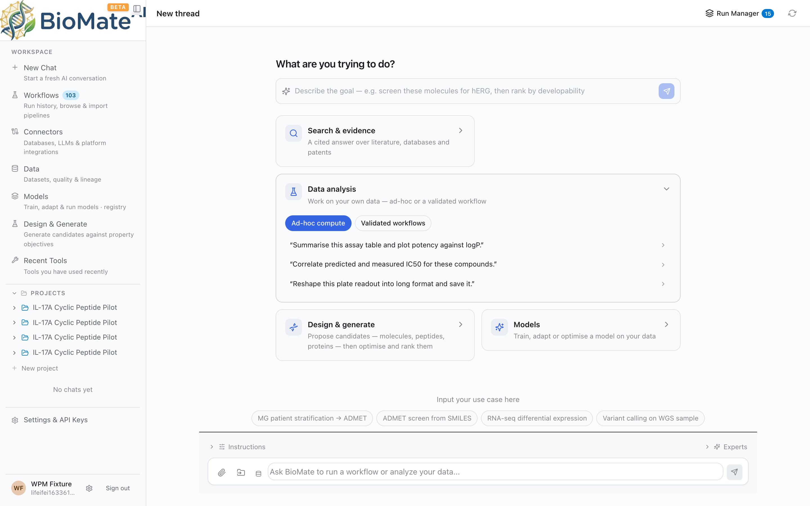

# Module 2 — Data analysis: working on your own data

> **Who this is for:** anyone — no coding needed. By the end you'll know the two ways BioMate can work on
> *your* data (a quick seconds-fast calculation, or a full validated pipeline), how to tell which one your
> question deserves, how to read a quick result, and how to promote a quick look into a defensible run.
> **Time:** ~10 minutes to read; a quick calculation returns in seconds, a full pipeline takes minutes to
> hours.
> **Where it fits:** Module 1 (Search & evidence) answers "what is known" without touching your files. This
> module is the opposite: everything BioMate does *to your own data*. Tutorial 3 is the deep dive on the
> heavy end of it (running a full pipeline and reading the report); this tutorial covers the whole module and
> the quick-calculation end that Tutorial 3 does not.

---

## 1. The problem this solves

You have data — a spreadsheet of assay readings, a plate readout, raw sequencing reads, a variant file — and
a question about it. Sometimes the question is small: *"what's the median library size?"*, *"plot potency
against logP,"* *"reshape this plate into long format."* Sometimes it is big: *"run differential expression
for figure 2,"* *"call variants and flag the clinically relevant ones."*

The trap is being forced to choose the *wrong tool* at the front door. A casual look does not need a
40-minute, audit-tracked pipeline — and a figure that will go into a manuscript should **not** come out of a
one-off, unversioned script. BioMate puts both under one module and **picks the right gear for you**, states
the pick, and lets you overturn it.

> **In one sentence:** describe what you want done to your data; BioMate decides whether it's a quick
> in-conversation calculation or a full validated pipeline, tells you which before anything runs, and lets
> you promote a quick look into a defensible run without retyping.

---

## 2. The ideas you need first (plain-language background)

**The two gears.** This is the central idea of the module:

| | **Ad-hoc compute** (the quick gear) | **Validated workflow** (the rigorous gear) |
|---|---|---|
| **Lane** | Instant | Cloud |
| **Time** | Seconds, in the conversation | Minutes to hours, as a tracked run |
| **What it is** | Code written for *this one question* and run in a locked-down sandbox — with the code shown to you | A versioned, multi-step pipeline with built-in quality gates |
| **What you get back** | A number, a table, or a figure — plus the code that made it | Typed outputs per step, gate verdicts, and an audit-ready report |
| **Right for** | Looking, checking, reshaping, one-off statistics | Anything a figure, a filing, or a decision will rest on |
| **Wrong for** | Results you'll publish or submit | "What's the median of column three?" |

**Gear arbitration — BioMate picks, and says so.** Before anything runs, BioMate shows the gear it chose as a
chip in the message box, with the escape hatch right next to it. The rules, in plain terms:
- Words like *figure, manuscript, submission, report* push to a **workflow** (the result will be leaned on).
- Naming an established **method** (DESeq2, docking, variant calling) is a workflow, because that method has a
  validated, gated implementation.
- Work too big to finish in the conversation is a workflow regardless of how it's phrased.
- **Everything else is compute** — the cheap, reversible default (summarising, correlating, plotting,
  reshaping).

You are never locked in. The chip always carries the opposite option — *"use a validated workflow instead?"*
or *"just compute it quickly?"* — one click away.

**The quick gear runs in a locked-down sandbox.** An ad-hoc calculation is real code (Python, R, or bash)
written for your question and run in an isolated sandbox: a hard time limit, its own scratch directory, and —
in BioMate's deployed setup — **no network access** (the sandbox container runs with networking switched
off). The code is always one click away ("Show the code"), never hidden and never shown by default. This is
why the quick gear is safe to use freely: it can't reach out anywhere, and you can always see exactly what it
ran.

**Bringing your data in.** Both gears work on files you've brought into BioMate — attached in the message box
or living in your Data area (Tutorial 4). When you drop a file in, BioMate often shows a small **data-check
card** automatically (see §5), so you can see the file is the shape you expected *before* you compute on it.

**The validated gear = Tutorial 3.** The heavy end of this module — picking a pipeline, setting parameters,
watching phases run on cloud computers, and reading the three-tab report — is covered in full by
**Tutorial 3**. This tutorial gets you to its door and spends its depth on the quick gear and the handoff
between the two.

---

## 3. When you'd use this

- You want a fast look at your own data — a summary, a plot, a correlation, a reshape — without setting up a
  pipeline.
- You have a standard analysis to run properly (RNA-seq, variant calling, an ADMET screen, a cryo-EM
  reconstruction) and want it done correctly with a defensible record.
- You started with a quick calculation and now realise the result needs to be *publishable* — and you want to
  re-run it rigorously without retyping everything.
- You want to sanity-check a file (reads, quality, row counts, missing values) the moment you bring it in.

---

## 4. Step by step

### 4a. A quick calculation (ad-hoc compute)

<!-- CAPTURE route=/ ; state=chat showing an ad-hoc compute result: a small table or figure, a one-line finding, a collapsed "Run Code" (CodeExecutionBlock) block with a language badge, and a "Redo as a validated run" action ; focus=compute result message + code-execution block ; note=show the code one-disclosure-away and the escalation button -->
*(Figure to add: a quick-calculation result — the figure/number, the collapsed code block with its language
badge, and the "Redo as a validated run" action.)*

1. **Attach your data and ask plainly.** In the message box, attach your file (or point at one in your Data
   area), and describe the quick thing you want — e.g. *"Summarise this assay table and plot potency against
   logP,"* or, continuing the series, *"Correlate predicted and measured IC50 for these JAK1-inhibitor
   compounds."*
2. **Check the gear chip.** BioMate should show **Instant · compute**. If it instead reads Cloud/workflow and
   you only wanted a quick look, click the escape hatch to switch it.
3. **Send.** BioMate writes code for your question, runs it in the sandbox, and replies in seconds.
4. **Read the result** — the figure or table, a one-line finding, and the code one click away under **Show
   the code**. The code's language (Python/R) and the files it read are shown too.

### 4b. A full pipeline (validated workflow)

1. **Describe the real analysis.** E.g. *"Run DESeq2 differential expression, treated vs control, then GO
   enrichment"* — naming the method (DESeq2) makes BioMate pick the **Cloud · workflow** gear. The opened
   **Data analysis** card also lets you browse *shapes* per domain (Drug discovery, Transcriptomics,
   Genomics, Functional genomics, Structural biology, Proteomics, Clinical) — each shape shows what it
   achieves, what it needs, and roughly how long it takes (e.g. "Differential expression between two
   conditions · needs a counts matrix · ~40 min"). A few shapes even come with a provided sample dataset so
   you can run one end-to-end before bringing your own.
2. **Confirm and run, then read the report.** From here it is the full run-and-read-the-report flow — set
   parameters, confirm, watch the phases run, read the Summary / Outputs / Reproducibility-record tabs.
   **That is Tutorial 3** — follow it for the details.

<!-- CAPTURE route=/ ; state=cold start with the Data analysis card expanded on the "Validated workflows" track, domain chips visible and one domain selected showing its workflow shapes (title · what it needs · time), a couple with a "sample" badge ; focus=cold-start Data analysis card, Validated workflows track ; note=show domain chips + shape rows + sample-dataset badge; nothing sent -->

---

## 5. The data-check card (what you see when you bring a file in)

When you attach a data file, BioMate reads the first part of it and shows a compact **data-check card** so
you can confirm the file is what you think it is before computing on it:

- **FASTQ (sequencing reads)** — read count, average read length, and average base quality (Phred). It flags
  a **QC warn** (amber) when average quality falls below Q20, with a plain note to consider trimming first.
- **FASTA (sequences)** — number of sequences and average length.
- **CSV / TSV (tables)** — row and column counts, the column names, and a **missing-values** readout per
  column; it flags a warn when any column is more than 20% empty.
- **VCF (variants)** — variant count, how many PASS the filter, and the spread across chromosomes.

The card expands for the full breakdown and collapses to a one-line summary. *(This is a fast first-lines
check, not a full QC pipeline — a real QC stage lives inside the validated workflows.)*

<!-- CAPTURE route=/ ; state=chat showing a DataAnalysisCard after a CSV/FASTQ upload: one-line summary (rows·cols or reads·Q·bp), a QC pass/warn badge, expanded to show the per-column or per-metric detail ; focus=data-analysis-card ; note=show both the collapsed summary line and the expanded detail with the QC badge -->
*(Figure to add: the data-check card after an upload — the one-line summary, the QC pass/warn badge, and the
expanded per-column (CSV) or per-metric (FASTQ) detail.)*

---

## 6. The most important path: promoting a quick look into a defensible run

This is the move the whole module is built around. You explore casually with the quick gear; then, when a
result turns out to matter, you **promote it** instead of starting over:

- On a quick-calculation result, use **"Redo as a validated run."** BioMate takes that calculation as the
  starting configuration for a proper, gated, audit-tracked pipeline (the Cloud lane). The casual look
  becomes publishable work without being retyped — and because it's a Cloud run, BioMate confirms before it
  spends compute.
- The same path backs **"Check against our data"** on a Search & evidence answer (Module 1): a literature
  claim becomes a real run on your own files.

> **Why this matters.** The quick gear keeps the code and its inputs so you can re-run it, but it is *not* a
> full audit trail. The moment a number is going into a figure, a filing, or a go/no-go decision, promote it
> — the validated run gives you pinned tool versions, a resolved-parameter record per step, quality-gate
> verdicts, and the downloadable reproducibility record you can defend later (Tutorial 3).

---

## 7. Honest limits — what to expect

- **The quick gear is for looking, not for leaning on.** An ad-hoc result keeps its code and inputs, but it
  is not a validated, version-pinned, gated pipeline. For anything a figure, a filing, or a decision will
  rest on, use a validated workflow — or promote the quick result with "Redo as a validated run."
- **The sandbox is locked down in deployment, with a simpler fallback locally.** In BioMate's deployed setup
  the quick gear runs inside an isolated container with **no network** and a hard time limit. A plain local
  developer setup falls back to a time-limited subprocess with an isolated working directory; the network
  guarantee specifically comes from the container deployment.
- **Server-side file checks need the file to be reachable.** The automatic data-check card reads files BioMate
  can open directly. A file that only lives in cloud storage (an `s3://…` path) is not inspected inline — the
  card says so rather than guessing numbers.
- **On a quick result, BioMate asks rather than guesses.** If your question is ambiguous (which two columns?
  which group is control?), it asks once, in words, naming the candidates — it does not silently pick the
  first match. If code errors, it shows the failing line and offers a repair rather than quietly retrying and
  presenting the second attempt as the first. If a result is suspiciously trivial (a correlation over four
  rows), it reports the result *with its n*, not a lone coefficient.
- **The validated gear's detail lives in Tutorial 3.** Parameters, phases, quality gates / auto-loop, the
  three-tab report, and skipping phases are all specified there — this tutorial deliberately stops at the
  door so it doesn't duplicate (or drift from) that one.

---

## 8. Where to go next

| You want to… | Where |
|---|---|
| Run a full pipeline and read its report | **Tutorial 3** |
| Bring a file into BioMate first | **Tutorial 4** |
| View or preview the outputs of a run | **Tutorial 5** |
| Ask "what is known" instead of running anything | **Module 1** (Search & evidence) |
| Ask your very first question | **Tutorial 0** |

The habit: **attach your data → describe the goal → check the gear chip (compute vs workflow) → send → read
the quick result, or follow Tutorial 3 for a full run → promote to a validated run when it needs to be
defensible.**

---

## 9. Key terms

| Term | What it means — and why you care |
|---|---|
| **Data analysis module** | Everything BioMate does *to your own data*, in two gears under one doorway. |
| **Ad-hoc compute (quick gear)** | Code written for one question and run in a sandbox in seconds; the code is always shown. Instant lane. For looking, not for leaning on. |
| **Validated workflow (rigorous gear)** | A versioned, gated, audit-tracked pipeline. Cloud lane. For anything a figure, filing, or decision rests on. (Tutorial 3.) |
| **Gear arbitration** | BioMate's pick between the two gears, shown as a chip before anything runs, always with the opposite option one click away. |
| **Sandbox** | The isolated place the quick gear runs: time-limited, its own directory, and no network in the deployed setup. |
| **Data-check card** | The compact readout shown when you bring a file in (reads/quality, rows/columns/missing, variants) — a fast sanity check, not full QC. |
| **QC warn** | An amber flag on the data-check card (e.g. average quality below Q20, or a column >20% empty) telling you to review before running. |
| **Redo as a validated run** | Promote a quick calculation into a proper, gated, reproducible pipeline — the single most important path in the module. |

---

> **Honest note on what you'll see today.** The quick gear (`run_code`) genuinely runs Python/R/bash in a
> sandbox and returns the result with its code; in deployment that sandbox runs network-off. The data-check
> card parses real FASTQ/FASTA/CSV/VCF files you bring in (local/reachable files; cloud-only paths are not
> inspected inline). The "Redo as a validated run" / "Check against our data" escalation is wired to the
> real workflow path. The full validated-run experience — parameters, phases, gates, the three-tab report —
> is documented and grounded in a real completed run in **Tutorial 3**.

_Companion technical references (for power users / developers): `docs/user-manual/modules/` (running an
analysis, files & the dataset object, outputs & viewers)._
