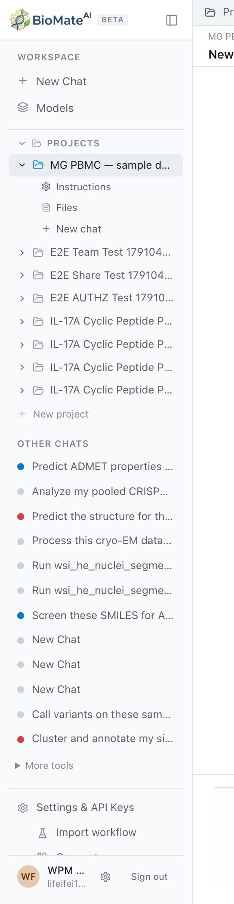

# Tutorial S1 — The sidebar: finding your way around BioMate

> **Who this is for:** anyone using BioMate who wants to know what every button on the left-hand menu
> does — no coding or bioinformatics background needed. By the end you'll be able to name each sidebar
> entry, know whether clicking it opens a pop-up window or moves you to a new page, and know which items
> are not available yet (so you don't go looking for them).
> **Time:** ~9 minutes to read.
> **Where it fits:** Tutorial 0 taught the one core loop (type a goal → check the lane → send → read the
> result). This tutorial is the map around that loop: the sidebar is how you reach your past work, your
> data, your projects, and your settings. The deeper tutorials (1–6) each live behind one of these
> entries, and this page tells you which.

---

## 1. The problem this solves

Once you've asked BioMate more than one question, you have history: past chats, finished analyses, files
you brought in, projects you're grouping work under. The **sidebar** — the vertical menu down the
left-hand edge of every screen — is the one place that gathers all of it, plus the shortcuts to start
something new. If you know the sidebar, you never have to wonder "where did my last run go?" or "how do I
get back to my data?"

This tutorial walks every entry, top to bottom, in plain language: what it is, what happens when you click
it, and when you'd use it.

> **In one sentence:** the sidebar is BioMate's table of contents — new work at the top, your projects and
> past chats in the middle, your account and settings at the bottom.

---

## 2. The ideas you need first (plain-language background)

**Two kinds of click.** Everything in the sidebar does one of two things, and it helps to know which
before you click:

- **Opens a pop-up window (a dialog).** The window appears *on top of* your current chat; close it and
  you're exactly where you were. Nothing you were doing is lost. *Workflows, Connectors, Recent Tools, and
  Settings* all work this way.
- **Takes you to a full page.** The whole screen changes to a new view (Data, Models, Design & Generate,
  a project). You get back with your browser's Back button, or by clicking **New Chat** or a chat in the
  history. *(Why the distinction matters: a dialog is a quick look that keeps your chat open; a page is a
  place you travel to.)*

**Nothing here spends money or runs an analysis by itself.** Opening a window or a page only *shows* you
things. The rule from Tutorial 0 still holds everywhere: a real analysis (a Cloud run) only starts after
you review a message and press Send. The sidebar is navigation, not a trigger.

**The three bands of the sidebar.** Reading top to bottom, the menu is grouped:
1. **Workspace** — buttons that start new work or open a tool (New Chat, Workflows, Connectors, Data,
   Models, Design & Generate, Recent Tools).
2. **Projects** — folders that group related chats, files, and runs together.
3. **Chat history + account** — your recent conversations, then Settings and your profile at the very
   bottom.

**A status dot is a traffic light.** Next to your most recent chats sits a small coloured dot that tells
you, at a glance, how that chat's analysis is doing — **blue = running, red = failed, green = finished,
grey = nothing has run yet.** More on this in §4.

<!-- CAPTURE route=/ ; state=sidebar fully expanded on a fresh login with at least one project and a few chats in history ; focus=app-sidebar (full column) ; note=show the three bands top-to-bottom — Workspace nav, Projects, Chat history + footer; one chat row should show a coloured status dot -->

---

## 3. When you'd use this

- You've done a few things in BioMate and want to get back to a past run, file, or conversation.
- You see a button in the menu and want to know what it does before clicking.
- You heard BioMate has "Billing" or a "CRO Library" and want to know whether they're available (short
  answer: not in this version — see §6).

---

## 4. Step by step — every sidebar entry, top to bottom

### 4.0 The header — logo, BETA chip, and the collapse button

At the very top sits the **BioMate logo**. In its top-right corner is a small **BETA** label — an honest
reminder that this is early-access software and features may change. Also in that corner is a **collapse
button** (an icon of a panel with a line down the left). Click it to **hide the sidebar** and give your
chat the full width; click it again (or the same icon in the thin rail that remains) to bring the sidebar
back. *(Why: on a small screen, or when you're reading a long result, hiding the menu gives you more room.)*

<!-- CAPTURE route=/ ; state=sidebar header close-up, then a second shot with the sidebar collapsed to its icon rail ; focus=brand header (logo + BETA chip + collapse button) ; note=show the BETA chip top-right and the collapse toggle; second frame shows the collapsed rail -->
*(Figure to add: the sidebar header — logo, BETA chip, and the collapse button — plus the collapsed state.)*

### 4.1 New Chat — start a fresh conversation

The first button under **Workspace**. Click it to open a brand-new, empty chat — the **cold start**
doorway from Tutorial 0, with the intent bar and the four module cards. Use it whenever you're starting a
new, unrelated question and don't want it mixed into a conversation already in progress. *(Nothing is
deleted; your previous chat stays in the history below.)*

### 4.2 Workflows — your run history and pipeline library

Opens the **Workflows** pop-up window. This is your record of analyses and your library of pipelines, in
three tabs:

- **Runs** — every analysis you've launched, newest first, each with its status. Clicking a run reopens
  the chat it belongs to so you can read its report; "run again" starts a fresh analysis with the same
  pipeline (you can change files or settings first). This is the quickest way back to *"what happened with
  that analysis I started?"*
- **My Imports** — pipelines you've added to your own library, ready to launch from any chat.
- **Import Workflow** — bring in a pipeline file so it shows up under *My Imports*.

If any analysis is currently running, a small **number badge** appears next to the word "Workflows" in the
sidebar — a live count of how many are in progress. *(Why you care: it's the at-a-glance "is anything
still cooking?" indicator without opening anything.)* Running a workflow and reading its report is covered
in Tutorial 3.

<!-- CAPTURE route=/ ; state=Workflows dialog open on the Runs tab with a few past runs listed, each showing a status; sidebar visible behind showing the running-count badge ; focus=workflow-history-dialog (Runs tab) + the "Workflows" sidebar badge ; note=show the three tabs (Runs / My Imports / Import Workflow) and the per-run status + "run again" action -->
*(Figure to add: the Workflows window on the Runs tab, and the running-count badge on the sidebar button.)*

### 4.3 Connectors — everything your workspace is attached to

Opens the **Connectors** pop-up window — the one place that shows what BioMate can reach: public
databases, AI models, and your lab instruments. It has four tabs:

- **Public Databases** — the scientific sources BioMate can look things up in from chat (UniProt, PDB,
  Ensembl, ChEMBL, ClinVar, KEGG, Open Targets, and dozens more). This tab is a **read-only reference** —
  it shows you what's available; you don't configure anything here.
- **AI & Platforms** — the AI models BioMate uses (Claude, Gemini, and others) and the external surfaces
  it can plug into. Also read-only reference — it is not where you set up access.
- **Your Connections** — the one place in this window you can actually *add* something: your own private
  database and your own MCP server (an advanced way to connect your own tools). Credentials you enter are
  encrypted, and database access is read-only.
- **Instruments** — register a lab or hospital instrument (a sequencer, a plate reader, a robot) so its
  data flows into BioMate. This is the subject of Tutorial 6.

*(Why it's all one window: the question behind every connection is the same — "what is this workspace
attached to, and is it working?")*

<!-- CAPTURE route=/ ; state=Connectors dialog open on the Public Databases tab, the four tabs (Public Databases / AI & Platforms / Your Connections / Instruments) visible along the top ; focus=connectors-dialog ; note=show the four tabs and the read-only note on the Public Databases / AI tabs -->
*(Figure to add: the Connectors window — the four tabs across the top, with the Public Databases list.)*

### 4.4 Data — your datasets, their quality and lineage

Takes you to the **Data** page (a full page, not a pop-up). This is where the files you've brought into
BioMate live: you see each dataset, a quality check on it, and its **lineage** (a record of which run
produced it). Use it to review, check, or pick up a file for the next analysis. Bringing your own data in
is covered in Tutorial 4; reading results is Tutorial 5.

### 4.5 Models — train, adapt, and run prediction models

Takes you to the **Models** page. A model here is a tool that *predicts* a property (for example, how
safe or how soluble a molecule is likely to be) and that can **learn from your own lab results** to get
better for your program over time. The page is the registry where your models live — every version kept,
so you can see how a model changed. The closed-loop idea (lab results → better model → better next round)
is the whole of Tutorial 2.

### 4.6 Design & Generate — propose new candidate molecules

Takes you to the **Design & Generate** page. Instead of asking "what is known," here you ask BioMate to
**generate new candidate molecules** that aim at the properties you care about (potency targets,
safety limits, drug-likeness). It hands back a shortlist with the trade-offs made visible, rather than a
blank page. This is the subject of Tutorial 1.

### 4.7 Recent Tools — jump back to a tool you used lately

Opens the **Recent Tools** pop-up window: a list of the individual tools you've used recently, with a
search box and a usage count, so you can re-open one without hunting for it. If you haven't used any yet,
the list is simply empty — that's expected on a new account, not a fault.

---

### 4.8 Projects — folders that group related work

Below the Workspace buttons is the **Projects** band. A **project** is a folder that keeps related chats,
files, and runs together — for example, everything to do with one drug program or one disease.

- The **Projects** header has a small arrow (**▸ / ▾**) to collapse or expand the whole list.
- Each project row has its own arrow. Click a project to open it; its arrow expands to reveal three
  shortcuts straight into that project: **Chats**, **Files**, and **Workflows** (each opens the project on
  that tab).
- A project someone else shared with you shows a small **"shared"** tag on its row, so you can tell your
  own projects apart from shared ones.
- **New project** (a **＋** at the foot of the list) creates a fresh folder.

*(Note: the sidebar shows your active projects, up to a dozen; archived projects are hidden here on
purpose, so the list stays short.)*

<!-- CAPTURE route=/ ; state=Projects band with one project expanded to show its Chats / Files / Workflows sub-links, and a second project carrying a "shared" tag ; focus=projects section of app-sidebar ; note=show the collapse arrows, the expanded project sub-links, the "shared" badge, and the "New project" button -->
*(Figure to add: the Projects band — a project expanded to its Chats/Files/Workflows links, a "shared" tag, and the New project button.)*

---

### 4.9 Chat history — your recent conversations, with status dots

Below Projects, taking up the scrollable middle of the sidebar, is your **chat history**: your recent
conversations, newest first, under two headings — **Current** (your latest handful) and **Recent** (the
ones before those). Click any chat to reopen it exactly where you left off. If you have no chats yet,
you'll see **"No chats yet"** — expected on a new account.

Next to each chat in the **Current** group is the **status dot** — the traffic light from §2 — that tells
you how that chat's analysis is doing:

| Dot colour | Meaning |
|---|---|
| **Blue** (gently pulsing) | An analysis in this chat is **running right now**. |
| **Red** | An analysis in this chat **failed**. |
| **Green** | An analysis in this chat **finished**. |
| **Grey** | **Nothing has run** in this chat yet (it's a plain conversation). |

*(The dot updates on its own every few seconds, so you can watch a run go from blue to green without
refreshing. Chats in the older "Recent" group don't carry a dot.)*

<!-- CAPTURE route=/ ; state=chat history with at least one blue (running) dot, one green (completed), one red (failed), and one grey (idle) chat row visible under the Current heading ; focus=chat-history list with status dots ; note=capture all four dot colours in one frame if possible; dots live on the Current group only -->
*(Figure to add: the chat history showing the four status-dot colours — blue running, green finished, red failed, grey idle.)*

---

### 4.10 Settings & API Keys — your account and preferences

Near the bottom of the scrolling area, and again as a **gear icon** in the footer, is **Settings & API
Keys**. Both open the same **Settings** pop-up window, organised into tabs down the side:

- **Profile** — your name, email, and role.
- **General** — language (English, 中文, and others).
- **Appearance** — light / dark / match-your-system theme.
- **Chat**, **Data**, **Notifications**, **Privacy**, **Security** — per-area preferences (for example,
  where your data is stored and how long it's kept).
- **API Keys** — where you store your own keys if you bring your own AI-model access.

*(Why two entry points: the gear in the footer is always reachable even when the list above is scrolled;
the labelled "Settings & API Keys" link is the obvious one to find.)*

### 4.11 The footer — your profile and sign-out

At the very bottom: a small avatar with your **name and email**, the **gear** (Settings, as above), and
**Sign out**, which logs you out and returns you to the login page.

> **Admin-only entry.** If — and only if — your account is an administrator, one extra link (**系统管理 /
> System Administration**) appears above the footer, leading to an admin dashboard. Ordinary accounts never
> see it, so if it's not there for you, nothing is wrong.

---

## 5. Honest limits — what to expect

- **The sidebar only navigates.** No button here launches an analysis or spends compute on its own. A
  Cloud run always waits for you to review a message and press Send (Tutorial 0). Opening a window or a
  page is always safe.
- **Status dots live on the "Current" chats only.** The older "Recent" group doesn't show a dot. A dot
  reflects the most relevant run in that chat (a running one takes priority over a finished one).
- **"Public Databases" and "AI & Platforms" are reference lists, not setup screens.** They show what
  BioMate can reach; you don't configure them there. The only place in the Connectors window you can add
  your own connection is the **Your Connections** tab.
- **Some things you may have heard of are not in this version** (see §6). If you can't find Billing, a
  Runs dashboard, or a CRO Library, that's because they aren't shipped here — not because you're looking in
  the wrong place.

---

## 6. Not available in this version (so you don't go looking)

To be honest about what's present, these are intentionally **switched off** in the current build. They are
described here only so you aren't left searching for them:

- **Billing / Usage & subscription** — not shown in the sidebar, and its page is disabled in this build.
  There is no billing screen to open here.
- **Runs dashboard** — there is no separate "Runs" page. Your run history lives inside the **Workflows**
  window (§4.2, Runs tab) instead.
- **CRO Library (drug-discovery CRO)** — not available as a sidebar destination in this build.
- **IND Report** — the report generator is hidden from the sidebar in this build (even though the
  underlying page still exists), so treat it as not reachable from the menu for now.

*(If a future version turns any of these on, they'll appear in the Workspace band alongside the others.)*

---

## 7. Where to go next

| You want to… | Sidebar entry | Tutorial |
|---|---|---|
| Ask your first question | **New Chat** | **Tutorial 0** |
| Design new candidate molecules | **Design & Generate** | **Tutorial 1** |
| Learn from lab results, improve the next round | **Models** | **Tutorial 2** |
| Run a full analysis and read the report | **Workflows** (Runs) | **Tutorial 3** |
| Bring your own data in | **Data** / **Connectors** | **Tutorial 4** |
| View and understand your results | **Data** | **Tutorial 5** |
| Connect a lab or hospital instrument | **Connectors → Instruments** | **Tutorial 6** |

The habit: **the top of the sidebar starts new work; the middle holds your projects and chats; the bottom
is your account.** Everything you do in BioMate, you reach from here.

---

## 8. Key terms

| Term | What it means — and why you care |
|---|---|
| **Sidebar** | The vertical menu down the left edge of every screen — BioMate's table of contents. |
| **Dialog (pop-up window)** | A window that opens on top of your chat (Workflows, Connectors, Recent Tools, Settings); close it and you're back where you were. |
| **Page** | A full-screen view you travel to (Data, Models, Design & Generate, a project); return with the Back button or by opening a chat. |
| **Workspace band** | The top group of buttons that start new work or open a tool. |
| **Project** | A folder grouping related chats, files, and runs; a "shared" tag marks one someone shared with you. |
| **Chat history** | Your recent conversations (Current + Recent); click one to reopen it. |
| **Status dot** | The coloured dot on a Current chat: **blue** = running, **red** = failed, **green** = finished, **grey** = nothing run yet. |
| **Collapse button** | The panel icon in the header that hides/shows the sidebar to free up screen space. |
| **Connectors** | The window listing what BioMate is attached to: public databases, AI models, your own connections, and instruments. |
| **Running-count badge** | The small number by "Workflows" showing how many analyses are in progress right now. |

---

_Companion technical references (for power users / developers): the sidebar is implemented in
`frontend/client/src/components/app-sidebar.tsx`; the windows it opens are
`workflow-history-dialog.tsx` (Workflows), `connectors-dialog.tsx` (Connectors),
`recent-tools-dialog.tsx` (Recent Tools), and `settings-dialog.tsx` (Settings)._
