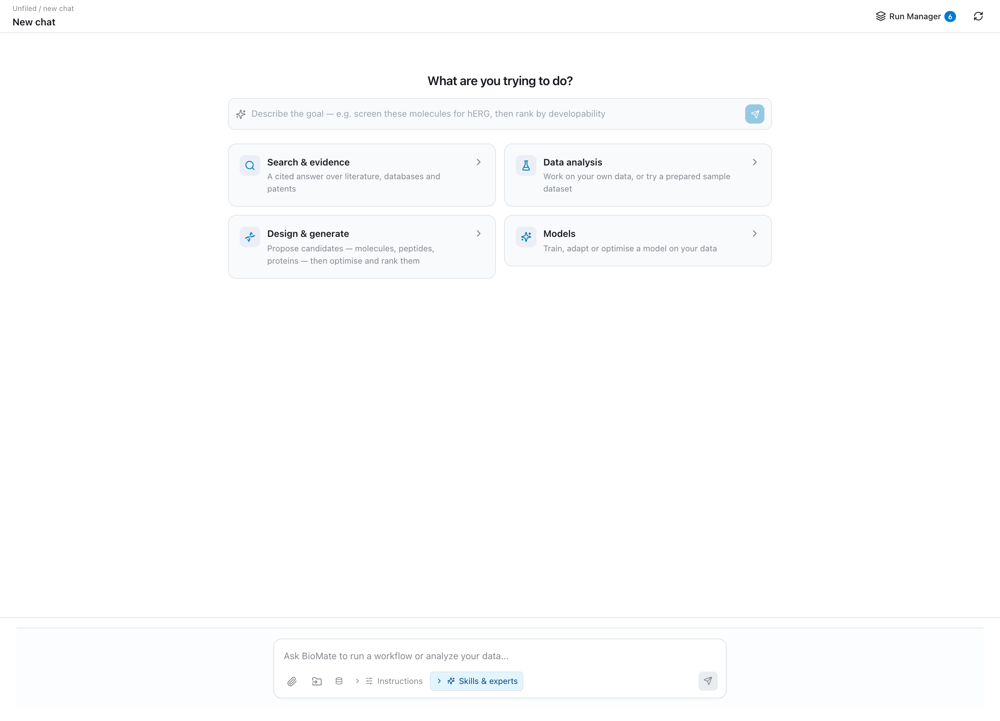

# Tutorial 0 — Getting started: your first question to BioMate

> **Who this is for:** anyone opening BioMate for the first time — no coding, no bioinformatics background
> needed. By the end you'll know what BioMate is, how to ask it for something, how to tell whether your
> request will return a quick answer or launch a bigger analysis, and how to read your first result.
> **Time:** ~8 minutes to read; the first example runs in seconds.
> **Where it fits:** this is the starting point. The deeper journeys — designing molecules (Tutorial 1), learning
> from lab results (Tutorial 2), and running a full analysis workflow (Tutorial 3) — all start from what
> this page teaches.

---

## 1. What BioMate is (in one honest paragraph)

BioMate is a cloud workbench for drug discovery and biology. Instead of installing software and connecting
tools together yourself, you describe what you want in plain language. BioMate then either **answers from the
scientific literature and databases** or **runs a tested analysis on cloud computers**, and hands back the
results with a record of how they were produced. It covers a few distinct kinds of work — finding
evidence, analysing your own data, designing new molecules, and learning from lab measurements — and this
tutorial shows you the single doorway they all share.

> **In one sentence:** you tell BioMate a goal in everyday words; it figures out what kind of work that is
> and does it — and it always shows you what it's about to do before anything runs or costs money.

---

## 2. The ideas you need first (plain-language background)

**The cold start — the doorway.** Every new conversation opens on the **cold start**: a screen with a
single **intent bar** (a box where you type your goal) and four **module cards**. It is the first thing
you see in an empty chat, and you can always get back to it by starting a new chat (sidebar → **New
chat**). Think of it as a reception desk: you say what you need, and it points you in the right direction.

**The four modules — the kinds of work BioMate does.** The four cards name the four kinds of work, so you
can recognise which one your goal belongs to:

- **Search & evidence** — ask *"what is known?"* and get a short, **cited** answer (the example in this
  tutorial).
- **Data analysis** — *"run this analysis on my data"* (e.g. RNA-seq, variant calling). Covered in
  Tutorial 3.
- **Design & generate** — *"propose new candidate molecules"* for a drug program. Covered in Tutorial 1.
- **Models** — *"learn from my lab results and improve the next round."* Covered in Tutorial 2.

You do **not** have to pick a module first. You can just type your goal in the intent bar and let BioMate
work out which kind of work it is.

**Instant vs Cloud — the single most useful thing to understand.** BioMate sorts every request into one
of two **lanes**, and it tells you which one *before* you send:

- **Instant** — a **cited answer in seconds**. It reads the literature and databases and replies in the
  chat. There is no large computation and no pipeline bill. Asking "what is known about X" is Instant.
- **Cloud** — a **validated workflow** that runs on cloud computers and takes minutes to hours (and uses
  paid compute). Running an analysis on your own data is Cloud.

Why you care: the lane tells you the **time and cost** consequence of your request up front. And BioMate
**will always confirm with you before it runs anything in the Cloud lane** — a Cloud request never starts
paid computation until you confirm.

**Nothing runs until you review and send.** This is the safety rule that applies throughout the product.
The module cards and the intent bar only **seed** (pre-fill) your message box — they never send on their
own. You read what was filled in, adjust it, attach any data, and press Send yourself.

---

## 3. When you'd use this

- You're opening BioMate for the first time and want to ask it one real question.
- You're not sure whether what you want is a quick answer or a full analysis — and you want to see which,
  before committing time or compute.
- You want to learn the one workflow (type a goal → check the lane → send → read the result) that every
  other tutorial builds on.

---

## 4. Step by step — asking your first question

We'll ask an evidence question, because it returns in seconds and shows you the full structure of a BioMate
answer. We'll use a real example: the link between the protein **JAK1** and **rheumatoid arthritis** (a
common autoimmune disease) — the same target used in Tutorial 1.

*The cold start, captured live: the intent bar at the top, the four module cards (Search & evidence · Data
analysis · Design & generate · Models), and the message box (the composer) at the foot.*

1. **Open a new chat.** The cold start appears automatically in any empty chat (sidebar → **New chat** to
   return to it later).
2. **Type your goal in the intent bar**, in plain language. For example:
   *"What is the evidence linking JAK1 to rheumatoid arthritis, and how strong is it?"*
   As you type, BioMate reads your goal and is designed to show a short **restatement** — the lane it heard
   (here **Instant**) and a subject area. It does not show a menu of tool names; it just tells you what kind
   of work it understood.
3. **Check the lane.** For a "what is known" question you should see an **Instant** read ("a cited answer
   in seconds"). If you ever see the wrong lane, you can adjust your wording (or pick the lane in the
   message box) before sending — but for this question, Instant is correct.
4. **Review the seeded message and send.** Your goal is placed in the **composer** (the message box at the
   foot of the chat). This is your chance to edit it. When it says what you mean, press **Send** (or the
   Enter key; Shift+Enter makes a new line). *Only now does anything happen.*

<!-- CAPTURE route=/ ; state=intent bar filled with a knowledge question, lane preview showing "Instant · cited answer" ; focus=composer + lane-preview strip ; note=shows the Instant verdict + "BioMate will confirm before running anything cloud" line before send -->

> **The message box can do more (for later).** Besides typing, the composer lets you **attach your own
> files** (the paperclip, for files on your computer) and **point at data BioMate already holds** (the
> Database icon — avoids re-uploading). You won't need either for an evidence question, but Tutorials 1–3
> use them. There are also optional **Instructions** (a standing preference applied to every message, e.g.
> "prefer conservative thresholds") and **Experts** (domain reasoning packs) — safe to ignore on your
> first run.

---

## 5. How to read your first answer

An evidence answer is a small, sourced report — not just a paragraph. Here is what you'll see and how to
read it:

- **The answer text**, with numbered markers like `[1]`, `[2]` that tie each claim to a source. BioMate
  lists only the sources the answer actually used, so the list reflects what the text drew on rather than a
  padded bibliography.
- **Citations you can open.** Each source shows its title, journal, and year, with an **open** action to
  step through the sources one by one. (It links out to the publisher's page for the full text, rather than
  pretending to show the article body.)
- **"Sources disagree" (when it happens).** If two sources genuinely conflict on the same point, BioMate
  shows both side by side with their sources, instead of quietly picking one. If there's no real
  disagreement, this section simply doesn't appear — it is never invented to look thorough.
- **The boundary block — always shown.** Below the answer sits a note stating *what the answer is NOT
  evidence for* — for an evidence answer, that it synthesises published literature only and has not been
  checked against your own data. Read this before you act on the answer.

> **What to do with the answer.** An evidence answer is a starting point. If you have a project open, you
> can **save it to the project** (it's kept with the project's notes, with its sources). And if you want to
> go further, a **check-against-your-own-data** follow-up turns the same question into a real analysis on your data
> (that one is a Cloud run — BioMate will confirm first).

---

## 6. Honest limits — what to expect on day one

- **An evidence answer is literature, not a verdict on your data.** It reflects what's published, with its
  sources attached; it has not been run against your files. The always-present boundary block says so.
- **If you ask a patent / freedom-to-operate question, the "Patents" framing is a doorway, not a patent
  search.** A patent-worded question still returns a literature-grounded answer today — BioMate does not
  search a patent database. Confirm freedom-to-operate with counsel.
- **Citation export is partial for literature.** You can copy a source's details and use its DOI/PubMed ID
  in your reference manager; fully formatted BibTeX is populated for workflow-tool citations, not yet for
  every literature source.
- **BioMate is built not to pad a section with invented content.** The search-transparency bars, the
  conflicts row, and formatted citations each appear **only** when real data backs them — otherwise they
  stay hidden. An empty section means "nothing to show honestly," not a bug.

---

## 7. Where to go next

| You want to… | Module | Lane | Tutorial |
|---|---|---|---|
| Ask what's known (cited answer) | Search & evidence | Instant | *this one* |
| Design new candidate molecules | Design & generate | — | **Tutorial 1** |
| Learn from lab results, improve the next round | Models | — | **Tutorial 2** |
| Run a full analysis on your data | Data analysis | Cloud | **Tutorial 3** |

The habit is always the same: **type a goal → check the lane → review → send → read the result (with its
sources or its record).** Everything else in BioMate is a richer version of this one loop.

---

## 8. Key terms

| Term | What it means — and why you care |
|---|---|
| **Cold start** | The screen a new, empty chat opens on — the intent bar plus the four module cards. Your doorway; get back to it with **New chat**. |
| **Intent bar** | The box where you type your goal in plain language; BioMate reads it and tells you the lane and subject before you send. |
| **Module** | One of the four kinds of work: Search & evidence, Data analysis, Design & generate, Models. You don't have to pick one — the intent bar routes you. |
| **Composer** | The message box at the foot of the chat; also lets you attach files, point at existing data, and set instructions. Nothing sends until you press Send. |
| **Lane (Instant / Cloud)** | Whether your request is a quick cited answer (**Instant**, seconds, no pipeline cost) or a full workflow (**Cloud**, minutes–hours, paid, confirmed first). Shown before you send. |
| **Seed** | Pre-filling your message box from a card or the intent bar. A seeded goal is a starting point — you review and send it; it is never sent for you. |
| **Cited answer** | An Instant-lane result that carries its sources, surfaces real disagreements, and states what it is not evidence for. |
| **Boundary block** | The note under an evidence answer saying what it does NOT cover — always shown, so you know the answer's limits. |

---

_Companion technical references (for power users / developers):
`docs/user-manual/modules/I01-getting-started-cold-start.md`, `I02-composer-talking-to-biomate.md`,
`I03-search-and-evidence.md`._
