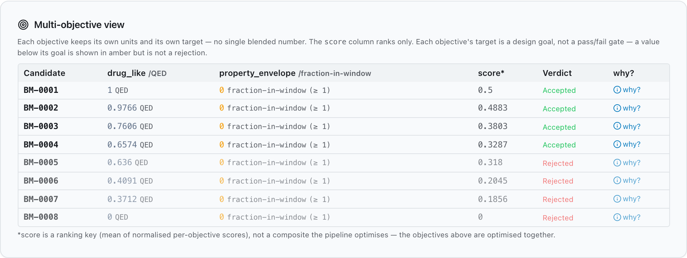

# Tutorial 1 — Designing new drug molecules (Design & Generate)

> **Who this is for:** anyone — no coding, no chemistry background needed. By the end you'll understand
> *what* molecular design is, *why* it's hard, and *how* to run it in BioMate and read the results with
> confidence.
> **Time:** ~10 minutes to read; ~2 minutes to run.

---

## 1. The problem this solves (why you'd ever do this)

A new medicine usually starts as a single **molecule** — a specific arrangement of atoms that sticks to a
disease-related **target** (usually a protein) and changes what it does. For example, many rheumatoid-arthritis
drugs work by blocking an inflammation-signalling protein called **JAK1**. The hard part is that a useful drug
molecule has to satisfy several demands *at the same time*:

- it must **bind the target** strongly enough to work (potency),
- it must be **safe** — not damage the heart, the liver, and so on,
- it must be **makeable** in a lab at reasonable cost (synthesizability),
- and it must **behave well in the body** — be absorbed, and not be cleared away too quickly.

The number of possible drug-like molecules is about 10⁶⁰ — more than the number of stars in the observable
universe. No chemist can draw and test even a fraction of them by hand. In a traditional program, narrowing
that space down to a first testable shortlist takes a chemistry team many months. **Design & Generate** is
BioMate's tool that does this first filtering automatically: it proposes brand-new candidate molecules,
predicts key properties, sets aside the clearly unsafe ones, and returns a short, ranked list — in minutes
instead of months. It is the very first step of drug discovery, *before* you spend money making or testing
anything.

> **In one sentence:** instead of *you* inventing molecules, BioMate proposes them, scores them, and ranks
> the best — so you start a project from a filtered shortlist, not a blank page.

---

## 2. The ideas you need first (plain-language background)

You don't need chemistry training, but a few concepts will make everything on screen make sense.

**Generate vs. screen.** "Screening" means testing molecules you *already have*. "Generating" (this tool)
means creating *new* molecules that did not exist before. This tutorial is about generating.

**Seed molecule, and where it comes from.** The generator does not start from nothing — you give it a
**seed**: one known molecule to build variations around. Think of giving a composer a short melody and asking
for variations on it. A seed is entered as a **SMILES** string — a standard text code for a molecule's
structure (for example, aspirin is `CC(=O)Oc1ccccc1C(=O)O`). You don't write these by hand: you look up any
known molecule on a free database like **PubChem** (pubchem.ncbi.nlm.nih.gov) and copy its "Canonical SMILES",
or your chemistry collaborators give you one.

> **Important — target vs. seed.** Your disease **target** is usually a *protein* (like JAK1). The seed you
> type here is a *molecule* (a small compound). If you already have a molecule known to act on your target,
> use it as the seed. If you only have the protein target and no molecule yet, search your target's name on
> **ChEMBL** or **PubChem**, pick a known binder, and use its SMILES as the seed. *(A way to specify the
> protein's binding site directly is on the roadmap; today the starting point is a seed molecule.)*

**Scaffold, and "stay / hop / grow."** The **scaffold** is a molecule's core skeleton — the part that gives
it its basic shape. You tell BioMate how adventurous to be:
- **Stay** — keep the same core, only vary the decorations around it (conservative).
- **Hop** — move to a *different* core that should still fit the target. Chemists do this to avoid a
  competitor's patent, or to escape a core that causes toxicity.
- **Grow** — start from a small fragment and build it up into a full drug-sized molecule.

**The property "window" (a preference, not a hard rule).** Decades of data show that molecules which get
absorbed into the body tend to fall within certain ranges of three measurable properties:
- **MW** (molecular weight) — roughly, the molecule's size;
- **logP** — how oily vs. water-loving it is;
- **TPSA** — how much of its surface is polar.

Why you care, in practical terms: these three together predict whether a molecule can be an **oral pill**
(versus needing an injection), how easily it **crosses cell membranes**, and whether it can reach targets
**inside the cell** or in the brain. In general, smaller and less-polar molecules cross membranes more
easily — so if your target is inside the cell, you may want to set the window to lower values. BioMate lets you set
a target window for these properties. This window is a soft preference used for ranking — **not** a strict
cut-off. A promising molecule just outside the window is not removed; it simply scores slightly lower.

(Large molecules such as **peptides** sit well *outside* this small-molecule window — which is exactly why
they are treated as a separate modality. See §3.)

**Several goals at once — and why there's no single magic score.** You want a molecule that is potent *and*
safe *and* makeable. These goals can pull against each other — improving one can drag another down. So BioMate
shows each goal **separately, in its own units**, and never blends them into one "overall" number. *You* decide
how to weigh them. This is deliberate: a single blended score could let an unsafe molecule hide behind a good
average.

**The safety gate.** Some chemical sub-structures are known to be risky — reactive groups, or fragments linked
to toxicity in the past. These are called **structural alerts** — the kind of red flag that can later turn into
a real clinical problem such as a heart-rhythm risk (the hERG/QT effect) or liver injury. Any candidate
containing one is **flagged and set aside — but still shown to you, with the reason**. Think of an alert as a *caution flag*, not a proven
toxicity measurement (some flagged groups are fine in the right context). The point is that BioMate never
hides a result: safety is a visible gate, not a secret filter.

> **An honest note on "potency".** Predicting exactly how strongly a molecule will bind a *specific* target
> needs a model trained for that target. Where BioMate does not have a trustworthy one, it does **not** invent
> a binding number — it says "not available" rather than guess. So the scores you'll see today are about
> **drug-likeness** and **property fit**, with safety as a gate; a target-specific potency prediction is a
> separate capability (see Tutorial 2 on Models).

---

## 3. When you'd use this

- You have a validated target (say, an inflammation target in an autoimmune disease) and want a first batch of
  candidate molecules to consider.
- You have a promising molecule but want **safer or more makeable** variations around it.
- You need to **avoid an existing patent** by switching to a different core (scaffold-hop).

> **If your interest is cyclic peptides / macrocycles** (a focus area for BioMate in immune-mediated disease):
> note that **today the small-molecule generator is the one that runs end-to-end**. The Peptide and Protein
> modalities show the form and record your settings, but do not yet produce candidates — the screen says so.

---

## 4. Step by step

*The Design & Generate screen. You fill in a few constraints, then click "Generate & rank."*

1. **Open Design & Generate.** From the home screen choose "Design & generate" (or go to the `/design` page).
   You'll see the form above — a set of constraints, not a chat box.
2. **Choose the modality** — *Small molecule*, *Peptide*, or *Protein / biologic*. Start with Small molecule
   (see the note in §3 about peptides).
3. **Give a seed** in the "Target / seed" box. Enter a molecule as a SMILES string. *(Despite the label, this
   box takes a molecule code — not your protein target's name; see §2 for where to get one.)* If you don't have one, look
   it up on PubChem or ChEMBL as described in §2. For this walk-through we use aspirin
   (`CC(=O)Oc1ccccc1C(=O)O`) — chosen only because it's familiar; you'd normally use a molecule relevant to your
   target.
4. **Pick the scaffold policy** — Stay, Hop, or Grow (see §2). "Stay" is the safe default.
5. **Set the property window** — MW, logP, TPSA. The defaults are sensible drug-like values; leave them unless
   you have a reason (for example, lowering them if your target is inside the cell).
6. **(Optional) Exclusions and seed series.** *Exclusions* = chemical groups to ban, entered as SMILES/SMARTS
   patterns, one per line (SMARTS is the same kind of text code, with wildcards). *Seed series* = a few extra known molecules (as SMILES, one per line) for the tool to
   learn from. Both are optional — you can skip them on a first run.
7. **Set how many candidates to keep** and click **Generate & rank.** It finishes in under a minute, and the
   results appear in the same panel.

---

## 5. How to read the results

*The multi-objective view: every candidate is one row, and each goal keeps its own column and units — nothing
is blended into a single number. (A separate trade-off chart and a rejection summary also appear on the
results page.)*

- **Each row is one proposed molecule** (BM-0001, BM-0002, …).
- **Each goal has its own column** — here `drug_like` (a 0–1 *heuristic* estimate of how drug-like the
  molecule is; higher is better) and `property_envelope` (the column name for the property window you set in
  step 5 — the same thing). You see the trade-off directly, side by side.
- **"score\*" is only a ranking key**, not a quality verdict — it just orders the list. The on-screen footnote
  says so, on purpose.
- **Verdict** — *Accepted* passed the checks; *Rejected* tripped the safety gate. **Rejected molecules stay
  visible with their reason**, so you learn *why* — nothing is hidden.
- **"why?"** on each row explains how that molecule was scored, including the nearest real, known molecule it
  resembles — so a result is never unexplained.
- The results page also shows a **trade-off chart** (a "Pareto" view). Read it like this: each dot is a
  candidate; the dots along the front boundary of the cluster are the best available compromises — to make one
  of them better on one goal, you'd have to accept it being worse on another. You pick from that boundary based
  on what matters most to you (e.g., favour safety over size).
- A **rejection summary** tells you *why* candidates were dropped. A high rejection rate is the clearest indicator
  that your seed or your constraints need adjusting — it's a useful diagnostic, not a failure.

> **If you get no results:** BioMate tells you *which kind* of empty it is. "All candidates were set aside"
> means adjust your constraints or seed (something you can act on). "Temporarily unavailable" means it's a
> problem on our side, not your inputs — nothing for you to change.

---

## 6. What happens next — the closed loop

A shortlist is a starting point, not a finished drug — these candidates are still a long way from the clinic;
the value is *starting smart*. From the results you can **export an order sheet**: a file that pairs each
candidate with a lab ID, so chemists (in-house or at a contract lab) can actually make and test the top
molecules. When the lab results come back, they feed into BioMate's **Models** module (Tutorial 2), which
*learns* from the real measurements and proposes a better next round. That cycle — **design → make → test →
learn → design again** — is the "closed loop", and it's how BioMate gets more accurate with every round.
Tutorial 2 covers this loop in detail, including a worked rheumatoid-arthritis example of how it can steer
designs away from a real safety risk.

Typical hand-offs: a **clinician or biologist** contributes the validated target and the real-world safety
problems to avoid; **BioMate** produces and ranks candidates; a **medicinal chemist** reviews the shortlist and
decides what to make.

---

## 7. Key terms

| Term | What it means — and why you care |
|---|---|
| **Target** | The protein (or other molecule) in the body a drug is meant to act on (e.g., JAK1 in rheumatoid arthritis). |
| **Seed** | A known molecule you ask BioMate to build variations around; entered as a SMILES code. |
| **SMILES** | A short text code for a molecule's structure; look one up on PubChem/ChEMBL and copy it. |
| **Scaffold** | A molecule's core skeleton. "Scaffold hopping" = switching to a different core (e.g., to avoid a patent). |
| **MW / logP / TPSA** | Size, oiliness, and surface polarity — together they predict oral absorption, membrane crossing, and brain access. |
| **Synthesizability** | Whether a molecule can actually be made in a lab at reasonable cost — some look fine on paper but can't be built. |
| **Multi-objective** | Optimising several competing goals (potency, safety, makeability) at once, shown separately rather than blended. |
| **Structural alert (safety gate)** | A substructure linked to reactivity/toxicity risk — a caution flag, not a proven toxicity measurement. |
| **Pareto / trade-off** | The set of candidates where you can't improve one goal without making another worse — the best available compromises. |
| **Closed loop** | Feeding real lab results back in so the next round of designs is better. |

---

_Companion technical reference (for power users / developers):
`docs/user-manual/modules/I11-design-and-generate.md`._
