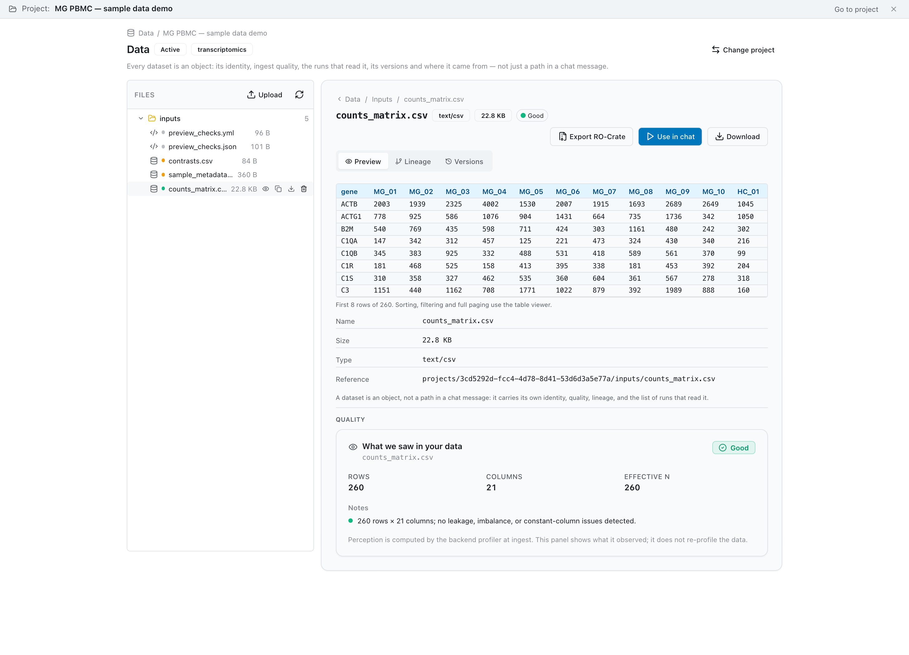
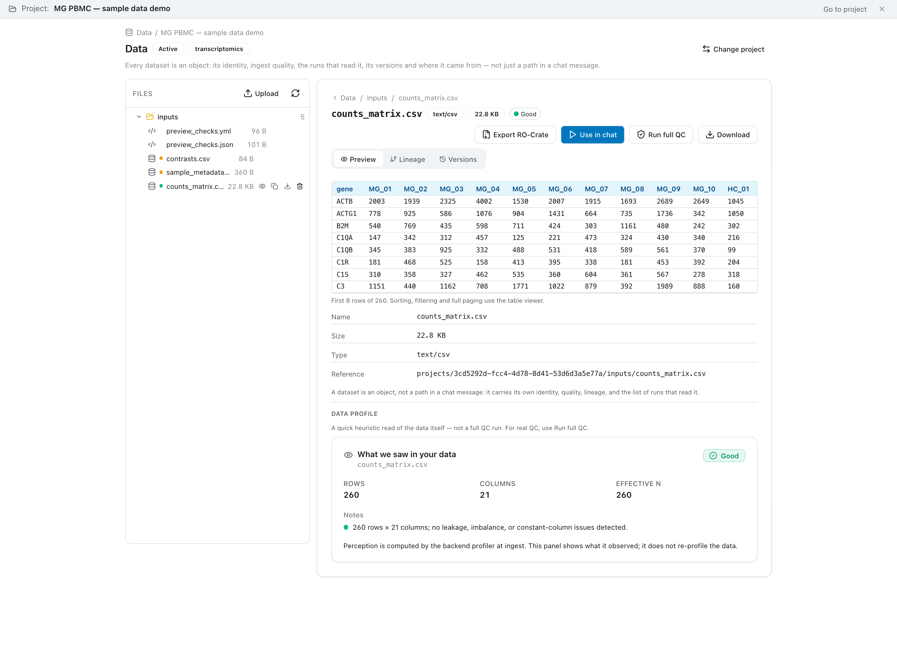
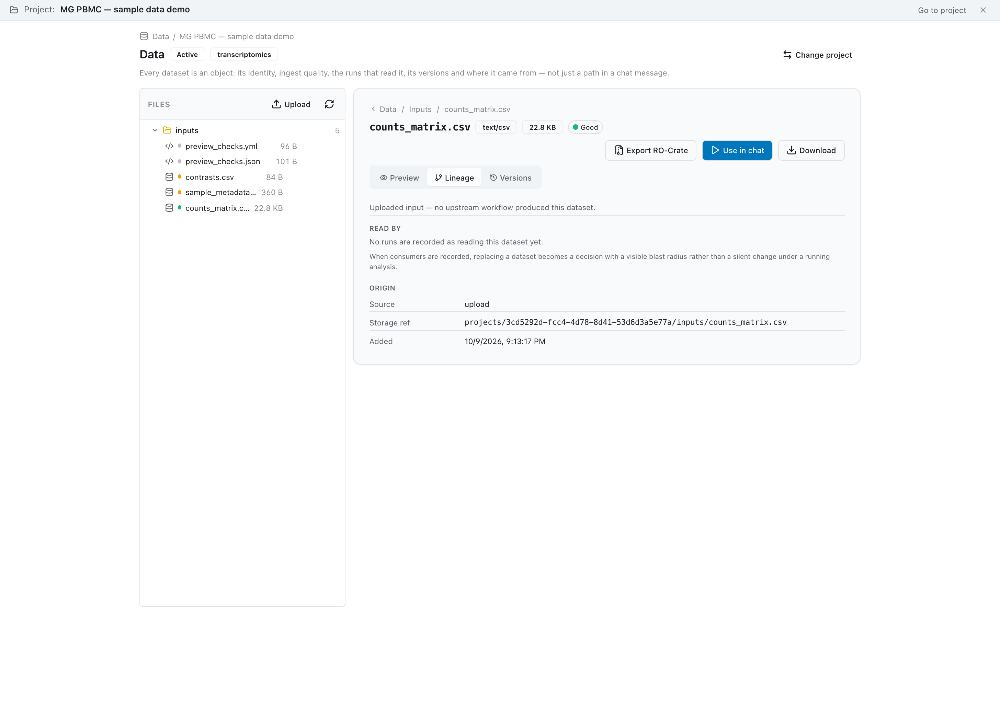
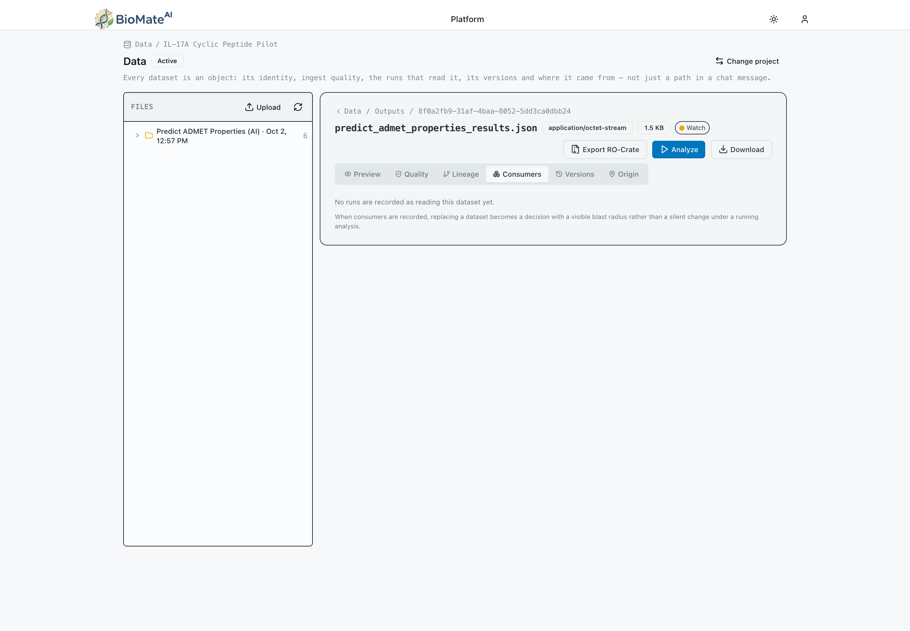
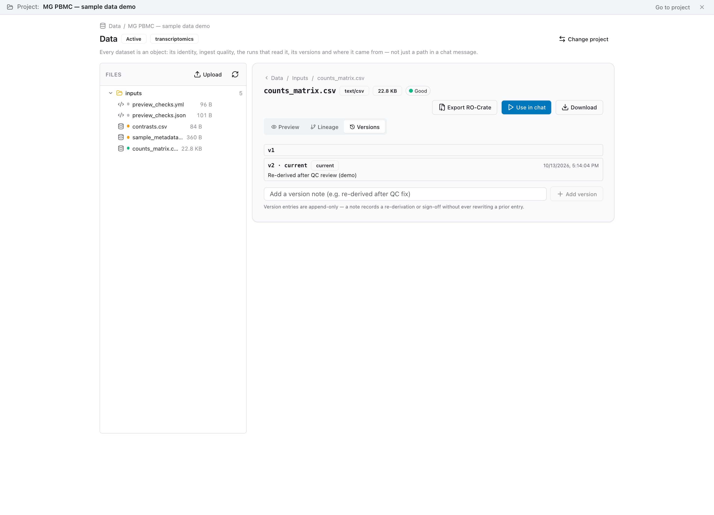

# Tutorial 10 — Exploring your datasets: metadata, preview, lineage & versions

> **Who this is for:** anyone who has data in BioMate — a file they uploaded, or a result a run produced —
> and wants to open it and understand it: what it *is*, what it *contains*, *where it came from*, *what has
> used it*, and *how it has changed*. No coding needed. By the end you'll know how to open any file as a
> **dataset object** and read every part of its detail view, and exactly which of those parts work today
> versus which are still being built.
> **Time:** ~9 minutes to read.
> **Where it fits:** Tutorial 4 taught you how to *bring data in* and check its ingest quality. Tutorial 5
> taught you how to *view a run's results*. This tutorial is about the **dataset object itself** — the single
> detail view that ties a file's identity, contents, and history together. It does not repeat how to upload
> (T4) or how to read a finished run's Outputs (T5); it stays on the object you click.

---

## 1. The problem this solves

Once you have run a few analyses, a project fills up with files: the data you brought in, and the results each
run wrote. A plain file list can tell you a name and a size, but it cannot answer the questions a scientist
actually asks about a file:

- *Is this the exact file the figure came from?*
- *Where did this result come from — which run, which workflow?*
- *If I change or replace this file, what analyses depend on it?*
- *Has anyone touched this since I last looked?*

Answered by hand, these questions mean reading filenames, digging through chat history, and asking colleagues —
and every one of those is a place a mistake can hide.

BioMate answers them by opening every file as a **dataset object**: one detail view that carries the file's
**metadata** (its plain facts), a **preview** of the real contents, its **lineage** (the run that produced it
and the runs that have read it), its **version log**, and its **origin**. You click a file once; everything
BioMate knows about it is in that one place.

> **In one sentence:** a dataset object turns a file from an inert name-and-size into something you can
> interrogate — its contents, where it came from, what used it, and how it has changed — without leaving the
> page.

---

## 2. The ideas you need first (plain-language background)

**The Data hub (`/files`).** The place your data lives is the **Data hub** (sidebar → **Data**). It has two
panes: a **file tree** on the left (your files, grouped under `inputs/` and per-run output folders), and a
**detail pane** on the right that shows the one file you clicked, opened as a dataset object. Data is
**project-scoped** — you pick a project first, then browse its data. *(Why it matters: a file in one project is
not visible in another; if you can't find a file, check you're in the right project.)* Tutorial 4 covers this
layout; here we focus on the right-hand detail pane.

**The dataset object.** When you click a file name, the right pane opens it as an object with a **header**
(identity) and six **tabs**: **Preview**, **Quality**, **Lineage**, **Consumers**, **Versions**, and **Origin**.
*(Why it matters: these tabs are the whole subject of this tutorial — each answers one of the questions in §1.)*

**Metadata.** The plain, factual description of a file — its name, its content type, its size, where it is
stored, and when it was added. *(Why it matters: metadata is how you confirm you are looking at the file you
think you are, before you trust anything else about it.)*

**Lineage and consumers (provenance).** **Lineage** is the record of *what produced* a dataset (the run,
workflow, and step). **Consumers** are the runs that have *read* it as an input. Together they are its
**provenance** — the chain that lets you say how a number was produced and what would be affected if the file
changed. *(Why it matters: in science you must be able to defend where a result came from; BioMate keeps that
chain for you.)*

**Version log.** An **append-only** list of notes about a dataset. "Append-only" means each entry is added on
top and a previous entry is never rewritten. *(Why it matters: it records *that* a dataset changed and why,
as a permanent note — see §4.4 for exactly what it does and does not do.)*

**Honest empty states.** Where BioMate has no record for a tab, it says so plainly ("no runs are recorded as
reading this dataset yet") rather than inventing one. *(Why it matters: an empty state you can trust is more
useful than a fabricated guess.)*

---

## 3. When you'd use this

- You want to confirm a result came from the run you think it did — before you put it in a paper or a report.
- You are about to replace or re-derive a file and want to know which analyses read it first.
- You opened an old result and want to see its contents and its origin without re-running anything.
- You need a portable provenance record of a dataset to hand to a collaborator or a reviewer.

A running example for this tutorial: a **differential-expression results table** (`de_results.csv`) produced
by an RNA-seq run on a rheumatoid-arthritis cohort (continuing the JAK1/RA thread from earlier tutorials). The
steps are the same for any file — an uploaded CSV of assay readings, a FASTQ, a called-variant VCF.

---

## 4. Step by step — reading a dataset object

Open the Data hub (sidebar → **Data**), pick your project, and click a file name in the tree. It opens in the
right pane. The **header** at the top shows the file's identity at a glance; below it are the six tabs. We'll
take them in the order the questions in §1 arise.

<!-- CAPTURE route=/files ; state=a project selected, a result CSV (e.g. de_results.csv) clicked open in the right pane ; focus=the whole two-pane Data hub with the dataset object open ; note=show the file tree on the left and the dataset object (header + tabs) on the right -->

*The Data hub: click any file in the tree and it opens on the right as a dataset object with its header and tabs.*

### 4.1 Metadata — the plain facts (works today)

The header shows the file's identity without you opening any tab:

- the **name** (shown in a monospace font so every character is unambiguous);
- the **content type** (e.g. `text/csv`) and the **size** (e.g. `2.3 MB`);
- a **quality pill** — Good / Watch / Blocked — once the ingest profiler has read the file (this is the same
  ingest check as Tutorial 4; it is not repeated in depth here);
- a **version count chip** (e.g. "2 vers") when the dataset has more than one version-log entry.

The **Preview** tab repeats the core facts as labelled rows — **Name**, **Size**, **Type**, and **Reference**
(the storage key or path BioMate resolves the file by). The **Origin** tab adds the rest: the **Source**
(`upload` or `run_output`), the **Storage ref**, and the date it was **Added**. Everything here is a real field
read from the file record — nothing is computed or guessed.

<!-- CAPTURE route=/files ; state=dataset object open, header visible ; focus=the dataset object header (name, content-type badge, size badge, quality pill, version chip, action buttons) ; note=show a file with a green quality pill and at least one version so the version chip appears -->

*The header carries the file's identity: name, content type, size, the ingest-quality pill, and (when present) a version count — so you read its status before opening a tab.*

> **How to read it:** the header answers "am I looking at the right file, and is it readable?" in one glance.
> If the name, type, and size match what you expect and the pill is green, the identity checks out. A **grey**
> or missing pill means the profiler does not read this file *type* — it is not a claim that the file is bad
> (see Tutorial 4 for the full quality story).

### 4.2 Preview / visualization — see the real contents (partial today)

The **Preview** tab shows the actual data, not just the facts about it. For a **table-like file** (CSV, TSV,
and similar delimited files the profiler can read), it renders the **columns and the first rows** as a real
table, with a note such as *"First 20 rows of 38,214"* so you know it is a window onto the file, not the whole
thing. This is the fastest way to catch a wrong file, a wrong column separator, or a header row that was read
as data — before you rely on the result.

<!-- CAPTURE route=/files ; state=dataset object open on a CSV, Preview tab active ; focus=the Preview-tab sample table (column headers + first rows) and the "First N rows of M" note ; note=use a real results CSV so the columns are meaningful (e.g. gene_id, log2FoldChange, padj) -->

**Be clear about the scope of the preview here**, because it is easy to expect more than this tab gives:

- The dataset object's **Preview tab renders a tabular sample** (columns + first rows) for files the profiler
  can parse, plus the identity rows from §4.1. That is what the object itself draws.
- For a quick look at an **image, a CSV, or a text file** without opening the object, the **file tree row** has
  an **eye icon**: it previews an image inline as a picture, a CSV/TSV as a small table, and text as readable
  lines.
- The **rich, type-aware viewers** — FASTA and VCF readers, rotatable 3-D protein structures, cryo-EM slice
  viewers, rendered HTML reports — are the **run Outputs surface covered in Tutorial 5**, not this object's
  Preview tab. If you want to open a structure or a variant file in its full viewer, go through the run's
  Outputs (T5).

> **How to read it:** use the Preview tab to confirm a table's shape and columns at a glance. If you need the
> full typed viewer for a non-table result (a structure, a VCF, a figure), that lives in the run's Outputs —
> this tab is the quick tabular check on the object itself.

### 4.3 Lineage & consumers — where it came from and what used it (works today)

This is the heart of the data-centric experience, and it is clickable.

**Lineage tab — what produced this file.** For a result file, BioMate derives the producing run from the
provenance it already tracks and shows:

- **Produced by run** — the run's id, as a **clickable link**. Clicking it opens that run in the workspace, so
  you can go straight from a result back to the run that made it.
- **Workflow** — the workflow that ran (e.g. the RNA-seq pipeline).
- **Status** and **Step** — the run's state and the step that wrote the file.

For an **uploaded** file, the tab says honestly: *"Uploaded input — no upstream workflow produced this
dataset."* You made it, so there is no producing run to show. If a file was produced by a run but BioMate no
longer holds that run's live record, it shows what it still knows and says *"live provenance is no longer
retained for this run"* rather than hiding the gap.

<!-- CAPTURE route=/files ; state=dataset object open on a run-output file, Lineage tab active ; focus=the Lineage tab showing "Produced by run" as an underlined clickable link, plus Workflow / Status / Step rows ; note=capture a result file so lineage is populated (not an uploaded input) -->

**Consumers tab — what has read this file.** This lists every run recorded as reading the dataset as an input.
Each row is clickable too, opening that consuming run. When nothing has read it yet, the tab says *"No runs are
recorded as reading this dataset yet"* — an honest empty state, not a blank. The tab also explains *why* this
matters: when consumers are recorded, replacing a dataset becomes a visible decision (you can see what depends
on it) rather than a silent change under a running analysis.

<!-- CAPTURE route=/files ; state=dataset object open on a file that has been used as an input, Consumers tab active ; focus=the Consumers tab listing one or more "reads" rows (each a clickable run) ; note=if no consumers exist on the captured file, show the honest empty state instead and note it in the caption -->

**Export RO-Crate.** The header also has an **Export RO-Crate** button. RO-Crate is a standard, portable
provenance manifest (a JSON file) that packages the dataset together with its lineage, its consumers, the
workflow parameters recorded on the producing run, and any version notes. It is assembled entirely from the
real records above — where a field is unknown it is left out, never invented. Use it to hand a defensible
provenance record to a collaborator or a reviewer.

> **How to read it:** Lineage answers "where did this come from?" and Consumers answers "what depends on it?"
> Because both are clickable, a result is never a dead end — you can always walk back to the run that made it,
> or forward to the runs that used it. That round-trip is what makes a result traceable.

### 4.4 Versioning — the append-only log (partial today)

The **Versions** tab lists the dataset's versions. Every dataset always has **v1 · current**, built from the
real file metadata. On top of that, you can **add a version note**: type a short note (for example, "re-derived
after fixing the sample-sheet header") and click **Add version**. Each note becomes the next entry (v2, v3, …),
with its text, a timestamp, and — when known — who added it. The newest entry is marked **current**.

The log is strictly **append-only**: adding a note never rewrites or deletes a previous entry. It is a
permanent record of *that* a dataset changed and why.

<!-- CAPTURE route=/files ; state=dataset object open, Versions tab active, with at least one added note so v1 + v2 both show ; focus=the version list (v1 · current / earlier entries with note, author, timestamp) and the "Add a version note" input with its Add version button ; note=show the append-only helper text under the input -->

**Be honest about what this is and is not** (this is the part most likely to be misread):

- A "version" here is an **annotation**, not a separate saved copy of the file's bytes. BioMate does **not**
  copy-on-write the file when you add a note. The bytes behind **v1** are the current file.
- There is therefore **no compare** (no side-by-side diff between versions) and **no restore/rollback** to an
  earlier copy, because there is no earlier copy stored to compare against or restore. Those are designed but
  not yet built — see Honest limits.

> **How to read it:** use the version log to leave a durable, dated note whenever you re-derive or sign off on
> a dataset, so the history is explained for whoever reads it next. Do **not** rely on it to roll a file back —
> it records history, it does not restore it.

### 4.5 Access scope — who can reach it (partial today)

Data in BioMate is **project-scoped**: a dataset belongs to a project, and reaching it requires being that
project's owner or a member. This is **enforced** on the server — a request for a project's files is checked
against project ownership and membership, so you cannot read another project's data by guessing a reference.
For read-only members, the editing controls (upload, delete) are hidden; you can browse and open datasets but
not change them.

What you will **not** see today is an explicit **scope badge** on the dataset object (project / shared /
account), nor a control to **promote** a file to a shared or account-wide scope. The object does not currently
display or let you change its scope; access is governed by which project the file lives in and your role there.

> **How to read it:** think of access as "which project is this in, and am I an owner or a member?" — that is
> what determines whether you can open and whether you can edit. There is no per-dataset sharing switch on the
> object yet.

---

## 5. Honest limits — what is not yet built

This is the data-centric headline feature, so it is worth being precise about the gap between what the object
does today and the fuller design it is heading toward:

- **Versions are notes, not copies.** The version log is append-only annotations. BioMate does not store
  earlier *bytes* of a file, so **version compare (a cell- or column-level diff) and version restore/rollback
  are not available**. The design calls for them; the current build ships the log only. (v1 is always the
  current file.)
- **No edit-in-place.** You cannot edit a dataset's contents inside the object and have the edit saved as a new
  version. Editing happens by producing a new file through a run or a new upload.
- **No scope badge or promote-to-shared control.** Access is enforced by project scope and your role, but the
  object does not *display* a project/shared/account scope, and there is no button to share one dataset beyond
  its project or promote it account-wide.
- **Preview in the object is tabular.** The Preview tab renders a column-and-rows sample for parseable tables
  (plus the file-tree row's quick image/CSV/text preview). The full type-aware viewers — FASTA, VCF, 3-D
  structures, cryo-EM maps, rendered reports — are the run **Outputs** surface (Tutorial 5), not this tab.
- **Lineage depends on a surviving run record.** When BioMate still holds (or can reconstruct from the storage
  key) the producing run, lineage is complete and clickable. When a very old run's live record is gone, the
  tab shows what it can and says so honestly rather than fabricating a run.
- **No single "all my data" view.** Data is per-project; there is no cross-project catalogue of every dataset
  you own.

None of these are bugs to work around — they are the honest current scope. Where a capability is not there, the
object says so plainly rather than faking it.

---

## 6. Where to go next

| You want to… | Where |
|---|---|
| Bring a new file in and check its ingest quality | **Tutorial 4 — Bringing your own data** |
| Open a run's results in their full type-aware viewers | **Tutorial 5 — Viewing your results** |
| Run an analysis on a dataset (the **Analyze** button primes this) | **Tutorial 3 — Running a workflow** |
| Understand how results feed the next round | **Tutorial 2 — Models & the closed loop** |

The habit: **open the file as an object → check its metadata and preview → trace its lineage and consumers →
leave a version note when you re-derive it → and know that access follows its project.**

---

## 7. Key terms

| Term | What it means — and why you care |
|---|---|
| **Dataset object** | A file opened as a first-class thing with a header and six tabs (Preview, Quality, Lineage, Consumers, Versions, Origin) — not just a name in a list. It is what lets you interrogate a file. |
| **Metadata** | A file's plain facts: name, content type, size, storage reference, source, and date added. How you confirm you have the right file. |
| **Preview (object)** | A tabular sample (columns + first rows) of a parseable file, shown in the object. Full typed viewers for structures/VCF/etc. live in the run Outputs (T5). |
| **Lineage** | The run, workflow, and step that **produced** a dataset — shown as a clickable link back to that run. An uploaded file honestly has none. |
| **Consumers** | The runs that have **read** a dataset as input — each clickable. Tells you what depends on the file before you change it. |
| **Provenance** | Lineage + consumers together: the chain that lets you defend where a result came from and what it affected. |
| **RO-Crate** | A portable, standard provenance manifest (a JSON file) you can export for a dataset, assembled from its real lineage, consumers, parameters, and version notes. |
| **Version log (append-only)** | A permanent, dated list of notes about a dataset. Records *that* it changed and why. Not a stored copy — so no diff and no rollback today. |
| **Access scope** | Reaching a dataset requires being its project's owner or member (enforced on the server). Read-only members can browse but not edit. No per-dataset sharing switch yet. |
| **Honest empty state** | When BioMate has no record for a tab, it says so plainly instead of inventing one — an empty you can trust. |

---

_Companion technical references (for power users / developers):
`docs/user-manual/modules/I05-files-and-dataset-object.md`, `I07-full-step-view-provenance.md`,
`I08-outputs-viewers-interactive.md`. Design reference:
`reference/claude_design/data_centroid_design_v2/spec/04 Files and the dataset object.html` (note: the spec
describes scope promotion and version compare/restore as the target design; this tutorial documents only what
the current build ships)._
