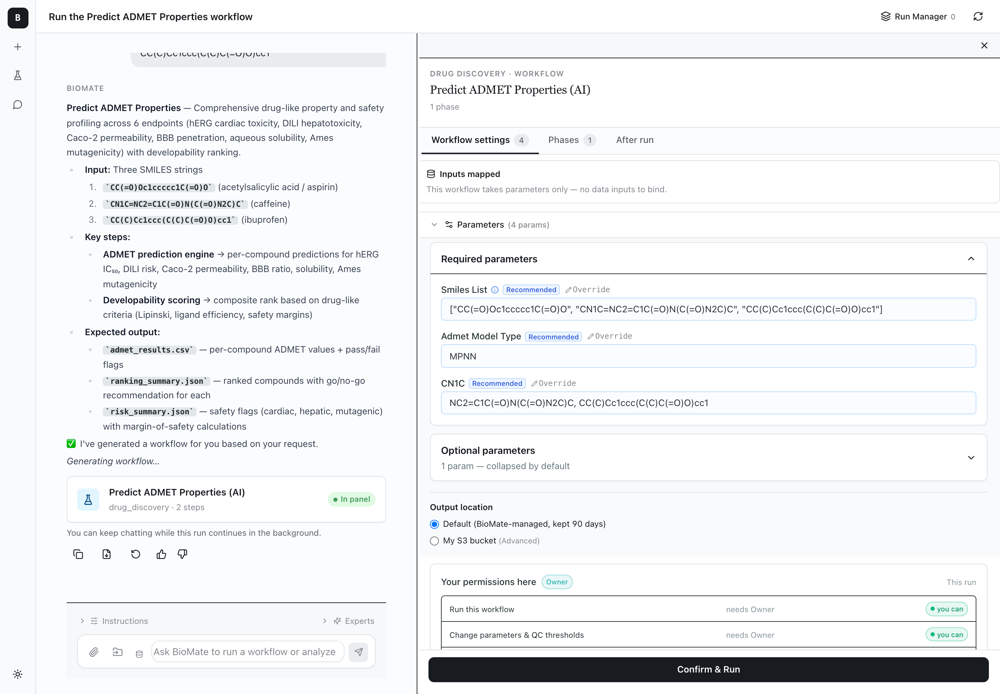
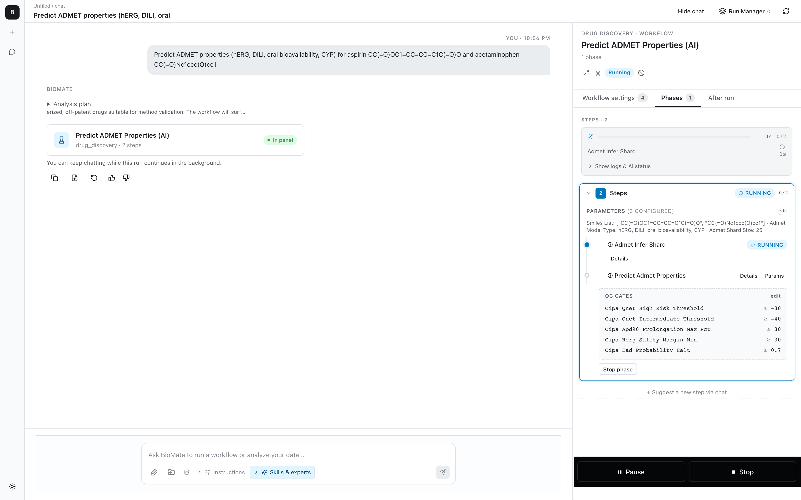
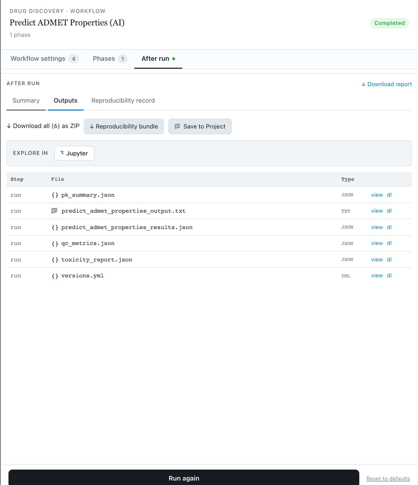
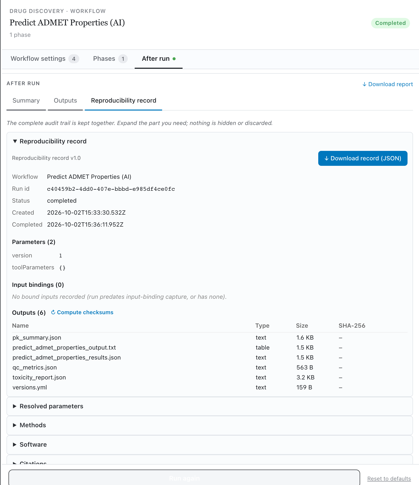

# Tutorial 11 — The whole drug-development pipeline, end to end

> **Who this is for:** anyone — a bench chemist, a biologist, a program lead — with no coding needed. Most
> other tutorials show one tool; this one shows the **whole journey**: from naming a goal, to designing
> candidate molecules, predicting their properties, testing them against the target's 3-D structure, ranking
> the survivors, closing the design–test loop, predicting the dose, and reading the final report. By the end
> you'll know *which real BioMate workflow does each stage*, *what order they go in*, and — just as
> importantly — *what is proven, what is available but unproven, and what is still a known gap.*
> **Time:** ~20 minutes to read.
> **Where it fits:** this is the map that ties the drug-discovery tutorials together. Tutorial 1 (Design &
> Generate) is stage 2 of this map; Tutorial 2 (Models & the closed loop) is stage 6; Tutorial 3 (and the
> W-series on the workflow panel) is how you run any single stage and read its report. Read those for the
> mechanics; read this for the **cohesive end-to-end story**.

---

## 1. The problem this solves (why one tool is never the whole story)

If you have only ever seen BioMate predict **ADMET** properties (whether a molecule is likely safe and
drug-like), it is fair to ask: *where is everything else?* Predicting safety on molecules someone else gave
you is one slice of drug development. A real program is a **pipeline** — a long chain of stages, each
answering a different question, each feeding the next:

- *What exactly am I trying to make, and what must it satisfy?* (framing)
- *What molecules should I even consider?* (design / generation)
- *Are they drug-like and safe?* (property prediction — ADMET and more)
- *Do they actually fit the target?* (structure-based evaluation)
- *Which handful is the best all-round compromise?* (multi-objective ranking)
- *How do I improve the losers and try again?* (the closed loop)
- *What dose would a human need?* (PK / PBPK)
- *What did I find, and can I prove it?* (report & reproducibility)

A single medicine takes a human team **10–15 years and well over a billion dollars** to develop, and most of
that money is spent on candidates that fail late. The purpose of running these stages computationally, in
order, is to **fail the bad candidates early and cheaply** — on a cloud computer in hours — so that the few
you actually make in a lab are the ones most likely to work. This tutorial is the single place that shows all
of these stages as one connected flow, grounds each one in the real BioMate workflow that performs it, and
is honest about how far each stage can be trusted today.

> **A disease to anchor the journey.** Throughout, we'll use a running example from autoimmune disease: we
> want an **oral small molecule that blocks JAK1** (an inflammation-signalling protein) for rheumatoid
> arthritis — but, unlike existing JAK drugs, one that **avoids the heart-rhythm risk** (the hERG/QT effect).
> This is illustrative, to make each stage concrete; it is not a reported BioMate result.

> **In one sentence:** drug development is a pipeline of many stages, not one prediction — and this tutorial
> maps every important stage to the real BioMate workflow that runs it, honestly labelled by how proven it is.

---

## 2. The ideas you need first (plain-language background)

A few concepts recur at every stage. Define them once here and the rest reads easily.

**Target vs. molecule.** The **target** is the thing in the body you want to act on — almost always a
*protein* (here, JAK1). A **candidate** (or ligand) is a *small molecule* you hope will stick to that target
and change what it does. Keeping these straight matters: some stages take a protein, others take a molecule,
and a few take both.

**SMILES.** A short text code for a molecule's structure — the standard way you type or paste a molecule
into BioMate (aspirin is `CC(=O)Oc1ccccc1C(=O)O`). You don't write these by hand; you look a known molecule
up on a free database such as **PubChem** or **ChEMBL** and copy its "Canonical SMILES". (Covered in depth in
Tutorial 1.)

**Prediction vs. measurement.** Every computational stage produces a **prediction** — an informed estimate,
not a lab measurement. A good prediction tells you where to spend your limited lab budget; it does not replace
the lab. BioMate's design rule is that when it does **not** have a trustworthy model for something, it says
*"not available"* rather than inventing a number. That honesty is the point, not a limitation.

**Several goals at once (multi-objective).** A useful drug must be potent **and** safe **and** makeable
**and** behave well in the body — goals that pull against each other (making a molecule bind harder can make
it less soluble, and so on). BioMate keeps each goal in **its own column and units** and never blends them
into one magic "overall score", because a blend can let an unsafe molecule hide behind a good average. *You*
decide the trade-off.

**The closed loop (Design–Build–Test–Learn, or DBTL).** You never get the perfect molecule on the first try.
The reliable method is a cycle: **design** candidates → **build** (make) the best few → **test** them at the
bench → **learn** from the real results → design a better batch. Each turn is a **round**, and the system
improves every round. (This is the whole subject of Tutorial 2.)

**QC gate / auto-loop.** Some workflows run an automatic **quality check** mid-run. If a result fails a
threshold (say, predicted heart-safety is worse than your limit), the run does **not** silently continue —
it flags the failure, shows you the measured value versus the required one, and for some workflows adjusts a
setting and re-runs automatically. (See Tutorial 3 and stage 6 below.)

**Honesty labels used in this tutorial.** Because this is a map of real capabilities, each stage carries a
plain verdict:
- **Validated** — BioMate runs this on real cloud compute and it has been checked against a benchmark or a
  known answer.
- **Available (unproven live)** — the workflow exists and runs, but a specific behaviour hasn't been
  confirmed on the live development site, or it needs your own data to be meaningful.
- **Partial / gap** — part of this stage is real and part is not yet built or not yet connected to the
  product. Stated plainly so you don't over-rely on it.

---

## 3. When you'd use this

- You are **new to BioMate's drug-discovery side** and want the big picture before diving into any single
  tool.
- You are **planning a program** and need to know which stages BioMate can genuinely do for you today, and
  which still need a lab, a data upload, or a human expert.
- You ran one stage (e.g. ADMET) and asked *"where is the rest?"* — this is the rest.
- You need to **explain the pipeline** to a colleague, a collaborator, or a reviewer, with honest boundaries.

You do **not** need to run all eight stages every time. Many real projects use just a few (e.g. design →
ADMET → docking → rank). The map simply shows how they connect when you do need the full chain.

---

## 4. Step by step — the eight stages

Each stage below gives you: *what it answers*, *the real BioMate workflow that performs it* (by name and
path), *how you'd run it*, *how to read the result*, and an honest **verdict**.

> **How you run any single stage.** In every case the mechanics are the same and are covered in Tutorial 3:
> describe the goal in plain English in the chat (or pick the workflow by name), check the parameters BioMate
> pre-fills, click **Confirm & run**, watch the phases progress, and read the after-run report. This tutorial
> focuses on *what each stage is for and how the stages connect*, not on repeating those run mechanics.

---

### Stage 1 — Framing the goal

**What it answers:** *What am I actually optimising for?* Before any molecule exists, you write down the
**target** (JAK1), the **objectives** (bind JAK1 strongly; be orally absorbed; be safe on the heart), and the
**constraints** (avoid a competitor's chemical scaffold; keep it synthesizable). This is a thinking step, not
a workflow — but it is the most important one, because every later stage inherits these choices. A vague goal
produces a vague shortlist.

In practice you capture the goal simply by **describing it in plain English** to BioMate ("design an oral
JAK1 inhibitor for rheumatoid arthritis that avoids hERG cardiac risk"), and by setting the **property window**
and **safety preferences** in the Design & Generate form (stage 2). The objectives you name here become the
columns you'll compare candidates on in stage 5, and the safety limit you care about (hERG) becomes the QC
gate in stage 6.

<!-- CAPTURE route=/ ; state=chat composer with a plain-English drug-design goal typed, before sending ; focus=composer ; note=show the composer with a framed goal like "design an oral JAK1 inhibitor that avoids hERG cardiac risk" to illustrate stage 1 framing -->
*(Figure to add: the chat composer with a framed, plain-English drug-design goal typed in, before sending — illustrating how the goal is captured.)*

> **Verdict — framing: not a workflow (always available).** This is a planning step you do with a human and
> the chat. There is nothing to validate; it simply sets up everything below.

---

### Stage 2 — Generating / designing candidates

**What it answers:** *Which molecules should I even consider?* Instead of you drawing molecules by hand (out
of ~10⁶⁰ possible drug-like molecules — more than the stars in the observable universe), BioMate **proposes**
candidates around a seed molecule and returns a ranked shortlist. This is the subject of **Tutorial 1 (Design
& Generate)** — read it for the full walk-through; here is where it sits in the pipeline and what really
backs it.

**The real workflow.** BioMate's catalog contains **REINVENT4 Generative Lead Design**
(`nextflow_nfcore/subworkflows/drug_discovery/reinvent4_lead_design/main.nf`) — a five-step pipeline
(validate inputs → generate molecules → enumerate a baseline → filter & rank on PAINS/Lipinski/novelty →
report). It supports four design modes you choose from in plain language:
- **de novo** — build new molecules from scratch,
- **scaffold decoration** — keep a core, vary the decorations,
- **linker design** — join two fragments,
- **scaffold hopping** — move to a *different* core that should still fit the target (e.g. to escape a patent
  or a toxic core).

A second real workflow, **Scaffold Hopping**
(`nextflow_nfcore/subworkflows/drug_discovery/scaffold_hopping/main.nf`), does focused core-swapping using
RECAP fragmentation + matched-molecular-pair analysis, and ranks novel scaffolds by drug-likeness and
synthetic accessibility.

**How you'd run it.** Give a **seed** molecule as SMILES (a known JAK1 binder from ChEMBL), pick a mode, set
the property window (size/oiliness/polarity) and any chemical groups to ban, and click generate. You get a
ranked list of proposed molecules, each with a "why?" explanation and the nearest known molecule it resembles.
It finishes in under a minute. (Full details: Tutorial 1 §4–5.)

<!-- CAPTURE route=/design ; state=Design & Generate results showing ranked generated candidates with per-objective columns ; focus=design-results ; note=reuse or re-capture the T1 multi-objective results view (i11-3) showing generated candidates ranked per objective -->
*(Figure to add: the Design & Generate results — a ranked list of generated candidate molecules, each goal in its own column. See Tutorial 1's multi-objective view for the reference layout.)*

> **Verdict — design: available end-to-end, but the trained generative core is a known GAP.** The Design &
> Generate workflow **runs end-to-end today** for small molecules and returns a ranked, safety-filtered
> shortlist — that part is real and useful as a *starting point*. **However, be honest about what is doing the
> generating:** a fully **trained, target-conditioned de-novo generator** (a model that has learned to invent
> molecules specifically likely to bind *your* target) is **not yet built** — today the engine leans on
> rule-based enumeration and reinforcement-learning scaffolding, and the "learned generator" label overstates
> the trained component. Treat stage 2's output as *ideas to filter and improve in the later stages*, not as
> finished, target-optimised designs. The peptide and protein modalities record your settings but do **not**
> yet produce candidates (the screen says so).

---

### Stage 3 — Property prediction: identifying developability questions

**What it answers:** *Of the molecules I now have, which are likely absorbed, safe, and worth the bother?*
This is the stage you may already know — but it has three distinct parts.

#### 3a. ADMET — absorption, distribution, metabolism, excretion, toxicity

**What it answers:** the core safety-and-behaviour questions — will it get absorbed, will it harm the heart
or liver, will the body clear it too fast? ADMET stands for **A**bsorption, **D**istribution, **M**etabolism,
**E**xcretion, **T**oxicity.

**The real workflow (BioMate's flagship, worked example).** **Predict ADMET Properties (AI)**
(`nextflow_nfcore/subworkflows/pharmacology/predict_admet_properties/main.nf`). It uses **ADMET-AI** (Chemprop
graph neural networks, Swanson et al. 2023) trained on 2M+ experimental measurements from ChEMBL and TDC, and
predicts **15 endpoints** from a SMILES list, including:
- **hERG** (cardiac / heart-rhythm risk — the one our JAK1 example cares about most),
- **CYP1A2/2C9/2C19/2D6/3A4** inhibition (drug–drug-interaction risk),
- **Caco-2** permeability and **BBB** penetration (gut absorption, brain access),
- **aqueous solubility** and **lipophilicity**,
- **plasma protein binding**, **volume of distribution**, **half-life**, **LD50** (acute toxicity),
- and, via companion workflows, **DILI** (liver injury) and **AMES** (mutagenicity).

**How you'd run it.** Paste or attach a SMILES list (your stage-2 shortlist), confirm the parameters, and
run. It executes on **AWS Batch** cloud workers and produces `admet`, `qc`, and `toxicity` outputs. The screens
below are from a real ADMET run — the pre-run parameter strip, the running state with QC gates, the outputs,
and the reproducibility record:

*Pre-run: the ADMET workflow's parameters (your SMILES list and model settings) are shown and editable before
any compute is spent — your chance to check everything first.*

*Running: the panel shows live progress and the QC gates that will be checked (e.g. hERG). If a gate fails,
inspect the reported value and threshold. A failed recorded check does not establish that execution halted or reran (see stage 6).*

**How to read the result.** Check each endpoint's definition, unit, comparison direction and source before ranking compounds. An hERG blocker-class score is unitless; an IC50 is a concentration. They are not interchangeable, and neither alone establishes clinical safety. This example contains both raw model scores and heuristic IC50 estimates; interpret them separately.

> **Evidence — execution and file access checked; predictive validity not established by this example.** The completed development run `c40459b2` and all six downloads were checked on 2026-10-03. Its inputs were aspirin, caffeine and ibuprofen, not a JAK1 activity experiment. No blanket accuracy percentage is asserted: a performance claim needs a named dataset, endpoint, metric, split and retrievable evaluation. Predictions require appropriate experimental follow-up.

#### 3b. Physicochemical / drug-likeness

**What it answers:** the simple, fast "sanity" properties — size (**MW**), oiliness (**logP**), surface
polarity (**TPSA**), hydrogen-bond donors/acceptors — and whether the molecule passes **Lipinski's rule of
five** (a classic rule-of-thumb for whether an oral pill is plausible).

**The real workflow.** **Calculate Physicochemical Properties**
(`nextflow_nfcore/subworkflows/pharmacology/calculate_physicochemical_properties/main.nf`), with
**Membrane Permeability Prediction** as a companion (Caco-2 / PAMPA / efflux). These are cheap, fast filters
you often run *before* the heavier stages to drop obviously undruggable molecules.

> **Verdict — physicochemical: available.** Real workflows that compute standard, well-defined descriptors
> (RDKit-based). The arithmetic is exact; the interpretation (e.g. the rule of five) is a guideline, not a
> law, so a promising molecule just outside the window is flagged, not deleted.

#### 3c. QSAR / activity prediction

**What it answers:** *How active is this molecule likely to be against my specific target?* **QSAR**
(Quantitative Structure–Activity Relationship) learns the relationship between molecular structure and a
measured activity (e.g. JAK1 pIC50) from a table of known molecules, then predicts activity for new ones.

**The real workflow.** **QSAR RF Model**
(`nextflow_nfcore/subworkflows/pharmacology/qsar_rf_model/main.nf`) trains a Random Forest with 5-fold
cross-validation on a CSV of `smiles,activity`, and reports an R² and RMSE. It has a built-in **QC gate**: if
cross-validated R² < 0.5 the result is flagged as blocking (a model that can't predict its own held-out data
isn't trustworthy), and fewer than 50 compounds raises an advisory.

**How you'd run it.** You must supply **your own labelled data** — a CSV pairing molecules with their measured
activities (from the literature, ChEMBL, or your own assays). Without labelled data there is nothing to learn
from.

> **Verdict — QSAR: available (needs your data).** The workflow is real and has an honest quality gate, but
> it is only as good as the activity data you give it, and a target-specific potency number is exactly the
> kind of thing BioMate will mark *"not available"* when it has no trustworthy model (see Tutorial 1's honest
> note on potency). Use it when you have a reasonable activity dataset for your target; don't expect a reliable
> potency prediction from structure alone.

---

### Stage 4 — Structure-based evaluation: testing binding hypotheses

**What it answers:** a prepared target structure lets you evaluate possible binding poses and compare hypotheses about affinity. These calculations do not demonstrate that a compound binds JAK1 experimentally. Docking, free-energy calculations and molecular dynamics answer different questions; they are not an automatic ladder of increasing accuracy.

**Molecular docking — pose and score.** AutoDock Vina searches candidate poses and assigns a scoring-function estimate, commonly reported in kcal/mol. A more favorable score within a consistent setup is a prioritization signal, not measured affinity. Check receptor preparation, protonation, binding-site definition and pose plausibility. Re-docking can test pose recovery for a particular reference structure; success on one complex does not validate performance across new compounds. See the [AutoDock Vina documentation](https://autodock-vina.readthedocs.io/en/latest/faq.html).

**Relative binding free energy — comparing transformations.** RBFE estimates a difference in binding free energy between ligands under a defined protocol. Interpret the sign convention, ligand mapping, force field, sampling, convergence and uncertainty. Agreement with experiment must be demonstrated on relevant data. This tutorial does not assert an unspecified benchmark accuracy or guarantee the ordering of a new series. See [Best Practices for Alchemical Free Energy Calculations](https://arxiv.org/abs/2008.03067).

**Molecular dynamics — sampling behavior over time.** MD samples motion under a chosen model and initial conditions. A pose remaining in a pocket during a finite simulation does not establish experimental binding or affinity. MM-GBSA estimates have additional assumptions and should not be presented as measured free energies. Select simulation length, replicas and analyses according to the scientific question.

**BioMate demonstration status.** Repository workflows include Vina docking, OpenFE RBFE and AMBER/GROMACS simulations. Their current end-to-end user journeys must be checked separately before filming. A predicted protein structure also needs suitability checks for the intended binding-site calculation; producing a structure is not itself validation of that site.

---

### Stage 5 — Multi-objective optimization & developability ranking

**What it answers:** after stages 2–4 you have, for each candidate, several numbers that disagree — potent but
insoluble, safe but hard to make. *Which handful is the best all-round compromise?* This stage ranks candidates
across the **competing objectives at once** and surfaces the set where you can't improve one goal without
sacrificing another — the **Pareto front** (the trade-off boundary).

**What's real today.** The visible, working version of this stage is the **multi-objective / Pareto view
inside Design & Generate** (Tutorial 1 §5): every candidate is a row, each goal keeps its own column and units
(never blended), rejected molecules stay visible with their reason, and a trade-off chart shows the front so
you can pick based on what matters most (favour heart-safety over size, say). For **biologics**, a dedicated
**Antibody Developability** workflow
(`nextflow_nfcore/subworkflows/drug_discovery/antibody_developability/main.nf`) scores aggregation, chemical
liabilities, and FcRn binding.

**What's not wired yet (be honest).** A deeper, dedicated **multi-objective optimizer** — a Gaussian-process
surrogate with expected-hypervolume (Pareto) acquisition that would actively *propose the next batch* to best
improve all objectives — **exists in BioMate's code but is not yet connected to the product** (no run button,
API, or panel). BioMate's own capability review calls this "the single biggest latent capability" in
drug development. So today you get an honest *side-by-side ranking you read yourself*; you do **not** yet get
an automated optimizer that picks the next batch for you.

<!-- CAPTURE route=/design ; state=the Pareto / trade-off chart in Design & Generate with the front highlighted ; focus=pareto-chart ; note=show the trade-off (Pareto) chart: dots = candidates, front boundary = best compromises; cross-ref T1 -->
*(Figure to add: the trade-off (Pareto) chart — each dot a candidate, the front boundary the best available compromises. See Tutorial 1 §5 for the reference.)*

> **Verdict — multi-objective ranking: PARTIAL.** The **unblended, read-it-yourself ranking** is real and
> available today (in Design & Generate). The **automated GP/Pareto optimizer that proposes the next batch is
> a known gap** — written but not wired to the product. Don't present BioMate as auto-optimising your library
> yet; it ranks honestly and leaves the batch choice to you (and to the closed loop, next).

---

### Stage 6 — The closed loop (Design–Build–Test–Learn) and the QC gate

**What it answers:** *How do I turn one round of designs into a steadily improving program?* No single pass
gives a finished drug. The reliable method is the **DBTL loop**: design candidates → make the best few → test
them at the bench → learn from the real measurements → design a better batch. This is the whole subject of
**Tutorial 2 (Models & the closed loop)** — read it for the mechanics; here is how it binds the other stages
together, plus the automatic quality gate that enforces it.

**How the loop connects the stages.** Stages 2–5 are one turn of "design". You **export an order sheet** from
the shortlist; chemists (in-house or a contract lab) make the top molecules; the lab measures them; those real
assay values are fed back through a **drug-discovery campaign** and used to **retrain** the scoring model — so
the next round's designs are more accurate. Each turn is a **round**, and the benefit compounds: a team that
runs three or four rounds ends with far better candidates than one that designs once. (Tutorial 2 §6 walks
through exactly this, with the same JAK1/hERG example.)

**The QC gate / ADMET auto-loop.** Inside a single run, BioMate also has an automatic quality gate. For ADMET,
the gate checks **hERG, DILI, AMES, and the rule of five**; if a candidate fails (e.g. predicted hERG risk is
worse than your threshold), the run flags it with the **measured value vs. the required threshold** and, for
some workflows, **adjusts a parameter (e.g. a logP/MW filter) and re-runs automatically**, logging each
remediation as a before→after diff. In BioMate's internal test suite this auto-loop passes **96/96** cases
across ADMET, CYP-DDI, docking, and PK tracks.

<!-- CAPTURE route=/ ; state=workflow panel showing a QC gate blocked (measured value vs threshold) and an auto-loop remediation diff ; focus=qc-gate ; note=show a blocked QC gate with the two-number display (measured vs threshold) and an auto-loop was->now parameter diff -->
*(Figure to add: a blocked QC gate showing the measured value vs. the threshold, and the auto-loop's was→now parameter change — the "never silently pass a failed check" behaviour.)*

> **Verdict — closed loop & QC gate: available in code; the live ADMET hERG gate is UNPROVEN on dev.** The
> DBTL loop and the self-remediating QC gate are real designs with a passing internal test suite, and the
> "never silently continue past a failed check" rule is one of BioMate's core trust features. **But be
> honest:** the **ADMET hERG QC gate has not yet been confirmed to actually fire during a live run on the
> development site** (a known open issue — the gate didn't materialise in-window on a dev E2E run). Treat the
> auto-loop as a validated *design* whose live firing on dev is still being confirmed, not as a guaranteed
> live behaviour today.

---

### Stage 7 — PK / PBPK modeling: exploring exposure

**What it answers:** PK describes drug concentrations over time. PBPK uses physiological compartments and compound-specific parameters to simulate exposure under stated assumptions. A simulation can inform research questions about dose and exposure; it cannot by itself establish a safe first-in-human dose.

**The workflow to verify.** The repository describes a PBPK chain combining allometric scaling, compartmental simulation and a virtual cohort. Its current user-facing execution and outputs still need a dedicated demonstration before this stage can be filmed as working.

**How to read a demonstrated result.** Inspect the dosing route and schedule, concentration and time units, input parameter sources, population assumptions and uncertainty. Cmax is peak concentration; AUC is concentration integrated over a specified time interval. Compare predictions with relevant observed data. Do not label a single unspecified percentage as overall predictive accuracy.

**Evidence boundary.** Neither a report template nor a completed computation establishes regulatory acceptance. FDA considers PBPK results according to their intended use and the quality, relevance and reliability of the analysis. See [FDA PBPK format and content guidance](https://www.fda.gov/regulatory-information/search-fda-guidance-documents/physiologically-based-pharmacokinetic-analyses-format-and-content-guidance-industry). Population PK fitting and non-compartmental analysis require suitable observed concentration–time data; the platform does not create clinical observations.

*Demonstration pending: a verified run with traceable inputs, units, concentration–time curves and a documented comparison with observations. Do not substitute a generated curve or a projected dosing instruction.*

---

### Stage 8 — Reading results and checking provenance

Open the completed run and inspect **Summary**, **Outputs**, and **Reproducibility record**. The first explains the result; the second gives access to its files; the third records available run metadata. Verify that every file and numerical claim belongs to the intended run.

*This example has six downloadable files. All six were retrieved through BioMate during review.*

*Check actual field values. The default record inspected here has empty input bindings and tool parameters, and no populated output checksums.*

**Evidence boundary.** The three tabs and six file downloads were checked for this run. The presence of the record does not establish complete reproducibility. Preserve the submitted inputs separately, verify software and parameter information, and document missing metadata. Record export and on-demand checksum computation require their own checks before being demonstrated as working.

---

## 5. The pipeline at a glance

| # | Stage | What it answers | Real BioMate workflow | Verdict |
|---|---|---|---|---|
| 1 | **Framing** | What am I optimising for? | (planning step + the chat / Design form) | Always available |
| 2 | **Design / generate** | Which molecules to consider? | REINVENT4 Generative Lead Design; Scaffold Hopping | Runs end-to-end; **trained de-novo generator = gap** |
| 3a | **ADMET** | Which ADMET questions need follow-up? | Predict ADMET Properties (AI) | Execution/downloads checked; predictions require validation |
| 3b | **Physicochemical** | Drug-like (Lipinski/logP)? | Calculate Physicochemical Properties | Available |
| 3c | **QSAR** | Active vs. my target? | QSAR RF Model | Available (needs your labelled data) |
| 4 | **Structure-based** | Does it fit the target? | Docking AutoDock Vina; OpenFE RBFE; AMBER/GROMACS MD | Dedicated demonstration pending |
| 5 | **Multi-objective rank** | Best all-round compromise? | Design & Generate Pareto view; Antibody Developability | **Partial** (optimizer not wired) |
| 6 | **Closed loop + QC gate** | Improve and try again? | DBTL campaign; ADMET auto-loop | In code; **live hERG gate unproven on dev** |
| 7 | **PK / PBPK** | How might exposure change? | PBPK Allometric Scaling chain | Dedicated demonstration pending |
| 8 | **Report & record** | What did I find; can I prove it? | After-run report + reproducibility record | Tabs/downloads checked; metadata incomplete |

---

## 6. Honest limits — what to expect

- **This is in-silico triage, not a drug.** Every stage produces *predictions* that narrow the field before
  the lab. Even a shortlist that clears all eight stages is years and many experiments away from a medicine.
  The value is **starting smart and failing cheap**, not skipping the lab.
- **The trained generative core is the real hole.** Stage 2 runs end-to-end and gives you a filtered starting
  shortlist, but a trained, target-conditioned de-novo generator is **not built**. Don't expect novel,
  target-optimised molecules out of the box — expect *ideas to filter and improve downstream*.
- **The automated multi-objective optimizer is written but not wired.** You get honest, unblended ranking you
  read yourself (stage 5); you do **not** yet get an optimizer that proposes the next batch.
- **The ADMET hERG QC gate's live firing is unconfirmed on dev.** The auto-loop is a validated design with a
  passing internal test suite, but its live behaviour on the development site is still being confirmed. Watch
  for the gate actually appearing in the running panel before relying on it mid-run.
- **Some stages need *your* data.** QSAR needs a labelled activity CSV; population PK/NCA needs real in-vivo or
  clinical PK data; the closed loop needs real bench measurements fed back through a campaign. BioMate runs the
  model — it cannot generate the data.
- **Potency is reported honestly or not at all.** Where BioMate lacks a trustworthy target-specific model, it
  marks a binding/potency number *"not available"* rather than inventing one. That is deliberate.
- **Peptides and biologics are thinner.** The small-molecule path is the most complete; peptide/protein design
  records settings but doesn't yet generate candidates, and biologics coverage (bispecifics, developability)
  is partial.

---

## 7. Where to go next

| You want to… | Where |
|---|---|
| Design/generate candidate molecules (stage 2) in depth | **Tutorial 1 — Design & Generate** |
| Understand the closed loop and models (stages 5–6) | **Tutorial 2 — Models and the closed loop** |
| Learn how to run any single workflow and read its report (stages 3–8) | **Tutorial 3 — Running a workflow and reading the report** |
| See the workflow panel's states (pre-run, running, QC gates) | **Tutorial W1 — The workflow panel before and during a run** |
| Read the after-run report in detail (Summary / Outputs / Reproducibility) | **Tutorial W2 — The after-run panel** |
| Bring your own data (SMILES lists, activity CSVs, PK data) | **Tutorial 4 — Bringing your own data** |
| Explore and preview the output datasets each stage produces | **Tutorial 10 — Exploring your datasets** |

The habit: **frame the goal → design → predict properties → test against the structure → rank the survivors
→ close the loop → project the dose → read and keep the record.** Not every project needs all eight — but when
one does, this is how the stages connect, and which of them you can trust today.

---

## 8. Key terms

| Term | What it means — and why you care |
|---|---|
| **Target vs. candidate** | The target is the protein you act on (JAK1); the candidate is the small molecule you hope binds it. Different stages take one, the other, or both. |
| **SMILES** | A short text code for a molecule's structure; look one up on PubChem/ChEMBL and paste it. |
| **ADMET** | Absorption, Distribution, Metabolism, Excretion, Toxicity — the core safety-and-behaviour predictions (hERG, CYP, DILI, Caco-2, BBB, solubility, AMES). |
| **hERG** | A heart ion channel; blocking it risks a dangerous rhythm change (QT prolongation). The safety limit in our running example. |
| **Lipinski / rule of five** | A rule-of-thumb (size, oiliness, H-bonds) for whether an oral pill is plausible — a guideline, not a law. |
| **QSAR** | A model that learns structure→activity from known molecules to predict activity for new ones; only as good as its data. |
| **Docking** | Placing a molecule into the target's pocket to estimate a binding pose and score (kcal/mol). Fast; ranks many. |
| **RBFE / FEP** | Alchemical free-energy perturbation — the precise physics comparison of two similar molecules (ΔΔG ± error). Slow; used late on a few. |
| **Molecular dynamics (MD)** | Simulating the molecule moving in the pocket to check the binding is stable and rescore it. The most expensive step. |
| **Multi-objective / Pareto** | Optimising competing goals at once, shown unblended; the Pareto front is the set of best available compromises. |
| **DBTL / closed loop / round** | Design → Build → Test → Learn → design again; each turn is a round, and the system improves each round. |
| **QC gate / auto-loop** | An automatic mid-run quality check that never silently passes a failure; for some workflows it fixes a setting and re-runs. |
| **PK / PBPK** | What the body does to the drug over time; PBPK is the mechanistic, organ-by-organ model that projects human dose. |
| **Reproducibility record** | The downloadable audit trail — parameters, software, outputs, checksums — that makes a result defensible. |
| **"Not available"** | BioMate's honest label when it lacks a trustworthy model for a number — shown instead of a fabricated value. |

---

_Companion technical references (for power users / developers): the drug-development coverage map lives in
`docs/20260417_DRUG_DEVELOPMENT_COVERAGE_ANALYSIS.md`, and the honest capability assessment in
`docs/20260908_BIOMATE_THREE_PARTS_PHARMA_HOSPITAL_DRUGDEV.md` (Part 3). Per-stage module references:
`docs/user-manual/modules/` and the I11 (Design & Generate) / I10 (Models) companion docs._
