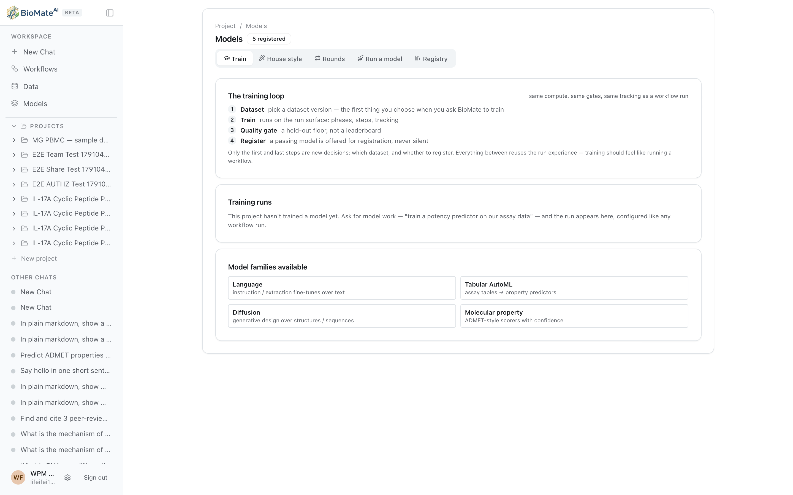
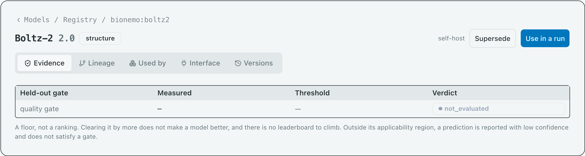

# Tutorial 2 — Models and the closed loop (how BioMate gets smarter)

> **Who this is for:** anyone — no coding or machine-learning background needed. By the end you'll
> understand what a "model" is here, the four things you can do with one, and — most importantly — the
> **closed loop**: how real lab results teach BioMate to design better molecules each round.
> **Time:** ~10 minutes to read.
> **Before this:** Tutorial 1 (Design & Generate) shows where the candidate molecules come from. This
> tutorial shows how BioMate *learns* from what happens to them next.

---

## 1. The problem this solves (why models matter)

In Tutorial 1, BioMate proposed and ranked candidate molecules. But to rank them well, it needs to
*predict* things about each one — for example, "how strongly will this bind our target?", "is this likely
to be toxic?", "how soluble is it?". A **model** is the piece that makes those predictions. Think of it as
reusable, learned expertise: once a model has learned a pattern from data, any project can ask it for a
prediction instead of running a slow, expensive lab experiment every time.

Two problems follow from that:

1. **Trust.** A prediction is only useful if you know *how good* the model is and *where* it can be
   trusted. A model that's never been checked, or is asked about molecules unlike anything it learned
   from, can be confidently wrong.
2. **Staleness.** The real world (your lab results) is the ground truth. A model that never updates with
   your new measurements slowly drifts away from reality.

The **Models** area solves both. It treats every model as an inspectable **object** (you can see who made
it, what evidence backs it, and what it's been used for), and it is where the **closed loop** lives — the
cycle that feeds your real lab results back in so the next round of designs is better. Continuing the
rheumatoid-arthritis example from Tutorial 1: if you test a batch of JAK1 candidates at the bench, those
measurements can teach the model, so its *next* set of proposals is sharper.

> **In one sentence:** Models is where BioMate keeps its reusable predictors and learns from your real
> lab results — so the platform gets more accurate every round instead of staying frozen.

---

## 2. The ideas you need first (plain-language background)

**A model = reusable learned expertise.** It takes an input (a molecule, a protein sequence) and returns
a prediction (a score, a 3-D structure). Some models are **pre-trained** — built by the community on huge
public datasets (for example, AlphaFold2 and Boltz-2 predict a protein's 3-D shape). Others are **custom**
— trained on *your* data to score *your* kind of molecule.

**A model is an object, not a leaderboard.** This is BioMate's guiding idea and it matters for trust.
Instead of ranking models on a scoreboard (which invites gaming), BioMate shows each model like a
documented object with:
- **Evidence** — how well it did on a fair, held-out test, versus a required quality **floor**;
- **Lineage** — what data and which run produced it;
- **Used by** — which analyses rely on it (so you can see the impact of changing it);
- **Versions** — every version, nothing deleted.

**A "floor", not a ranking.** A model must clear a minimum quality bar to be trusted — but clearing it by
more doesn't earn it a higher rank, and there's no leaderboard to climb. If a model hasn't been measured
yet, BioMate says **"not evaluated"** rather than showing a made-up score. ("Not evaluated" is the truth
about what we know, not a hidden number.)

**The four things you do with models.** On the Models screen these are four "tracks":
- **Run a pre-trained model** — use an existing public model to make a prediction now (e.g., predict a
  protein's structure from its sequence). Nothing of yours is trained; this is just inference.
- **Train** — build a new custom model from your data (e.g., a scorer for your target).
- **Adapt ("House style")** — gently tune BioMate's outputs to match how *your* team works, by learning
  from the corrections you make. Nothing is changed silently — each learned rule is shown and can be
  switched off.
- **Optimise ("Rounds")** — the **closed loop**, shown as rounds (see §3).

**The closed loop (the heart of this tutorial).** Drug discovery is not one-shot. The reliable way to
improve is to cycle: **design → make → test → learn → design again.** BioMate proposes molecules (design),
you make and test the best ones at the bench (make + test), the measurements are fed back to update the
model (learn), and the improved model proposes a better next round. Each turn of this cycle is a
**round**. This is what "closed loop" means, and it's why BioMate improves with use instead of staying
fixed.

> **An honest note on what runs today.** Two tracks do live work: **Run a model** (inference) and the
> **Registry** (browse and reuse models). **Train** and **Rounds** are *windows* onto work that runs in a
> larger cloud campaign — they show you what's happening but do not have a "start training" or "launch the
> loop" button on this screen, and they show a clear empty state until a job or loop is running. Also, on
> the development site, predicting a protein structure may return a clearly-labelled **placeholder**
> (marked `stub`) when the heavy structure-prediction service isn't connected — always check that label
> before trusting a predicted structure.

---

## 3. When you'd use this

- You want to **reuse a model** another project (or the community) already built — e.g., predict a
  protein's 3-D structure before designing against it.
- You have **lab results** and want them to improve the next round of designs (the closed loop).
- You want to **check how trustworthy** a prediction is before you rely on it (open the model object and
  read its evidence).
- You want BioMate's reports and suggestions to follow **your team's conventions** (Adapt / House style).

---

## 4. Step by step — browsing and reusing a model

The most useful first thing to do is inspect a model, so you understand what you're trusting.

*The Models screen, with its tracks across the top and the model families it covers.*

1. **Open Models** (from the home screen, or the `/models` page).
2. **Go to the Registry tab.** This lists every model available to your account — community models like
   Boltz-2, AlphaFold2, OpenFold2 (protein structure) and Evo2 (genomics), plus any custom models your
   team has registered.

*Opening a model (here Boltz-2) shows it as an object: Evidence, Lineage, Used by, Interface, Versions.*

3. **Open a model** to see its object view. The **Evidence** tab shows the held-out quality gate — the
   measured score, the required floor, and the verdict. (Here it reads "not evaluated", which honestly
   means this thin layer hasn't measured it — not that a number is hidden.) The note on screen says it
   plainly: *a floor, not a ranking.*
4. **Read the other tabs** — **Lineage** (what produced it), **Used by** (what depends on it), and
   **Versions** (its full history). This is how you decide whether to trust a model before using it.
5. **Reuse it** with **"Use in a run"**, which brings the model into an analysis.

**To make a prediction now (inference):** use the **Run a model** track — pick a domain (Structure,
Genomic, or Chemical), paste an input (for Structure, a protein's one-letter sequence), and run it.
Remember the honesty note: on the development site a structure result may come back as a labelled
placeholder until the heavy prediction service is connected.

---

## 5. How to read the results

- **The evidence gate** (on the model object): a model that *passes* has cleared the quality floor on a
  fair, held-out test. A model marked **"not evaluated"** simply hasn't been measured here — treat its
  predictions with appropriate caution. A high "pass" is not a bragging number; it just means "trustworthy
  enough to use."
- **"Outside its applicability region"** means you asked the model about something unlike what it learned
  from — BioMate lowers its confidence rather than pretending to know. Respect that signal.
- **A placeholder (`stub`) result** is a demonstration of the *shape* of an answer, not a real
  measurement. Check for the label before reading any predicted number.
- **In the closed-loop (Rounds) view**, two honesty rules are built in: a proposal that the safety gate
  rejected **stays visible with its reason** (you can always see what the loop wanted to do and why it was
  stopped), and a censored lab value — e.g., "activity greater than 30" — is kept as "greater than 30",
  never silently turned into the number 30.

---

## 6. The closed loop in practice (tying it together)

Here is the whole cycle, connecting Tutorial 1 and this one:

1. **Design** — Design & Generate (Tutorial 1) proposes and ranks candidate molecules.
2. **Make + test** — you export the shortlist as an order sheet; chemists make the top molecules and the
   lab measures them.
3. **Learn** — the real measurements are fed back. A model is updated (retrained) using them. In BioMate
   this update is itself a tracked job, with the same evidence gate — so you can see that the *new* model
   is genuinely better on a fair test, not just better on the data it just learned from.
4. **Design again** — the improved model scores the next round of candidates more accurately.

Each loop is a **round**, and the Rounds view is your window onto it. The pay-off is compounding: a team
that runs three or four honest rounds ends up with far better candidates than one that designs only once —
and, crucially, BioMate can *show* the improvement, measurement by measurement, instead of asking you to
take it on faith.

> **Who does what:** BioMate proposes and scores; your **lab** makes and measures; a **scientist** decides
> what to make and reads the evidence. BioMate's job in the loop is to learn honestly and show its work.

---

## 7. Key terms

| Term | What it means — and why you care |
|---|---|
| **Model** | Reusable learned expertise that predicts something (a score, a structure) instead of running a lab experiment each time. |
| **Pre-trained model** | A model built by the community on public data (e.g., AlphaFold2, Boltz-2) that you can use right away. |
| **Custom model** | A model trained on *your* data to score *your* kind of molecule. |
| **Inference** | Using a model to make a prediction (as opposed to training one). "Run a model" does inference. |
| **Model object** | A model shown as inspectable facts — evidence, lineage, what uses it, versions — instead of a scoreboard entry. |
| **Held-out gate / floor** | A minimum quality bar, measured on a fair test the model didn't learn from. A pass means "trustworthy enough", not a rank. |
| **"Not evaluated"** | Honest label meaning the quality hasn't been measured here — not a hidden number. |
| **Applicability region** | The kind of inputs a model learned from; outside it, predictions are reported with low confidence. |
| **Closed loop / round** | The design → make → test → learn → design cycle; each turn is a round, and the model improves each time. |
| **Stub / placeholder** | A clearly-labelled demonstration result returned when a heavy model service isn't connected — not a real measurement. |

---

> **Honest summary of what runs today.** *Live:* browsing/reusing models (Registry), inference (Run a
> model — structure/genomic results may be labelled placeholders on dev without the heavy service
> connected; registered chemical scorers return real scores), and learning from your edits (Adapt /
> House style). *Windows onto cloud work (no start button on this screen):* Train and Rounds — they
> display training jobs and the running loop, which are launched through a drug-discovery campaign.
> BioMate never fabricates an evaluation score or a prediction it can't stand behind — it says "not
> evaluated" or labels a placeholder instead.

_Companion technical reference (for power users / developers): `docs/user-manual/modules/I10-models.md`._
