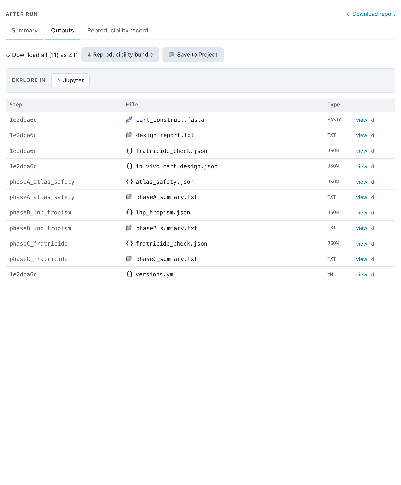
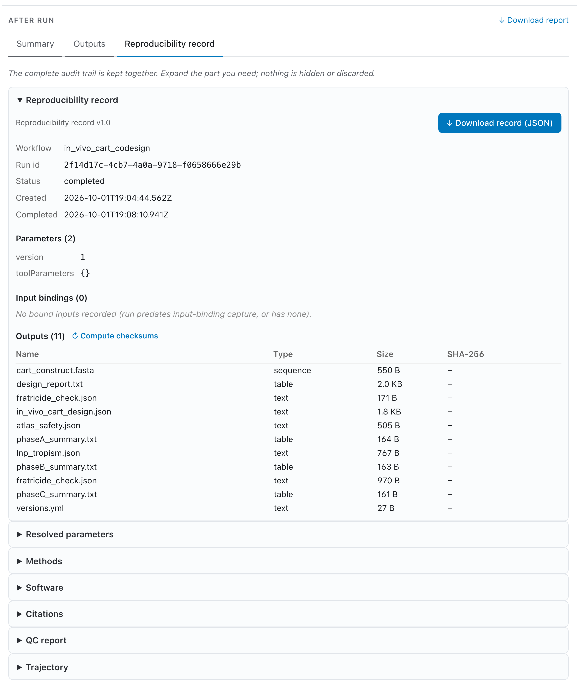

# Tutorial 3 — Running a workflow and reading the report

> **Who this is for:** anyone — no coding needed. By the end you'll know how to run a validated, multi-step
> analysis in BioMate and how to read the report it produces — the outputs, the audit trail, and what each
> step did.
> **Time:** ~10 minutes to read; a run itself takes minutes.
> **Where it fits:** Tutorial 1 designs molecules; Tutorial 2 learns from lab results. This tutorial is the
> everyday middle: running a ready-made analysis pipeline and getting trustworthy results back.

---

## 1. The problem this solves

Most real analysis isn't one button — it's a **pipeline**: a sequence of steps that each take an input,
do something, and hand their output to the next step. For example, designing an in-vivo CAR-T therapy
involves checking the target's safety across tissues, choosing a delivery vehicle, checking for a
self-killing ("fratricide") risk, and finally assembling the construct — several steps that must run in
order. Doing this by hand means stitching tools together, tracking versions and parameters, and hoping you
can reproduce it later.

A **workflow** in BioMate is one of these pipelines, already validated and wired together. You describe
what you want in plain English, BioMate runs the whole pipeline on cloud computers, and returns a single
**report** — the results, every output file, and a complete record of exactly how they were produced.

> **In one sentence:** a workflow runs a whole validated pipeline for you and hands back results plus a
> full, reproducible record — so the output is something you can defend in a paper, to a regulator, or to
> your own team six months later.

---

## 2. The ideas you need first (plain-language background)

**Workflow.** A ready-made, validated pipeline for a specific job (e.g., an in-vivo CAR-T co-design, or an
RNA-seq differential-expression analysis). You don't assemble it; you run it.

**Phases and steps.** A workflow is organised into **phases** (big stages), each made of one or more
**steps** (individual tools). In the CAR-T example the phases are *Atlas safety → LNP tropism → Fratricide
check → CAR construct assembly*. Each phase takes inputs and produces outputs that the next phase uses.

**Parameters (the inputs you set).** Before a run, a workflow has **parameters** — the settings that tell
it what to do (for CAR-T: the target `CD19`, the indication `DLBCL`, the delivery cell `T-cell`, and so
on). BioMate fills in sensible defaults and shows you every value before anything runs, so you can check or
change them.

**QC gate / auto-loop.** Some workflows have automatic **quality checks** mid-run. If a result fails a
threshold, the run can pause and show you the measured value versus the required one, and (for some
workflows) suggest a parameter change and re-run that step — a small "fix-and-retry" loop inside the run.
It never silently proceeds past a failed check.

**The after-run report.** When the run finishes, BioMate opens a report with three tabs:
- **Summary** — a plain-language account of what the run found;
- **Outputs** — every file produced, organised by the step that made it;
- **Reproducibility record** — the complete audit trail (parameters, software, checksums, methods).

**Audit-ready / reproducible.** The report records the exact parameters, tool versions, and a fingerprint
(**checksum**) of every output — so anyone can verify the result resolves to the same methods and the same
files. Nothing is hidden or discarded.

---

## 3. When you'd use this

- You have a standard analysis to run (variant calling, RNA-seq, a drug-discovery design pipeline, etc.)
  and want it done correctly without assembling the tools yourself.
- You need results that are **defensible** — for a manuscript, a regulatory submission, or a review.
- You want a complete, shareable **record** of how a result was produced.

---

## 4. Step by step

1. **Ask in plain English.** In the chat, describe your goal — for example, *"Co-design an in-vivo CD19
   CAR-T for DLBCL with LNP delivery to T cells."* BioMate identifies the right validated workflow and opens
   its panel on the right.
2. **Review the plan and parameters.** The panel shows the workflow, its phases, and the parameters it will
   run with (the inputs). Check them, adjust anything you need. This is your chance to see exactly what will
   happen *before* any compute is spent.
3. **Confirm and run.** Click **Confirm and run**. BioMate runs the pipeline on cloud computers.
4. **Watch it run.** Each phase moves from *pending* → *running* → *completed* in real time. If a quality
   gate fires, the run pauses and shows you what to do.

*A completed run: the header shows the workflow (an in-vivo CAR-T co-design), its 4 phases, and a green
"Completed" badge. The three section tabs — Workflow settings · Phases · After run — let you review the
configuration, the phase-by-phase progress, and the report. "Run again" re-runs it.*

5. **Read the report.** When the run completes, the **After run** section opens (see §5).

---

## 5. How to read the report

The after-run report has three tabs.

**Outputs — every file, organised by step.**

*The Outputs tab lists every file the run produced, grouped by the step that made it — here 11 files across
the four phases (e.g. `atlas_safety.json` from the Atlas-safety phase, `lnp_tropism.json` from the LNP phase,
`cart_construct.fasta` and `design_report.txt` from the final assembly). You can view or download each one,
download all as a ZIP, open them in a Jupyter notebook, or save them to a project.*

This is the clearest view of the **input/output of each step**: every output is filed under the phase that
produced it, so you can trace the pipeline end to end.

**Reproducibility record — the audit trail.**

*The Reproducibility record is the complete, defensible account of the run: its id, status and timestamps,
the parameters used, and every output with its type, size, and SHA-256 checksum. Expandable sections hold
the Methods, Software versions, Citations, QC report, and the full decision trajectory — "nothing is hidden
or discarded." A one-click "Download record (JSON)" gives you the whole thing for a paper or a submission.*

**Summary — the plain-language findings.** The Summary tab turns the outputs into a short, readable account,
with the key numbers drawn directly from the output files (and, in a full report, each number links back to
the output it came from).

*An important honesty detail: the findings are generated **from the real output files**. If BioMate cannot
read those files (as on this development run, where output access was unavailable), it **withholds the
findings and says so** rather than inventing a summary. A "RUN ORIGINAL" badge marks the unedited record;
any report you edit is saved alongside it and the original is never overwritten.*

---

## 6. Input and output of each process (tying it together)

Putting the three tabs together, you can follow any result from end to end:
- **Phases** (in the Phases tab) show each stage's **inputs and parameters** — e.g. the Atlas-safety phase
  ran with target `CD19`, indication `DLBCL`, delivery cell `T-cell`.
- **Outputs** show what each phase **produced**, filed under that phase.
- **Reproducibility record** ties inputs, outputs, parameters, software, and checksums into one downloadable
  audit trail.

So "what went in, what came out, and how" is answerable for every step — which is what makes a run
defensible rather than just done.

---

## 7. Key terms

| Term | What it means — and why you care |
|---|---|
| **Workflow** | A ready-made, validated multi-step pipeline you run (you don't assemble it). |
| **Phase / step** | A big stage / an individual tool within it; each takes inputs and produces outputs. |
| **Parameters** | The settings a workflow runs with (e.g. target, indication); shown before the run so you can check them. |
| **QC gate / auto-loop** | An automatic mid-run quality check that can pause and suggest a fix — it never silently passes a failed check. |
| **After-run report** | The results view with three tabs: Summary, Outputs, Reproducibility record. |
| **Outputs** | Every file the run produced, organised by the step that made it. |
| **Reproducibility record** | The full audit trail — parameters, software, checksums, methods — downloadable as one file. |
| **Checksum (SHA-256)** | A fingerprint of a file, so anyone can verify they have the exact same output. |
| **RUN ORIGINAL** | The unedited record of what a run produced; edits are saved alongside it, never overwriting it. |

---

> **Honest note on what you'll see today.** The run above (an in-vivo CAR-T co-design) genuinely completed
> end-to-end on the development site, producing 11 output files and a full reproducibility record. On that
> same environment, the Summary's **findings were withheld** because the output files could not be read —
> BioMate reported that honestly rather than fabricating a summary. This is the intended behaviour: findings
> come from real outputs, or they are withheld. The Outputs and Reproducibility-record tabs populate from
> the run manifest and are shown in full above.

_Companion technical references (for power users / developers): `docs/user-manual/modules/` (running an
analysis, outputs & viewers, reports & reproducibility)._
