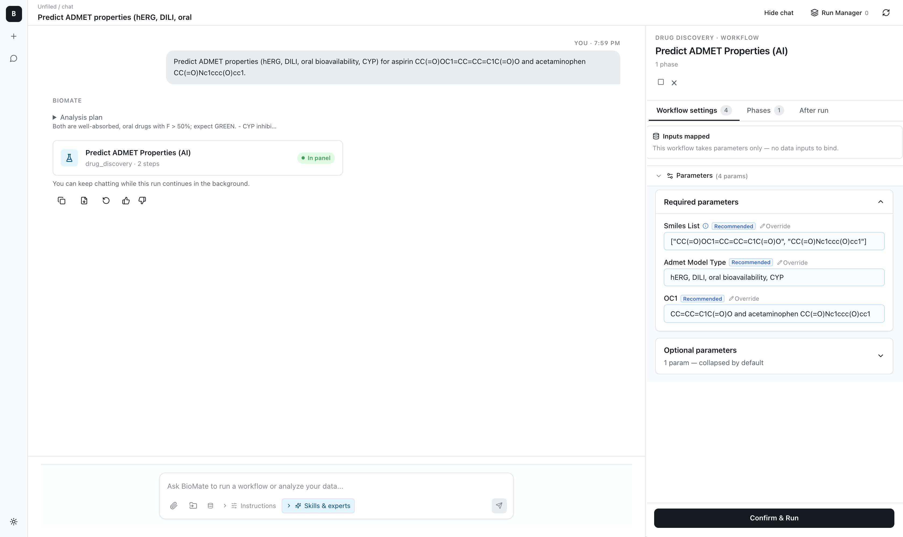

# Tutorial 3 — Running a workflow and reading the report

> **Who this is for:** anyone — no coding needed. By the end you'll know how to run a validated, multi-step
> analysis in BioMate, how to bring your own data to it, and how to read the report it produces — the
> outputs, the audit trail, and what each step did.
> **Time:** ~10 minutes to read; a run itself takes minutes to hours depending on the analysis.
> **Where it fits:** Tutorial 1 designs molecules; Tutorial 2 learns from lab results. This tutorial is the
> everyday middle: running a ready-made analysis pipeline and getting trustworthy results back.

---

## 1. The problem this solves

Most real analysis isn't one step — it's a **pipeline**: a sequence of steps that each take an input, do
something, and pass their output to the next step. For example, designing an in-vivo CAR-T therapy involves
checking the target's safety across tissues, choosing and checking a delivery vehicle, checking for a
cell-to-cell killing risk, and finally assembling the construct — several steps that must run in order.
Doing this yourself means connecting each tool manually, keeping track of versions and settings, and hoping
you can repeat the exact same steps later.

A **workflow** in BioMate is one of these pipelines, already tested and connected for you. You describe what
you want in plain English, attach your data, and BioMate runs the whole pipeline on cloud computers and
returns a single **report** — the results, every output file, and a record of how they were produced.

> **In one sentence:** a workflow runs a whole tested pipeline for you and hands back results plus a
> complete record of how it got them — so you can explain and justify the output in a paper, in a
> regulatory submission, or to your team at any time in the future.

---

## 2. The ideas you need first (plain-language background)

**Workflow.** A ready-made, tested pipeline for a specific job — for example an in-vivo CAR-T co-design, or
an RNA-seq analysis (measuring which genes change between two groups of samples), or variant calling
(finding the DNA differences in a genome). You don't assemble it; you run it. *("Validated/tested" here
means each step uses a published, established method — not that the result is clinically proven.)*

**Phases and steps.** A workflow is organised into **phases** (big stages), each made of one or more
**steps** (individual tools). In the CAR-T example the phases are *Atlas safety → LNP tropism → Fratricide
check → CAR construct assembly*:
- **Atlas safety** — checks whether the target (here CD19) also appears on *healthy* tissues, not just the
  tumour. This is the central CAR-T safety question (the "off-tumour, on-target" risk).
- **LNP tropism** — checks that the delivery vehicle (a lipid nanoparticle, LNP) actually reaches the *right*
  cells — here, T cells — rather than ending up in the liver (where LNPs tend to go by default).
- **Fratricide check** — checks whether the engineered T cells would attack *one another*, which happens when
  the target is also present on the T cells themselves. (For CD19 this is not expected — CD19 isn't on T
  cells — so the pipeline runs the check and expects it to pass.)
- **CAR construct assembly** — assembles the final design.

**Parameters (the inputs you set).** Before a run, a workflow has **parameters** — the settings that tell it
what to do (for CAR-T: the target, the indication, the delivery cell). BioMate fills in sensible defaults and
shows you every value before anything runs, so you can check or change them.

**Bringing your own data.** You attach your own files when you set up the run (in the composer, or from the
Data area where your files live). Different workflows take different inputs — a sequence file (**FASTA**) for
a protein, raw reads (**FASTQ**) for RNA-seq, a spreadsheet (**CSV**) of measurements, or a list of molecule
codes (**SMILES**) for drug design. BioMate connects your file to the matching parameter.

**QC gate / auto-loop.** Some workflows have automatic **quality checks** mid-run. If a result fails a
threshold, the run pauses and shows you the measured value versus the required one — and, for some workflows,
suggests a new setting and runs that step again automatically. **It never silently continues past a failed
check** — this is one of BioMate's most important trust features.

**The after-run report.** When the run finishes, BioMate opens a report with two tabs — **Results**
(plain-language findings on top, then each output previewed inline below), and **Reproducibility record** (the full audit
trail: a complete record of parameters, software, and results, kept so the run can be checked later).

**Checksum (SHA-256).** A short fingerprint of a file, so anyone can verify they have the exact same output.
In BioMate these are generated **on demand** (you click "Compute checksums").

---

## 3. When you'd use this

- You have a standard analysis to run (RNA-seq, variant calling, a drug-discovery design pipeline, etc.) and
  want it done correctly without assembling the tools yourself.
- You need results that are **defensible** — that you can explain and justify for a manuscript, a regulatory
  submission, or a review.
- You want a complete, shareable **record** of how a result was produced.

---

## 4. Step by step

1. **Ask in plain English.** In the chat, describe your goal — for example, *"Co-design an in-vivo CD19
   CAR-T for DLBCL with LNP delivery to T cells."* BioMate identifies the right validated workflow and opens
   its panel on the right. *(If it picks the wrong one, or nothing appears, rephrase your goal or name the
   analysis you want.)*
2. **Attach your data and check the settings.** If the analysis needs your own data, attach your file here
   (e.g. a FASTQ, CSV, FASTA, or SMILES file). Then review the parameters — for example, make sure the target
   and indication are what you intend. This is your chance to see exactly what will happen *before* any
   compute is spent.
3. **Confirm and run.** Click **Confirm and run**. BioMate runs the pipeline on cloud computers.
4. **Watch it run.** In the **Phases** tab, each phase moves from *pending* → *running* → *completed* in real
   time. If a quality gate fires, the run pauses and shows a message with the measured value and the required
   one; follow the on-screen instruction (BioMate tells you whether to adjust a setting or continue).
5. **Read the report.** When the run completes, open the **After run** section and read the two tabs
   (see §5).

*A completed run: the header shows the workflow (an in-vivo CAR-T co-design), its 4 phases, and a green
"Completed" badge. The three section tabs — Workflow settings · Phases · After run — let you review the
configuration, the phase-by-phase progress, and the report. "Run again" re-runs it.*

---

## 5. How to read the report

The after-run report has two tabs — **Results** and **Reproducibility record**.

**Outputs — every file, previewed inline on the Results tab.**

*On the Results tab, below the findings, every file the run produced is shown as an inline preview — searchable — here 11 files across
the four phases (e.g. `atlas_safety.json` from the Atlas-safety phase, `lnp_tropism.json` from the LNP phase,
`cart_construct.fasta` — a sequence file — and `design_report.txt` from the final assembly). File types are
shown (FASTA = a sequence, JSON = structured data, TXT = text, YML = a software-version record). Steps named
`phaseA_…` map to a phase; the short code (e.g. `1e2dca6c`) is the internal ID of the final assembly step —
files without a named phase came from it. You can view or download each file, download all as a ZIP, open
them in a Jupyter notebook, or save them to a project.*

This is the clearest view of the **input/output of each step**: every output is filed under the step that
produced it, so you can trace the pipeline from start to finish.

**Reproducibility record — the audit trail.**

*The Reproducibility record is the complete, downloadable account of the run: its id, status, timestamps, the
recorded parameters, and every output with its type, size, and a SHA-256 checksum (shown as "–" until you
click **Compute checksums** to generate the fingerprints). Expandable sections hold the Methods, Software
versions, Citations, QC report, and the full decision trajectory. (This particular run is older, so its
"Input bindings" show as not captured — newer runs record the input files here too.) A one-click "Download
record (JSON)" gives you the whole thing for a paper or a submission.*

**Summary — the plain-language findings.** Normally the Summary turns the outputs into a short, readable
account, with the key numbers taken directly from the output files. Crucially, those findings are generated **from the real output files** — so if BioMate cannot
read them, it **withholds the findings and says so, rather than inventing a summary.** That honesty is the
feature; the screenshot below shows exactly that behaviour on a run where output access was unavailable.

*The honesty behaviour in action: this run completed and produced 11 files, but its outputs could not be read,
so the Results tab withholds the findings and says so — it does not fabricate a result. (The "RUN ORIGINAL" badge
marks the unedited record; any report you edit is saved alongside it and the original is never overwritten.)
On a normal run this tab shows the findings described above, with each output previewed just below them.*

---

## 6. Input and output of each step, and what the result means

Putting the tabs together, you can follow any result: the **Phases** tab shows each stage's inputs and
settings; the **Outputs** tab shows what each step produced, filed under that step; and the **Reproducibility
record** ties parameters, software, outputs, and checksums into one downloadable file. That traceability is
what lets you explain and justify every result, not just report that the run finished.

> **What this means for the program (CAR-T example).** This workflow is an *in-silico design aid* — it informs
> a preclinical go/no-go decision (e.g. is CD19 safe enough to pursue in this construct, and is the delivery
> targeted correctly), and it hands you a defensible record of *why*. It is a computational prediction, **not
> patient data and not a clinical result.** (Note: in-vivo CAR-T — engineering the cells inside the patient
> via an LNP — is the harder, less-established modality; most approved CAR-T is made outside the body and
> reinfused. That is exactly why the LNP-delivery and safety checks matter so much here.)

---

## 7. Key terms

| Term | What it means — and why you care |
|---|---|
| **Workflow** | A ready-made, tested multi-step pipeline you run (you don't assemble it). "Tested" = established methods, not a clinical-proof claim. |
| **Phase / step** | A big stage / an individual tool within it; each takes inputs and produces outputs. |
| **Parameters** | The settings a workflow runs with (e.g. target, indication); shown before the run so you can check them. |
| **QC gate / auto-loop** | An automatic mid-run quality check that can pause and suggest a fix — it never silently passes a failed check. |
| **After-run report** | The results view with two tabs: Results (findings + previewed outputs) and Reproducibility record. |
| **Outputs** | Every file the run produced, organised by the step that made it. |
| **Reproducibility record / audit trail** | A complete record of every parameter, tool version, and output, kept so the run can be checked or repeated later; downloadable as one file. |
| **Checksum (SHA-256)** | A fingerprint of a file, so anyone can verify they have the exact same output; generated on demand. |
| **RUN ORIGINAL** | The unedited record of what a run produced; edits are saved alongside it, never overwriting it. |

---

> **Honest note on what you'll see today.** The run above (an in-vivo CAR-T co-design) genuinely completed
> end-to-end on the development site, producing 11 output files and a full reproducibility record. On that
> same environment, the Summary's **findings were withheld** because the output files could not be read —
> BioMate reported that honestly rather than fabricating a summary (this is the intended behaviour). The
> Outputs and Reproducibility-record tabs populate from the run's record and are shown in full above.

_Companion technical references (for power users / developers): `docs/user-manual/modules/` (running an
analysis, outputs & viewers, reports & reproducibility)._
