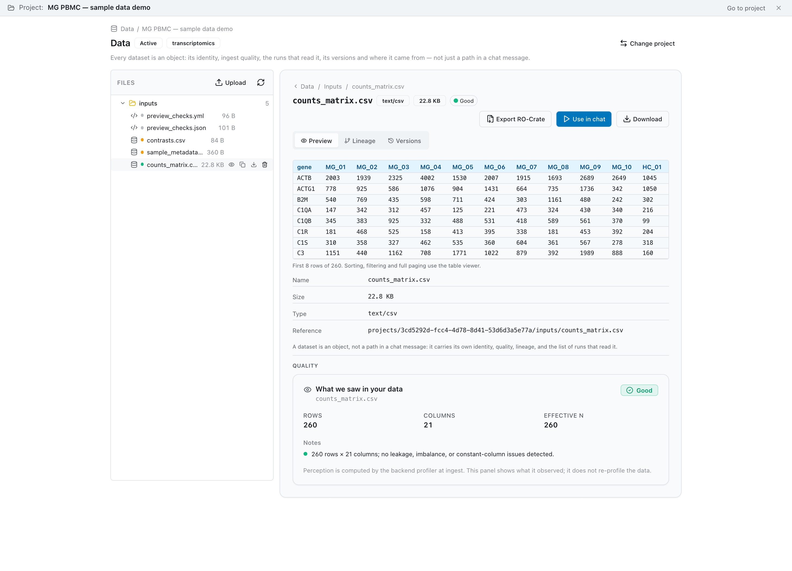
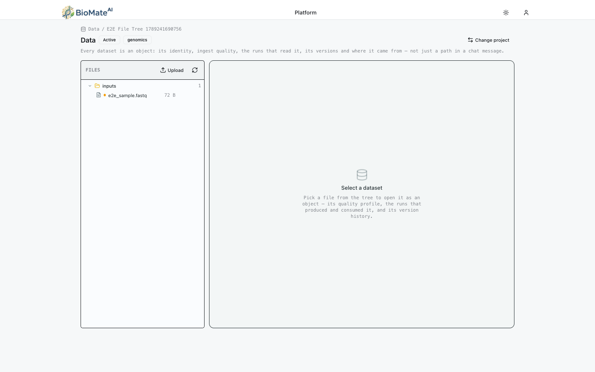
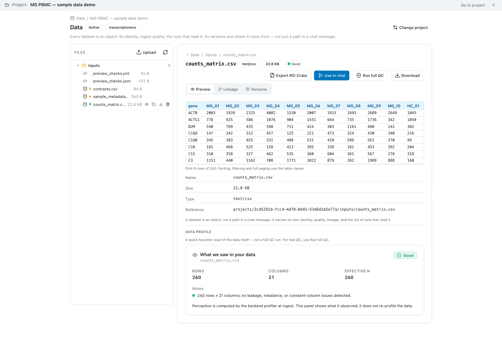
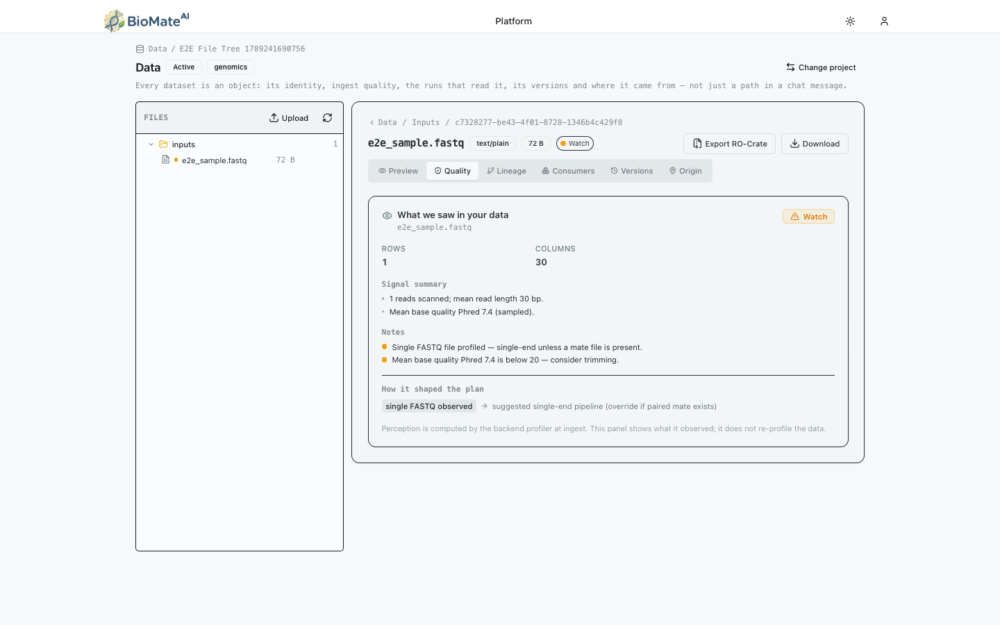

# Tutorial 4 — Bringing your own data

> **Who this is for:** anyone who has their own data files — measurements, sequencing reads, a spreadsheet —
> and wants BioMate to work on them. No coding needed. By the end you'll know how to get a file into BioMate,
> what BioMate turns it into, how to tell whether it's clean enough to analyse, and how it then feeds a real
> analysis.
> **Time:** ~8 minutes to read; uploading a file takes seconds.
> **Where it fits:** Tutorial 0 taught the doorway and the first question. This tutorial is the next step for
> anyone with their own data — and it's the thing every analysis in Tutorial 3 depends on.

---

## 1. The problem this solves

An analysis is only as good as the data going into it, and most real problems start the same way: *"I have
these files — now what?"* Done by hand, getting data ready means tracking which file is which, checking it's
readable and not obviously broken, and remembering later where a result came from. That manual tracking is
where mistakes creep in.

BioMate treats **your data as the centre everything connects to**. When you bring a file in, BioMate doesn't just
store a copy — it opens the file as a **dataset object**: a single, named thing that carries its *type*, a
*quality* check, and its *lineage* (the record of where it came from and what has used it). Every later step
— an analysis, a result, a report — points back to that same object, so you can always answer "what exactly
did this come from?"

> **In one sentence:** you bring a file in once; BioMate turns it into a dataset object with a quality check
> and a provenance record, and everything that uses it refers back to that same object.

---

## 2. The ideas you need first (plain-language background)

**The Data hub.** The place your data lives is the **Data hub** (sidebar → **Data**, at `/files`). It has two
panes: a **file tree** on the left (your files, grouped), and a **detail pane** on the right (the one file you
clicked, opened as an object). Data is **project-scoped** — it belongs to a project, so you pick a project
first, then see its data. *(Why it matters: a file in one project is not visible in another. If you can't find
a file, check you're in the right project.)*

*The Data hub, captured live: the two-pane layout where every file becomes a dataset object you can open.*

**The dataset object — a file is not just a file.** When you click a file, it opens as a **dataset object**
with everything BioMate knows about it in one place: a **Preview** of the real data, a **Quality** verdict, its
**Lineage** (what produced it) and **Consumers** (what has used it), a **Versions** log, and its **Origin**.
*(Why it matters: this is what lets a result trace back to the exact input it used.)*

**Quality — is this file clean enough to run on?** BioMate runs a quick **profiler** on readable files and
gives a one-word verdict: **Good** (green), **Watch** (amber), or **Blocked** (red). *(Why it matters: it
catches an unreadable or badly skewed file *before* you spend time and money analysing it.)* A fourth state,
**grey**, means **"not profiled" — not "bad"** (see §5).

**Lineage / provenance.** **Provenance** is the record of where a dataset came from and what has read it.
*(Why it matters: in science you must be able to say how a number was produced; BioMate keeps that record for
you so a result is defensible in a paper or a review.)*

**File types you'll meet.** Different work uses different file formats. You don't convert them — you bring the
file BioMate expects and it recognises the type:
- **CSV / TSV** — a table of measurements (rows and columns), e.g. assay readings or gene counts.
- **FASTQ** — raw sequencing reads (the output of a sequencer), used for RNA-seq and genome work. Paired-end
  runs come as two files (R1 and R2); bring both.
- **FASTA** — biological sequences (a protein or a stretch of DNA) in plain text.
- **VCF** — a list of genetic variants (differences found in a genome).
- **Images** — e.g. microscopy pictures or plots.

---

## 3. When you'd use this

- You have your own files (a spreadsheet of results, sequencing reads, sequences) and want BioMate to analyse
  them.
- You want to check a file is clean and readable *before* committing to an analysis.
- You need a result you can later explain — tied to the exact input it was computed from.

---

## 4. Step by step — getting your data in

We'll use a simple example: a **CSV of measurements** (a table) you want to analyse — for instance a CSV of
JAK1-inhibitor assay readings from Tutorial 1, or RNA-seq reads from a rheumatoid-arthritis cohort. The steps
are the same for a FASTQ, a FASTA, or a VCF.

1. **Pick (or open) a project.** Go to **Data** in the sidebar. Choose the project the data belongs to — the
   hub shows that project's files. *(If you don't have a project yet, create one first; data is always kept
   inside a project.)*
2. **Bring the file in.** On the file tree, **drag your file in** or click **Upload**. Your uploaded files are
   grouped under an **`inputs/`** folder; a run's results appear in their own per-run folder, labelled with the
   workflow and date, so you can tell different runs apart.
3. **Watch the quality dot.** Each file row shows a small **quality dot** — green (Good), amber (Watch), red
   (Blocked), or grey (not profiled). It appears once BioMate has read the file. For a CSV it will usually turn
   green or amber within a moment. A FASTA shows a **grey** dot — a type the profiler doesn't read, which is
   not a problem (see §5).

*The file tree: your uploads under `inputs/`, run outputs in their own folders, each row carrying a quality dot.*

**Two ways to use a file in a question.** You don't always go to the Data hub first. In the chat **composer**
(the message box) you can:
- **Attach a file from your computer** with the **paperclip** — a quick upload for a one-off.
- **Point at data BioMate already holds** with the **Database icon** — so you don't re-upload a file that's
  already in your project.

*(Why two ways: the paperclip is for a file on your laptop right now; the Database icon is for data already in
your workspace. Both end up as the same kind of dataset object.)*

---

## 5. How to read a dataset object

Click a file name and it opens in the right pane. The **header** shows the name, the content type, the size,
and — once the profiler finishes — a **quality pill** and a **version count**, so you can see its status at once.

*The dataset header: identity (name, type, size) plus the Good/Watch/Blocked quality pill and version count.*

Below the header are tabs. The ones you'll use most:

- **Preview** — the first rows of the real data as a table, without downloading it. *The fastest way to catch
  a wrong file, a wrong column separator, or a header row that isn't actually a header — read this before you
  run.*
- **Quality** — the detail behind the pill: for a table, how many rows and columns, the **effective N** (the
  usable sample size, which can be smaller than the row count when the data is correlated or imbalanced), class
  balance, and any notes; for sequencing reads it shows reads, read length, and average base quality (Phred)
  instead of rows and columns. *The verdict comes from BioMate reading your data, not from a guess.*
- **Lineage** — for a result file, the run, workflow, and step that produced it. An uploaded file honestly
  says "no upstream workflow produced this" (you made it, not a run).
- **Consumers** — the analyses that have read this dataset. If none have yet, it says so plainly rather than
  showing an empty guess.
- **Versions** — a log where you can add a note ("re-derived after fixing the header"). It records *that* the
  data changed and why.
- **Origin** — the plain facts: whether it was uploaded or produced by a run, its storage reference, and when
  it was added.

*The Quality tab: here a FASTQ the profiler flagged **Watch** — reads, read length, and mean base quality
(Phred), with a note like "below 20 — consider trimming" and a plain line on how it shaped the suggested plan.*

**How to read the quality verdict:**
- **Good (green)** — readable and nothing obviously wrong; you can proceed.
- **Watch (amber)** — usable, but something is worth a look (e.g. for FASTQ, the average read quality is
  low). Read the notes before you rely on it.
- **Blocked (red)** — BioMate could not read the file properly. Fix the file before you route it to an
  analysis.
- **Grey (not profiled)** — BioMate does not profile this file *type*, so it makes **no claim** about it. Grey
  means "no check was run," never "bad." (The profiler reads tables, VCF, and FASTQ; other types stay grey.)

> **One thing to know:** this quality pill is an **ingest check** — it looks at the file as it comes in. It is
> separate from the quality gates that run *during* an analysis (those are covered in Tutorial 3). A Blocked
> file means "unreadable on arrival," so fix it first.

---

## 6. From data to an analysis

Once a dataset is in and its quality looks right, you use it the same way as everything else in BioMate: in the
chat, describe the analysis you want and reference the dataset (attach it, or point at it with the Database
icon). BioMate matches the right workflow, shows you the settings with your file filled in, and runs it only
after you confirm — exactly the flow in **Tutorial 3 (Running a workflow and reading the report)**. The result
files come back as **new dataset objects**, each with its own Lineage pointing back to the run that produced
it (and that run records the input you started from) — so the whole chain, from your upload to the final
result, is traceable.

> **Who does what.** You bring the file in and check its quality; BioMate profiles it, runs the analysis you
> confirm, and records the provenance. You stay in control of what runs; BioMate keeps the record.

---

## 7. Honest limits — what to expect

- **Quality profiling covers specific file types.** BioMate profiles delimited tables (CSV/TSV/TXT), VCF, and
  FASTQ. Other types upload and work fine but show a **grey** dot, because no profile was run — not because
  they're bad.
- **Versions are a log, not an undo.** Adding a version records *that* a dataset changed and why; it does not
  save a copy you can roll back to. It is a record, not a backup.
- **Data is project-scoped.** A file belongs to one project and is not visible in another. There is no single
  "all my data across every project" view today.
- **Lineage shows the producing run as text, not a link.** You can read which run produced a file, but you
  can't yet click straight through to that run from here (open it from its chat instead).
- **For exact format and size rules,** see the Data module reference (`docs/user-manual/modules/I05-files-and-dataset-object.md`) — this tutorial doesn't restate limits it can't guarantee.

---

## 8. Where to go next

| You want to… | Where |
|---|---|
| Ask your first question | **Tutorial 0** |
| Run an analysis on the data you just brought in | **Tutorial 3** |
| Design new molecules | **Tutorial 1** |
| Learn from lab results over rounds | **Tutorial 2** |

The habit: **bring the file in → check its quality → reference it in a question → run (with confirmation) →
get results that trace back to it.**

---

## 9. Key terms

| Term | What it means — and why you care |
|---|---|
| **Data hub** | The two-pane place your data lives (sidebar → **Data**): file tree on the left, dataset detail on the right. It's project-scoped — pick the project that owns the data. |
| **Dataset object** | A file opened as a first-class thing carrying its type, quality, preview, lineage, consumers, and version log — not just a stored copy. It's what lets a result trace back to its input. |
| **Quality (Good / Watch / Blocked / grey)** | An ingest check of your file: green = fine, amber = look at the notes, red = unreadable (fix it), grey = not profiled (no claim made, *not* "bad"). |
| **Effective N** | The usable sample size, which can be smaller than the raw row count when data is correlated or imbalanced. Tells you how much your data really supports. |
| **Lineage / provenance** | The record of where a dataset came from and what has used it. Lets you explain and defend how a number was produced. |
| **Consumers** | The analyses recorded as having read this dataset. Honest-empty when none have. |
| **Versions** | An append-only log of notes about a dataset's changes — a record of *that* it changed and why, not a rollback. |
| **`inputs/` folder** | Where your uploaded files are grouped in the file tree; run results sit in their own per-run folders. |

---

_Companion technical references (for power users / developers):
`docs/user-manual/modules/I05-files-and-dataset-object.md`, `I02-composer-talking-to-biomate.md`,
`I06-running-an-analysis.md`._
