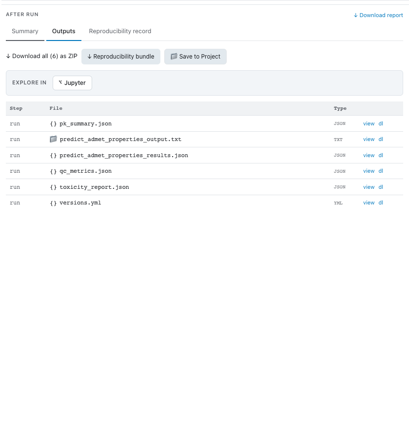
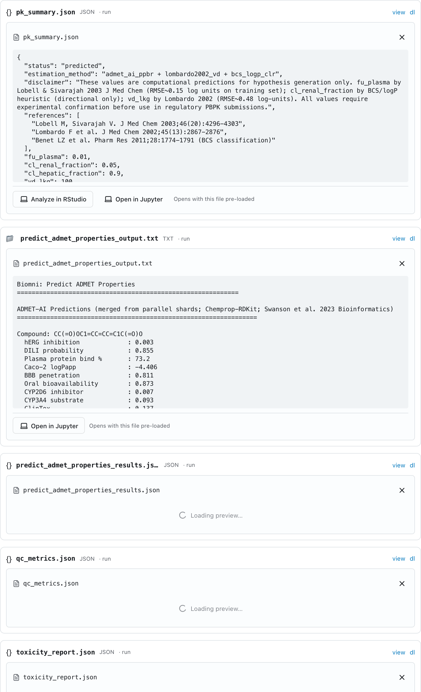

# Tutorial 5 — Viewing your results: outputs, previews & interactive tools

> **Who this is for:** anyone who has run an analysis and wants to actually *look* at what it produced —
> figures, tables, sequences, structures — without downloading anything or installing software. No coding
> needed. By the end you'll know how BioMate shows each kind of output right in the page, how to tell a good
> result from a wrong one quickly, and when the optional interactive tools come in.
> **Time:** ~8 minutes to read.
> **Where it fits:** Tutorial 3 taught you to *run* a workflow and read its report. This tutorial goes one
> level deeper into the report's **Outputs** — how to open and read each individual result file. Tutorial 4
> covered the data going *in*; this one is about the results coming *out*.

---

## 1. The problem this solves

An analysis can produce dozens of files — a plot, a results table, a called-variant list, a predicted protein
structure. The old way to look at any of them was to download the file and open it in some desktop program,
which is slow and means leaving the tool. Worse, a wrong result (an empty plot, a table whose header got read
as data) often looks fine in a file name — you only catch it when you actually *see* the contents.

BioMate renders almost every result **in the page**: you click a file and it opens as a picture, a sortable
table, a readable sequence, or a rotatable 3-D structure, right where you're reading. Downloading is the
exception, not the workflow — and because each preview reads the **real file**, what you see is what you'd get.

> **In one sentence:** BioMate shows each result file inline — as the figure, table, sequence, or structure it
> actually is — so you can read and sanity-check a result without downloading it or leaving the page.

---

## 2. The ideas you need first (plain-language background)

**The Outputs tab.** When a run finishes, its files appear in the **Outputs** tab of the after-run report (the
report you met in Tutorial 3). Each row shows **which step made the file**, the **file name**, its **type**,
and two actions — **view** (open it inline) and **dl** (download). *(Why it matters: files are grouped by the
step that produced them, so you can trace any result back to the stage it came from.)*

**Inline viewer.** Clicking **view** opens the file in an **inline viewer** — a reader built into the page that
picks the right display for that file type (a picture for an image, a grid for a table, and so on). *(Why it
matters: you read the result in place; you don't download it and find a program that opens it.)*

**Previews are the real file, not a copy.** Every inline viewer reads the same stored file the download link
would give you — there is no separate "preview" version that could be out of date. *(Why it matters: a preview
that showed something different from the real file would be worse than useless; BioMate avoids that by reading
the actual bytes.)*

**Findings link to their output.** A number in the plain-language **Summary** (e.g. "log2 fold-change = 2.4")
is a **live link** back to the exact output file it came from — click it and BioMate opens that file. *(Why it
matters: every headline number is evidence you can open and check, not a number disconnected from its source.)*

---

## 3. When you'd use this

- A run finished and you want to see its figures and tables, not just the summary.
- You want to **sanity-check** a result — did the plot actually render? does the table have the right columns? —
  before you trust or share it.
- You want to open one specific output (a structure, a variant list) and read it closely.

---

## 4. Step by step — opening a result

1. **Open the run's report.** From a completed run, open the **After run** section and go to the **Outputs**
   tab (Tutorial 3 shows how to get here).
2. **Find the file by its step.** Each row is labelled with the step that produced it, so you can go straight to
   the stage you care about (e.g. the plotting step, or the final results step).
3. **Click "view".** The file opens inline in an overlay, displayed the right way for its type (see §5). Use
   **dl** instead only when you want the raw file on your computer.

*The Outputs tab: every file the run produced, each row carrying the step that made it and a **view** / **dl**
action. Clicking **view** opens the file inline.*

*A real run's outputs, grouped by step — here 11 files across four phases. This is the clearest view of
"what each step produced," and the starting point for opening any one of them.*

---

## 5. What each kind of file looks like when you open it

BioMate recognises the file type and renders it inline. You don't convert anything — you open the file and it
shows up the right way:

- **Images** (PNG, JPG, SVG) — the figure itself, with click-to-zoom. PDFs (common for publication-quality
  Bioconductor figures) render as a sharp full page.
- **Tables** (CSV, TSV, JSON) — a **sortable grid**. BioMate auto-detects the column separator and shows the
  first rows. *This is the fastest way to catch a wrong file or a header row that was mistakenly read as data.*
- **Sequences** (FASTA, FASTQ) — each record with its length, the first records shown.
- **Variants** (VCF) — a variant table with the standard columns (chromosome, position, reference, alternate…).
- **Annotations** (BED, GFF, GTF) — a feature table with the correct columns for that format.
- **3-D structures** (PDB, mmCIF) — a **rotatable 3-D model** you can spin and style. For a *predicted*
  structure (e.g. from AlphaFold/ESMFold), it also shows a **pLDDT confidence chart** beside the model — a
  per-residue measure of how sure the prediction is (see the tip below). Clicking a residue in the chart
  highlights it in the 3-D view.
- **Cryo-EM density maps** (MRC/MAP) — a slice viewer through the three axes.
- **Reports** (HTML, e.g. MultiQC) — rendered as a safe, read-only page.
- **Logs / text** — readable text with a "show the last lines" toggle.

Anything BioMate can't render in a browser (certain large binaries) offers **download only** — an honest
fallback rather than a broken preview.

<!-- CAPTURE route=/ (completed run → Outputs → click "view" on a table and on a PDB structure) ; state=an inline table viewer open, and separately an inline 3-D structure with its pLDDT chart ; focus=step-output-preview overlay ; note=show (a) a sortable table preview with the "showing N of M rows" note, and (b) a 3-D structure with the pLDDT confidence chart beside it -->
*(Figures to add: a table opened inline as a sortable grid; and a predicted structure shown in 3-D with its
pLDDT confidence chart.)*

> **Tip — read confidence by colour, not one number (predicted structures).** On a pLDDT chart, above ~90 is
> very high confidence (a well-defined backbone), 70–90 is confident, 50–70 is low, and below 50 is often a
> disordered region. Look at *where* the structure is confident, not just a single overall score.

---

## 6. How to tell a good output from a wrong one — quickly

Opening the file is also how you sanity-check it. A few quick reads:

- **A figure that rendered vs a blank one.** An image that opens empty or all-white usually means the plotting
  step had no data or failed quietly — worth checking the step's log before you trust the run.
- **A table with the right columns.** If the first row of a table shows your real column names, the file parsed
  correctly; if the "data" looks like a header repeated, the separator or header was misread.
- **"Showing N of M".** Previews are **truncated on purpose** — tables show the first 200 rows, variants the
  first 100, sequences the first 20 records, logs the last 80 lines — each with an explicit "showing N of M"
  note. That note means the preview is a window, not the whole file; it is never silently cut. For the whole
  thing, download it.
- **An honest "no data".** The domain chart viewers (e.g. a cryo-EM QC curve) show "no data" when a file is
  empty or malformed, rather than drawing a fake result. A "no data" is information, not a glitch.

> **Why this matters:** most wrong results are caught by *looking*, not by reading a status badge. The whole
> point of inline previews is to make that look take seconds.

---

## 7. Saving and sharing what you found

Beyond viewing one file at a time, the Outputs tab lets you:

- **Download all as a ZIP** — every output in one archive.
- **Download a reproducibility bundle** — the configs, command scripts, logs, and software versions needed to
  re-run the analysis elsewhere (this pairs with the reproducibility record from Tutorial 3).
- **Save to a project** — copy the outputs into a project, where they become first-class **dataset objects**
  (with quality, lineage, and versions — exactly the dataset objects from Tutorial 4). This is how a result
  becomes the input to the next analysis.

---

## 8. Interactive tools (RStudio / Jupyter / CellxGene) — the honest scope

Beyond reading a result, BioMate can offer **interactive environments** — a full RStudio session, a Jupyter
notebook, or a CellxGene browser — for open-ended, write-your-own-code exploration *after* you've read the
result. Here is the honest scope, because it is easy to over-expect:

- **They are not the main path.** The inline viewers above cover reading and checking a result. The interactive
  tools are only for when you want to run your own code against the outputs.
- **They must be provisioned, and the buttons hide when they're not.** BioMate checks whether these tools are
  installed in your environment; if they aren't, the "Open in RStudio / Jupyter / CellxGene" buttons simply
  **don't appear**, rather than offering something that would fail.
- **On the development site today, they are not provisioned** — so you won't see those buttons there. Use the
  inline viewers to read results, and **download** if you want the raw file locally. This is expected, not a bug.
- **They don't auto-load your data.** Launching one opens an *empty* session; BioMate shows quick-start code and
  the file paths, but you load the outputs into it yourself. Don't expect your results table to already be
  loaded in the R workspace.

> **One more honest note (single-cell).** BioMate has an in-app single-cell summary (a UMAP plot with clusters
> and markers) for `.h5ad`/`.loom` files, but it only draws when the pipeline wrote a small summary file
> alongside the data. Until the single-cell pipelines emit that end-to-end, expect the download/interactive
> fallback on a real run rather than the in-app UMAP. (For exact, current support, see the Outputs module
> reference.)

---

## 9. Where to go next

| You want to… | Where |
|---|---|
| Run the analysis whose outputs you're viewing | **Tutorial 3** |
| Turn a saved output into the input for the next analysis | **Tutorial 4** |
| Understand the whole report (Summary / Outputs / Reproducibility) | **Tutorial 3** |
| Learn from results over rounds (the closed loop) | **Tutorial 2** |

The habit: **open the Outputs tab → view the file inline → read it (and sanity-check it) → save or share what
matters.**

---

## 10. Key terms

| Term | What it means — and why you care |
|---|---|
| **Outputs tab** | The part of the after-run report listing every file a run produced, grouped by the step that made it, each with a **view** and **download** action. |
| **Inline viewer** | A reader built into the page that shows a file as the thing it is (image, table, sequence, structure…), so you don't download it or leave BioMate. |
| **Preview reads the real file** | The inline view shows the actual stored bytes, not a separate copy — so a preview can't drift from the real result. |
| **pLDDT** | A per-residue confidence score (0–100) for a *predicted* protein structure; read it by colour/region, not one global number. Above ~90 very high, 70–90 confident, below 50 often disordered. |
| **"Showing N of M"** | Previews are truncated on purpose (first rows / last lines); the note tells you it's a window, not the whole file. Download for everything. |
| **Reproducibility bundle** | A downloadable package of configs, scripts, logs, and software versions — enough to re-run the analysis elsewhere. |
| **Save to project** | Copy outputs into a project so they become dataset objects (quality, lineage, versions) — the bridge from a result to the next analysis's input. |
| **Interactive tools (RStudio/Jupyter/CellxGene)** | Optional code environments for ad-hoc exploration; only shown where provisioned (not on the dev site today), and they open empty — you load the data yourself. |

---

_Companion technical references (for power users / developers):
`docs/user-manual/modules/I08-outputs-viewers-interactive.md`, `I07-full-step-view-provenance.md`,
`I09-reports-and-reproducibility.md`._
