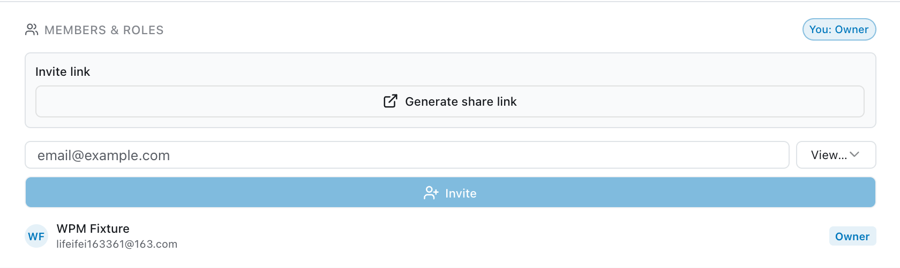

# Tutorial 7 — Projects, standing instructions & collaboration

> **Who this is for:** anyone whose work spans more than one sitting or more than one person — a PI
> running a screening campaign, a postdoc on a manuscript's worth of analyses, a lab sharing results
> with a collaborator. No coding needed. By the end you'll know what a **project** is, how to give
> BioMate **standing instructions** it reads on every chat, and how to **share** a project with
> teammates at the right level of access.
> **Time:** ~9 minutes to read; setting up a project takes a minute or two.
> **Where it fits:** Tutorial 0 taught the single chat and its doorway; Tutorial 4 taught getting your
> data in. This tutorial is the container that holds many chats, many files, and many people together —
> the thing you open when one conversation isn't enough.

---

## 1. The problem this solves

Real research is not one question. It is dozens of chats over weeks, a folder of files, several runs,
and — often — more than one person. Done in bare chats, three things go wrong:

- **You retype the same context every time.** "This is mouse liver." "Paired-end, reverse-stranded."
  "We use GRCh38." Every new chat starts from nothing, so you say it again, and the one time you forget,
  the analysis is subtly wrong.
- **Your plans and notes scroll away.** The hypothesis a run was testing, the reason you chose one
  threshold over another — buried in old chat history nobody can find later.
- **Sharing is all-or-nothing.** You want a collaborator to *see* results without being able to delete
  the project, or a postdoc to *run* analyses without managing who else has access. A raw link can't do
  that.

A **project** fixes all three. It is the container for one line of research — its files, its chats, its
runs, and the **context BioMate keeps in mind every time you talk to it**. Where a single chat is one
conversation, a project is the **standing memory** around many conversations, plus a way to bring people
in at a defined level of access.

> **In one sentence:** a project lets you say your context *once* so every chat inherits it, keeps your
> plans and notes next to the data, and lets you share the work with teammates who can each do exactly
> as much as their role allows — no more, no less.

---

## 2. The ideas you need first (plain-language background)

**A project is a container, not a chat.** It holds many chats, the files you brought in (Tutorial 4),
the runs you launched (Tutorial 3), and three kinds of written context: **standing instructions**,
**plans/hypotheses**, and **notes**. You open the project page from the sidebar's **Projects** band.

**The active project — how a chat "knows" it's in a project.** One project at a time can be the
**active project**. When it is, every new chat you start inherits its standing instructions
automatically — you don't have to open the project page first. BioMate remembers your active project
across page refreshes. *(Why it matters: set the project once, and you stop re-typing context for the
rest of the day.)*

**Standing instructions — the context BioMate reads every time.** These are directives the assistant
reads on **every chat in the project**: your organism and genome build, your experimental design, your
house conventions ("always use GRCh38", "we prefer edgeR to DESeq2"). The project page card says it
plainly: *"Read by the assistant on every chat in this project."* *(Why it matters: this is the single
biggest time-saver — the one place to put context you're tired of repeating.)*

**Notes — for you, not for the AI.** A **note** is human-only free text. The card says *"Private to you
— not read by the assistant."* It is a sticky-note for a human reader; BioMate never acts on it. *(Why
it matters: this is a deliberate safety line — see the pitfall in §4. If you want the AI to use
something, it must be a standing instruction, not a note.)*

**Plans / hypotheses — the "why" a run can cite.** A **plan** records the goal (and optional
hypothesis) a piece of work is testing, as a saved object rather than a line that scrolls away in chat.
A run can later point back to the plan it was built on.

**Roles — who can do what.** When you share a project, each person gets a **role**. BioMate's shipped
roles, from least to most powerful, are:

- **Viewer** — read the project, its files and runs; download files. No changes.
- **Editor** — everything a Viewer can, plus edit the project's content (standing instructions, tags),
  upload and delete files, create plans, and add notes. Cannot manage people or delete the project.
- **Owner** — everything: edit, run, manage members and their roles, change the project's status,
  archive or delete it, share it, and hand ownership to someone else.

> **A note on role names (design vs. what ships).** You may see a *four*-role vocabulary in BioMate's
> design materials — **Viewer / Contributor / Reviewer / Owner**. The shipped product today uses
> **three**: Viewer, **Editor** (the design's "Contributor"), and Owner. There is **no separate
> "Reviewer" role** yet. This is called out again in *Honest limits* so you're not left looking for a
> control that isn't there.

**Disabled, never hidden.** This is a design principle BioMate actually follows on the project page: a
control your role can't use is shown **greyed-out with the role it needs** ("needs Owner"), rather than
removed from the screen. *(Why it matters: a missing button is indistinguishable from a broken product;
a disabled button with a role label tells you exactly who to ask.)*

---

## 3. When you'd use this

- Your work spans more than one sitting and you're tired of re-typing the same context into every chat.
- You want a hypothesis, a plan, or a decision recorded next to the data — not lost in chat scrollback.
- You want to bring a collaborator in to **view** results, or a labmate to **run** analyses, without
  handing them the keys to delete everything.
- You're handing a body of work off to someone else and need to transfer ownership cleanly.

If you're working alone on a single quick question, you don't need a project — a standalone chat
(Tutorial 0) is fine. Reach for a project when the work, or the team, grows.

---

## 4. Step by step

We'll use a running example: a lab studying **rheumatoid arthritis** has an **RNA-seq** project (mouse
liver, paired-end, reverse-stranded) that the PI wants a postdoc to run analyses in, while a clinical
collaborator just needs to view the results.

### 4a. Create the project and set its standing instructions

1. **Create the project.** In the sidebar's **Projects** band, click **New project**. Give it a name
   (required) — e.g. *"RA liver RNA-seq"* — and, if you like, a short description. You can also seed
   its standing instructions right here, or add them later.
2. **Open the project** from the Projects band. Its page shows cards for **Standing instructions**,
   **Notes**, **Plan / hypothesis**, and (lower down) **Members & roles**.
3. **Write your standing instructions** in the Standing instructions card and save. For this example:
   *"Mouse liver. Paired-end, reverse-stranded (dUTP). Align to GRCm39. Prefer edgeR over DESeq2.
   Report log2 fold-change with FDR < 0.05."* The card reminds you these are *"Read by the assistant on
   every chat in this project."*

<!-- CAPTURE route=/projects?project=<id>&tab=files ; state=project page with Standing instructions card filled (mouse-liver/paired-end/GRCm39) and the Notes card below it empty ; focus=Standing instructions card + its "Read by the assistant on every chat in this project" subtitle, and the Notes card's "Private to you — not read by the assistant" subtitle ; note=show the two cards stacked so the trust boundary (AI-read vs human-only) is visible in one shot -->

4. **Make it the active project** (opening the project does this for you). From now on, every new chat
   you start inside this project inherits those instructions — you won't retype "mouse liver,
   paired-end" again.

> **How to tell the instructions actually fired.** When you send a message in a project chat, the
> composer shows an **instructions chip** — a small count of the standing instructions in context.
> Click it to see the list. If a parameter in a run shows its origin as **inherited**, that means it
> came from a standing instruction you wrote — possibly weeks ago. That's the system telling you, out
> loud, what shaped the run.

### 4b. Record a plan, and keep a private note

5. **Add a plan (optional).** In the **Plan / hypothesis** card, give a **Goal** (required) and an
   optional **Hypothesis** — e.g. goal *"find genes separating flare vs. managed RA liver"*, hypothesis
   *"interferon-response genes are up in flare."* A later run can cite this plan, so the report can say
   what it was testing. (Creating a plan needs Editor or Owner rights.)
6. **Add a note (optional).** In the **Notes** card, jot anything *for a human* — "re-run once the new
   batch of samples lands." Remember: **a note never changes how BioMate behaves.**

> **Pitfall — a Note is invisible to the AI.** If you write *"use the new reference"* as a **Note** and
> expect the assistant to pick it up, it won't — notes are human-only by design. Put behavioural
> guidance in **Standing instructions** instead. There's a **"Promote to instruction ↑"** action that
> copies a note's text into the standing instructions; that explicit click is the *only* way a note's
> content ever reaches the assistant.

### 4c. Share the project with teammates

Open the **Members & roles** panel on the project page. Your own role shows as a **"You: <role>"** badge
so you always know what you can do here. There are two ways to add people (both are **Owner-only**):

7. **Invite by email.** Type the person's email, pick a role — **Viewer** or **Editor** — and invite.
   *(The person must already have a BioMate account; if not, BioMate says "No user found with that
   email" rather than silently failing — ask them to sign up first.)* For our example: invite the
   postdoc as **Editor**, and the clinical collaborator as **Viewer**.
8. **Or generate a share link.** Click **Generate share link** to mint a URL at a chosen role. Anyone
   who opens it and accepts is added at that role. You can **copy** it, change its role, or **revoke**
   it to kill it.

<!-- CAPTURE route=/projects?project=<id>&tab=files ; state=Members & roles panel open as Owner — invite-by-email input, share-link generate/copy/revoke controls, and a member list with a postdoc (Editor) + collaborator (Viewer) each with a role dropdown ; focus=the "You: owner" badge, the role dropdowns, and the "Make owner" transfer control on a member row ; note=capture as the OWNER so the full set of owner-only controls is visible and enabled -->

9. **Change or remove people later.** As Owner, each member row has a **role dropdown** (switch someone
   Viewer↔Editor) and a remove action. Any non-owner member can **leave** a project themselves. To hand
   the project off entirely, use **Make owner** on a member — that promotes them to Owner and demotes
   you to Editor (an irreversible transfer, so BioMate confirms first).

### 4d. See your own permissions — disabled, not hidden

10. On the project page, the **"Your permissions here"** card lists what you can and cannot do, each row
    tagged with the role it needs and a plain **"you can" / "you cannot"** verdict — driven by your
    *real* server-assigned role, not a guess. A Viewer sees the owner-only rows (like "Manage members &
    roles") marked **"needs Owner · you cannot"** rather than blank. That's the *disabled, not hidden*
    principle in action: you can always see what a locked action requires, so you know who to ask.

<!-- CAPTURE route=/projects?project=<id>&tab=files ; state=project page viewed AS A VIEWER (log in as the collaborator) so the "Your permissions here" card shows owner-only and editor-only rows marked "you cannot" with the required role ; focus=the RolesCard rows — "Read & download files · you can", "Run analyses & edit project content · needs Editor · you cannot", "Manage members & roles · needs Owner · you cannot" ; note=MUST be captured as a Viewer, not the Owner, or every row shows "you can" and the disabled-not-hidden point is lost -->
*(Figure to add: the "Your permissions here" card seen as a Viewer — the owner-only and editor-only
rows clearly marked "you cannot" with the role each needs, never hidden.)*

---

## 5. Honest limits — what to expect

- **Three shipped roles, not four.** BioMate's design materials describe four roles — Viewer,
  **Contributor**, **Reviewer**, Owner — but the product today ships **three**: Viewer, **Editor**, and
  Owner. The design's "Contributor" is the shipped **Editor** (add files, edit parameters, start runs).
  There is **no separate "Reviewer" role**: overriding a quality gate or signing off on an approval is
  not wired to a distinct project role today. If you read about a Contributor or Reviewer elsewhere, map
  them to Editor and "not yet," respectively.
- **One permissions card is live; another is a placeholder.** The **"Your permissions here"** card on
  the *project page* is real — it reflects your actual server-assigned role. A second, similar-looking
  permissions card appears in a **run's workflow panel (Settings tab)**; that one is a **static
  design placeholder** — it always shows "Owner" with every row allowed (and even lists an "Invite a
  reviewer" row), regardless of who you are. Trust the project-page card for real permissions, not the
  run-panel one.
- **Standing instructions are per-project only.** There is no account-wide or cross-project standing
  instruction that applies everywhere. If you want the same context in two projects, you set it in each.
- **Experts are chosen per chat, not saved as a project switch.** You can toggle **Expert** packs in
  the composer for a given chat, and a project's standing context flows into that chat — but there is
  **no per-project switch** on the project page that turns specific skills/experts on for the whole
  project. (The Experts selector lives in the message box; it's honestly empty when no packs are
  available.)
- **Notes never reach the AI unless promoted.** This is by design, but worth repeating: behavioural
  guidance belongs in Standing instructions. A note only influences the assistant after you explicitly
  **Promote to instruction ↑**.
- **Invitees must already have a BioMate account.** Invite-by-email finds an existing user; it does not
  send a sign-up invitation to a stranger. Have new collaborators register first.
- **Collaboration may be a paid-plan feature.** On lower plans, inviting members, changing roles,
  sharing links, and transferring ownership can be blocked with a **"Team plan required"** message.
  Reading and solo project work are unaffected. (Exact plan rules live in the billing/tier reference.)
- **Other people's projects return "not found," not "access denied."** If you don't have access, BioMate
  returns a plain **404** and never even confirms the project exists — so you can't probe for projects
  you weren't invited to.
- **Deleting a project doesn't destroy your chats.** Deleting removes the project's plans, notes and
  knowledge, but linked chat sessions survive as standalone chats. **Archiving** (a reversible
  soft-delete) is the safe option when you just want a project out of the way.

---

## 6. Where to go next

| You want to… | Where |
|---|---|
| Ask your first question (no project needed) | **Tutorial 0** |
| Bring your own data into a project | **Tutorial 4** |
| Run an analysis inside the project | **Tutorial 3** |
| View and read a run's results | **Tutorial 5** |
| The full technical rules (roles, endpoints, gates) | `docs/user-manual/modules/I04-projects-instructions-collaboration.md` |

The habit: **create a project → write its standing instructions once → work in chats that inherit them
→ share at the right role → hand off or archive when done.**

---

## 7. Key terms

| Term | What it means — and why you care |
|---|---|
| **Project** | The container for one line of research — its files, chats, runs, and standing context. Open it from the sidebar's **Projects** band. Use one when work spans many chats or people. |
| **Active project** | The one project currently in context; every new chat inherits its standing instructions. BioMate remembers it across refreshes — set it once. |
| **Standing instructions** | Directives the assistant reads on **every chat in the project** (organism, build, conventions). The one place for context you're tired of repeating. |
| **Note** | Human-only free text, **never read by the assistant**. A sticky-note for people, not an instruction for the AI — promote it if you want the AI to use it. |
| **Promote to instruction** | The explicit action that copies a note's text into the standing instructions. The only way a note's content ever reaches the assistant. |
| **Plan / hypothesis** | A saved record of the goal (and optional hypothesis) a run is testing, so a report can cite what it set out to show. Needs Editor or Owner to create. |
| **Viewer** | Can read the project and download files. No changes. |
| **Editor** | Can edit content, upload/delete files, create plans, run analyses. Cannot manage people or delete the project. (The design's "Contributor.") |
| **Owner** | Can do everything, including manage members, share, archive/delete, and transfer ownership. |
| **Disabled, not hidden** | BioMate shows a control you can't use greyed-out **with the role it needs**, rather than removing it — so a permission limit is never mistaken for a missing feature. |
| **Share link / invite** | Two Owner-only ways to add people — a URL minted at a role (copy/revoke) or an email invite to an existing BioMate user. |
| **Transfer ownership** | "Make owner" promotes a member to Owner and demotes you to Editor — an irreversible hand-off, confirmed first. |

---

_Companion technical reference (for power users / developers):
`docs/user-manual/modules/I04-projects-instructions-collaboration.md`. Verified against the shipped
code: `pages/project-detail.tsx`, `components/roles-verify.tsx`, `server/project-routes.ts`,
`components/app-sidebar.tsx`, and the design spec `data_centroid_design_v2/spec/00 Foundations and the
cold start.html` §0.14._
