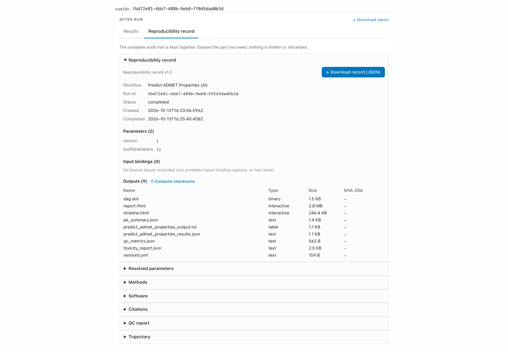

# Tutorial 8 — Reports as editable files, and exporting them

> **Who this is for:** anyone who has run an analysis in BioMate and now needs to *change the wording* of its
> report, keep a clean history of those changes, or hand the report to someone else in the file format they
> expect. No coding needed.
> **Time:** ~8 minutes to read.
> **Where it fits:** Tutorial 3 taught you to run a workflow and read its report; Tutorial 5 taught you to open
> each result file. This tutorial is the next step: the report is not a frozen picture — part of it is an
> **editable document** you can revise and save as versions, and the whole thing can be **exported** to take
> away.

---

## 1. The problem this solves

A finished run gives you a report, but a report is rarely final the moment it appears. You might need to soften
or sharpen a caveat ("say plainly that some batch values were estimated"), rewrite the methods paragraph for a
journal reviewer, or trim a section that repeats itself. And when you share the result, the person on the other
end wants a file — a document to read, a machine-readable record to check, or a package to re-run the analysis
themselves.

Doing this by hand — copying the text into a word processor, editing it there, losing track of which version
is which — is exactly where mistakes creep in. You end up with three slightly different copies and no record of
what the run actually produced.

BioMate keeps this honest. The run's **original report is never overwritten**: it is kept as a fixed record of
what the analysis produced. On top of that, the **methods report** is an editable document — you revise it in
place and each save becomes a new **version**, saved alongside the original. And when you want to take the
report away, BioMate exports it in a small set of real, well-defined formats.

> **In one sentence:** your report's original stays fixed as the record of the run, while you edit a working
> copy into clean versions and export it in the format whoever you're sharing with actually needs.

---

## 2. The ideas you need first (plain-language background)

**The after-run report (recap from Tutorial 3).** When a run finishes, BioMate shows a report with two tabs:
**Results** (the plain-language findings on top, then every output file previewed inline) and
**Reproducibility record** (the audit trail). This tutorial lives mostly in two places: the top of the report,
where the download buttons are, and the **Methods** section inside the Reproducibility record, which is the
part you can edit.

**The immutable run original.** BioMate marks the run's first, unedited report as the **run original** (labelled
**v0**). It is never changed — not when you edit, not when you save. *(Why it matters: months later, when you
have to show exactly what the analysis reported, the untouched original is still there. Your edits sit beside
it, not over it.)* You will see a **"Run original"** badge on the Summary saying: *"The unedited record of what
this run produced. Reports you edit are saved alongside it; this original is never overwritten."*

**Editing by hand.** In the **Methods** section, an **✎ Edit** button opens the report text in a built-in
document editor (the same editor used for regulatory documents). You type your changes directly. *(Why it
matters: you fix the wording where it lives, instead of exporting, editing elsewhere, and re-importing.)*

**Versions.** When you click **⤴ Save version**, your edited text is saved as a **new version** (v1, v2, and so
on). The list shows every version oldest-to-newest, with **v0** marked **"immutable run original."** *(Why it
matters: nothing you do deletes earlier text. If an edit was wrong, the earlier version — and the original — are
still there.)* Saving is **server-first**: the version is stored with the run. If the server can't be reached,
BioMate falls back to downloading your edit as a Markdown file so you never lose it.

**Export.** Separately from editing, the report can be **downloaded** in a few real formats — a readable
document, a machine-checkable record, and a re-run package. These are covered in step 5, with an exact list of
what is and isn't available.

**Where the report lives.** The report belongs to its **run**, and the run belongs to the **chat session** it
came from. To get a report, its versions, and its record back later, reopen that chat session. *(Why it
matters: there isn't a separate "Documents" folder you hunt through — the report is always attached to the run
that made it. See Honest limits for what this means.)*

---

## 3. When you'd use this

- A run finished and the report is right, but the **wording** needs work — a clearer caveat, a methods
  paragraph rewritten for a reviewer, a repeated section trimmed.
- You need to keep a **clean history** of those edits, with the original untouched, so you can show what the
  run actually produced versus what you revised.
- You need to **hand the report to someone** — a co-author, a reviewer, a colleague re-running the analysis —
  as a file in a format they can open or verify.

---

## 4. Step by step — editing the report

1. **Open the run's report.** From a completed run, open the **After run** section (Tutorial 3 shows how to get
   here).
2. **Go to the Methods section.** Open the **Reproducibility record** tab and expand **Methods**. This is the
   editable part of the report. *(The Summary and the record itself are kept as the fixed account of the run;
   the Methods prose is the working document.)*
3. **Click ✎ Edit.** The methods text opens in an in-page editor. Make your changes directly — reword a
   sentence, shorten a paragraph, add a caveat. Nothing is saved yet.
4. **Click ⤴ Save version.** Your edit is saved as a new version (for example, "Saved as version v1"). The
   **run original (v0)** is untouched and still listed. You can edit and save again; each save adds another
   version.
5. **Check the version list.** Under the toolbar, the **Report versions** list shows v0 (immutable run
   original) and each edit you saved, with its date. This is your edit history.

<!-- CAPTURE route=/ (completed run → After run → Reproducibility record → Methods, Edit mode on) ; state=a completed run with the methods editor open and at least one saved version below ; focus=[data-testid="methods-tab"] ; note=show (a) the ✎ Edit / ⤴ Save version toolbar, (b) the editable prose, and (c) the "Report versions" list with v0 "immutable run original" + a v1 edit -->
*(Figure to add: the Methods report in edit mode — the ✎ Edit / ⤴ Save version toolbar, the editable text, and
the "Report versions" list showing v0 "immutable run original" and a saved v1.)*

*The "RUN ORIGINAL" badge on the Summary: the unedited record of what the run produced. Any report you edit is
saved alongside it as a new version — the original is never overwritten. (This is the same run from Tutorial 3.)*

---

## 5. Step by step — exporting the report

The download buttons sit at the top of the **After run** section and inside the **Outputs** and
**Reproducibility record** tabs. Here is exactly what each one gives you, and the real file format:

| You want… | What you get | Format | Where the button is |
|---|---|---|---|
| **A readable write-up** to share or paste into a draft | One document that stitches together the summary, parameters, methods, QC events, software, and citations | **Markdown** (`.md`) | **↓ Download report** (top of After run) |
| **A machine-checkable record** | The reproducibility record (identity, parameters, input bindings, outputs with checksums) | **JSON** | **↓ Download record (JSON)** (Reproducibility record tab) |
| **Everything needed to re-run elsewhere** | Configs, command scripts, logs, and the software-version file | **ZIP** | **↓ Reproducibility bundle** (Outputs section) |
| **All the result files** in one go | Every output the run produced | **ZIP** | **↓ Download all as ZIP** (Outputs section) |
| **Just the methods section** on its own | The methods write-up by itself | **Plain text** (`.txt`) | **Download methods report** (on the workflow panel) |

A few things worth knowing:

- The **Download report** Markdown file is the one most people want for a write-up: it is comprehensive (every
  tab in one file) and opens in any text or Markdown editor. It is saved as `biomate-run-<run id>.md`.
- Every download **carries the run id**, so a copy on someone's laptop can always be traced back to the run it
  came from.
- When you **save an edited methods version** (step 4 above) and the server is reachable, that version is stored
  with the run. If the server can't be reached, the same action **downloads your edit as a Markdown file**
  instead — an honest fallback so the edit is never lost.

<!-- CAPTURE route=/ (completed run → After run) ; state=a completed run ; focus=[data-testid="afterrun-download-report"] ; note=show the "↓ Download report" button at the top of the After run panel, and (Outputs section) the "↓ Reproducibility bundle" + "↓ Download all as ZIP" buttons -->
*(Figure to add: the export buttons — "↓ Download report" at the top of the After run panel, and the
"↓ Reproducibility bundle" / "↓ Download all as ZIP" buttons on the Outputs section.)*

*The Reproducibility record tab: identity, parameters, and the outputs table, with "↓ Download record (JSON)"
for the machine-readable copy. (SHA-256 checksums show "–" until you compute them on demand — see Tutorial 3.)*

---

## 6. How to read what you exported

- **Markdown report (`.md`).** This is the human write-up. It inlines the real findings text and the real QC
  table, and ends with a reproducibility note listing the parameters and software versions used. Use it for a
  draft, a methods section, or a shareable summary.
- **JSON record.** This is for a checker, not a reader — a program (or a careful reviewer) can read the exact
  parameters, input bindings, and output list, and verify checksums. Use it when a result must be audited.
- **Reproducibility bundle (`.zip`).** This is the "re-run it yourself" package: the configs and scripts, not
  just the prose. Use it when a collaborator needs to reproduce the analysis on their own machine.

> **Why the split matters.** A write-up without its parameters and outputs isn't reproducible, and a bundle of
> scripts isn't readable. BioMate gives you both deliberately, rather than one file pretending to be both.

---

## 7. Honest limits (read this before you expect more)

These are real gaps in the product today, surfaced here rather than buried:

- **"Ask BioMate to edit this" (a chat edit with an accept/reject diff) is not built for run reports.** The
  design exists — you would ask in plain English, BioMate would propose a before/after change with a reason,
  and you would **Accept** or **Reject** it — but it is **not wired in this product**. Report editing today is
  **hand-editing + Save version only**. There is no propose-a-diff, accept-or-reject flow for the report prose,
  and no cell-level diff for data files. (If you have seen this in a design mock-up, that is the deferred Spec-12
  vision, not the shipped behaviour.)
- **Only some export formats are real.** The generic report path exports **Markdown, JSON, plain text, and ZIP**
  (the formats in the step-5 table). **PDF, DOCX, and HTML export are not available** for a normal run report.
  (A DOCX conversion exists only inside the IND-report flow, which is turned off in this product — so treat
  DOCX/PDF/HTML as *not offered* here.)
- **The report does not yet appear as a standalone file in a project's file list.** It lives **with its run and
  chat session** — reopen that session to get the report, its versions, and its record back. You *can* save the
  run's **output files** into a project (Tutorial 5's "Save to project"), where they become dataset objects, but
  the editable report document itself stays attached to the run.
- **Checksums are computed on demand.** The SHA-256 column in the record shows "–" until you ask BioMate to
  compute it (see Tutorial 3). A dash means "not hashed yet," not "corrupt."

> **Why the honesty helps you.** If you plan a submission around a DOCX export, or expect to find reports in a
> documents folder, you would hit a wall late. Knowing the real shape now — Markdown/JSON/ZIP, hand-edit with
> versions, report-lives-with-its-run — lets you plan around it.

---

## 8. Where to go next

| You want to… | Where |
|---|---|
| Run a workflow and read the report in the first place | **Tutorial 3** |
| Open and sanity-check each individual output file | **Tutorial 5** |
| Turn a saved output into the input for the next analysis | **Tutorial 4** |
| Understand the reproducibility record and checksums in depth | **Tutorial 3** / module `I09` |

The habit: **edit the methods in place → Save version (original stays safe) → export the format your reader
needs.**

---

## 9. Key terms

| Term | What it means — and why you care |
|---|---|
| **Immutable run original (v0)** | The unedited report of what the run produced; never overwritten. Your edits are saved beside it, so you can always show the original. |
| **Edit (by hand)** | The ✎ Edit button opens the methods report in an in-page editor; you change the text directly, then save. |
| **Save version** | Saves your edit as a new version (v1, v2…), kept with the run. Server-first; falls back to a Markdown download if offline, so an edit is never lost. |
| **Report versions** | The oldest-to-newest history of the report: v0 (immutable original) plus every saved edit, with dates. Nothing is deleted. |
| **Download report (Markdown)** | A comprehensive `.md` file stitching every tab (summary, parameters, methods, QC, software, citations) — the human write-up. |
| **Download record (JSON)** | The machine-readable reproducibility record — for auditing and checksum verification, not reading. |
| **Reproducibility bundle (ZIP)** | Configs, scripts, logs, and software versions — enough to re-run the analysis elsewhere. |
| **Ask-to-edit (chat diff)** | A *designed-but-not-built* flow where you ask for a change and accept/reject a proposed diff. Not available for run reports today — editing is hand-edit + Save version. |

---

> **Honest note on what you'll see today.** The editable methods report, its version history with the immutable
> v0 original, and the Markdown / JSON / ZIP / plain-text downloads are all real and wired. The "ask BioMate to
> edit this" accept/reject-diff flow, PDF/DOCX/HTML export of a generic report, and a report appearing as a
> standalone file in a project's file list are **not** built — they are called out in §7 rather than implied.

_Companion technical references (for power users / developers):
`docs/user-manual/modules/I09-reports-and-reproducibility.md` (reports, versions, downloads, checksums),
`I08-outputs-viewers-interactive.md` (outputs & viewers)._
