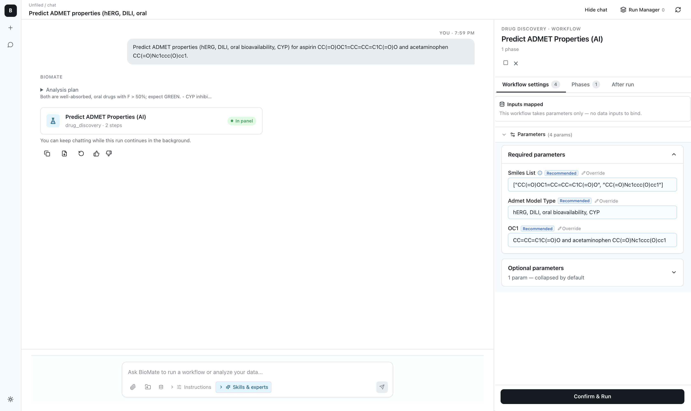

# Tutorial W1 — The workflow panel before and during a run

> **Who this is for:** anyone who has asked BioMate to run an analysis and now sees a panel open on the
> right-hand side — and wants to understand every part of it *before* and *while* it runs. No coding needed.
> By the end you'll know how to read and set the parameters, how to watch each phase run live, and what a
> mid-run quality gate is asking you.
> **Time:** ~10 minutes to read.
> **Where it fits:** Tutorial 3 gives the whole run-and-read-the-report story at a high level. This tutorial
> zooms into the **right-hand panel itself** — its tabs, its controls, and what changes on screen as a run
> moves from *idle* to *running*. Its companion, **Tutorial W2**, covers the panel *after* the run finishes.

---

## 1. The problem this solves

When you ask BioMate to run an analysis, a panel opens on the right. It is doing a lot at once: it shows what
the workflow will do, lets you check and change its settings, blocks you from starting with a missing
required value, and then — once running — turns into a live view of each stage finishing. If you don't know
which part does what, it is easy to miss a setting that matters, or to stare at the panel unsure whether
anything is happening.

This tutorial walks through the panel **one control at a time**, for the two periods *before* a run starts
and *while* it is running. (Everything that appears *after* it finishes — the outputs, the findings, the
reproducibility record — is Tutorial W2.)

> **In one sentence:** the workflow panel is where you review a pipeline's settings, start it, and watch it
> run step by step — with BioMate stopping you from starting a run that is missing something it needs.

---

## 2. The ideas you need first (plain-language background)

**The panel has three tabs across the top.** They are **Workflow settings**, **Phases**, and **After run**.
The panel opens on whichever tab fits the run's current state — **Workflow settings** before you start (so you
can configure it), **Phases** once it is running (so you can watch), and **After run** once it finishes (so
you can read results). You can click any tab yourself at any time; doing so stops the panel from
auto-switching for the rest of the session. *(Why it matters: you are never "stuck" on a tab — the panel just
tries to show you the most useful one first.)*

**Parameters are the settings a workflow runs with.** A phone number for the analysis: the target, the input
file, a threshold. BioMate fills in sensible defaults and, when you described your goal in plain English,
often fills in values it inferred from what you said. Every value is shown before anything runs.

**Required vs optional parameters.** Some parameters *must* have a value or the run can't start (a **Required**
label marks them, and the start button stays greyed out until they're filled). Others are optional and have
safe defaults. *(Why it matters: this is BioMate refusing to start a run that would fail halfway for a reason
you could have fixed in two seconds.)*

**Phases and steps.** A workflow is organised into **phases** (big stages), each made of one or more **steps**
(individual tools). In the Phases tab each phase is a card you can expand to see its steps. *(Same idea as
Tutorial 3 — here you see it as the actual on-screen cards.)*

**QC gate (quality gate).** A mid-run automatic quality check. If a measured result falls outside an allowed
threshold, the run pauses and a card appears showing the **measured value** against the **required** one, so
you can decide what to do. **It never silently continues past a failed check.** *(Why it matters: this is one
of BioMate's most important trust features — see Tutorial 3.)*

**Live status (SSE).** While a run is going, the panel updates itself in real time — phase cards change from
*pending* to *running* to *completed* on their own, without you refreshing. *(You don't need to know the
mechanism; just that what you see is current, not a stale snapshot.)*

---

## 3. When you'd use this

- You asked BioMate to run something and want to check its settings carefully before spending compute.
- A required value is missing and you're not sure where to fill it in.
- A run is going and you want to see which phase it's on, or understand a quality-gate message that popped up.

---

## 4. Step by step — from opening the panel to a running workflow

1. **Open the panel.** In chat, describe your goal in plain English; BioMate picks the matching workflow and
   opens its panel on the right (Tutorial 3, §4). The header shows the workflow's name, its domain, and how
   many phases it has.
2. **Go to Workflow settings and fill in what's required.** The panel usually opens here before a run. Open
   the **Parameters** strip, work through the **Required parameters** first (anything still empty is flagged),
   then any **Optional parameters** if you want to change a default. See §5 for each control type.
3. **Check the output location (optional).** Below the parameters you can choose where results are stored —
   the BioMate-managed default (kept 90 days), your project folder, or your own storage bucket (advanced).
4. **Press "Confirm and run".** The start button at the bottom of the panel. It stays disabled, with a tooltip
   telling you how many required values are still missing, until everything needed is filled in.
5. **Switch to the Phases tab and watch.** The panel moves here automatically once the run starts. Each phase
   card moves from *pending* to *running* to *completed* in real time (§6). If a quality gate fires, a card
   appears asking you to decide (§7).

<!-- CAPTURE route=/ ; state=workflow panel idle (pre-run), Workflow settings tab active, Parameters strip expanded showing Required parameters with one empty required field flagged, Confirm-and-run button disabled ; focus=workflow-artifact-panel ; note=show the three tabs (Workflow settings · Phases · After run), the Parameters strip with a red "Required" chip, and the greyed-out run button with its "fill in N required parameters" tooltip -->
*(Figure to add: the panel in its pre-run state — the Workflow settings tab open, a required parameter still
empty, and the start button disabled.)*

*For orientation, here is the same panel on a finished run (from Tutorial 3): the header names the workflow
and its 4 phases, the three tabs sit below it, and the state badge is green. Before a run, the same panel
opens on the **Workflow settings** tab with the start button at the bottom; while running, it shows the
**Phases** tab with live status.*

---

## 5. The Workflow settings tab — reading and setting parameters

This is where you configure the run. The parameters live in a collapsible **Parameters** strip, split into two
groups:

- **Required parameters** — values the run needs. If any are still empty, a red **Required** chip appears on
  the strip and the start button stays disabled. Fill these first.
- **Optional parameters** — collapsed by default, with safe defaults already set. Open them only if you want
  to change something.

**The control you see depends on the parameter's type:**

- **On/off setting** → a **toggle switch** (e.g. "single-end reads: on").
- **A choice from a fixed list** → a **dropdown** (e.g. a reference genome, a strandedness option).
- **A number** → a **number box**.
- **A file** → a **text box** with a **Browse** action that opens your uploaded datasets, so you can pick a
  file you brought in rather than typing a path (bringing your own data is Tutorial 4).

**AI-filled values are marked.** When BioMate inferred a value from what you asked, that value carries a badge
and an **Override** option, so you can see what it chose and why, and change it if you disagree. (How BioMate
decides these, and the "why?" behind each, is covered in Tutorials 1 and 2.)

**Output location.** Below the parameters (for cloud pipelines) you can choose where outputs are written:
*Default* (BioMate-managed, kept 90 days), *My project folder*, or *My S3 bucket* (advanced — your bucket must
grant BioMate write access). Leave it on Default if you're unsure.

**Permissions & verification.** Lower in this tab are two small read-only cards: one showing what you're
allowed to do here (you own your own run), and one listing the kinds of gate that can stop a run (quality gate,
human approval, license gate). These are informational — nothing to fill in.

**If a workflow has no settings,** this tab simply says so and points you to the start button.

<!-- CAPTURE route=/ ; state=Workflow settings tab, Parameters strip open with a mix of control types visible — a toggle, a dropdown, a number box, and a file field with a Browse button; an AI-filled value showing its badge/Override ; focus=button-toggle-workflow-settings ; note=show the Required vs Optional grouping and at least one of each control type, plus an AI-filled badge -->
*(Figure to add: the Parameters strip open — a toggle, a dropdown, a number box, and a file field, with an
AI-filled value badged and overridable.)*

---

## 6. The Phases tab — watching a run live

Once you press **Confirm and run**, the panel switches here. A label at the top reads **PHASES · N** (or
**STEPS · N** for a single-stage workflow). Below it is one **card per phase**.

**Each phase card shows:**

- A **letter badge** and the phase's **name**.
- A **status chip** — *RUNNING* (with a spinner), *DONE*, *FAILED*, or a plain step count while pending.
- An **N / M** counter of how many of its steps are done.
- A **Run** button (before the overall run starts) to run just that phase.

**Expand a card** (click its header) to see:

- **Per-phase parameters** — a compact summary line when collapsed, with an **edit** link to change the values
  that belong only to that phase.
- **The step rows** — each numbered, with the step's name and its own *RUNNING / DONE / FAILED* chip. Once a
  step has run, each row offers **Details** (a full view of what the step did), **Rerun**, and **Params**
  (adjust and re-run), and lists the **output files** it produced with **view** and **dl** (download) actions.
- **A "QC Gates" block** — the quality thresholds for that phase, each shown as a metric with a *≥* or *≤* and
  its value (e.g. "Alignment Rate ≥ 70%"). An **edit** link lets you change a threshold number before or
  between runs.

**What changes live:** as the run proceeds, each phase card's status moves *pending → running → completed* on
its own, each step chip flips to *DONE*, and the overall badge in the header tracks the whole run. You don't
refresh anything.

**The bottom action bar (while running).** A dark bar appears at the foot of the panel with **Pause** and
**Stop**; if you pause, it becomes **Resume** and **Stop**.

<!-- CAPTURE route=/ ; state=Phases tab during a live run — one phase card expanded with status RUNNING (spinner) and at least one step row showing DONE and one showing RUNNING; the dark Pause/Stop action bar visible at the bottom ; focus=panel-phases ; note=capture a real idle→running→terminal transition: at least one phase card data-status="running" with a step already completed -->
*(Figure to add: the Phases tab mid-run — a phase card in the RUNNING state with a completed step above a
running step, and the Pause / Stop bar at the bottom.)*

---

## 7. When a quality gate fires mid-run

If a measured result falls outside an allowed threshold, the run pauses and an amber card appears in the panel,
headed **"QC Gate — <step name> — Review Required".** It shows:

- Each failing check as a row: the **measured value** (in red) against the **required threshold** (in green),
  with the comparison between them — so you see exactly how far off it was.
- Any **suggested setting change** BioMate can offer, written as *parameter: current → suggested*.
- A short countdown — *"Pipeline continues in M:SS unless you act"* — because BioMate won't block your run
  forever waiting; if you don't choose, it keeps the current settings and continues, and tells you so.

**Your three buttons:**

- **Apply suggestions** — accept the suggested change and re-run that step from where it left off (it reuses
  the work already done, it doesn't start the whole pipeline over).
- **Keep current** — continue with the values as they are.
- **Cancel run** — stop the workflow.

The key honesty point (same as Tutorial 3): BioMate **shows** you the failed check and lets you decide — it
never silently passes it.

<!-- CAPTURE route=/ ; state=Phases tab with the QC gate inline card visible — "QC Gate — <step> — Review Required", a failing metric row with measured (red) vs threshold (green), a suggested param change, the countdown line, and the Apply suggestions / Keep current / Cancel run buttons ; focus=qc-gate-inline ; note=real QC gate (e.g. an alignment-rate or hERG threshold), not mocked -->
*(Figure to add: the mid-run QC gate card — measured-vs-threshold in red/green, a suggested change, the
countdown, and the three decision buttons.)*

---

## 8. Honest limits — what the panel does and doesn't do today

- **There are no "Skip phase" or "Skip step" buttons.** They are intentionally not shown, because skipping
  isn't wired into execution yet. (Before a run you may see a small read-only **skip map** that tells you
  which phases a workflow *declares* as skippable — it is informational only; you can't act on it.)
- **Automatic self-correction is turned off right now.** There is no "self-correct on QC failure" toggle, and
  BioMate does not silently retry a phase on its own while end-to-end testing is in progress. When a quality
  gate fires, **you** decide (Apply suggestions / Keep current / Cancel) — see §7. The automatic
  remediation view (the "was → now" parameter diff) is disabled until that loop is re-enabled.
- **No live percentage bar and no pre-run cost estimate.** Progress is shown by the status badges and the
  per-phase chips, not a percent bar; and the panel does not show a dollar estimate before you run (your
  actual usage appears on the billing page).
- **A usage meter** (vCPU-hours used vs your limit) may appear near the start button before a run — a rough
  budget cue, not a per-run price.

---

## 9. Where to go next

| You want to… | Where |
|---|---|
| The whole run-and-read-the-report story at a high level | **Tutorial 3** |
| Read the panel *after* the run finishes (outputs, findings, record) | **Tutorial W2** |
| Open and read each individual output file | **Tutorial 5** |
| Attach your own data to a parameter | **Tutorial 4** |
| Understand AI-filled values and the "why?" behind them | **Tutorials 1 & 2** |

The habit: **Workflow settings (fill required) → Confirm and run → Phases (watch live) → decide at any QC
gate.**

---

## 10. Key terms

| Term | What it means — and why you care |
|---|---|
| **Workflow settings / Phases / After run** | The panel's three tabs. The panel opens on the one that fits the run's state; you can switch freely. |
| **Parameters** | The settings a workflow runs with; shown before the run so you can check or change them. |
| **Required parameter** | A value the run can't start without; the start button stays disabled until it's filled. |
| **Phase / step** | A big stage / an individual tool within it; each phase is an expandable card in the Phases tab. |
| **QC gate** | A mid-run quality check that pauses and shows measured-vs-threshold so you can decide; never silently passed. |
| **Live status** | The panel updates phase and step states in real time while running — no refresh needed. |
| **Confirm and run** | The start button; disabled until required parameters are set. Becomes "Run again" / "Restart" after a run. |
| **Output location** | Where results are stored — BioMate default (90 days), your project folder, or your own bucket. |

---

_Companion technical references (for power users / developers): `docs/user-manual/modules/` (running an
analysis). Source component: `frontend/client/src/components/nextflow-workflow-viewer.tsx`._
