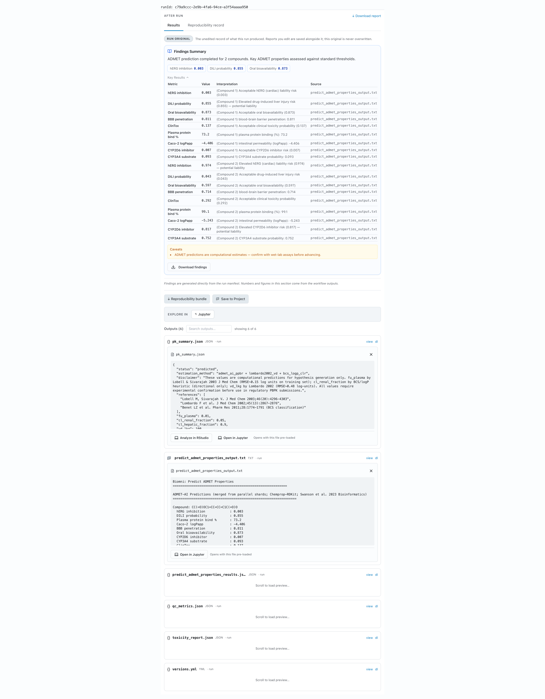
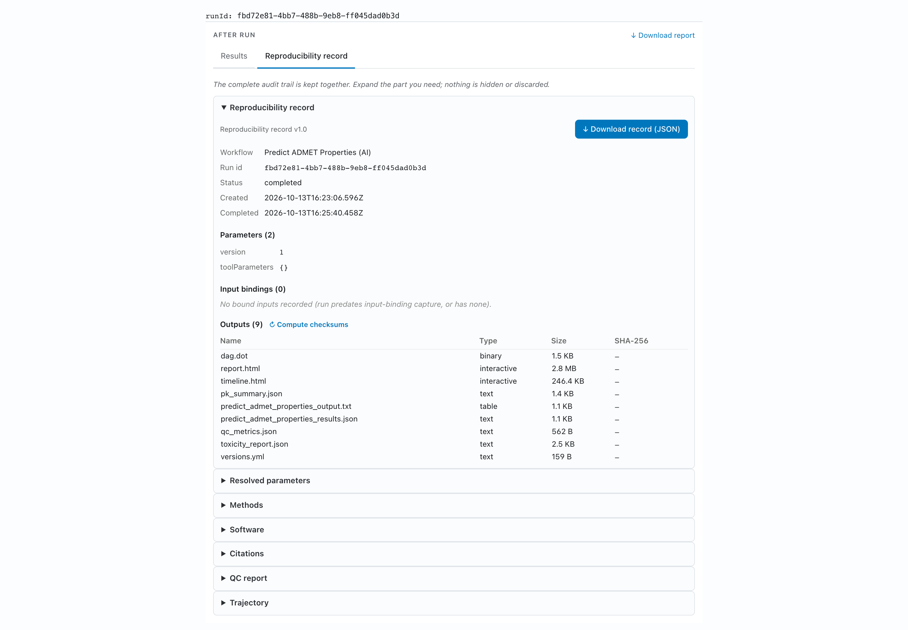
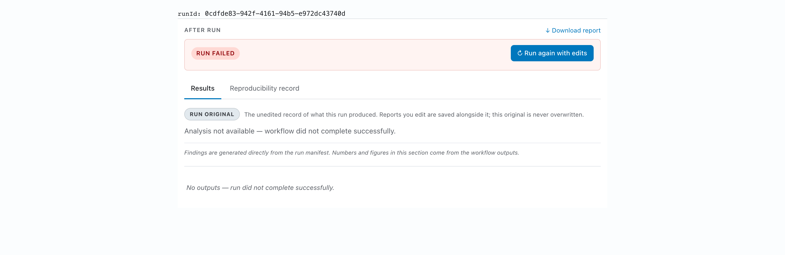

# Tutorial W2 — The after-run panel: the Results tab and the Reproducibility record

> **Who this is for:** anyone whose run has finished (or failed) and who wants to understand every part of the
> **After run** section of the workflow panel. No coding needed. By the end you'll know where the findings
> live, how to open and download the output files, where the full audit trail is, and what a *failed* run
> shows you.
> **Time:** ~10 minutes to read.
> **Where it fits:** Tutorial W1 covered the panel *before* and *during* a run. This tutorial is its sequel:
> the same panel once the run reaches a terminal state. Tutorial 3 tells the whole story at a high level and
> Tutorial 5 goes deep on opening individual files — this tutorial focuses on the **structure of the after-run
> tabs** and how they fit together.

---

## 1. The problem this solves

A finished run produces a lot: a plain-language summary, a pile of output files, and a full record of how it
all happened. If these were scattered, you'd never trust or reuse the result. BioMate gathers them into one
**After run** section with a small, fixed set of tabs, so you always know where to look: the headline findings
in one place, every file in another, and the complete audit trail in a third.

This tutorial names each tab, says exactly what's in it, and — importantly — is honest about what shows up only
when the underlying data is available, and about how a *failed* run looks.

> **In one sentence:** when a run finishes, the After-run section gives you the findings, the files, and the
> full record — each in its own tab — plus a one-click download that stitches them all together.

---

## 2. The ideas you need first (plain-language background)

**The After-run section has exactly two tabs.** They are **Results** and **Reproducibility
record**. The panel opens here automatically once a run completes or fails. *(Why it matters: it's a short,
fixed list — you don't have to look through many tabs.)*

- **Summary** is the landing tab: the plain-language **findings** (so "where are the findings?" — they're here).
- **Outputs** is every file the run produced, grouped by the step that made it.
- **Reproducibility record** is the full audit trail — identity, the **parameters** the run used, inputs,
  outputs, methods, software, citations, the QC report, and the decision log — gathered as expandable sections.

**Findings are generated from the real output files.** The Summary's findings are read from the actual outputs,
not invented. If BioMate cannot read the outputs, it **says the findings are unavailable rather than fabricating
them** — that honesty is the feature (Tutorial 3 shows this exact behaviour).

**Reopening a run shows its saved results.** You don't have to keep a run open to keep its results. Open a
completed run again later — from a project's **Runs** list — and its After-run report is rebuilt from
**persisted data**: the **Outputs** and the **Findings** are shown from what the run saved, so the findings
survive across sessions rather than showing "pending" or regenerating. *(Why it matters: a finished result
stays readable whenever you come back to it.)*

**A checksum (SHA-256) is a file's fingerprint.** It lets anyone confirm they have the identical file. In
BioMate these are computed **on demand** — you click "Compute checksums" in the record. *(Why it matters: it's
the tamper-evidence a reproducibility record exists for.)*

**Download report.** A single button that builds one combined document from every tab, so you can keep or share
the whole run in one file.

---

## 3. When you'd use this

- A run finished and you want to read what it found, then open the key files to check them.
- You need the complete, shareable record of a result — for a manuscript, a submission, or your team.
- A run *failed* and you want to understand why and try again.

---

## 4. The Results tab — findings on top, outputs below

The Results tab is the landing tab. The findings banner sits at the top; the outputs are previewed inline just below it.

*The Results tab of a completed ADMET run: findings (summary, headline chips, Key Results expanded, Caveats, **Download findings**) on top, then the Outputs section — each file previewed inline, searchable.* At the top sits a **Run original** badge with a short note: this is the
unedited record of what the run produced; any report you edit later is saved *alongside* it and the original is
never overwritten.

Below that is the **Findings Summary** card:

- **A summary paragraph** in plain language, with the key numbers taken from the outputs. Each number is read from a specific output file, named in the **Source** column of the Key Results table below.
- **Headline metric chips** — the top few results as at-a-glance chips.
- **Key Results** — the table (Metric · Value · Interpretation · Source), **shown expanded by default** (collapsible).
- **Supporting Literature** — references, when the workflow provides them, each linking out.
- **Caveats** — any limitations BioMate wants you to know about.
- **Download findings** and, when offered, **Continue analysis** (sends a suggested next step to chat).

**What you'll see while findings are still being prepared, or can't be read** (be ready for these — they are
normal, honest states, not errors):

- *"Analyzing outputs…"* or *"Analysis in progress…"* — the findings are still being generated; the card fills
  in when they're ready.
- *"Findings are unavailable because workflow outputs could not be read."* — an honest message; BioMate will
  not invent a summary (see Tutorial 3's worked example of exactly this).
- On a **failed** run: *"Analysis not available — workflow did not complete successfully."* — a static message,
  with no stuck spinner.

*The honesty behaviour from Tutorial 3: this run completed and produced files, but its outputs couldn't be
read, so the Summary says so rather than fabricating a result. The "RUN ORIGINAL" badge marks the unedited
record. On a normal run this tab shows the populated Findings Summary described above.*

<!-- CAPTURE route=/ ; state=After run → Results tab on a run with findings present — Findings Summary card showing a summary paragraph with a clickable number, headline metric chips, Key Results expanded, and the Download findings button ; focus=findings-card ; note=show a populated findings card (not the withheld state), with at least one finding number rendered as a link -->

---

## 5. Outputs — every file, previewed inline (same Results tab)

Below the findings on the Results tab, every file the run produced is shown as an **inline preview** (JSON/tables/text render in place; large or binary files preview on click), with a **search box** to filter them. (Tutorial 5 is the deep dive on *opening and reading* each file.)

**At the top, bulk actions:**

- **Download all as ZIP** — every output in one archive.
- **Reproducibility bundle** — the configs, command scripts, logs, and software versions needed to re-run the
  analysis elsewhere.
- **Save to Project** — copy the outputs into a project, where they become first-class dataset objects (quality,
  lineage, versions — the dataset idea from Tutorial 4). This is how a result becomes the input to the next
  analysis.
- **Explore in…** — buttons for interactive tools (Jupyter / RStudio / CellxGene) *when they're provisioned in
  your environment*. On the development site today they aren't, so these buttons simply don't appear — that's
  expected, not a bug (Tutorial 5 explains the full scope).

**Then the file table** — one row per file, with columns **Step · File · Type**, and two actions per row:
**view** (open it inline, in an overlay, displayed the right way for its type) and **dl** (download). Files are
grouped by the step that produced them, so you can trace any result to its stage.

**If there are no files:** the tab says *"No output files registered yet"* — or, on a failed run, *"No outputs —
run did not complete successfully."*

*A real run's outputs (the in-vivo CAR-T co-design from Tutorial 3), grouped by step. Each row carries the step
that made it, the file type, and a **view** / **dl** action. Clicking **view** opens the file inline (Tutorial
5).*

---

## 6. The Reproducibility record tab — the full audit trail

This tab leads with a short note — *"The complete audit trail is kept together. Expand the part you need;
nothing is hidden or discarded."* — and then a set of **expandable sections**. The first is open by default;
click any heading to open the rest:

- **Reproducibility record** (open by default) — the run's identity (workflow, run id, status, created /
  completed times), the **resolved parameters** it actually ran with, the **input bindings** (the files fed
  in), and the **outputs** with type, size, and a SHA-256 column. A **Download record (JSON)** button gives you
  the whole thing in one file.
- **Resolved parameters** — the same parameter values on their own, with a **Run again with edits** shortcut.
- **Methods** — an AI-written methods write-up you can read and, with the **Edit** toggle, revise and save.
- **Software** — the tool versions used (shown when the run recorded them).
- **Citations** — references for the workflow (shown when available).
- **QC report** — the quality-gate log: gates evaluated, passed, auto-corrected, and manual, with a per-gate
  table. When nothing was flagged it shows a green *"All quality gates passed."*
- **Trajectory** — the run's decision / step log (shown when the run recorded one).

**Checksums are computed on demand.** The SHA-256 column shows "—" until you click **Compute checksums**, which
fills in the fingerprints for each output (bounded to a sensible number and size of files). This is the
tamper-evidence a record is for; it's off by default because hashing bytes isn't free.

**Honest empty states.** The Software, Citations, Trajectory, and input-binding sections appear in the record
but only carry content when the run actually recorded that data — e.g. input bindings may read *"No bound
inputs recorded (run predates input-binding capture, or has none)."* An empty section is information, not a
bug.

*The Reproducibility record from Tutorial 3: the run's identity, recorded parameters, and every output with
type, size, and a SHA-256 shown as "—" until you click **Compute checksums**. The former peer tabs (methods,
software, citations, QC report, trajectory) are folded here as expandable sections — nothing is discarded.*

---

## 7. The one-click "Download report"

At the top of the After-run section is a **Download report** button. It builds a single document that stitches
together the findings, the outputs list, the methods, the QC events, the software, and the citations — the
whole run in one file you can keep or share. (This is separate from **Download all as ZIP**, which gives you the
raw output *files*, and from **Download record (JSON)**, which gives you the structured audit record.)

---

## 8. When a run failed

If a run fails or is cancelled, the After-run section shows a dedicated block **above the tabs**, so you get the
context without opening each tab:

- A **"Run failed"** (or **"Run cancelled"**) badge, and a **"Run again with edits"** button that re-opens the
  panel with your parameters ready to adjust.
- An **Auto-fix** summary when BioMate tried to recover the run automatically — how many attempts it made, and
  an expandable attempt history. This distinguishes *"failed after N fix attempts"* from *"failed on the first
  try."*
- The **underlying error**, rewritten into a readable one-line cause (the raw pipeline log is trimmed for you).
- The **failed step(s)** and a **log tail** (the last lines of output) for the details.

The start button at the bottom of the panel also changes to match: **Restart** (re-run from the beginning), or,
when the failure is recoverable, **Resume from last step** / **Fix & resume** (reuse the work already done), with
a **Start over** link if you'd rather discard the cached work.

Crucially, a failed run's Summary shows the static *"Analysis not available — workflow did not complete
successfully"* message (§4) — **not** a spinner that never resolves.

<!-- CAPTURE route=/ ; state=After run on a FAILED run — the failed-run block above the tabs: "Run failed" badge, Run-again-with-edits button, a humanized error line, failed step(s), and a log tail; the footer start button reading "Restart" ; focus=afterrun-failed-section ; note=real failed run (e.g. a container/exit-code failure), showing the readable one-line error, not a raw stack trace -->
*(Figure to add: a failed run's After-run view — the "Run failed" block with the readable error, failed step,
and log tail, and the "Restart" button at the bottom.)*

---

## 9. Honest limits — what to expect

- **Two tabs, not more.** The After-run section is exactly **Results · Reproducibility record**.
  The **findings** live inside the Results tab (not a separate "Findings" tab), and the **parameters** live
  inside the Reproducibility record (as "Resolved parameters" and in the record itself) — not a standalone
  "Parameters" tab. Everything is reachable; it's just grouped this way.
- **Findings are never fabricated.** If the outputs can't be read, the Summary says the findings are
  unavailable instead of inventing them (§4, and Tutorial 3's worked example).
- **Interactive tools only appear where provisioned.** On the development site the Jupyter / RStudio /
  CellxGene buttons won't show; use the inline **view** and **dl** instead (Tutorial 5).
- **Checksums are off until you ask.** The SHA-256 column is "—" until you click **Compute checksums**.
- **Some record sections can be empty.** Software, Citations, Trajectory, and input bindings show content only
  when the run recorded it — an honest empty state, not an error.
- **Editing the Methods report saves a copy, not a server-side version history (today).** The edit-and-save
  affordance works; full versioned report history is a documented follow-up.
- **Reopened runs restore Outputs and Findings; the QC gate table is still being made durable.** When you reopen
  a completed run, its Outputs and Findings come back from saved data. The per-run **QC gate** table may not
  always be restored on reopen yet — that durability is a documented follow-up.

---

## 10. Where to go next

| You want to… | Where |
|---|---|
| The whole run-and-read-the-report story at a high level | **Tutorial 3** |
| The panel *before* and *during* a run (settings, phases, QC gate) | **Tutorial W1** |
| Open and read each individual output file (tables, structures, etc.) | **Tutorial 5** |
| Turn a saved output into the input for the next analysis | **Tutorial 4** |
| Learn from results over rounds (the closed loop) | **Tutorial 2** |

The habit: **After run → Summary (read findings) → Outputs (open and check the files) → Reproducibility record
(keep the audit trail) → Download report to share.**

---

## 11. Key terms

| Term | What it means — and why you care |
|---|---|
| **After-run section** | The panel once a run finishes — two tabs: Results (findings + previewed outputs) and Reproducibility record. |
| **Results tab** | The landing tab holding the plain-language **findings**; numbers link back to their source file. |
| **Findings** | The results read **from the real outputs**; withheld honestly if outputs can't be read, never invented. |
| **Outputs section** | Every file the run produced, previewed inline on the Results tab (searchable), each with **view** and **dl**; plus ZIP / bundle / save-to-project. |
| **Reproducibility record** | The full audit trail — identity, resolved parameters, inputs, outputs, methods, software, citations, QC, trajectory. |
| **Checksum (SHA-256)** | A file fingerprint for tamper-evidence; computed **on demand** via "Compute checksums". |
| **Run original** | The unedited record of what the run produced; edits are saved alongside it, never overwriting it. |
| **Download report** | One combined document stitching every tab together, to keep or share. |
| **Failed-run block** | The error context shown above the tabs on a failed run — badge, readable error, failed step, log tail, and Run-again. |

---

_Companion technical references (for power users / developers):
`docs/user-manual/modules/I08-outputs-viewers-interactive.md`, `I09-reports-and-reproducibility.md`. Source
components: `frontend/client/src/v2/AfterRunReport.tsx`, `frontend/client/src/components/findings-card.tsx`._
